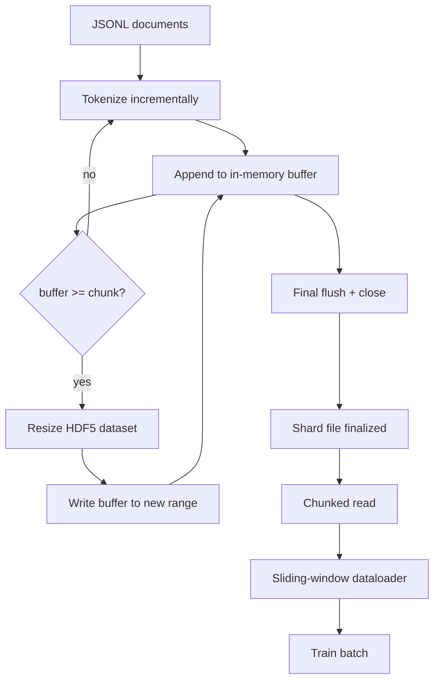

# HDF5 टोकन 语料库

> डाउनलोड करने के लिए अच्छी भाषा सामग्री को एक प्रशिक्षक पर गिरना चाहिए जो कि ड्राइव पर JSONL  नहीं रहता 16 डेटा लोडर कार्यकर्ताओं में। HDF5 के पूरे ब्लॉक डेटासेट के आकार को समायोजित करने योग्य है।

**Type:** Build
**Languages:** Python
**Prerequisites:** Phase 19 lessons 30-37
**Time:** ~90 分钟

## सीखने के लक्ष्य

- एक निर्धारात्मक चक्रीकरण के साथ एक पूर्ण डेटासेट में एक दस्तावेज प्रवाह को लिखने के लिए।
- कई HDF5 फ़ाइलों में विभाजन में लिखेंगे, जिससे असफल सीमा नियंत्रण योग्य हो जाएगी, और इसे संभव बना दिया जाएगा।
- 通过 HDF5 支的页面缓存 支的分断布局 读回代币,使数据加载器只在批量时间 复制到批量缓冲器──
- 规则发发出固定长度训练序列──

## समस्या

现代语言模型 प्रशिक्षण रन 会在数十名工人上以每秒数万样本的速度读取代码──磁盘上的JSONL 时首次冷缓存页面错误 时就会崩:JSON पार्सर 很慢,文档边界无法寻址,而寻找到"样本 4,217,884" 需要扫描文件──即使压缩效果很好 帕克特,也不适合这里,因为教练不想要列;它想要带$O(1)$यादृच्छिक पहुँच के 平 टोकन धारा

HDF5  अनुकूल, क्योंकि यह एक टुकड़ा  आकार  समायोज्य  मात्र पूर्णांक डेटासेट प्रदान करता है, इसके टुकड़े  पृष्ठ कैश मित्र  प्रशिक्षक अनुरोध `tokens[3,200,000 : 3,200,8192]`का स्लाइस, एचडीएफ 5 पेज कैश से अनुरोध के हाइपरलैब को कॉपी करने के लिए नए आवंटित संख्या सरणी में शामिल करेगा। लागत प्रत्येक कार्यकर्ता के लिए एक खुला फ़ाइल हैंडल है, साथ ही एक टुकड़ा बड़ी पृष्ठ कैश पदचिह्न; तुलनात्मक रूप से JSONL कोड को हल करने की लागत, जो अनदेखी की जा सकती है।

构建问题在让写入端诚实可靠―― मापनीय डेटासेट 易被误用:一次写一个文档,HDF5文件会碎碎化到不可用――一次大小化 写入所有文档,进程死亡会丢失整个片段―― सही纪律是缓冲然后扩展,缓冲尺寸要匹配块尺寸,并用碎片写把工作量拆分成多个文件,这样的崩,最后只会丢失一个片段――

## अवधारणा



### सही उपयोग मापने योग्य HDF5

टोकन डेटासेट 使用 `maxshape=(None,)`और निश्चित `chunks=(chunk_size,)`创建──写入时,将代币 缓存在长度为 `chunk_size`█████████████████████████████████████████████████████████████████████████████████████████████████████████████████████████████████████████████████████████████████████████████████████████████████████████████████████████████████████████████████████████████████████████████████████████████████████████████████████████████████████████████████████████████████████████████████████████████████████████████████████████████████████████████████████████████████████████████████████████████████████████████████████████████`chunk_size`扩展,并把缓冲 写入新范围──在 shard 结束时,剩余缓冲 会写入最后一个部分范围──除了最后的写入外, प्रत्येक लेखन contiguous 且分别一致; पाठक会根据 shard के HDF5 गुण 中记录的`token_count`截断最后一次写入──

### टुकड़े टुकड़े लिखना

单个 HDF5 文件是单点故障──管线 会并行写入片段:Phase 19 lesson 42 中的每个输入片段 生成一个 HDF5输出片段──`shards.json`index 会按碎片 记录文件路径、 टोकन गिनती、 दस्तावेज़ गिनती, तथा टोकन के sha256──trainer 读取 `shards.json`वैश्विक ऑफसेट का गणना करने तथा सत्यापित करने के लिए

### स्मृति-मैप रीडिंग

प्रशिक्षण के दौरान, प्रत्येक कार्यकर्ता को`swmr=True`मोड 打开自己负责的 HDF5 फ़ाइलें,并请求 `tokens[start:stop]`◊ एक बार टुकड़ा 变热, एचडीएफ 5 का टुकड़ा लेआउट 就会让它成为页面缓存支持的读物──worker 永远不会实现 整个文件:slice 会被复制到数据库的批量缓冲器,之后数据库在批量时间将其复制到固定记忆训练 tensor──热路 在每次块转换时有一个系统调用;其余是RAM访问──

### स्लाइडिंग विंडो डेटा लोडर

डेटा लोडर केवल प्रशिक्षण अनुक्रम की लंबाई का पता है के चरणों में है। यह वैश्विक टोकन प्रवाह में है।`window_size + 1`个 टोकन, फिर वापस `(input, target) = (tokens[:-1], tokens[1:])`️ दस्तावेजों की सीमाओं का पालन करना अनिवार्य नहीं है: एक खिड़की दो दस्तावेजों को पार कर सकती है, बीच में स्पष्ट है `boundary_token_id`,让模型学会使用分隔器── यह मानक पैकिंग नियम है; यह भी शुरुआती लोगों के लिए आसान भूलने वाला नियम है, अंतिम प्राप्त होने वाली भाषा भंडार 8 प्रतिशत प्रशिक्षण सीमा टोकन और 92 प्रतिशत प्राकृतिक पाठ में बदल जाएगी──


```figure
cc-hdf5-corpus
```

## इसे बनाओ

`code/main.py`实现:

- `Tokenizer`- एक बाइट स्तर निर्धारक टोकन, डेमो के लिए 足足好──接口是 `encode(text) -> list[int]`和 `vocab_size`
- `HDF5ShardWriter`- 打开一个可调整的大小的整数数据集, टोकन बफर टुकड़ा आकार तक,按固定大小步骤大小尺寸并写入,在关闭时把 `token_count`和 `sha256`记录为 HDF5 गुणों。
- `ShardedTokenizationPipeline`- इनपुट दस्तावेजों को भरें, उन्हें लेखक के पास भेजें, और उन्हें आउटपुट करें`shards.json`सूचकांक
- `MmapTokenStore`- 打开碎片文件  मेमोरी-मैप रीड्स, गणना वैश्विक ऑफसेट, exposing singles `get_slice(start, stop)`एपीआई
- `SlidingWindowDataloader`- वैश्विक धारा से 中 चुनें यादृच्छिक खिड़कियां,并 yield `(input_ids, target_ids)`संख्यात्मक सरणीएँ

文件底部的演示会构建一个很小的内存体, टोकन化到两个片段,通过内存地图打开它们,运行数据载体10批发,并打印每个批发的形状和检查数量――

运行:

```bash
python3 code/main.py
```

脚本以 0 退出并印批发检查金──

## उत्पादन के पैटर्न

चार पैटर्न  इस कोर्स को वास्तविक प्रशिक्षण रन में विस्तारित कर सकते हैं

**Chunk size 等于典型读取大小。**प्रशिक्षक प्रत्येक नमूना 读取 `window_size + 1`个 टोकन──把 HDF5 टुकड़ा 设置为 `window_size`का गुणांक,读取就会页-कैश संरेखित── टुकड़ा असंगत होगा, क्योंकि प्रत्येक नमूना दो टुकड़ों को छूएगा──

**Token count 放在 attributes 中，而不是 dataset 中。**डेटासेट के अंतिम भाग का स्लाइस हो सकता है पूरी तरह से भरा नहीं हो, क्योंकि टुकड़ा आकार अपरिहार्य रूप से दस्तावेज़ सीमा को हटा देता है।`token_count`作为 HDF5 विशेषता 存在数据集上,并让读者在该值处截断──否则读者 会越过真实末尾读到零填补的代币,模型也会学会预测零──

**带 parallel verification 的 sharded sha256。**प्रत्येक शार्ट के पास अपना टोकन बाइट होता है Sha256। प्रशिक्षक प्रशिक्षण शुरू होने से पहले सभी शार्ट्स का परीक्षण कर सकता है।

**两侧都使用 `swmr=True`，writer 使用 `libver="latest"`。**एकल-लेखक-बहु-पाठक मोड  आवश्यकता लेखक 以 `libver="latest"`打开, पहले प्रत्येक डेटासेट बनाने, फिर सेटअप `file.swmr_mode = True` इसके बाद लेखक  को  प्रत्येक बार आकार बदलने  के बाद प्रयोग करना चाहिए `dataset.flush()`, इस तरह से उपयोग `swmr=True`打开的读者工人 才能见一致数据──跳过 `libver="latest"`, या संरचना में बदलाव के बाद SWMR को फिर से सक्रिय करना, "फ़ाइल लॉक है"

## इसका प्रयोग करें

उत्पादन के पैटर्नः

- **每个 source shard 一个 HDF5。**डाउनलोडकर्ता(पाठ 42) प्रत्येक URL 输出一个片;tokenization(本课) प्रत्येक स्रोत 输出一个 HDF5──1:1 मानचित्रण 让恢复 和 आंशिक विफलता वसूली 变得简单──
- **Boundary token id。**बॉर्डर टोकन टोकन करने वाले शब्दावली का हिस्सा है, यह डेटा लोडर में दर्ज किए जाने वाले एकमात्र टोकन भी है।
- **`shards.json` 是 source of truth。**添加新片意味着写入 HDF5、计算它的 sha256,并添加一个入口──trainer 在启动时读取该文件一次,之后永远不碰目录列表──

## इसे भेजें

वास्तविक परियोजनाओं में,`outputs/skill-hdf5-tokenized-corpus.md`मैं वर्णन करता हूँ कि कौन सा टोकन बनाने वाला है 输入 पाइपलाइन  कौन सा टुकड़ा आकार  फिट ट्रेनर के खिड़की `shards.json`️️️️️️️️️️️️️️️️️️️️️️️️️️️️️️️️️️️️️️️️️️️️️️️️️️️️️️️️️️️️️️️️️️️️️️️️️️️️️️️️️️️️️️️️️️️️️️️️️️️️️️️️️️️️️️️️️️️️️️️️️️️️️️️️️️️️️️️️️️️️️️️️️️️️️️️️️️️️️️️️️️️️️️️️️️️️️️️️️️️️️️️️️️️️️️️️️️️️️️️️️️️️️️️️️️️️️️️️️️️️️️️️️️️️️️️️️️️️️️️️️️️️️️️️️️️️️️️️️️️️️️️️️️️️️️️️️️️️️️️️️️️️️️️️️️️️️️️️️️️️️️️️️️️️️️️️️️️️️️️️️️️️️️️️️️️️️️️️️️️️️️️️️️️️️️️️️️️️️️️️️️️️️️️️️️️️️️️️️️️️️️️️️️️️️️️️️️️️️️️️️️️️️️️️️️️️️️️️️️️️️️️️️️️️️️️️️️️️️️️️️️️️️️️️️️️️️️️️️️️️️️️️️️️️️️️️️️️️️️️️️️️️️️️️️️️️️️️️️️️️️️️️️️️️

## व्यायाम

1. 给HDF5 लेखक 添加 `--compression gzip`ध्वज, और डेमो कॉर्पस 上测量吞吐成本──为所选默认做出辩护──
2. 给滑窗数据充电器 添加确定性种子,并验证相同种子的两次运行会产生相同批量──
3. 添加 `--validate`मोड,读取每块,重新计算其代币的 sha256,并与 `shards.json`इसके लिए, प्रशिक्षण शुरू करने से पहले इसे चलाना चाहिए।
4. आंशिक आकार के मुकाबले खिड़की आकार ∙ आधा खिड़की आकार ∙ दो गुना खिड़की आकार ∙ डेटा लोडर 吞吐── रिपोर्ट पृष्ठ-कैश प्रभाव ∙
5. 添加 `--max-document-tokens`लेख में बहुत लम्बी अवधि के लिए एक लेख का संग्रह किया गया है।

## प्रमुख शर्तें

| Term | What people say | What it actually means |
|------|-----------------|------------------------|
| Resizable dataset | "Append-only" | 一个带 `maxshape=(None,)` 的 HDF5 dataset，通过按 chunk 大小 stride 调用 `resize` 增长 |
| Chunked layout | "How HDF5 stores it" | 固定大小的 on-disk pages，kernel 可 memory-map，dataloader 可连续读取 |
| `swmr` mode | "Read-while-write" | Single-Writer-Multiple-Reader mode，使 dataloader workers 能安全共享文件 |
| Shard index | "shards.json" | 包含 offsets 和 content hashes 的所有 token shards 的 durable index |
| Sliding window | "Training sample" | global token stream 的固定长度 slice，trainer 会把它与 shift-by-one target 配对 |

## आगे पढ़ना

- [HDF5 chunking documentation](https://docs.hdfgroup.org/hdf5/v1_14/)- 本课使用的分块化, आकार के योग्य डेटासेट लेआउट
- [h5py user guide](https://docs.h5py.org/en/stable/)- HDF5 के पायथन बंधन
- [NumPy memory mapping](https://numpy.org/doc/stable/reference/generated/numpy.memmap.html)- एचडीएफ 5 通过 h5py 暴露的读侧原始
- चरण 19 · 42 - 输出由本课 टोकन बनाने का डाउनलोडर
- चरण 19 · 44 - 消费 इस डेटा लोडर के कॉसिन अनुसूची
- चरण 19 · 45 - 包裹 प्रशिक्षण चरण का एएमपी लूप
