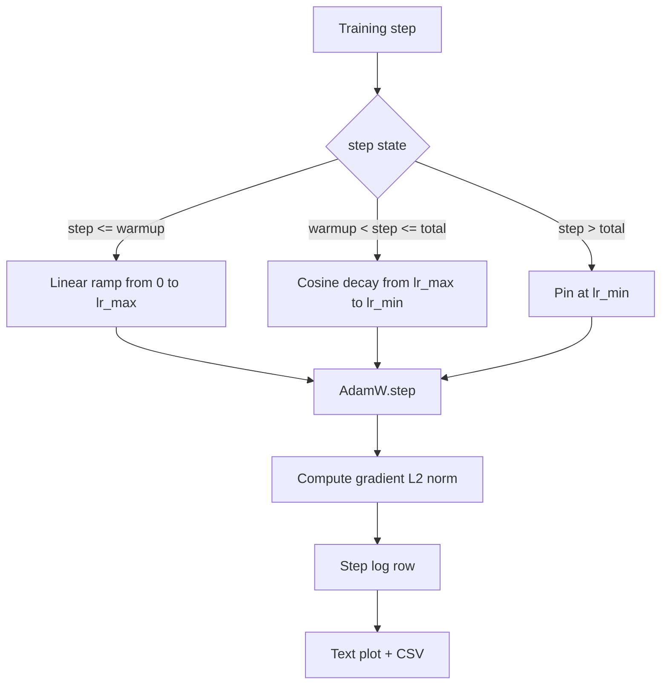

# 带 रैखिक वार्मअप के कॉसिन LR

> सीखने की दर अनुसूची केवल हानि कार्य के बाद है दूसरा महत्वपूर्ण निर्णय। साथ में कॉस्मीन गिरावट और रैखिक वार्मिंग का एडमडब्ल्यू भाषा मॉडल प्रशिक्षण की आधुनिक मानक पसंद है, क्योंकि यह मॉडल को कमजोर पहले 1000 बार अपडेट में छोटे प्रभावी चरण आकार को देखने देता है, धीरे-धीरे विन्यास के शिखर तक बढ़ता है, फिर शून्य के करीब वापस घटता है।

**Type:** Build
**Languages:** Python
**Prerequisites:** Phase 19 lessons 30-37
**Time:** ~90 分钟

## सीखने के लक्ष्य

- 实现 एक AdamW अनुकूलक,并接入带线性变暖的共性学习率时间表──
- 精确计算时间表的值,跨运转出现浮点漂移的避免
- प्रवृत्ति L2 मानदंड और सीखने की दर को क्रमबद्ध करने के लिए, प्रशिक्षण स्वास्थ्य स्थिति को देखने के लिए।
- मानव आंखों के लिए पठनीय पाठ ग्राफ, साथ ही किसी भी उपकरण के लिए उपभोग्य CSV को शेड्यूल करें।

## समस्या

पिछला एक हजार बार प्रशिक्षण अद्यतन 最──模型的重量 仍然接近初始化──优化器 का चल रहा सेकंड-मॉमेंट अनुमान 尚未稳定──渐进的规范 又大又噪── यदि इन अद्यतनों में सीखने की दर चरम पर है, तो मॉडल या तो सीधे भिन्न हो, या तो हमेशा से गायब होने वाले नुकसान के पठार में फंस जाए── दो प्रसिद्ध ज्ञानपूर्ण सुधार विधि है ग्रेडिएंट कटिंग, यानि चरण 19 पाठ 45  थीम, तथा एक से छोटे से शुरू होने से धीरे-धीरे वृद्धि की सीखने की दर-तालिका-

कोसिन-से-थर्मअप कार्यक्रम में तीन क्षेत्रों है।`warmup_steps`,शिक्षा दर शून्य से संकुचित होकर संवर्धन के शिखर तक`lr_max` से `warmup_steps`तक `total_steps`,शिक्षा दर कोसिन वक्र के ऊपर से `lr_max`衰减到 `lr_min` में `total_steps` इसके बाद, सीखने की दर  स्थिर `lr_min`, इस तरह के एक ओवरऑप के गलत तैनाती प्रशिक्षक चुपचाप समय से बाहर नहीं होगा.

 निर्माण समस्याएँ शेड्यूल में होती हैं  आसानी से एक-एक से घट जाती हैं  प्रशिक्षण रन में 6 घंटे बाद प्रदर्शन सीखने की दर के लिए  मॉडल में ओवरफिटिंग के समय में उच्च या निम्न 1 प्रतिशत; जब तक शेड्यूल की सीमा पर विस्तृत परीक्षण नहीं किया जाता, अन्यथा यह अदृश्य है 

## अवधारणा



### वार्मअप सूत्र

 के लिए `warmup_steps > 0`时位于 `[0, warmup_steps]``step`,शिक्षा दर है `lr_max * step / warmup_steps`                                                                                                                                                                                                                                                              `warmup_steps = 0`मामले को "कोई वार्मिंग नहीं" के रूप में देखा जाता हैः अनुसूची में कदम शून्य  सीधे से `lr_max`开始,并立即进入 कॉसिन क्षय. कुछ परीक्षण हर्न 会传进.`warmup_steps = 0`, निरीक्षण अनुसूची के लिए अभी भी उपलब्ध वक्र उत्पन्न कर सकते हैं

### कोसिन सूत्र

 के लिए `(warmup_steps, total_steps]`मध्य `step`,शिक्षा दर है `lr_min + 0.5 * (lr_max - lr_min) * (1 + cos(pi * progress))`, उनमें से `progress = (step - warmup_steps) / max(1, total_steps - warmup_steps)` में `step = warmup_steps`,कोसिन 求值为 `cos(0) = 1`, प्राप्त `lr_max`, ताप के अंत बिंदु के साथ  सटीक मेल `step = total_steps`,कोसिन 求值为 `cos(pi) = -1`, प्राप्त `lr_min`, क्षय के अंत बिंदु के साथ  सटीक मेल

 दो अंत बिंदुओं के ऊपर निरंतरता  कोई संयोग नहीं है  इसलिये, कार्यक्रम एक के बारे में  के रूप में लागू किया गया है `step`拼接在一起──拼接的时间表 在第一次改变 `lr_max`जब हम एक सीमा खो देंगे

### कुल चरणों के बाद तल

 के लिए `step > total_steps`,शिक्षा दर            `lr_min`◊ अनुबंध स्पष्ट हैः अनुसूची, न तो रिपोर्ट गलत है, न ही एक्सट्रापोलेट; यह मंजिल पर तय है, और प्रशिक्षक को चेतावनी देने की अनुमति नहीं देता है।`total_steps`, बजाय संशोधन लूप

### ग्रेडिएंट मानदंड और दर को एक साथ रिकॉर्ड करना

कार्यक्रम है प्रशिक्षण स्वास्थ्य स्थिति एक आधा──ग्रेडिएंट मानदंड है दूसरी आधा──प्रशिक्षण लूप प्रत्येक चरण 记录两者──विभेदक प्रशिक्षण रन होगा पहले वृद्धि ग्रेडिएंट मानदंड, फिर हानि 才会变化;调得好的热升会让 Norma 随着速度 线性上升;过激进的峰会表现为热升 后规 仍然保持高位在磁盘上的数据集是`step, lr, grad_l2_norm, loss`◊CSV एकमात्र स्थायी रिकॉर्ड है


```figure
cap-cosine-warmup
```

## इसे बनाओ

`code/main.py`实现:

- `CosineWithWarmup`- एक राज्यहीन कार्य, प्रारूप के लिए आधारित विन्यास अनुसूची के `lr(step) -> float`
- `TrainState`- एक मॉडल होगा`AdamW`अनुकूलक तथा अनुसूची 封装成单一步函数──
- `TrainState.step`- एक बार आगे जाने के लिए, एक बार पीछे जाने के लिए, रिकॉर्ड ग्रेडिएंट L2 मानदंड,并把`lr(step)` अनुप्रयोग करने के लिए अनुकूलक 
- `plot_schedule_ascii`- 染为人眼可读的文字 भूखंड को शेड्यूल करें
- `write_schedule_csv`- प्रत्येक चरण के लिए 输出一行学习率

फ़ाइल के नीचे डेमो एक बहुत ही छोटा बना होगा `nn.Linear`模型,在固定输入批上训练20 कदम,并印印每步的学习速度、渐进规范 和损失──日程也会被染为文本图,用于视觉智能检查──

运行:

```bash
python3 code/main.py
```

脚本以 0 退出,并印每步训练日志 和时间表图――

## उत्पादन के पैटर्न

चार पैटर्न ️ शेड्यूल 提升为生产文物

**Schedule 放在 config 中，而不是 code 中。**प्रशिक्षक से प्रस्तुत करने के लिए git के YAML या JSON विन्यास 读取 `warmup_steps``total_steps``lr_max``lr_min`◊अनुसूची का उपयोग करने योग्य है, क्योंकि कॉन्फ़िग सामग्री-उपदेशित है; अनुसूची का उपयोग करने योग्य है, क्योंकि कॉन्फ़िगिंग PR अंतर का हिस्सा है।

**Step counter 是 monotonic，并与 epochs 解耦。**जब डेटासेट को टुकड़े टुकड़े या डेटा लोडर पुनः शुरू किया जाता है, कुछ ढांचे 会混 कदम 和 epoch──अनुसूची से प्रशिक्षक के चेकपॉइंट 读取`global_step`, बजाय स्थानीय काउंटर से 读取── फिर से चलना होगा 会在正确的时间表 位置继续, चूंकि चरण काउंटर एक टिकाऊ अक्ष है──

**Schedule plot 放在 run directory 中。**हर प्रशिक्षण दौड़ शहर में होगा`outputs/lr_schedule.png`(या本课中的文字图片)写入它的运行目录―― समीक्षक 浏览目录时,无需重新运行任何东西就能智能检查时间表――

**Log row schema 固定。** `step, lr, grad_l2_norm, loss`, क्रमशः इस प्रकार──下游 नोटबुक या डैशबोर्ड 会读取这个方案;不 bump版本就重新命名列,会让所有现有仪表板 失效──

## इसका प्रयोग करें

उत्पादन के पैटर्नः

- **先 sweep peak，再 sweep 其他任何东西。** `lr_max`सबसे संवेदनशील है. पहले छोटे मॉडल ऊपर झाड़ो. यह इष्टतम है.`lr_max`मॉडल के बड़े आकार के पैमाने  बहुत कमजोर है, इसलिए छोटे मॉडल की पोंछ एक मजबूत प्राथमिकता है 
- **Warmup 是 total steps 的 fraction，不是绝对 count。**एक 200 मिलियन चरणों की दौड़ यदि केवल 2,000 वार्मिंग चरणों में, लगभग शीर्ष तक पहुंच जाता है; एक 20,000 चरणों की दौड़ उसी संख्या के साथ 10 प्रतिशत गर्म हो जाती है।
- **`lr_min` 非零是有意的。**एक के लिए `lr_max`10 प्रतिशत के तल, Optimizer को लंबे पूंछ में सीखने के लिए अनुमति देगा`lr_min = 0`कार्यक्रम में एक अच्छी तरह से देखने वाली प्रशिक्षण वक्र, साथ ही एक व्यावहारिक रूप से पूरा नहीं किया गया प्रशिक्षण मॉडल प्राप्त होगा।

## इसे भेजें

वास्तविक परियोजनाओं में,`outputs/skill-cosine-warmup.md`                                                                                                                                                                                                                                                              `lr_max`स्पाइप 产出部署值──本课交付引擎──

## व्यायाम

1. 添加时间表的逆-平方根变化, और 200-चरण खिलौना प्रशिक्षण रन 上对比── कौन सी अवस्था 产生更低的最终损失?
2. 添加 `--restart`ध्वज, में `total_steps / 2`增加第二次热点──为热点重新启动 在玩具运行 上是升升还是伤害做辩护──
3. 添加一个单位测试 验证时间表是连续的:对于 `[0, total_steps]`मध्य के प्रत्येक चरण,差值 `|lr(step+1) - lr(step)|``lr_max / warmup_steps`约束──
4. 将时间表 接入 `torch.optim.lr_scheduler.LambdaLR`, इसे फ्रेमवर्क कोड के साथ 组合──本课使用简单步骤函数;包装 改变了什么?
5. 添加 `--plot-png`ध्वज, के माध्यम से `matplotlib`写出真实图片──为本课的文字图片 和 PNG 哪个更适合合作为CI रन के लिए डिफ़ॉल्ट 做出辩护──

## प्रमुख शर्तें

| Term | What people say | What it actually means |
|------|-----------------|------------------------|
| Warmup | "Slow start" | 在前 `warmup_steps` 次 updates 中，从 zero 到 `lr_max` 的 linear ramp |
| Cosine decay | "Smooth drop" | 在剩余 steps 中，从 `lr_max` 到 `lr_min` 的上半段 cosine curve |
| Floor | "After training" | schedule 在超过 `total_steps` 后固定的 `lr_min` 值 |
| Gradient norm | "L2 of grads" | 拼接后的 gradient vector 的 Euclidean norm，每 step 记录 |
| Global step | "Schedule axis" | 一个能跨 restart 保留的 monotonic step counter，用于驱动 schedule |

## आगे पढ़ना

- [Loshchilov and Hutter, SGDR: Stochastic Gradient Descent with Warm Restarts (arXiv 1608.03983)](https://arxiv.org/abs/1608.03983)- कॉसिन शेड्यूल का संदर्भ पत्र
- [Loshchilov and Hutter, Decoupled Weight Decay Regularization (arXiv 1711.05101)](https://arxiv.org/abs/1711.05101)- AdamW का संदर्भ पत्र
- [PyTorch torch.optim.lr_scheduler](https://docs.pytorch.org/docs/stable/optim.html#how-to-adjust-learning-rate)- चरण कार्य 如何与框架 शेड्यूलर 组合
- चरण 19 · 42 - 产出此表 所消费语料的下载器
- चरण 19 · 43 - इस कार्यक्रम के साथ 共同 विकास के डेटा लोडर
- चरण 19 · 45 - ग्रेडिएंट क्लिपिंग व AMP, यानि लूप का निचला स्तर
