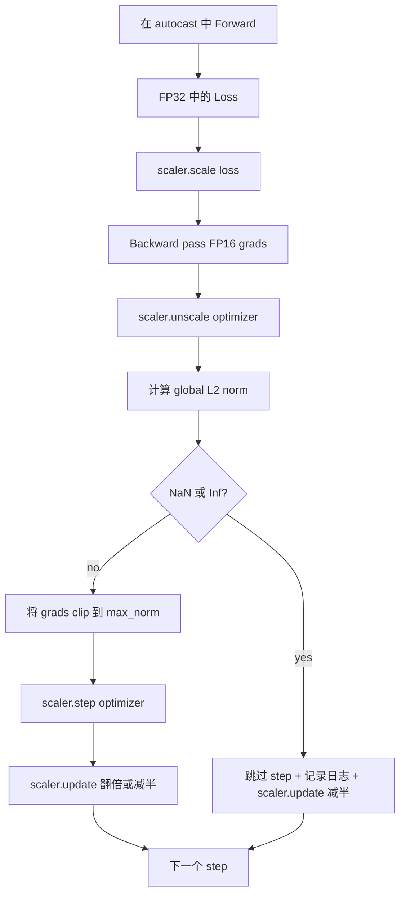

# ग्रेडिएंट क्लिपिंग और मिश्रित परिशुद्धता

> ️️️️️️️️️️️️️️️️️️️️️️️️️️️️️️️️️️️️️️️️️️️️️️️️️️️️️️️️️️️️️️️️️️️️️️️️️️️️️️️️️️️️️️️️️️️️️️️️️️️️️️️️️️️️️️️️️️️️️️️️️️️️️️️️️️️️️️️️️️️️️️️️️️️️️️️️️️️️️️️️️️️️️️️️️️️️️️️️️️️️️️️️️️️️️️️️️️️️️️️️️️️️️️️️️️️️️️️️️️️️️️️️️️️️️️️️️️️️️️️️️️️️️️️️️️️️️️

**Type:** Build
**Languages:** Python
**Prerequisites:** Phase 19 lessons 30-37
**Time:** ~90 minutes

## सीखने के लक्ष्य

- 计算 सभी पैरामीटर ग्रेडिएंट्स के वैश्विक L2 मानदंड, और से अधिक विन्यास 值时原地 क्लिप
- ऑटो कास्ट के साथ GradScaler पैक प्रशिक्षण चरण, FP16 आगे और पीछे पास 能承受溢出让.
- 检测 Loss या Gradient 中的 NaN 和 Inf, कूदने के लिए अनुकूलक चरण,并记录 इस समय छोड़ दिया
- प्रत्येक चरण में  GradScaler के स्केलिंग कारक की रिपोर्ट करें, जिससे लगातार बड़ी मात्रा में 能立刻可见――

## समस्या

कल भी कर सकते हैं शुद्ध संचालन प्रशिक्षण रन, में कदम 8,217 时 हानि वक्र अचानक垂直上升──罪祸首 एक बैच है, इसकी ग्रेडिएंट मानदंड  4,200 तक पहुंच गया, यह इस समय के शिखर के बीस गुना है। 没有剪辑 时,优化器会执行一次步骤,把模型前一小时学到的东西全部重置──使用标准 1.0 के वैश्विक L2 क्लिप 后,同一批只贡献单元-标准更新;Loss 保持在趋势线;运行 活存下来──

मिश्रित-सटीक प्रशिक्षण  FP16  गणना आगे पास के माध्यम से और अधिकांश पीछे पास के माध्यम से, होगा吞吐 बढ़े 2-3 倍 ⋅ कीमत FP16 के एक्सपोनेंट रेंज  बहुत संकीर्ण है ⋅ एक FP16 में ओवरफ्लो का एक विशिष्ट ग्रेडिएंट Inf में बदल जाएगा, और बाद के स्तर में प्रसारित होगा NaN, जिसके परिणामस्वरूप अगले अनुकूलक चरण में डाल दिया जाएगा ⋅ प्रत्येक वजन को NaN में सेट करें ⋅ PyTorch के GradScaler ⋅ पीछे पास के माध्यम से एक बड़ा स्केलिंग कारक ⋅ गुणा करने के लिए हानि, और अनुकूलक चरण में पहले एक ही कारक को हटाएं ग्रेडिएंट इस समस्या को हल करने के लिए ⋅ यदि अनस्केल में किसी भी ग्रेडिएंट है या Inf समस्या NaN, स्केलर कदम से आगे बढ़ जाएगा और स्केलिंग आधा; यदि पहले N ⋅ ⋅ ⋅ ⋅ ⋅ ⋅ ⋅ ⋅ ⋅ ⋅ ⋅ ⋅ ⋅ ⋅ ⋅ ⋅ ⋅ ⋅ ⋅ ⋅ ⋅ ⋅ ⋅ ⋅ ⋅ ⋅ ⋅ ⋅ ⋅ ⋅ ⋅ ⋅ ⋅ ⋅ ⋅ ⋅ ⋅ ⋅ ⋅ ⋅ ⋅ ⋅ ⋅ ⋅ ⋅ ⋅ ⋅ ⋅ ⋅ ⋅ ⋅ ⋅ ⋅ ⋅ ⋅ ⋅ ⋅ ⋅ ⋅ ⋅ ⋅ ⋅ ⋅ ⋅ ⋅ ⋅ ⋅ ⋅ ⋅ ⋅ ⋅ ⋅ ⋅ ⋅ ⋅ ⋅ ⋅ ⋅ ⋅ ⋅ ⋅ ⋅ ⋅ ⋅ ⋅ ⋅ ⋅ ⋅ ⋅ ⋅ ⋅ ⋅ ⋅ ⋅ ⋅ ⋅ ⋅ ⋅ ⋅ ⋅ ⋅ ⋅ ⋅ ⋅ ⋅ ⋅ ⋅ ⋅ ⋅ ⋅ ⋅ ⋅ ⋅ ⋅ ⋅ ⋅ ⋅ ⋅ ⋅ ⋅ ⋅ ⋅ ⋅ ⋅ ⋅    ⋅                                                          

构建问题在于正确连线――先剪辑 再不尺度,值就会作用在尺度梯度上;先不尺度 再剪辑,GradScaler 上的操作顺序就很重要──正确顺序是:`scaler.scale(loss).backward()`, फिर `scaler.unscale_(optimizer)`, फिर `clip_grad_norm_`, फिर `scaler.step(optimizer)`, आख़िर`scaler.update()` किसी भी अन्य क्रम में एक चुपके-चुपके क्षति का लूप उत्पन्न होता है

## अवधारणा



### वैश्विक L2 मानक

वैश्विक L2 मानदंड एक पैरामीटर के मानदंड के बजाय, एक पछाड़ के ग्रेडिएंट वेक्टर का यूक्लिडियन मानदंड है।`torch.nn.utils.clip_grad_norm_(parameters, max_norm)` यह फ़ंक्शन प्री-क्लिप मानदंड पर लौटता है, इसलिए यह कक्षा प्राकृतिक मूल्य और क्लिप मूल्य दोनों को एक साथ रिकॉर्ड कर सकती है, यह निदान के लिए आवश्यक है कि हम प्रत्येक चरण में क्लिप कर रहे हैं

### ऑटोकास्ट और ग्रेडस्केलर

`torch.amp.autocast(device_type)` एक संदर्भ प्रबंधक,  चयनात्मक  FP16 运行符合条件的操作 (बहुत से अधिक प्रकार के संचालन) `torch.amp.GradScaler(device_type)`एक सहायक, पिछड़े में होगा पूर्व पैमाने हानि, और अनुकूलक चरण में होगा पूर्व उल्टा पैमाने ग्रेडिएंट;; दूसरा एक डिजाइन है; केवल एक प्रयोग है में से एक है विन्यास त्रुटि, परीक्षण इस तरह की समस्या को पकड़ना चाहिए;;

इस वर्ग में सीपीयू ऑटोकास्ट का उपयोग किया जाता है, क्योंकि यह सीआई के माध्यम से चलाने योग्य सामग्री है; एक ही पैटर्न को पारित किया जा सकता है ।`device_type="cpu"`改为 `device_type="cuda"`मूल रूप से CUDA में स्थानांतरित किया गया है। CPU के ऊपर GradScaler एक स्टब है। CPU ऑटोकास्ट डिफ़ॉल्ट रूप से BF16 के साथ चल रहा है, नुकसान स्केलिंग की आवश्यकता नहीं है।

### एनएएन और इन्फ का पता लगाना

检测发生在两个位置――首先, 损失 实际会在后退前用 `torch.isfinite`检查;In या NaN हानि उपयोगी उत्पन्न नहीं होगा ग्रेडिएंट, होगा में प्रवेश अनुकूलक पूर्व से कूद गया.`scaler.unscale_(optimizer)`之后,本课会使用 `has_non_finite_grad(...)`扫描 unscaled gradients,并把任何 Inf या NaN 视为跳转── ये दोनों जाँचें एक साथ कवर फॉरवर्ड-पास और बैकवर्ड-पास 两类失败模式──

### स्केलिंग कारक निदान

स्केलिंग कारक GradScaler की आंतरिक स्थिति है। प्रत्येक चरण,本课读取 `scaler.get_scale()`, इसे सीखने की दर और ग्रेडिएंट मानदंड के साथ मिलाकर एक रिकॉर्ड बनाएं। स्वस्थ रन में स्केलिंग कारक 以 2 के  वृद्धि का पता चलता है, जब तक `2^17`या `2^18`附近和── व्यवहार असामान्य का चलना  उच्च मूल्य और निम्न मूल्य के बीच झटके का संकेत देगा, यह मॉडल के ग्रेडिएंट को कभी-कभी सीमा में, कभी-कभी अनुपस्थित करेगा──


```figure
grad-clip-monitor
```

## इसे बनाओ

`code/main.py`实现:

- `clip_global_l2_norm`- के लिए`torch.nn.utils.clip_grad_norm_`का आवरण, पूर्व क्लिप और पोस्ट क्लिप मानक लौटाएँ
- `has_non_finite_grad`- 扫描 ग्रेडिएंट 中 NaN 和 Inf के सहायक
- `AmpTrainState`- एक मॉडल को पैक करें`AdamW`अनुकूलक ∙ एक GradScaler, तथा एक ऑटोकास्ट डिवाइस ∙`step(inputs, targets)`,运行完整的剪裁, स्केलिंग 和 skip-on-NaN पाइपलाइन
- `StepLog`和 `SkipLog`- संरचनात्मकता का प्रति चरण रिकॉर्ड
- एक डेमो, एक छोटे से प्रशिक्षण होगा `nn.Linear`मॉडल 20 个 कदम, in step 5 向 ग्रेडिएंट 注入 Inf 以触发跳路,并印得到的日志──

运行:

```bash
python3 code/main.py
```

脚本以 0 退出,并印每步日记,每行标记为 `STEP`या `SKIP`उनमें से कम से कम एक पंक्ति है`SKIP`

## उत्पादन के पैटर्न

चार पैटर्न इस लूप को उत्पादन प्रशिक्षण चरण में विकसित कर सकते हैं।

**Skip counter 应该是 alert，而不是一行 log。**प्रत्येक प्रशिक्षण रन 跳过少量步骤是健康的── प्रत्येक युग में 100 से अधिक स्किप हार्ड अलर्टः मॉडल FP16 में प्रवेश कर गया 无法承担的区域, जबकि लूप 正在静默失败──本课跟踪1000-步骤滚滚跳率; उत्पादन में, यदि 率 5 प्रतिशत से अधिक है, तो यह पृष्ठ पर होना चाहिए──

**Clip threshold 放在 config 中。** `max_norm = 1.0`️ आधुनिक भाषा-मॉडल प्रशिक्षण का मुफ़्त मूल्य️ पहले छोटे मॉडल पर फ़न; बड़ी सीमा ️️️️️️️️️️️️️️️️️️️️️️️️️️️️️️️️️️️️️️️️️️️️️️️️️️️️️️️️️️️️️️️️️️️️️️️️️️️️️️️️️️️️️️️️️️️️️️️️️️️️️️️️️️️️️️️️️️️️️️️️️️️️️️️️️️️️️️️️️️️️️️️️️️️️️️️️️️️️️️️️️️️️️️️️️️️️️️️️️️️️️️️️️️️️️️️️️️️️️️️️️️️️️️️️️️️️️️️️️️️️️️️️️️️️️️️️️️️️️️️️️️️️️️️️️️️️️️️️️️️️️️️️️️️️️️️️️️️️️️️️️️️️️️️️️️️️️️️️️️️️️️️️️️️️️️️️️️️️️️️️️️️️️️️️️️️️️️️️️️️️️️️️️️️️️️️️️️️️️️️️️️️️️️️️️️️️️️️️️️️️️️️️️️️️️️️️️️️️️️️️️️️️️️️️️️️️️️️️️️️️️️️️️️️️️️️️️️️️️️️️️️️️️️️️️️️️️️️️️️️️️️️️️️️️️️️️️️️️️️️️️️

**Norm log 和 schedule 一起进入 CSV。**CSV स्तंभ है `step, lr, grad_l2_pre_clip, grad_l2_post_clip, loss, skipped, skip_reason, scaler_scale`◊ समीक्षक 打开文件后, एक ही पंक्ति में तालिका Gradient के कथा स्केलिंग कारक, साथ ही परिणाम 含原因)  इन स्तंभों को विभाजित कई फ़ाइलों में, 

**`scaler.update()` 每个 step 都运行，即使 skip 也一样。**⇒ ⇒ ⇒ ⇒ ⇒ ⇒ ⇒ ⇒ ⇒ ⇒ ⇒ ⇒ ⇒ ⇒ ⇒ ⇒ ⇒ ⇒ ⇒ ⇒ ⇒ ⇒ ⇒ ⇒ ⇒ ⇒ ⇒ ⇒ ⇒ ⇒ ⇒ ⇒ ⇒ ⇒ ⇒ ⇒ ⇒ ⇒ ⇒ ⇒ ⇒ ⇒ ⇒ ⇒ ⇒ ⇒ ⇒ ⇒ ⇒ ⇒ ⇒ ⇒ ⇒ ⇒ ⇒ ⇒ ⇒ ⇒ ⇒ ⇒ ⇒ ⇒ ⇒ ⇒ ⇒ ⇒ ⇒ ⇒ ⇒ ⇒ ⇒ ⇒ ⇒ ⇒ ⇒ ⇒ ⇒ ⇒ ⇒ ⇒ ⇒ ⇒ ⇒ ⇒ ⇒ ⇒ ⇒ ⇒ ⇒ ⇒ ⇒ ⇒ ⇒ ⇒ ⇒ ⇒ ⇒ ⇒ ⇒ ⇒ ⇒ ⇒ ⇒ ⇒ ⇒ ⇒ ⇒ ⇒ ⇒ ⇒ ⇒ ⇒ ⇒ ⇒ ⇒ ⇒ ⇒ ⇒ ⇒ ⇒ ⇒ ⇒ ⇒ ⇒ ⇒ ⇒ ⇒ ⇒ ⇒ ⇒ ⇒ ⇒ ⇒ ⇒ ⇒ ⇒ ⇒ ⇒ ⇒ ⇒ ⇒ ⇒ ⇒ ⇒ ⇒ ⇒ ⇒ ⇒ ⇒ ⇒ ⇒ ⇒ ⇒ ⇒ ⇒ ⇒ ⇒ ⇒ ⇒ ⇒ ⇒ ⇒ ⇒ ⇒ ⇒ ⇒ ⇒ ⇒ ⇒ ⇒ ⇒ ⇒ ⇒ ⇒ ⇒ ⇒ ⇒ ⇒ ⇒ ⇒ ⇒ ⇒ ⇒ ⇒  ⇒ ⇒ ⇒  ⇒    ⇒ ⇒      ⇒      ⇒                                                                                                               `update()`, यही स्केलिंग कारक पैदा करना है अपरिवर्तित बग से

## इसका प्रयोग करें

उत्पादन के पैटर्नः

- **Autocast device 匹配 optimizer device。**GPU प्रशिक्षण `torch.amp.autocast(device_type="cuda")`;CPU उपयोग `torch.amp.autocast(device_type="cpu")`️ संयोजन डिवाइस में एक त्रुटि होगी, सतह पर एक हानि वक्र है, सामान्य लगता है, लेकिन मॉडल नहीं सीख रहा है
- **Backward 前检查 Loss。** `torch.isfinite(loss).all()`यह एक बार टेंसर में कमी है; लागत को अनदेखा किया जा सकता है, जबकि एनएएन हानि ऊपर बचत एक पूर्ण प्रशिक्षण चरण है।
- **`zero_grad` 中使用 `set_to_none=True`。**将 ग्रेडिएंट 设为 `None`शून्य के बजाय, ऑप्टिमाइज़र को प्रभावित पैरामीटर समूह के गणना से अधिक नहीं छोड़ना चाहिए। यह सेटिंग मुफ्त में संचलन वृद्धि है, बग सतह को भी थोड़ा कम कर सकती है।

## इसे भेजें

`outputs/skill-clip-amp.md`में वास्तविक परियोजना में बैठक प्रशिक्षण चरण का वर्णन करें उपयोग किस क्लिप सीमा और ऑटोकास्ट डिवाइस ✓ प्रति चरण CSV संस्करण नियंत्रण में स्थान, तथा उत्पादन स्किप-रेट अलर्ट सीमा क्या है ❓❓

## व्यायाम

1. उपयोग वास्तविक हानि स्पाइक 替换合成 Inf 注入(把某一批次的目标 乘以1e8),并验证跳路 会触发──
2. 添加一个 `--bf16`मोड, ऑटोकास्ट को FP16 के बजाय FP16 तक काट देगा। FP16 की तुलना में BF16 की एक्सपोनेंट रेंज अधिक चौड़ी होती है, आमतौर पर बहुत कम नुकसान स्केलिंग की आवश्यकता होती है।
3. 添加一个单位测试,验证在没有剪辑发生时,渐进式剪辑包装会正确返回前剪辑和后剪辑规范──
4. 添加滚动窗口跳速 计算,以及一个CLI旗: यदि दर 连续 100 个步骤 配置值 से अधिक हो,就让运行 失败――
5.  लूप 接到正文 CSV(`step, lr, grad_l2_pre_clip, grad_l2_post_clip, loss, skipped, skip_reason, scaler_scale`) लिखें, और प्रत्येक पंक्ति के बाद फ्लश करें  पुष्टिकरण फ़ाइल Ctrl-C  के बाद सहेजी जा सकती है

## प्रमुख शर्तें

| Term | What people say | What it actually means |
|------|-----------------|------------------------|
| Global L2 norm | "Clip target" | 所有可训练 parameter 的拼接 gradient vector 的 Euclidean norm |
| autocast | "Mixed precision" | 在 `with` block 内，对符合条件的 operation 选择性执行 FP16（或 BF16） |
| GradScaler | "Loss scaler" | 在 backward 前乘以 Loss，并在 optimizer step 前 inverse-scale Gradient 的 helper |
| Skip | "Bad step" | 因为 Gradient 或 Loss 是 non-finite 而拒绝执行的 optimizer step；scaler 会将 factor 减半 |
| Scaling factor | "Scaler state" | GradScaler 当前的 multiplier；干净区间后翻倍，每次 skip 时减半 |

## आगे पढ़ना

- [Micikevicius et al., Mixed Precision Training (arXiv 1710.03740)](https://arxiv.org/abs/1710.03740)- नुकसान के पैमाने पर प्रस्ताव
- [Pascanu, Mikolov, Bengio, On the difficulty of training recurrent neural networks (arXiv 1211.5063)](https://arxiv.org/abs/1211.5063)- ग्रेडिएंट क्लिपिंग 参考论文
- [PyTorch torch.amp.GradScaler](https://docs.pytorch.org/docs/stable/amp.html)- 本课包裹的 स्केलर एपीआई
- [PyTorch torch.nn.utils.clip_grad_norm_](https://docs.pytorch.org/docs/stable/generated/torch.nn.utils.clip_grad_norm_.html)- 本课使用的剪裁 आदिम
- चरण 19 · 42 - के लिए लूप  प्रदान corpus का डाउनलोडर
- चरण 19 · 43 - लूप 消耗的数据 लोडर
- चरण 19 · 44 - इस लूप के साथ 组合 के कार्यक्रम
