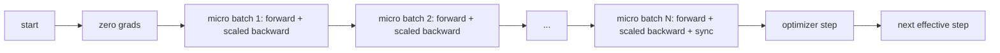
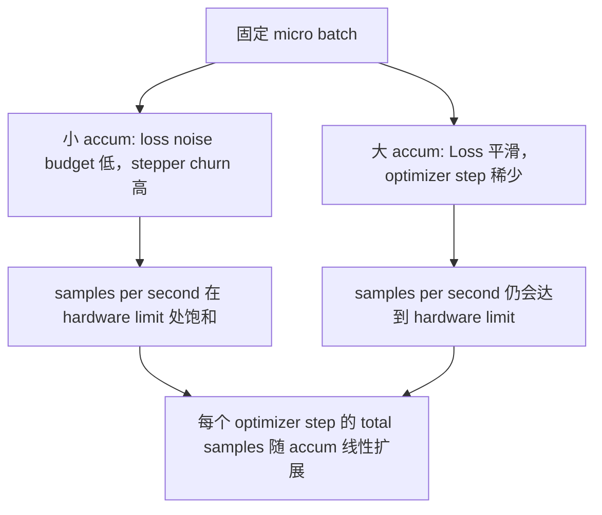

# क्रमिक जमा

> एक माइक्रो बैच के साथ, आप प्रभावी बैच का भार उठाने के लिए प्रशिक्षण प्राप्त करें।

**Type:** Build
**Languages:** Python
**Prerequisites:** Phase 19 lessons 42 to 45
**Time:** ~90 minutes

## सीखने के लक्ष्य

- 推导 प्रभावी बैच 恒等式:`effective_batch = micro_batch * accum_steps`
-  प्रति सूक्ष्म बैच हानि स्केलिंग को प्राप्त करें, जमा ग्रेडिएंट 匹配 एक बार पूर्ण पूर्ण बैच वापस आओ
- पिछले माइक्रो बैच में  पहले अनुकूलक सिंक्रनाइज़ेशन पर कूदने
- 读取 प्रभावी बैच वक्र के खिलाफ आउटपुट,并解释 घटती रिटर्न。

## समस्या

आप प्रभावी बैच 512  प्रशिक्षण का उपयोग करना चाहते हैं, क्योंकि हानि वक्र अधिक समतल, अनुकूलन कदम इस पैमाने पर अधिक उचित है। टेबल पर त्वरक में स्मृति समाप्त हो जाता है। पहले केवल 32 उदाहरणों को समायोजित कर सकता है।

风险在于,Loss 不再是大批次时的同数值──将将16个迷你批次的交叉进化 直接相加,将是一个全批次的 16倍的Loss──没有扩展时,渐进方向是正确的,但幅度是错误的,优化步骤会大16倍──修复方法只有一次除法──修复也很容易忘记──

## अवधारणा



अनुबंध 很短:

- प्रत्येक सूक्ष्म बैच के नुकसान में `backward()`पूर्व से`accum_steps`PyTorch 默认会把渐进 累加到 `param.grad`मध्य; इस बार निकासी राशि को सही माप पर वापस लाएगी।
- अनुकूलन चरण प्रत्येक प्रभावी बैच 触发一次,在最后一个微批次的后退 之后──中途步骤 会扭曲后续整个运行所依赖的每个参数──
- ऑप्टिमाइज़र की स्थिति (मॉमेंट बफर, एडम मोंट) प्रत्येक प्रभावी कदम एक बार आगे बढ़ता है, प्रत्येक सूक्ष्म बैच के बजाय एक बार आगे बढ़ता है।
- एक ही डिवाइस पर, यह सिर्फ लेखांकन है. एक ही पैटर्न में, एक ही पैटर्न होगा अंतिम माइक्रो बैच 包 में `no_sync`संदर्भ में, स्पाइप ग्रेडिएंट ऑल-रिड्यूस; अंतिम माइक्रो-बैच एक बार में पूर्ण संचित ग्रेडिएंट को कम करेगा, बजाय भुगतान N 次 नेटवर्क लागत──

### कोड में समकक्षता प्रमाण

```python
loss = criterion(model(x_full), y_full)
loss.backward()
opt.step()
```

等价格

```python
for x, y in chunks(x_full, y_full, n):
    scaled = criterion(model(x), y) / n
    scaled.backward()
opt.step()
```

लूप के अंत में जमा ग्रेडिएंट बफर के साथ एक बार पूर्ण बैच के पीछे होने वाले टेन्सर के बराबर होगा।`equivalence_check`मध्य प्रयोग से कम 1e-4 के अधिकतम-abs अंतर 断言此点──

### जहां लागत जाती है

प्रत्येक सूक्ष्म बैच को एक बार आगे और एक बार पीछे की जरूरत होती है।`outputs/accum-curve.json`मध्य आउटपुट वक्र  दिखाया गया है कि फिक्स्ड माइक्रो-बैच में नीचे प्रभावी बैच  वृद्धि बड़े समय क्या होगाः



没有免费的午餐──将 `accum_steps`翻倍,会让每个优化步的墙时间 翻倍――变化是渐进估计的变化:在相同的墙预算下,你执行的优化步更少,但每次都在更多样本上平均──文献把大批和小批视为不同的优化问题;本课关注的是机制,而不是统计──


```figure
cc-grad-accumulation
```

## इसे बनाओ

`code/main.py`यह तीन चीजें करता है।

### चरण 1: समकक्षता जांच

`equivalence_check()`एक ही बीज के साथ एक ही नेटवर्क के दो संस्करणों का निर्माण करें। एक एक बार आगे के पास में 16 नमूना बैच देखें। दूसरा चार 4 नमूना टुकड़े देखें, और इसे खो दें।`max_abs_diff < 1e-4`

### चरण 2: अंतिम चरण पर समक्रमण पैटर्न

`train_one_optimizer_step`️️️️️️️️️️️️️️️️️️️️️️️️️️️️️️️️️️️️️️️️️️️️️️️️️️️️️️️️️️️️️️️️️️️️️️️️️️️️️️️️️️️️️️️️️️️️️️️️️️️️️️️️️️️️️️️️️️️️️️️️️️️️️️️️️️️️️️️️️️️️️️️️️️️️️️️️️️️️️️️️️️️️️️️️️️️️️️️️️️️️️️️️️️️️️️️️️️️️️️️️️️️️️️️️️️️️️️️️️️️️️️️️️️️️️️️️️️️️️️️️️️️️️️️️️️️️️️️️️️️️️️️️️️️️️️️️️️️️️️️️️️️️️️️️️️️️️️️️️️️️️️️️️️️️️️️️️️️️️️️️️️️️️️️️️️️️️️️️️️️️️️️️️️️️️️️️️️️️️️️️️️️️️️️️️️️️️️️️️️️️️️️️️️️️️️️️️️️️️️️️️️️️️️️️️️️️️️️️️️️️️️️️️️️️️️️️️️️️️️️️️️️️️️️️️️️️️️️️️️️️️️️️️️️️️️️️️️️️️️️️️️️️️️️️️️️️️️️️️️️️️️️️️️️️`no_sync_context(model)`                                                                                                                                                                                                                                                              `sync_counter`记录我们离开 no_sync scope 的次数; N 个微批量, गिनती प्रत्येक प्रभावी चरण एक बार है, बजाय N 次。

### चरण 3: आउटपुट वक्र

`sweep_effective_batches`उपयोग फिक्स्ड माइक्रो-बैच 和一组 संचय चरण 运行同一个模型──每个设置都会记录:

- `samples_per_sec`: 看到 की कुल नमूने दीवार समय को छोड़कर
- `median_step_ms`: प्रत्येक प्रभावी कदम का 50 वीं प्रतिशत
- `sync_calls`: 被触发的集体点
- `avg_loss`: स्वीप का अनुकूलक कदम 平均值

 आउटपुट में `outputs/accum-curve.json`,并可从笔记本 复用──

运行:

```bash
python3 code/main.py
```

脚本 पहले प्रिंट करें समतुल्यता भिन्न, फिर प्रिंट करें स्वीप टेबल, अंतिम प्रिंट करें JSON पथ──प्रस्थान कोड शून्य──

## इसका प्रयोग करें

उत्पादन प्रशिक्षण में, ग्रेडिएंट संचय 藏在一个扣 后面──PyTorch का पैटर्न है`accumulation_steps = effective_batch // (micro_batch * world_size)` यहाँ अनुमति नहीं है का उपयोग करने के लिए ढांचे में होगा एक ही लूप में पैक, लेकिन कदम एक ही हैः पैमाने हानि, कूद गैर-अंतिम माइक्रोसॉफ्ट ऊपर के सिंक्रनाइज़ेशन, जमा, कदम एक बार 

实践 में तीन पैटर्न हैंः

- माइक्रो बैच आकार 被选为能满设备内存──更小会浪费加速器周期──更大会崩──
- प्रभावी बैच से सीखने की दर अनुसूची 中选择── बड़े प्रभावी बैच 需要规模化学习率和升温; यही रैखिक पैमाने पर नियमावली है जिसका चर्चा 2017 से हो रहा है──
- संचय संख्या है, जो दोनों के बीच का एक पुल है, और यह भी आप एकमात्र है जो रनटाइम में डेटा लोडर के बटन को पुनः लिखना नहीं कर सकता है।

## इसे भेजें

`outputs/skill-gradient-accumulation.md`इस नुस्खा को पकड़ो, साथी इसे नए रेपो में डाल सकते हैं।`accum_steps`पैमाने हानि, गैर-अंतिम माइक्रो में ऊपर कूद अनुकूलक सिंक्रनाइज़ेशन, प्रत्येक प्रभावी बैच केवल कदम अनुकूलक एक बार, प्रभावी बैच के खिलाफ आउटपुट को JSON  रिकॉर्ड, व्यापार को देखने के लिए

## व्यायाम

1. उपयोग `--num-steps 100`重新运行扫描,并绘制样本每秒对有效批次――曲线在哪里变平?
2. 添加一个错误扩展变异(不做除法),并展示步骤 1 时相对参考的参数差──
3. एसजीडी को एडमडब्ल्यू में बदलकर, और प्रत्येक प्रभावी चरण को एक बार में सुधारने की पुष्टि करें, प्रत्येक सूक्ष्म बैच को एक बार में सुधार करने के बजाय।
4. 引入真实 `DistributedDataParallel`लपेटकर,并把 `no_sync_context`路由到它的方法── पुष्टि समक्रमण_कॉल प्रत्येक प्रभावी बैच  N-1 को कम करें──
5. 修改等价 जाँच,对比两种不同的微分分 ((2 x 8 vs 4 x 4),并解释你需要放宽的任何容忍──

## प्रमुख शर्तें

| Term | What people say | What it actually means |
|------|-----------------|------------------------|
| Micro batch | 你 forward 的 batch | 单次 forward pass 中能放进 memory 的 slice |
| Accum steps | 每个 step 的 backward pass 数 | 在一次 optimizer step 前累加的 backward 数量 |
| Effective batch | 这个 batch | Micro batch 乘以 accum steps，再乘以 data parallel world size |
| Loss scaling | 除以 N | Per-micro-batch division，使 summed gradients 匹配 full batch |
| Sync on last | 跳过其余部分 | 只在 window 中最后一次 backward 上运行 Gradient collective |

## आगे पढ़ना

- PyTorch डॉक्स 中关于 `DistributedDataParallel.no_sync`技巧的制作 版本──
- Goyal et al., 2017, बड़े बैच प्रशिक्षण के रैखिक पैमाने पर, is concerned प्रभावी बैच के क्लासिक कारणों:.
- PyTorch समस्या ट्रैकर 中关于 ग्रेडिएंट संचय के साथ मिश्रित परिशुद्धता unscaling के संबंध में
- चरण 19 पाठ 42 से 45 覆盖本课所假设的模型、数据 लोडर、优化器 和 प्रशिक्षक मंचन──
- चरण 19 पाठ 47 覆盖检查点 和复习,让长时间积累运行 能在壁表顶下存活──
