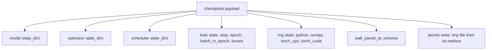
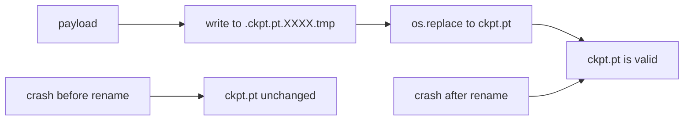
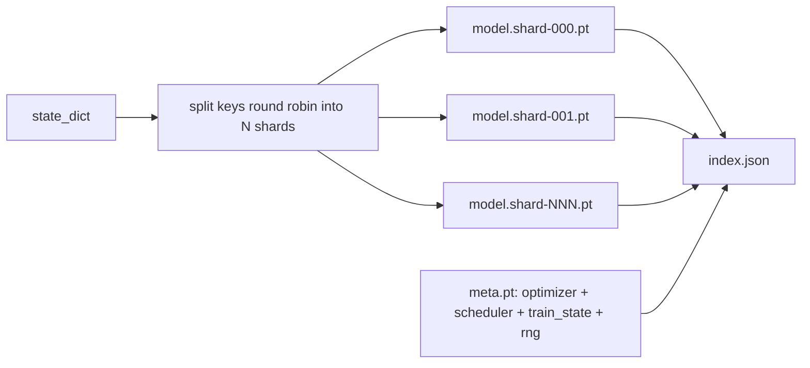

# नियंत्रण बिंदु 保存与恢复

> 训练中断会杀死运行;checkpoint 让它们可以继续──原子化保存模型、优化器、安排器、Loss history、步数计和RNG state,这样任何时刻都被终止时,磁盘上都会留下一个有效文件──

**Type:** Build
**Languages:** Python
**Prerequisites:** Phase 19 lessons 42 to 45
**Time:** ~90 minutes

## सीखने के लक्ष्य

- एक पूर्ण प्रशिक्षण स्थिति को एक एकल उपयोगिता लोड में कैप्चर करें, ताकि इसे एक पूरी तरह से नई प्रक्रिया में पुनः लोड किया जा सके।
- उपयोग पहले लिखने में समय पुनः नामकरण के तरीके परमाणु बचत को प्राप्त करने के लिए, सुनिश्चित दुर्घटना  हमेशा नहीं रह जाएगा लिखने के लिए आधा फ़ाइलों को।
- पयथन、नंबरपी और पायटॉर्च की आरएनजी स्थिति को पुनः प्राप्त करें, ताकि 后的Loss 匹配未中断的基线──
- एक ही फ़ाइल के मॉडल में नहीं रखा जा सकता है खंडित चेकपॉइंट लेआउट का निर्माण, जिसमें हैश सत्यापन के साथ-साथ एक JSON सूचकांक शामिल है 

## 问题

आप एक प्रशिक्षण कार्य निर्धारित करते हैं, 18 घंटे के लिए निर्धारित करते हैं। प्रत्येक आवंटन को 4 घंटे तक सीमित रखें, इसलिए इस बार चलना शुरू होता है। फिर चलने के 11 घंटे में, क्लस्टर फिर से शुरू होता है, क्योंकि किसी व्यक्ति ने आपके वेतन से अधिक श्रेणी में किसी को कर्नेल अपग्रेड की मंजूरी दी है। कोई चेकपॉइंट नहीं है, आपको शुरू से शुरू करना होगा। कोई रिज्यूमे नहीं है, आप भी खो जाएंगे।

सही कलाकृतियाँ एक एकल फ़ाइल है, जिसमें सहेजने के लिए प्रशिक्षण जारी रखने की आवश्यकता हैः मॉडल पैरामीटर、अनुकूलन राज्य、अनुसूचक राज्य、चित्रण के लिए उपयोग किया जाता है हानि इतिहास、वर्तमान चरण और युग तथा बैच-इन-एपॉच काउंटर, वहाँ भी प्रत्येक यादृच्छिकता स्रोत RNG राज्य── बिना RNG राज्य, पुनः प्राप्ति के बाद हानि वक्र एक और वक्र होगा── एक ही मॉडल、 एक ही डेटा、 अलग-अलग शफल、 अलग-अलग ड्रॉपआउट मास्क、डैशबोर्ड ऊपर अलग-अलग संख्याएँ──

परमाणु सहेजने का मतलब है कि इस अनुबंध का दूसरा भाग है। सीधे लिखने के लिए अंतिम फ़ाइल का नाम दुर्घटना का अर्थ है। दुर्घटना का अर्थ है कि दुर्घटना का कारण बनता है। दुर्घटना का अर्थ है कि दुर्घटना का कारण बनता है। दुर्घटना का अर्थ है कि दुर्घटना का कारण बनता है। दुर्घटना का अर्थ है कि दुर्घटना का कारण बनता है। दुर्घटना का अर्थ है कि दुर्घटना का कारण बनता है। दुर्घटना का अर्थ है कि दुर्घटना का कारण बनता है। दुर्घटना का अर्थ है कि दुर्घटना का कारण बनता है। दुर्घटना का अर्थ है कि दुर्घटना का कारण बनता है। दुर्घटना का अर्थ है कि दुर्घटना का कारण बनता है। दुर्घटना का अर्थ है कि दुर्घटना का कारण बनता है। दुर्घटना का अर्थ है कि दुर्घटना का कारण बनता है। दुर्घटना का अर्थ है कि दुर्घटना का कारण बनता है। दुर्घटना का अर्थ है कि दुर्घटना का कारण बनता है। दुर्घटना का अर्थ है कि दुर्घटना का कारण बनता है। दुर्घटना का अर्थ है कि दुर्घटना का कारण बनता है। दुर्घटना का अर्थ है कि दुर्घटना का कारण बनता है। दुर्घटना का अर्थ है कि दुर्घटना का कारण बनता है कि दुर्घटना का कारण बनता है। दुर्घटना का कारण बनता है कि दुर्घटना का कारण बनता है कि दुर्घटना का कारण बनता है। दुर्घटना का कारण है कि दुर्घटना का कारण हो सकता है कि दुर्घटना का कारण हो सकता है कि दुर्घटना का कारण हो सकता है। दुर्घटना का कारण है कि दुर्घटना का कारण हो सकता है कि दुर्घटना के कारण हो सकता है कि दुर्घटना के कारण, दुर्घटना के कारण, दुर्घटना के कारण, दुर्घटना के कारण, दुर्घटना के कारण, दुर्घटना के कारण, दुर्घटना के कारण, दुर्घटना के कारण, दुर्घटना के कारण, दुर्घटना के कारण, दुर्घटना के कारण, दुर्घटना के कारण, दुर्घटना के कारण, दुर्घटना के कारण, दुर्घटना के कारण, दुर्घटना के कारण, दुर्घटना के कारण, दुर्घटना के कारण, दुर्घटना के कारण, दुर्घटना के कारण, दुर्घटना के कारण, दुर्घटना के कारण, दुर्घटना के कारण, दुर्घटना के कारण, दुर्घटना के कारण, दुर्घटना के कारण, दुर्घटना के कारण, दुर्घटना के कारण, दुर्घटना के कारण, दुर्घटना के कारण, दुर्घटना के कारण, दुर्घटना के कारण, दुर्घटना के कारण, जो की कारण, दुर्घटना के कारण, दुर्घटना के कारण, दुर्घटना के कारण, कारण, कारण, एक दुर्घटना के कारण, जो की कारण, एक दुर्घटना में, जो की कारण, दुर्घटना में, जो की वजह से हुई, जो की वजह से हुई, जो कि एक दुर्घटना में, जो की वजह से हुई, जो कि एक दुर्घटना में, जो की

## 概念



### 五个 राज्य बाल्टिन

| Bucket | 为什么重要 |
|--------|------------|
| Model | Weights 和 buffers；也就是 model 本身。 |
| Optimizer | Momentum 和 adaptive moments；没有它们，下一步就是另一个 Optimization 问题。 |
| Scheduler | Learning rate 在 curve 上的位置；cosine schedules 尤其在意这一点。 |
| Train counters | Step、epoch、batch-in-epoch，以及绘制 dashboard 的 Loss history。 |
| RNG state | 为 dropout、data shuffling，以及 model 内部的任何 sampling 提供 determinism。 |

### परमाणु बचत



两条规则──第一,临时文件必须位于目标所在的同一目录中,这样的重命名才会停留在同一个文件系统内;跨设备重命名 不是原子的──第二,临时名称对每次尝试都必须唯一,避免两个作者 相互覆盖──

### टुकड़े टुकड़े किए गए चेकपोस्ट

जब मॉडल 变大时,单文件用载量会变得太大, लोड不够快,检查不方便,而且在网络共享中途动时非常痛苦── समाधान विधि है पैरामीटर राज्य 拆分碎片,并写入一个小索引把它们关联起来──



अनुक्रमणिका  रिकॉर्ड शार्ड की संख्या  प्रत्येक शार्ड का sha256, साथ ही मेटा फ़ाइल का sha256 जब कोई भी हैश असंगत होता है, तो लोडर स्पष्ट रूप से विफल रहता है

### संक्षिप्त रूप से युग मध्य मार्ग जारी

अगले युग के लिए फिर से शुरू करना, कुछ मिनट से लेकर एक दिन तक का समय बर्बाद करना है।`(epoch, batch_in_epoch)`इसके बाद, प्रशिक्षण लूप में यादृच्छिक संख्या जनरेटर होगा 快进越前时代中已经消耗的批量, फिर से `batch_in_epoch`⇒ ⇒ ⇒ ⇒ ⇒ ⇒ ⇒ ⇒ ⇒ ⇒ ⇒ ⇒ ⇒ ⇒ ⇒ ⇒ ⇒ ⇒ ⇒ ⇒ ⇒ ⇒ ⇒ ⇒ ⇒ ⇒ ⇒ ⇒ ⇒ ⇒ ⇒ ⇒ ⇒ ⇒ ⇒ ⇒ ⇒ ⇒ ⇒ ⇒ ⇒ ⇒ ⇒ ⇒ ⇒ ⇒ ⇒ ⇒ ⇒ ⇒ ⇒ ⇒ ⇒ ⇒ ⇒ ⇒ ⇒ ⇒ ⇒ ⇒ ⇒ ⇒ ⇒ ⇒ ⇒ ⇒ ⇒ ⇒ ⇒ ⇒ ⇒ ⇒ ⇒ ⇒ ⇒ ⇒ ⇒ ⇒ ⇒ ⇒ ⇒ ⇒ ⇒ ⇒ ⇒ ⇒ ⇒ ⇒ ⇒ ⇒ ⇒ ⇒ ⇒ ⇒ ⇒ ⇒ ⇒ ⇒ ⇒ ⇒ ⇒ ⇒ ⇒ ⇒ ⇒ ⇒ ⇒ ⇒ ⇒ ⇒ ⇒ ⇒ ⇒ ⇒ ⇒ ⇒ ⇒ ⇒ ⇒ ⇒ ⇒ ⇒ ⇒ ⇒ ⇒ ⇒ ⇒ ⇒ ⇒ ⇒ ⇒ ⇒ ⇒ ⇒ ⇒ ⇒ ⇒ ⇒ ⇒ ⇒ ⇒ ⇒ ⇒ ⇒ ⇒ ⇒ ⇒ ⇒ ⇒ ⇒ ⇒ ⇒ ⇒ ⇒ ⇒ ⇒ ⇒ ⇒ ⇒ ⇒ ⇒ ⇒ ⇒ ⇒ ⇒ ⇒ ⇒ ⇒ ⇒ ⇒ ⇒ ⇒ ⇒ ⇒ ⇒ ⇒ ⇒ ⇒ ⇒ ⇒ ⇒ ⇒ ⇒ ⇒ ⇒ ⇒ ⇒ ⇒ ⇒ ⇒ ⇒ ⇒ ⇒ ⇒ ⇒ ⇒ ⇒ ⇒ ⇒ ⇒ ⇒ ⇒ ⇒ ⇒ ⇒ ⇒ ⇒ ⇒ ⇒ ⇒ ⇒ ⇒   ⇒ ⇒     ⇒ ⇒                                                                        


```figure
cc-atomic-checkpoint
```

## इसे बनाओ

`code/main.py` four primitives और एक डेमो ड्राइवर प्रदान करें

### चरण 1: आरएनजी की स्थिति को पकड़ने और पुनर्स्थापित करने

`capture_rng_state`返回一个字句,包含Python 的 `random.getstate`、NumPy के `np.random.get_state`, तथा PyTorch CPU तथा CUDA RNG बाइट्स`restore_rng_state`इसे पुनर्प्राप्त करने के लिए एक रिवर्स टेंसर है, एक Uint8 बाइट बफर, PyTorch के RNG  जानता है कि कैसे इसे खपत करने के लिए

### चरण 2: परमाणु बचत

`atomic_save`                                                                                                                                                                                                                                                              `os.replace`इसे अंतिम नाम तक बदला जाना`atomic_write_json`                                                                                                                                                                                                                                                              

### चरण 3: 完整检查站回路

`save_checkpoint` मॉडल  अनुकूलक  शेड्यूलर  ट्रेन स्टेट 和 RNG 打包到一个命令中──`load_checkpoint`इसे पुनर्स्थापित करने के लिए,并返回一个 `TrainState`◊ योजना क्षेत्र है उन्नयन हुक:未来格式变化会递增版本 स्ट्रिंग, जबकि लोडर 会进行发送──

`load_checkpoint`调用 `torch.load(..., weights_only=True)``.pt`文件是一个,用 `weights_only=False`एक अविश्वसनीय फ़ाइल को अनुक्रमित करने के लिए, फ़ाइल में निर्दिष्ट किसी भी कोड को निष्पादित करेगा। केवल वजन-केवल लोडर केवल टेन्सर और बुनियादी कंटेनर स्वीकार करता है, बाकी सब कुछ अस्वीकार करता है, यह चरण 1 है आरएनजी राज्य को बनाए रखना सामान्य सूची में मौजूद कारणों में से एक है। पूर्णता जांच फेंक दी।`ValueError``assert`, क्योंकि `python -O`会去掉声明── कृपया टॉर्च 2.6 या अपडेट संस्करण का उपयोग करेंः`weights_only=True`इस प्रकार, इस वर्ग पर निर्भर होने की गारंटी केवल 2.6 से ही स्थापित की गई है।

### चरण 4: टुकड़े टुकड़े

`save_sharded_checkpoint`इस प्रकार राउंड-रोबिन  तरीके से पैरामीटर कुंजी को N 个 shards में विभाजित करें, प्रत्येक shard में अपने स्वयं के परमाणु सहेजें  लिखें, एक मेटा फ़ाइल में लिखें जिसमें ऑप्टिमाइज़र, शेड्यूलर और ट्रेन स्टेट शामिल है, और JSON सूचकांक में लिखें जिसमें shard sha256 शामिल है।`load_sharded_checkpoint`एकीकरण में पहले परीक्षण प्रत्येक टुकड़ा

### चरण 5: पुनः आरंभ डेमो

`run_resume_demo`会将一个小模型 训练 `total_steps`, में `interrupt_at`保存点, फिर चालू रखना──第二个过程 会恢复点并运行剩余步骤──该函数 返回断点 之后两条损失轨迹的最大绝对差──有RNG恢复,差异为零或浮点噪音──

运行它:

```bash
python3 code/main.py
```

单文件和碎片的演示 都断言最大差小于1e-4──摘要会写入 `outputs/resume-demo.json`

## इसका प्रयोग करें

生产训练会把检查点 作为教练的一部分交付──形状相同:model + Optimizer + scheduler + counters + RNG,以原子方式写入,并按步骤命名,便于找到最新文件──`index.json`यह इस बात का हिस्सा है।

चार प्रकार के आदेशों को अनिवार्य रूप से लागू करनाः

- **用 `weights_only=True` 加载。**साझा करने या डाउनलोड करने से प्राप्त चेकपॉइंट अविश्वसनीय है।
- **Schema 是 payload 中的一个 string。**आप्रवासन  इसके अनुसार ️ ️ ️ ️ ️ ️ ️ ️ ️ ️ ️ ️ ️ ️ ️ ️ ️ ️ ️ ️ ️ ️ ️ ️ ️ ️ ️ ️ ️ ️ ️ ️ ️ ️ ️ ️ ️ ️ ️ ️ ️ ️ ️ ️ ️ ️ ️ ️ ️ ️ ️ ️ ️ ️ ️ ️ ️ ️ ️ ️ ️ ️ ️ ️ ️ ️ ️ ️ ️ ️ ️ ️ ️ ️ ️ ️ ️ ️ ️ ️ ️ ️ ️ ️ ️ ️ ️ ️ ️ ️ ️ ️ ️ ️ ️ ️ ️ ️ ️ ️ ️ ️ ️ ️ ️ ️ ️ ️ ️ ️ ️ ️ ️ ️ ️ ️ ️ ️ ️ ️ ️ ️ ️ ️ ️ ️ ️ ️ ️ ️ ️ 
- **对每个 shard 计算 Sha256。**静默截断的下载是最糟糕的 bug; लोडर 么快速失败,要么晚些失败──
- **让 checkpoint cadence 保持诚实。**हर N कदम  सहेजें एक बार, और प्रत्येक अलग-अलग कई वॉलवॉच-मिनट  सहेजें एक बार, ले更短者──否则, दुर्घटना 发生在一个长远步骤上时,会浪费整一个窗口的工作──

## इसे भेजें

`outputs/skill-checkpoint-save-resume.md`️ किसी भी नए प्रशिक्षण स्क्रिप्ट का संयोजन: payload आकार, परमाणु लेखन, आरएनजी कैप्चर, संकुचित सूचकांक ️ इस कौशल को ️ रिपो में डाल, ️ आवधिक सहेजें साइट ️`save_checkpoint`, स्टार्टअप में 接入 `load_checkpoint`, हम मारने के लिए तैयार हो जाएगा

## व्यायाम

1. उपयोग पैरामीटर समूह के अनुसार 分片 प्रतिस्थापन गोल-रोबिन sharding(以 `.weight`结尾的层 vs `.bias`)― किस समय प्रत्येक लेआउट बेहतर फिट बैठता है?
2.  विस्तार सहेज लूप, अंतिम K 个 चेकपोइंट को बनाए रखें, और पुराने को साफ करें।
3. 添加一个 `--ckpt-every-seconds`झंडा, वॉल क्लॉक अंतराल पर 触发保存, बस कदम गिनती पर नहीं
4.  एक चेकसम सत्यापन पथ जोड़ें, 运行 में स्टार्टअप करें,扫描目录 में प्रत्येक चेकपॉइंट,并报告哪些 भ्रष्ट हो गये
5. 实现一个 `migrate_v1_to_v2`फ़ंक्शन, के लिए उपयोगिता लोड 添加一个新字段,并递增方案字符串──让 लोड 同时兼容两个版本──

## प्रमुख शर्तें

| Term | 人们常说 | 实际含义 |
|------|----------|----------|
| Atomic save | “写入然后祈祷” | 写入同一目录中的 temp file，然后用 os.replace 放入 target name |
| State dict | “Weights” | Model parameters 和 buffers，按 parameter name 作为 key |
| Sharded checkpoint | “大 model file” | 多个文件，每个 shard 一个，加上一个 meta file 和一个包含 sha256 的 JSON index |
| RNG state | “Random seed” | python random、numpy、torch CPU、torch CUDA 的捕获状态；不只是 seed |
| Mid-epoch resume | “Restart” | 快进 RNG，并从同一 epoch 中的下一个 batch 继续 |

## आगे पढ़ना

- POSIX `rename`अर्थशास्त्र, के लिए प्रयोग`os.replace`परमाणुता के दावा पर निर्भरता
- पिटॉर्च  About `torch.save`和 `torch.load`                                                                                                                                                                                                                                                                                                                                                                                                                                                                                                                             `map_location`
- चरण 19 पाठ 46 में इस कक्षा के चेकपॉइंट के उपयोगिता भार को कवर किया गया है।
- चरण 19 पाठ 48 में इस कार्यक्रम के लिए एक सामंजस्यपूर्ण राज्य निर्देश प्रारूप शामिल है।
- लिनक्स कर्नेल `fsync`परमाणु नामकरण के लिए प्रलेखन, स्थायित्व गारंटी के पीछे
