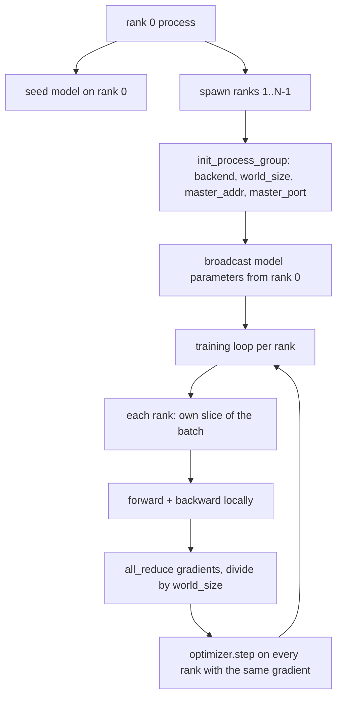
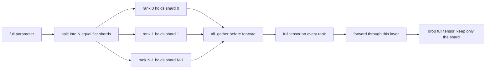

# शून्य से निर्माण वितरित डेटा समानांतर और FSDP

> बहु-श्रेणी प्रशिक्षण दो सामूहिक है 和一条规则── प्रारंभ में प्रसारण मापदंड, पिछड़े 后 औसत ग्रेडिएंट, कभी भी प्रत्येक श्रेणी को अपने लिए किस चरण में होने पर मतभेद पैदा करने न दें──

**Type:** Build
**Languages:** Python
**Prerequisites:** Phase 19 lessons 42 to 45
**Time:** ~90 minutes

## सीखने के लक्ष्य

- उपयोग `gloo`backend 启动跨 N 个级的过程组,不需要特殊硬件──
-  एक न्यूनतम डीडीपी रैपर को प्राप्त करना,  निर्माण में प्रसारण मापदंडों को प्राप्त करना, और  पीछे सभी-कम gradients को प्राप्त करना
- 证明 प्रति रैंक ग्रेडिएंट्स का सर्व-कम 匹配 समाहित इनपुट 上的 एकल-प्रक्रिया ग्रेडिएंट
- 勾勒 FSDP पैरामीटर sharding: प्रत्येक रैंक 持有一个片,前进通过 时收集全 tensor,后落──

## 问题

模型能放进一个设备──数据设置 放不下──优化预算 要求你在每秒钟内 看到N 倍样本──第一杆是数据平行: प्रत्येक रैंक 批发的不同分片上运行同一个模型,然后在优化步骤 之前平均梯度──第二杆是FSDP:模型本身也放不进一个设备,所以每个级别 持有每个参数的一部分,并通过 期间逐层重建全子──

痛点在会计管理中──如果参数在排列 之间漂移, इस बार रन 会静默损坏── यदि औसत ग्रेडिएंट्स हैं, लेकिन औसत हानि नहीं है, डैशबोर्ड 就会撒谎── यदि सामूहिक बैकेंड 无法达成一致的拓学, रन 会永远挂──修复方法是亲手写一次集体,然后永远不要信任你无法复现的包装──

इस वर्ग में CPU पर काम करते हैं।`gloo`बैकेंड 随着每一个PyTorch निर्माण 一起提供,并接受 `torch.multiprocessing`श्रमिकों; एक ही कोड के हिस्से को बहु-जीपीयू नोड ऊपर `nccl`时, संरचना परिवर्तन की आवश्यकता नहीं है

## 概念



###  दो महत्वपूर्ण सामूहिक

| Collective | 做什么 | 何时使用 |
|------------|--------------|------|
| `broadcast` | 将一个 tensor 从一个 rank 复制到所有其他 rank | Parameter init、scheduler state、任何 one-to-all sync |
| `all_reduce` | 在所有 rank 间对一个 tensor 求和（或 mean、或 max），每个 rank 都得到结果 | Backward 后的 Gradient averaging |
| `all_gather` | 每个 rank 贡献一个 tensor，每个 rank 都得到 concatenation | Logits collection、FSDP parameter unshard |

डीडीपी अनुबंध 时 `broadcast`, पीछे की ओर 后 `all_reduce`❖ FSDP स्केच 在每一层前进通过 前加入 `all_gather`

### ग्रेडिएंट औसत 匹配 एकल प्रक्रिया ग्रेडिएंट

N 个级 上使用B 个样本的批量 训练模型,必须产生与单个过程 在 N*B 的批量 上训练相同的梯度──是对每级梯度 求和并除以 N,得到平均损失梯度,这是中减的中减的十字 Entropy 在全批量 上会产生的结果──教程代码 会在手动全减梯度和参考单过程梯度 之间断定`max-abs-diff < 1e-3`

### एफएसडीपी स्केच



मेमोरी जीत सटीक हैः प्रति रैंक पैरामीटर मेमोरी 降至1/N──代价是收集, प्रत्येक बार आगे गुजरना 都要支付── प्रोडक्शन FSDP会将收集与上层的计算重叠,所以壁表成本比朴素核算预测的小得多──本课对每个参数做回路,并断定重建与原始比特等──

### CPU और अंधेरे बैकेंड

CUDA उत्पादन लक्ष्य है, लेकिन CPU ऊपर भी एक ही कोड पथ मौजूद हैं।`gloo`यह GPU पर है।`nccl`慢数级, लेकिन एपीआई सतह 完全相同──本课的过程组 用 `backend="gloo"`प्रथमतः,并用 `torch.multiprocessing`प्रजनन रैंक, बजाय `torchrun`; दोनों अंततः सभी एक ही उपयोग करेंगे `torch.distributed` बहु-जीपीयू नोड ऊपर, एकमात्र परिवर्तन है `backend="nccl"`、डिवाइस टेंसर, तथा उपयोग `torchrun` प्रारंभ करना


```figure
cg-allreduce-ring
```

## इसे बनाओ

`code/main.py`यह एक कलाकृतियों का उपयोग कर सकते हैं।

### चरण 1: प्रक्रिया समूह प्रारंभ करें

```python
os.environ["MASTER_ADDR"] = "127.0.0.1"
os.environ["MASTER_PORT"] = str(port)
dist.init_process_group(backend="gloo", rank=rank, world_size=world_size)
```

`MASTER_ADDR`和 `MASTER_PORT`यह एक ही पोर्ट पर एक ही होस्ट पर एक ही पोर्ट पर जाता है।

### चरण 2: निर्माण 时 प्रसारण

`MinimalDDP.__init__`遍历每参数 和缓冲,并调用 `dist.broadcast(tensor, src=0)`✿ रैंक 0 का मान बन जाता है कैनोनिक init── इस कदम के बिना, प्रत्येक रैंक अपने बीज के साथ आरंभिकरण, रैंक से प्रथम चरण से विचलन शुरू करेगा──

### चरण 3: पीछे की ओर 后 सभी घटाने gradients

```python
def all_reduce_grads_(module, world_size):
    for p in module.parameters():
        if p.grad is None:
            p.grad = torch.zeros_like(p.data)
        dist.all_reduce(p.grad.data, op=dist.ReduceOp.SUM)
        p.grad.data.div_(world_size)
```

प्रत्येक रैंक को अंततः समान औसत ग्रेडिएंट मिलता है। ऑप्टिमाइज़र चरण अब प्रत्येक रैंक पर समान इनपुट के आधार पर फ़ंक्शन पर है, यही कारण है कि पूरे रन में पैरामीटर सिंक्रनाइज़ होते हैं।

### चरण 4: प्रमाणन सममूल्य

`manual_all_reduce_matches_single_process`रैंक 0 पर एक ही मॉडल का निर्माण करते हुए, सभी घटाने के बाद ग्रेडिएंट को एकल प्रक्रिया के साथ तुलना करने के लिए एक साथ इनपुट पर गणना की गई ग्रेडिएंट की तुलना करें।

### चरण 5: एफएसडीपी यात्रा

`fsdp_round_trip_sketch`हर पैरामीटर को सपाट करें, पैड तक`world_size`का गुणांक, स्लाइस, ऑल-गर्निंग, पुनः अनपैड── प्रत्येक रैंक का पुनर्निर्माण 都等于原始── यह अनखंडित चरण है; इसका उलट--- आगे 后 पुनः-खंडित)就是 एकत्रित तन्सर से 中取一个切片──

运行:

```bash
python3 code/main.py
```

默认 विश्व आकार है 2―― दो CPU प्रक्रियाओं spawn, के माध्यम से `gloo`相互通信,并以零 退出──输出 `outputs/ddp-demo.json`फ़ैच प्रत्येक रैंक के पैरामीटर के योग  सभी-कम  के ग्रेडिएंट मानदंड  FSDP राउंड-ट्रिप परिणाम, तथा मैनुअल- बनाम-रिफरेंस ग्रेडिएंट अंतर 

## इसका प्रयोग करें

उत्पादन प्रशिक्षण स्टैक 调用相同原始人──PyTorch 的 `DistributedDataParallel`增加了: पोस्ट-ब्याकवर्ड ग्रेडिएंट हुक, उपयोग सभी-कम करने के लिए और पीछे ढलान; बुकेट सभी-कम करने के लिए, कई छोटे ग्रेडिएंट 合并为一次集体;以及教案 46 使用过的 `no_sync`संदर्भ

PyTorch के FSDP  बढ़ाया गयाः प्रत्येक स्तर एक सपाट पैरामीटर दृश्य, प्रत्येक रैंक  एक आसन्न बफर है; नीचे स्तर unshard के साथ वर्तमान स्तर की गणना के ओवरलैप; तथा चयनित shard CPU अपलोड;;

形状保持不变: प्रारंभ करते समय प्रसारण, पीछे हटते समय घटते समय, पैरामीटर 放不下时进行碎片──

## इसे भेजें

`outputs/skill-distributed-fsdp-ddp.md`携带新训练脚本 的食谱:用 `gloo`CPU के प्रक्रिया समूह को प्रारंभ करें, उपयोग `nccl`प्रक्रिया समूह को प्रारंभ करें, मॉडल को डीडीपी खोल में पैक करें, निर्माण के दौरान प्रसारण न करें पश्चात ढ़ेर कम करें, फ़ेसबुक पर FSDP स्केच का उपयोग करके पैरामीटर के लिए सभी_गेर पैटर्न का उपयोग करें।

## व्यायाम

1. उपयोग `--world-size 4`运行,并确认整个运行中参数分布 保持在 1e-3 以下。
2. 替换为  将 मैन्युअल औसत`dist.all_reduce(op=dist.ReduceOp.AVG)`समय में अंतर
3. DDP रैपर जोड़ा पोस्ट-ब्याकवर्ड हुक, सब कुछ कम करने के लिए  पीछे के शेष भाग के साथ ओवरलैप; माप दीवार घड़ी  सुधार
4. 实现 FSDP पुनः-शिल्ड चरण: फॉरवर्ड पास 后, फिर से स्थानीय शार्ड  पूर्ण tensor ⇒ बदलें ⇒ कन्फर्म प्रति रैंक मेमोरी ⇒ नीचे
5. CUDA 机器上将 बैकेंड 切换为 `nccl` रिकॉर्ड करें कि कौन से पर्यावरण चर  बदलते हैं, कौन से परिवर्तन नहीं करते हैं

## प्रमुख शर्तें

| Term | 人们的说法 | 实际含义 |
|------|-----------------|------------------------|
| Backend | "gloo or nccl" | 实现 collective ops 的 library；gloo 是 CPU，nccl 是 GPU |
| World size | "Total ranks" | group 中的 process 数量；group 是 collectives 操作的 unit |
| Rank | "Worker id" | group 内的 process identifier，从零开始索引 |
| All-reduce | "Sum the grads" | 在所有 rank 间对一个 tensor 求和，每个 rank 最终得到相同结果 |
| Unshard | "Gather the params" | 通过 all_gather 从 per-rank slices 重建 full tensor |

## आगे पढ़ना

- पिटोरच `torch.distributed`दस्तावेज, इस विषय पर आधारित सामूहिक अर्थशास्त्र को समझना
- `gloo`पुस्तकालय की सामूहिक सूची, इसकी आकार और CUDA समर्थित `nccl`आदिम समान
- चरण 19 पाठ 46 में, डीडीपी को सभी-कम करने के बारे में जानकारी प्राप्त होगी।`no_sync`मध्य ग्रेडिएंट संचय पैटर्न
- चरण 19 पाठ 47 में, डीडीपी और एफएसडीपी के बीच जीवित चेकपॉइंट लेआउट को समझना।
- PyTorch FSDP प्रलेखन, यहाँ स्केच के पैरामीटर sharding के उत्पादन कार्यान्वयन को जानें
