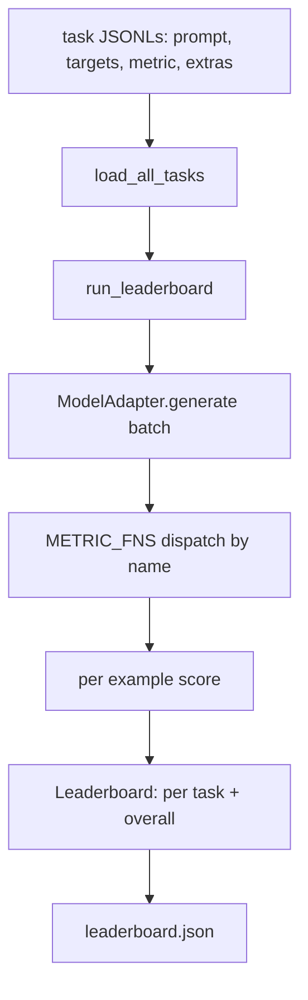
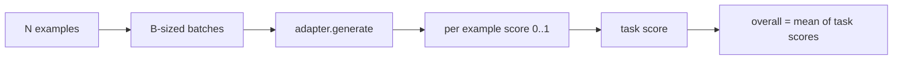

# 语言模型评测 हर्नेस

> यदि कोई मॉडल आपके द्वारा परिभाषित किए जाने वाले कार्य पर अच्छा प्रदर्शन करता है, तो यह केवल संयोग से अच्छा प्रदर्शन करता है।

**Type:** Build
**Languages:** Python
**Prerequisites:** Phase 19 lessons 42 to 45
**Time:** ~90 minutes

## सीखने के लक्ष्य

- एक JSONL फ़ाइल के रूप में एक कार्य को परिभाषित करने के लिए, प्रत्येक उदाहरण 包含 `prompt``targets``metric`, तथा विकल्प `extras`
- 实现五个指标:精确匹配、红色-l F1、执行检查、多选和子字符串含有──
- 构建一个运行器,按任务 批处理示例,并分发给可替换的模型适配器──
- आउटपुट लीडरबोर्ड JSON, प्रत्येक कार्य का स्कोर, विलंबता, तथा पुनः प्राप्ति योग्य समग्र औसत शामिल है

## 问题

हर हफ्ते एक नया भाषा मॉडल सामने आता है। विपणन शब्द का कहना है कि यह अच्छा प्रदर्शन करता है। ईमानदारी का सवाल यह है कि यह किस पहलू में अच्छा प्रदर्शन करता है? ईमानदारी का जवाब है कि आप खुद लिखते हैं, क्योंकि विक्रेता का लीडरबोर्ड वही है जिसे वे अनुकूलित करते हैं।

यदि आपका रिपो 里 में कोई हर्नर नहीं है, तो आप केवल दो मॉडल की तुलना करने के लिए महसूस कर सकते हैं। यदि आपके पास हर्नर है, तो आप निश्चित कार्य सेट पर हो सकते हैं, निश्चित मीट्रिक ऊपर तुलना करें, और उन्हें अलग-अलग JSON आउटपुट प्राप्त कर सकते हैं।

陷是让harness 过拟合到单个模型──修复方式是反过来使用同一个陷:harness 小到十五分钟能读完,任务小到可以随随随 发布,计量从零编写以便同事审计,而适配器是唯一放置模型特定代码的地方──替代适配器,领袖板 会变;替代任务,领袖板 会变――其他一切不应变──

## 概念



### कार्य विनिर्देश

प्रत्येक उदाहरण एक पंक्ति JSONL हैः

```json
{"id": "arith-00", "prompt": "compute: 2 + 2", "targets": ["4"], "metric": "exact_match"}
```

对于需要的评分助手的指标,`extras`携带旁路 उपयोगिता भार:

```json
{
  "id": "code-00",
  "prompt": "python: write a function f that doubles its input",
  "targets": ["ok"],
  "metric": "code_exec",
  "extras": {"io_pairs": [[1, 2], [3, 6]]}
}
```

एक कार्य है`outputs/tasks/`नीचे एक `.jsonl`文件──文件名就是任务名称──一个文件中的所有例子 共享同一个指标──

### 五个 फिटिंग कार्य

| Task | Metric | 测试内容 |
|------|--------|---------------|
| arithmetic | exact_match | 对确定性答案的 Token 级正确性 |
| summary | rouge_l | 针对单行 reference summary 的 longest common subsequence F1 |
| code-exec | code_exec | 可执行测试：预测出的 function 必须满足一组 input-output pairs |
| multiple-choice | multiple_choice | prediction 的首字母必须匹配允许的 letter |
| generation | substring_contains | Free-form text 必须包含至少一个 target substring |

### मीट्रिक अनुबंध

प्रत्येक मीट्रिक एक समारोह हैः`(prediction, targets, extras) -> float in [0.0, 1.0]`◊ प्रति उदाहरण स्कोर पर उपयोग 取平均得到任务 स्कोर, पुनः对任务 स्कोर पर औसत प्राप्त समग्र ◊ मेट्रिक फ़ंक्शन 都很小:

- `exact_match`:转小写、折叠白空、判断平等──
- `substring_contains`: समान सामान्यीकरण,做 सबस्ट्रिंग परीक्षण。
- `multiple_choice`: पहला चरित्र लो और बड़े लेखन में परिवर्तित हो जाओ
- `rouge_l`:LCS लंबाई के अलावा पूर्वानुमान और संदर्भ की लंबाई, गणना सटीकता और रिकॉल की F1──
- `code_exec`: में सीमित नामस्थान में निष्पादन भविष्यवाणी, प्रत्येक इनपुट-आउटपुट जोड़ी के लिए 调用 `f(x)`, सांख्यिकीय मैचों

code_exec मेट्रिक 会在精简后的内置名空间 中运行预测──本课的测试 断言 `import os`会失败, क्योंकि `os` 不在名区中;你无法从代码预测 访问文件系统──

### मॉडल एडाप्टर

```python
class ModelAdapter(Protocol):
    def generate(self, prompts: Sequence[str]) -> List[str]: ...
    @property
    def name(self) -> str: ...
```

एडाप्टर 接点──本课提供 `ToyAdapter`, यह एक निश्चितता पैटर्न मिलान है, पांच फिक्स्ड कार्यों के लिए होगा के बीच प्रत्येक संकेत  लौटें सही जवाबों。 वास्तविक एडाप्टर 调用模型并返回输出──Harness 不关乎是哪一个──

### धावक

`run_task`प्रत्येक बैच प्रसंस्करण`batch_size`个 प्रॉम्प्ट्स,并分发给 मीट्रिक फ़ंक्शन──`run_leaderboard` प्रत्येक कार्य में                                                                                                                                                                                                                                                             `write_leaderboard`输出带 schema string 的 JSON, thus未来 स्वरूप 变化不会静默破坏仪表板──




```figure
eval-harness-matrix
```

## इसे बनाओ

`code/main.py`यह एक कलाकृतियों का उपयोग कर सकते हैं।

### चरण 1: बीज फिक्स्चर कार्य

`seed_fixture_tasks(target_dir)`写入五个 `.jsonl`文件──第一次运行 `main.py`时, यदि कैटलॉग के लिए खाली है, यह बीज इन फाइलों को होगा

### चरण 2: लोड कार्य

`load_all_tasks(task_dir)`读取每个 `.jsonl`,并返回从任务名称到 `Example`रिकॉर्ड 列表的 dict──以 `#`प्रथम टिप्पणी पंक्तियाँ तथा रिक्त पंक्तियाँ टाल दी जाएंगी, इसलिए योगदानकर्ता इन फाइलों को टिप्पणी कर सकते हैं

### चरण 3:मीट्रिकों को लागू करें

प्रत्येक मेट्रिक एक छोटा सा फ़ंक्शन होता है, जिसमें यूनिट टेस्ट होता है। इस कक्षा के टेस्ट सूट में 13 मामले होते हैं, जिनमें सामान्यीकरण, आंशिक ओवरलैप, कोड निष्पादन और असुरक्षित कोड अस्वीकृति शामिल होती है।

### चरण 4: धावक लिखें

`run_task`代 बैच,并生成一个 `TaskResult`, जिसमें स्कोर,सही गणना,कुल गणना तथा विलंबता शामिल है।`run_leaderboard` सभी कार्यों में,并生成带 समग्र औसत `Leaderboard`

### चरण 5: JSON जारी करें

`write_leaderboard`सभा क्रमबद्ध बोर्ड`--include-per-example`प्रति उदाहरण रिकॉर्ड flag 会导出, इस प्रकार जब स्कोर  परिवर्तन, आप पूर्वानुमान को पिछले बार के साथ अलग कर सकते हैं

运行它:

```bash
python3 code/main.py
```

脚本第一次运行时会种子装置,用玩具适配器 (玩具适配器) 打分,并写入`outputs/leaderboard.json`◊ खिलौना एडाप्टर का उपयोग 时 समग्र स्कोर 1.0 है;`test_main.py`मध्य के स्टब एडाप्टर परीक्षण  दिखाया जब एडाप्टर  जवाब नहीं दे सका, एक ही हर्नस 0.0 होगा

## इसका प्रयोग करें

वास्तविक मॉडल में संलग्न करने के लिए, एक एडाप्टर लिखेंः

```python
class HttpAdapter:
    name = "vendor.v1"

    def __init__(self, endpoint, api_key):
        self.endpoint = endpoint
        self.api_key = api_key

    def generate(self, prompts):
        out = []
        for prompt in prompts:
            response = http_post(self.endpoint, prompt, self.api_key)
            out.append(response["text"])
        return out
```

`main()`顶部把 `ToyAdapter`替换成 `HttpAdapter`शरीर, कार्य, मीट्रिक और रैंकिंग बोर्ड में कोई बदलाव नहीं हुआ है

वास्तविक परियोजना में हर्न जारी करने पर, तीन मोडों को अनिवार्य रूप से निष्पादित करने की आवश्यकता होती हैः

- **Pin task files。**leaderboard.json को हेश-पिन किए गए कार्य सामग्री को ले जाना होगा, या JSONL को एक साथ ले जाना होगा; अन्यथा कार्य फ़ाइल एक परिवर्तन स्कोर बदल जाएगा, और आप यह तय नहीं कर सकते कि कौन बदल गया है।
- **Diff predictions，不只是 diff scores。** `--include-per-example`झंडा आप स्कोर देख सकते हैं नीचे नीचे दिन मॉडल आखिरकार क्या कहा है
- **限制 batch size。**वास्तविक एडाप्टरों के लिए दर सीमाएँ हैं।

## इसे भेजें

`outputs/skill-lm-eval-harness.md`携带 नुस्खा:JSONL कार्य विनिर्देश 五个度数 可替换适配器 批发运行器 带方案字符串 的排行榜 JSON。`outputs/tasks/`मध्य कार्य फ़ाइलें फिक्स्चर हैं; उन्हें वास्तविक परियोजना में एक बिन्दु के रूप में कॉपी करें।

## अभ्यास

1.  जोड़ें छठा कार्य, और उपयोग आप शून्य से लिखने के लिए कस्टम मीट्रिक( BLEU के ओवरलैप की तरह,, BLEURT के संदर्भ स्कोरिंग की तरह, या किसी भी अनुबंध 清晰的东西)
2. 扩展 `code_exec`, पकड़ने स्टॉडआउट,并接受一组 अपेक्षित स्टॉडआउट 作为目标──
3. 添加一个排名表差命令:给定两个 `leaderboard.json`文件, प्रिंट कौन से कार्य  परिवर्तन हुए तथा परिवर्तन की मात्रा 
4. 限制每例的延迟──用时间out 包装适配器调用;在排名表中暴露一个单独的 `timeouts`स्तंभ
5. रैंकिंग बोर्ड में sha256 पिन टास्क कंटेंट का उपयोग करके भविष्य के पाठक यह सत्यापित कर सकते हैं कि वे एक ही टास्क की समीक्षा करते हैं।

## 关键术语

| Term | 人们的说法 | 实际含义 |
|------|-----------------|------------------------|
| Task spec | “eval format” | JSONL 文件，每个 example 包含 prompt、targets、metric 和可选 extras |
| Metric | “你怎么打分” | 从 (prediction, targets, extras) 到 [0, 1] 内 float 的函数 |
| Adapter | “model client” | 带有 generate(prompts) -> list[str] method 的对象；唯一的模型特定代码 |
| Leaderboard | “scoreboard” | 包含 per-task scores、total counts、latency 和 overall average 的 JSON |
| Code exec metric | “运行它并检查” | 在受限 namespace 中执行 prediction，并与 input-output pairs 比较 |

## 延伸阅读

- मूल आईएम-मूल्यांकन-उपयोग उत्पादन श्रेणी संदर्भ के रूप में किया जा सकता है, आकार बहुत अधिक है, लेकिन आकार समान है
- HuggingFace का प्रकाशमान एक ही अनुबंध का एक और प्रकार का कार्यान्वयन है।
- चरण 19 पाठ 46  कवर किया गया हर्नस 评测 के प्रशिक्षण स्टैक के बीच उपयोग के ग्रेडिएंट जमा पैटर्न
- चरण 19 पाठ 47  आपके मूल्यांकन केंद्रों के लिए लक्षित चेकपॉइंट प्रारूप को कवर करता है; रैंकिंग बोर्ड में पिन चेकपॉइंट हैश
- चरण 19 पाठ 48  ने उत्पन्न किए गए परीक्षण मॉडल के वितरित प्रशिक्षण स्टैक को कवर किया
