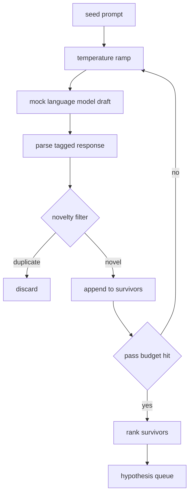

# परिकल्पना जनरेटर

> एक शोध एजेंट यदि एक ही प्रश्न दो बार पूछता है, तो वह एक बर्बाद टोकन में है।

**Type:** Build
**Languages:** Python
**Prerequisites:** Phase 19 Track A lessons 20-29
**Time:** ~90 分钟

## सीखने के लक्ष्य
- बीज शीघ्र 驱动样本,并将其输出 转成带类型的假设记录──
- प्रत्येक पास में नमूना तापमान में वृद्धि, अगले ड्राफ्ट एक से अधिक दूर स्थानांतरित करने के लिए।
- एक छोटे से एम्बेडिंग मॉडल और कॉसिन दूरी की सीमा के साथ 过近似重复项──
- प्रयोग मिश्रित नवीनता, विशिष्टता एवं परीक्षण क्षमता के स्कोरिंग फ़ंक्शन के लिए幸存项排列──
-  हर कदम को निश्चितता बनाए रखने, ताकि एक ही बीज  हमेशा एक ही कतार उत्पन्न करते हैं

## क्यों श्री成, फिर से पार

एक योजनाकार  एक मॉडल को बुलाता है एक बार, केवल एक परिकल्पना मिलती है। यह कामकाजी उदाहरण पर है, कोई समस्या नहीं है। लेकिन अनुसंधान लूप पर, आकार नहीं है। लूप को एक गहरी रैंक की कतार की आवश्यकता होती है, ताकि जब पहला परिकल्पना  विफल हो जाता है, तो धावक पुनः तैयार हो जाता है, और एक बार फिर से पूरी नमूना पास की लागत का भुगतान नहीं करना पड़ता है।

दो विचारों का संयोजन इस कतार को उत्पन्न करता है। पहला तापमान रैंपिंग हैः प्रत्येक बार नमूने के माध्यम से 时都把温度 提高一点,让后草更愿意游走―― दूसरा है नवाचार फ़िल्टरिंगः प्रत्येक मसौदा 之后, जनरेटर 测量它与每一个前幸存者的嵌入距离,并拒绝任何落在集群 内部内容――

इस कोर्स में एक नकली भाषा मॉडल प्रदान किया गया है, जो निश्चित प्रॉम्प्ट पर केंद्रित है, जो कि लिखित के टोकन अनुक्रम को वापस लाती है।

## परिकल्पना 形状

```text
Hypothesis
  id             : int           (monotonic within a run)
  text           : str           (the claim)
  variables      : list[str]     (what changes between conditions)
  metric         : str           (what the runner will measure)
  baseline_ref   : str | None    (which paper or run the comparison cites)
  draft_pass     : int           (which sampler pass produced this)
  temperature    : float         (the sampler setting at draft time)
  novelty_score  : float         (distance from prior survivors, 0..1)
  rank_score     : float         (weighted sum used for ordering)
```

`variables`和 `metric`️️️️️️️️️️️️️️️️️️️️️️️️️️️️️️️️️️️️️️️️️️️️️️️️️️️️️️️️️️️️️️️️️️️️️️️️️️️️️️️️️️️️️️️️️️️️️️️️️️️️️️️️️️️️️️️️️️️️️️️️️️️️️️️️️️️️️️️️️️️️️️️️️️️️️️️️️️️️️️️️️️️️️️️️️️️️️️️️️️️️️️️️️️️️️️️️️️️️️️️️️️️️️️️️️️️️️️️️️️️️️️️️️️️️️️️️️️️️️️️️️️️️️️️️️️️️️️️️️️️️️️️️️️️️️️️️️️️️️️️️️️️️️️️️️️️️️️️️️️️️️️️️️️️️️️️️️️️️️️️️️️️️️️️️️️️️️️️️️️️️️️️️️️️️️️️️️️️️️️️️️️️️️️️️️️️️️️️️️️️️️️️️️️️️️️️️️️️️️️️️️️️️️️️️️️️️️️️️️️️️️️️️️️️️️️️️️️️️️️️️️️️️️️️️️️️️️️️️️️️️️️️️️️️️️️️️️️️️️️️️️️️️️️️️️️️️️️️️️️️️️️️️️️️️

`baseline_ref`⇒503 कक्षा में मूल्यांकनकर्ता ⇒503 कक्षा में मूल्यांकनकर्ता ⇒503 कक्षा में मूल्यांकनकर्ता ⇒503 कक्षा में मूल्यांकनकर्ता ⇒503 कक्षा में मूल्यांकनकर्ता ⇒503 कक्षा में मूल्यांकनकर्ता ⇒503 कक्षा में मूल्यांकनकर्ता ⇒503 कक्षा में मूल्यांकनकर्ता ⇒503 कक्षा में मूल्यांकनकर्ता ⇒503 कक्षा में मूल्यांकनकर्ता ⇒503 कक्षा में मूल्यांकनकर्ता ⇒503 कक्षा में मूल्यांकनकर्ता ⇒503 कक्षा में मूल्यांकनकर्ता ⇒503 कक्षा में मूल्यांकनकर्ता ⇒503 कक्षा में मूल्यांकनकर्ता ⇒503 कक्षा में मूल्यांकनकर्ता ⇒503 कक्षा में मूल्यांकनकर्ता ⇒503 कक्षा में मूल्यांकनकर्ता ⇒503 कक्षा में मूल्यांकनकर्ता ⇒503 कक्षा में मूल्यांकनकर्ता ⇒503 कक्षा में मूल्यांकनकर्ता ⇒503 कक्षा में मूल्यांकनकर्ता ⇒503 कक्षा में मूल्यांकनकर्ता ⇒503 कक्षा में मूल्यांकनकर्ता ⇒503 कक्षा में पिछले बार रन पर वापस लौटेंगे ⇒503 कक्षा में मूल्यांकनकर्ता ⇒503 कक्षा में मूल्यांकनकर्ता ⇒503 कक्षा में मूल्यांकनकर्ता ⇒503 कक्षा में मूल्यांकनकर्ता ⇒503 कक्षा में मूल्यांकनकर्ता ⇒503 कक्षा में पुनरावलोकनकर्ता ⇒


```figure
cg-novelty-ramp
```

## 架构



यह लूप बहुत सीधा है। मतलब, प्रत्येक बॉक्स में सख्त अनुबंध है।

## तापमान रैंप

से `t_min`开始, तक `t_max`结束, कदम 为 `(t_max - t_min) / (n_passes - 1)` प्रत्येक पास  वर्तमान तापमान  समायोज्य नमूना, से `GeneratorConfig.schedule()` उत्पन्न `n_passes`个均间隔的值──मोक मॉडल 通过在一小组按 `(prompt, temp_bucket)`索引的脚本化反应 之间切换来遵守温度──桶是开区间,因此温度的小幅变化会选择不同桶,并产生不同草案──生产中,样本会是真实模型,并传入`temperature=t`

默认 अनुसूची `0.2`तक `1.2`六次足以填满队列,不必为新品过器 反正会拒绝的样本 付费――低于 `0.2`时,model 会复述种子──高于 `1.2`时,response 往往偏离主题并导致解析者 失败──

## नवजात फ़िल्टर

प्रत्येक ड्राफ्ट के बाद, जनरेटर टेक्स्ट एम्बेड करेगा, प्रत्येक स्वीकार्य परिकल्पना के साथ तुलना करेगा। एम्बेडिंग शब्द टोकन का एक छोटा हैश बैग है, जो इकाई लंबाई तक सामान्य हो जाएगा। दो इकाई वेक्टरों के बीच कॉसिन दूरी है।`1 - dot(a, b)` यदि किसी भी पूर्व जीवित व्यक्ति तक न्यूनतम दूरी अधिक है `novelty_threshold`, यह सिर्फ पारित किया गया है.`0.25`

हैश किए गए एम्बेडिंग नहीं उच्च है। यह निश्चितता की है।

## रैंक स्कोर

```text
rank_score = w_novelty * novelty_score
           + w_specificity * specificity_score
           + w_testability * testability_score
```

तीन उप स्कोर`novelty_score`️️️️️️️️️️️️️️️️️️️️️️️️️️️️️️️️️️️️️️️️️️️️️️️️️️️️️️️️️️️️️️️️️️️️️️️️️️️️️️️️️️️️️️️️️️️️️️️️️️️️️️️️️️️️️️️️️️️️️️️️️️️️️️️️️️️️️️️️️️️️️️️️️️️️️️️️️️️️️️️️️️️️️️️️️️️️️️️️️️️️️️️️️️️️️️️️️️️️️️️️️️️️️️️️️️️️️️️️️️️️️️️️️️️️️️️️️️️️️️️️️️️️️️️️️️️️️️️️️️️️️️️️️️️️️️️️️️️️️️️️️️️️️️️️️️️️️️️️️️️️️️️️️️️️️️️️️️️️️️️️️️️️️️️️️️️️️️️️️️️️️️️️️️️️️️️️️️️️️️️️️️️️️️️️️️️️️️️️️️️️️️️️️️️️️️️️️️️️️️️️️️️️️️️️️️️️️️️️️️️️️️️️️️️️️️️️️️️️️️️️️️️️️️️️️️️️️️️️️️️️️️️️️️️️️️️️️️️️️️️️️️️️️️️️️️️️️️️️️️️️️️️️️️️️`specificity_score`है परिकल्पना में विशिष्ट चर की संख्या को लक्ष्य संख्या से घटाकर`testability_score`时为一,只指定尺度 时为二分之一,否则为零──

默认权重是 `0.4``0.3``0.3`权重位于生成器配置中, इसलिए निम्नक्रम उन्हें समायोजित कर सकता है, बिना फोर्क कोड के

## नकली भाषा मॉडल

```python
class MockLLM:
    def sample(self, prompt: str, temperature: float, seed: int) -> str:
        ...
```

给定 `(prompt, temperature, seed)`तीन बार, नमूना निश्चित है.`(prompt_signature, temperature_bucket)`索引的脚本化响应表―― यदि तालिका 没有某个键的输入,样本会返回一个会让解析器 失败的倒退――其中一个测试会覆盖这个倒退路――

बीज प्रतिक्रिया में मिश्रण होगा, इसलिए एक साथ `(prompt, temperature)`एक जोड़ी 配上不同种子会产生不同草案──测试中我们固定种子,以保持结果可复现── वास्तविक तैनाती में, बीज 会来自系统时钟或计量──

## आउटपुट कतार

输出是按 `rank_score`降序排序 का `Hypothesis`रिकॉर्ड 列表──第五十二课中的跑者 弹出头,运行实验,第五十三课中的评价者 写回判决── यदि फैसला कहता है परिकल्पना 错了, धावक 就弹出下一个──

कतार सीमित है. जब यह खाली हो जाता है, तो ऑर्केस्ट्रेटर बीज की वृद्धि कर सकता है, फिर से चालू जनरेटर, या बजट समाप्त हो गया है।

## 如何阅读代码

`code/main.py` परिभाषा `Hypothesis``MockLLM``HypothesisGenerator`और एक निश्चितता डेमो-जनरेटर`run(seed_prompt)`विधि, वापसी排序后的排列;पास गिनती से `GeneratorConfig.n_passes`读取, बजाय तर्क के रूप में 传入──embedding हैश किए गए टोकन बैग है──नवियत फ़िल्टर एक एकल फ़ंक्शन है──रैंक स्कोर एक एकल फ़ंक्शन है──कुछ नहीं निर्भर करता है `numpy`गणित को सम्मिलित करना शुद्ध अभ्यास है, इसलिए यह पाठ्यक्रम पोर्टेबल रहता है।

`code/tests/test_generator.py`覆盖 रैखिक पथ、डप्लिकेट रिजेक्शन पथ、पारसर विफलता पथ、तापमान रैंप सीमा 和 रैंक क्रमण。

## यह कहाँ से आता है

第五十三课读取两者的成果并写出判决──四节课组合成一个没有人参与的研究循环;人可以在任何边界介入──
