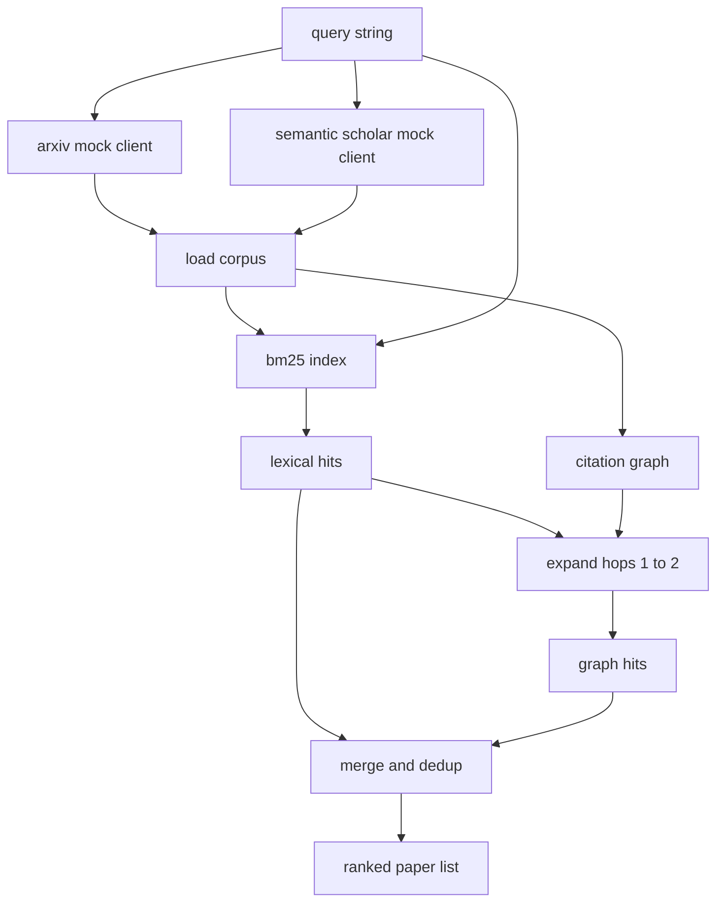

# 文献检索

> एक परिकल्पना  बहुत सस्ती  जानिए क्या किसी ने इसे साबित कर दिया है, तो महंगी बात है  निर्माण पुनः प्राप्ति परत, धावक  आरंभ सैंडबॉक्स  से पहले इस प्रश्न का उत्तर दें 

**Type:** Build
**Languages:** Python
**Prerequisites:** Phase 19 Track A lessons 20-29
**Time:** ~90 分钟

## सीखने के लक्ष्य
- प्रयोग लूप नीचे游会读取的字段, एक छोटे से कागज रिकॉर्ड के लिए 建模──
- केवल स्ट्डलिब डेटा संरचना का उपयोग करके, सारांशों में ऊपर निर्मित BM25 सूचकांक
- 遍历引用图,浮现词典搜索 遗漏的论文──
- 通过稳定的 पेपर आईडी,对词典和图 两轮命中结果去重──
- दो नकली बाहरी एपीआई को एक ग्राहक के पीछे पैक करना, ताकि वास्तविक अंत बिंदुओं को जोड़ने के दौरान, अपलोड कॉल साइट 保持不变──

## क्यों दो दौर की वसूली की जरूरत है

सारों के लिए कीवर्ड खोज करना, क्वेरी के साथ लौट आएगा, साझा शब्दकोश के पेपरों में योगदान करेगा। यह अधिकांश स्तर की स्थिति को कवर करेगा। लेकिन यह दो प्रकार की स्थिति को याद करेगा। पहला प्रकार अलग-अलग शब्दों का उपयोग करके आधारभूत पेपर है; उदाहरण के लिए, क्वेरी "छोटे ध्यान" एक लेख को याद करेगा जिसका शीर्षक है "ट्रांसफॉर्मर रूटिंग में ब्लॉक चयन"। दूसरा प्रकार संबंधित पेपर किसी ज्ञात एंकर के बाद के काम का हवाला देता है; एंकर को पुनः प्राप्त करना, क्रूर बल पूल की तुलना में पुनः प्राप्त करना।

本课会构建这两轮──摘要上的BM25 捕获词汇 hits──引用图 traversal 从种子集合 出发,向前和向后扩展一到两跳──二者的并集按纸 id 去重,并用一个小型组合分数排序──

## कागज 形状

```text
Paper
  id          : str           (稳定 identifier，mock corpus 中为 "p001")
  title       : str
  abstract    : str
  year        : int
  authors     : list[str]
  references  : list[str]     (这篇 paper 引用的 paper ids)
  citations   : list[str]     (引用这篇 paper 的 paper ids)
  source      : str           (提供它的 mock api，"arxiv" 或 "s2")
```

संदर्भ और उद्धरण 字段 गठन 字段 गठन 字段 गठन 字段 निर्माण 字段 निर्माण 字段 निर्माण 字段 निर्माण 字段 निर्माण 字段 निर्माण 字段 निर्माण 字段 निर्माण 字段 निर्माण 字段 निर्माण 字段 निर्माण 字段 निर्माण 字段 निर्माण 字段 निर्माण 字段 निर्माण 字段 निर्माण 字段 निर्माण 字段 निर्माण 字段 निर्माण 字段 निर्माण 字段 निर्माण 字段 निर्माण 字段 निर्माण 字段 निर्माण 字段 निर्माण 字段 निर्माण 字段 निर्माण 字段 निर्माण 字段 निर्माण 字段 निर्माण 字段 निर्माण 字段 निर्माण 字段 निर्माण 字段 निर्माण 字段 निर्माण 字段 निर्माण 字段 निर्माण 字段 निर्माण 字段 निर्माण 字段 निर्माण 字段 निर्माण 字段 निर्माण 字段 निर्माण 字段 निर्माण 字段 निर्माण 字段 字段 निर्माण 字段 字段 字段 字段 字段 字段 字段 字段 字段 字段 字段 字段 字段 字段 字段 字段 字段 字段 字段 字段 字段 字段 字段 字段 字段 字段 字段 字段 字段 字段 字段 字段 字段 字段 字段 字 字 字 字 字 字 字 字 字 字 字 字 字 字 字 字 字 字 字 字 字 字 字    字    字 字     字                                                                                                                                          `id`इनका एक साथ लेना।


```figure
cg-citation-hops
```

## वास्तुकला



रिट्रीवल क्लाइंट 拥有这两轮和 merge──caller 传入一个查询,并拿回一个排名列表; उनमें से प्रत्येक条目都携带每纸分数 字段(`bm25_score``graph_distance``recency_score``final_score`), व्याख्या करने के लिए प्रयोग किया जाता है।

## शून्य से प्राप्त BM25

实现使用标准 Okapi BM25,默认参数为 `k1=1.5``b=0.75`index  दो शब्दकोश हैंः`term -> doc_frequency`和 `term -> list of (doc_id, term_count)`◊ दस्तावेज़ लंबाई ◊ अमूर्त का टोकन संख्या ◊ औसत दस्तावेज़ लंबाई ◊ सूचकांक  निर्माण  गणना एक बार ◊ क्वेरी 打分时,会对 क्वेरी शर्त 求和:`idf * tf_norm`, उनमें से `tf_norm`️️️️️️️️️️️️️️️️️️️️️️️️️️️️️️️️️️️️️️️️️️️️️️️️️️️️️️️️️️️️️️️️️️️️️️️️️️️️️️️️️️️️️️️️️️️️️️️️️️️️️️️️️️️️️️️️️️️️️️️️️️️️️️️️️️️️️️️️️️️️️️️️️️️️️️️️️️️️️️️️️️️️️️️️️️️️️️️️️️️️️️️️️️️️️️️️️️️️️️️️️️️️️️️️️️️️️️️️️️️️️️️️️️️️️️️️️️️️️️️️️️️️️️️️️️️️️️️️️️️️️️️️️️️️️️️️️️️️️️️️️️️️️️️️️️️️️️️️️️️️️️️️️️️️️️️️️️️️️️️️️️️️️️️️️️️️️️️️️️️️️️️️️️️️️️️️️️️️️️️️️️️️️️️️️️️️️️️️️️️️️️️️️️️️️️️️️️️️️️️️️️️️️️️️️️️️️️️️️️️️️️️️️️️️️️️️️️️️️️️️️️️️️️️️️️️️️️️️️️️️️️️️️️️️️️️️️️️️️️️️️️️️️️️️️️️️️️️️️️️️️️️️️️️️

टोकनiser पहले है`lower`, पुनः अनक्षर संख्यात्मक अक्षर विभाजित── यह कोई मतभेद नहीं करती── उत्पादन प्रणाली एक छोटे से मतदाता में बदल जाएगी── संपर्क बरकरार रहेगा──

```math
\begin{aligned}
\text{idf}(t) &= \log\!\left(\frac{N - \text{df} + 0.5}{\text{df} + 0.5} + 1.0\right) \\
\text{tf\_norm}(t) &= \frac{f \cdot (k_1 + 1)}{f + k_1 \cdot \left(1 - b + b \cdot \text{dl} / \text{avgdl}\right)} \\
\text{score}(d, q) &= \sum_{t \in q} \text{idf}(t) \cdot \text{tf\_norm}(t)
\end{aligned}
```

## उद्धरण ग्राफ पार करना

ग्राफ 会从 corpus 构建一次──前边 从一篇论文指向它的引用──后边 从一篇论文指向它的引用──横向是宽度第一搜索,以顶部BM25 hits为种子,最多两跳──

两跳是刻意设置的上限──一跳太浅;代理 常常需要直接祖先或后代──三跳会让连接图上的结果规模膨胀,并且易偏离主题──本课把跳限 暴露为一个配置键,这样下游循环可以收紧它──

## डिडूप और रैंकिंग

两轮会返回重叠集合―― merge 作为关键的纸 id 作为关键的纸 id 两轮会返回重叠集合―― merge 两轮会重回重叠集合―― merge 两轮会重叠集合―― merge 两轮会重回重叠集合―― merge 两轮会重叠集合―― merge 两轮会重叠集合―― merge 两轮会重叠集合―― merge 两轮会重叠集合―― merge 两轮会重叠集合―― 两轮会重叠集合―― 两轮会重叠集合―― 两轮会重叠集合―― 两轮会重叠集合―― 两轮会重叠集合―― 两轮会重叠集合―― 两轮会重叠集合―― 两轮会重叠组组组合 两轮组组合 两轮组组合 两轮组组合 两轮组组合 两轮组组合 两轮组合 两轮会重叠组合 两轮组合 两轮组合 两轮组合 两轮组合 两轮组合 两轮组合 两轮组合 两轮组合 两轮组合 两轮组合 两轮组合 两轮组合 两轮组合 两组合 两组合 两组合 两组合 两组合 两组合 两组合 两组合 组合 两组合 组合 两组合 两组合 组合 两组合 组合 两组合 两组合 组合 两组合 组合 两组 组 组合 两组合 组 组 组 组 组合 组 组 组 组合 组 组 组 组 组 组 组 组 组 组 组 组 组 组 组 组 组 组 组 组 组 组 组 组 组 组 组 组 组 组 组 组 组 组 组 组 组 组 组 组 组 组 组 组 组 组 组 组 组 组 组 组 组 组 组 组 组 

```text
final_score = w_bm25 * bm25_score_norm
            + w_graph * graph_score
            + w_recency * recency_score
```

`bm25_score_norm`यह BM25 स्कोर है जो मिश्रित सेट के बीच के सबसे बड़े BM25 स्कोर को छोड़कर है।`graph_score`सीधे शब्दकोश हिट के लिए`0.6`, दो跳为 `0.3`,否则为零──`recency_score`                                                                                                                                                                                                                                                              

默认 वजन है `0.5``0.3``0.2`◊ वजन एक कॉन्फ़िग है; पुराना विषय शायद हालियापन को कम करेगा, जबकि तेजी से बदलता विषय इसे बढ़ाएगा

## नकली शरीर

कॉर्पस में 100 पेपर हैं,`build_corpus()`生成── प्रत्येक पेपर में एक हाथ से लिखा गया शीर्षक एवं सार होता है, विषय पांच प्रकार से आते हैंः ध्यान की कमी, पुनर्प्राप्ति वृद्धि, निम्न श्रेणी के एडाप्टर, डेटासेट डिस्टिलैशन और मूल्यांकन के उपयोगिताएँ── संदर्भ और उद्धरण 已连线, प्रत्येक विषय को एक जुड़े उप-ग्राफ के रूप में बनाने दें,并带有少量跨主题边缘──

दो नकली एपीआई क्लाइंट्स(`ArxivMockClient``SemanticScholarMockClient`)读取同一个体,但暴露不同字段──Arxiv 返回标题、抽象、年、作者──Semantic Scholar 增加引用和引用──检索客户端 按 id 取并集;跨客户领域分歧处理 留到后续课程──

## पाठ 52 और 53 बैठक पढ़ते हैं

पाठ 52 मध्य धावक 会读取 `paper.id``paper.title`, तथा सार के पहले तीन वाक्य, प्रयोग के संदर्भ में। पाठ 53 मध्य मूल्यांकनकर्ता 会读取`paper.year`和 `paper.references`, आधार रेखा 归因某篇具体论文──

पुनर्प्राप्ति क्लाइंट  वापसी एक `RetrievalResult`, जिसमें एक साथ रैंक सूची और प्रति क्वेरी मीट्रिक शामिल हैंः हिट गिनती, औसत स्कोर, शीर्ष स्कोर, कुल दीवार समय, रनर इन सामग्री को रिकॉर्ड करेगा, ताकि नीचे की ओर देखने योग्य पास समय के साथ परिवर्तन की गुणवत्ता को चित्रित कर सके।

## 如何阅读代码

`code/main.py` परिभाषित किया `Paper``ArxivMockClient``SemanticScholarMockClient``BM25Index``CitationGraph``RetrievalClient`एक ही फाइल में रखा गया है, इस प्रकार एक वर्ग, छत्तीसगढ़, ग्राफ क्रॉसिंग एक विधि है।

`code/tests/test_retrieval.py`覆盖词典路径、图形路径、 merge、dedup 和 रिक्त क्वेरी──

## यह किस स्थान पर रखा गया है

पाठ पचास  उत्पन्न एक परिकल्पना  पाठ पचास एक  खोज साहित्य, निर्णय इस परिकल्पना है या नहीं है निश्चित निष्कर्ष  यदि नहीं, पाठ पचास दो 运行 प्रयोग  पाठ पचास तीन 读取检索结果 和实验指标,写出判决──检索客户是四个阶段中便宜的之一,并且会在乐团员中首先运行──
