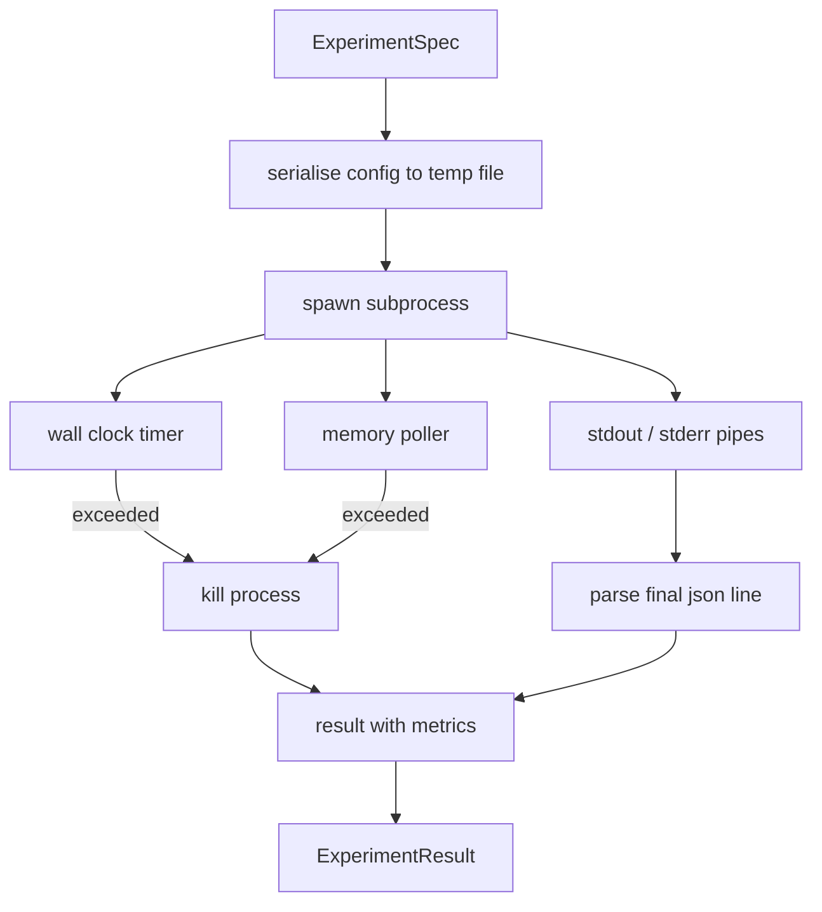

# प्रयोग धावक

> लूप की ईमानदारी की डिग्री इसके मापों पर निर्भर करती है।

**Type:** Build
**Languages:** Python
**Prerequisites:** Phase 19 Track A lessons 20-29
**Time:** ~90 分钟

## सीखने के लक्ष्य
- प्रयोग को एक टाइप किए गए विनिर्देश के लिए कोड करेगा, रनर इसे उपप्रक्रिया को क्रमबद्ध कर सकता है।
-  एक हार्ड वॉल क्लॉक टाइमआउट और सॉफ्ट मेमोरी कैप के उपप्रक्रिया को प्रारंभ करें,并将二者都暴露于终端条件――
-                                                                                                                                                                                                                                                               
- 构建ablation तालिका,在固定 आधार स्पेक्ट 上一次扫一个配置按──
-  जब                                                                                                                                                                                                                                                              

## उपप्रक्रिया का उपयोग क्यों करें

अनुसंधान लूप 会运行 अविश्वसनीय कोड──अनुमान से नमूना, प्रयोग स्क्रिप्ट भी एक ही मार्ग से आते हैं;  में से किसी एक को सुरक्षित रूप से प्रक्रिया में कोड, सभी एक बार में एक बैठक खींचने के लिए प्रतीक्षा कर रहे हैं  ऑर्केस्ट्रेटर के दुर्घटना── उपप्रक्रियाएँ भाषा के सबसे सरल अलगाव हैंः एक स्वतंत्र प्रक्रिया、 एक स्वतंत्र पता स्थान, तथा माता-पिता के पक्ष के संकेत हैंडल──

यहाँ धावक  पूर्ण सैंडबॉक्सिंग को पूरा नहीं करता है ∙ कोई cgroup, कोई seccomp filter, न ही नामस्थान रीमैपिंग ∙ इसमें वॉल क्लॉक टाइमआउट ∙ स्मृति वृद्धि की जांच करने के लिए मतदान लूप, साथ ही साथ एक रेंज सीमा में समाप्ति प्रक्रिया का मार पथ ∙ यह सभी अधिक जटिल सैंडबॉक्स शहर विस्तार के रनटाइम अनुबंध ∙ 本课把 अनुबंध 保持到足够小,可以一次读完──

## प्रयोगविशेषण 形状

```text
ExperimentSpec
  spec_id        : str            (stable id，"exp_001")
  hypothesis_id  : int            (链接回 lesson 50 中的 queue)
  script_path    : str            (要运行的 python script 路径)
  config         : dict           (作为一个 json arg 传给 script)
  seed           : int            (experiment 的 deterministic seed)
  wall_timeout_s : float          (hard timeout，超出则 kill)
  memory_cap_mb  : int            (soft cap，轮询；超出则 kill)
  metric_keys    : list[str]      (evaluator 会读取的字段)
```

स्क्रिप्ट डिस्क पर मौजूद है;runner 会把 कॉन्फ़िगर 写入一个临时文件路径,script 再读取它──script 应该在 stdout 上打印单个 json line,其键是 `metric_keys`उपसमूहों के उपसमूहों को उपसमूहों के उपसमूहों के उपसमूहों के उपसमूहों को उपसमूहों के उपसमूहों के उपसमूहों के उपसमूहों के उपसमूहों के उपसमूहों को उपसमूहों के उपसमूहों द्वारा उपसमूहों के उपसमूहों के उपसमूहों के उपसमूहों के उपसमूहों के उपसमूहों को उपसमूहों के उपसमूहों के उपसमूहों के उपसमूहों के उपसमूहों के उपसमूहों के उपसमूहों के उपसमूहों के उपसमूहों के उपसमूहों के उपसमूहों के उपसमूहों के उपसमूहों के उपसमूहों के उपसमूहों के उपसमूहों के उपसमूहों के उपसमूहों के उपसमूहों के उपसमूहों के उपसमूहों के उपसमूहों के उपसमूहों के उपसमूहों के उपसमूहों के उपसमूहों के उपसमूहों के रूप में शामिल किया जाता है।


```figure
cg-runner-limits
```

## वास्तुकला



धावक एक वर्ग है, एक मुख्य विधि के साथ। पोलर एक छोटा सा धागा है, प्रत्येक अलग मतदान अंतराल  उठो एक बार, और जब संभव हो तो proc फ़ाइल सिस्टम 读取 उपप्रक्रिया के `psutil`समकक्ष; जब मंच इसे उजागर नहीं करता है, तो इसे बिना किसी विकल्प के वापस किया जाता है।

## क्यों नरम स्मृति कैप

हार्ड मेमोरी कैप 需要 `resource.setrlimit`, और केवल POSIX पर काम करते हैं। यह कक्षा एक पोर्टेबल दृष्टिकोण प्रदान करती हैः प्लेटफॉर्म पर राउंडर रिज़िडेंट सेट आकार से, यदि कैप से अधिक हो तो उपप्रक्रिया को मार डालना। कैप नरम है, क्योंकि पोलर के पास शून्य अंतराल नहीं है; प्रक्रिया हो सकती है दो राउंडर के बीच स्पाइक से ऊपर तक कैप, फिर वापस आ जाती है। रनेर रैकर्ड अधिकतम आरएसएस का अवलोकन करता है, इस तरह मूल्यांकनकर्ता इस रन को देख सकता है 离 सीमा के अधिक निकट है।

बिना प्रक्रिया निरीक्षण सहायता के सिस्टम पर, पोलर एक बार चेतावनी रिकॉर्ड करेगा और इसे स्वयं बंद कर देगा।

## 捕获 stdout 和 stderr

धावक 会在完成时读取并排空两条管──Stdout 会逐行扫描; अंतिम एक को सक्षम बनाने के लिए और आवश्यक सभी को शामिल करने के लिए`metric_keys`के रेखा 会被视为指标blob──更早的 json रेखा 会保留在结果中作为 `intermediate_metrics`; मूल्यांकनकर्ता इनका उपयोग सीखने की वक्र रेखांकित कर सकता है।

Stderr 会原样捕获到结果中──runner 永远不会因为非零出口代码而上升; यह कोड 记录在结果中──任何非零出口都标记为`"crash"`, यहां तक कि स्क्रिप्ट प्रिंट मेट्रिक्स, इसलिए मूल्यांकनकर्ता 默认会把部分 रन当作失败.

## क्षरण तालिका

```python
def ablate(base: ExperimentSpec, knob: str, values: list[Any]) -> list[ExperimentSpec]:
    ...
```

给定基标和按名称,该辅助会返回每个值对应的一个标,并覆盖 `config[knob]` प्रत्येक व्यक्ति को एक जीवन प्राप्त होगा `spec_id`(`f"{base.spec_id}_{knob}_{value}"`)― धावक 提供一个 `AblationRunner`, क्रम में इन विनिर्देशों को चलाने के लिए, और वापस एक के रूप में कुंजी के रूप में बटन मूल्य के रूप में `AblationTable`

क्यों एक बार केवल एक बटन को बदलना है। पूर्ण कारणांक स्वीप करता है।

## निर्धार

प्रत्येक स्पेसिफिकेशन एक बीज ले जाता है. रनिंगर कॉन्फ़िग डिटेक्ट के माध्यम से बीज को ट्रांसफर करेगा।`config["__seed"] = spec.seed`)。`code/experiments/`中中中中中中中中中中中中中中中中中中中中中中中中中中中中中中中中中中中中中中中中中中中中中中中中中中中中中中中中中中中中中中中中中中中中中中中中中中中中中中中中中中中中中中中中中中中中中中中中中中中中中中中中中中中中中中中中中中中中中中中中中中中中中中中中中中中中中中中中中中中中中中中中中中中中中中中中中中中中中中中中中中中中中中中中中中中中中中中中中中中中中中中中中中中中中中中中中中中中中中中中中中中中中中中中中中中中中中中中中中中中中中中中中中中中中中中中中中中中中中中中中中中中中中中中中中中中中中中中中中中中中中中中中中中中中中中中中中中中中中中中中中中中中中中中中中中中中中中中中中中中中中中中中中中中中中中中中中中中中中中中中中中中中中中中中中中中中中中中中中中中中中中中中中中中中中中中中中中中中中中中中中中中中中中中中中中中中中中中中中中中中中中中中中中中中中中中中中中中中中中中中中中中中中中中中中中中中中中中中中中中中中中中中中中中中中中中中中中中中中中中中中中中中中中中中中中中中中中中中中中中中中中中中中中中中中中中中中中中中中中中中中中中中中中中中中中中中中中中中中中中中中中中中中中中中中

## नकली प्रयोग स्क्रिप्ट

本课提供一个实验脚本:`code/experiments/sparsity_experiment.py`यह एक वास्तविक स्क्रिप्ट है, अपनी कॉन्फ़िग फ़ाइल पढ़ लेगी, नंबरी रैंडम पास का उपयोग करके 模拟一个小型训练运行,并印一个 json मेट्रिक्स ब्लब──script 支持 `sleep_s`परीक्षण समय आउट के लिए बटन, भी समर्थन `allocate_mb`बटन प्रयोग करने के लिए मेमोरी पोलर

सिमुलेशन ने वास्तव में कुछ भी प्रशिक्षित नहीं किया है। यह एक संख्यात्मक गणना है, प्रशिक्षण लूप के आकार की तरह हैः हानि वक्र, अंतिम भ्रम, दीवार समय।

## परिणाम 形状

```text
ExperimentResult
  spec_id              : str
  hypothesis_id        : int
  exit_code            : int
  terminal             : "ok" | "timeout" | "oom" | "crash"
  wall_time_s          : float
  peak_rss_mb          : float | None
  metrics              : dict
  intermediate_metrics : list[dict]
  stdout_tail          : str
  stderr_tail          : str
```

मूल्यांकनकर्ता 会先读取 `metrics`和 `terminal` यदि टर्मिनल `"ok"`, प्रयोग लेखांकन विफल रन के लिए, मूल्यांकनकर्ता का फैसला स्वचालित रूप से उत्पन्न होगा.

## 如何阅读代码

`code/main.py` परिभाषित किया `ExperimentSpec``ExperimentResult``ExperimentRunner``AblationRunner`和一个确定性化演示――子进程管理 是一个类――记忆调试器 是一个小线――消灭辅助器 是一个单独的函数――

`code/experiments/sparsity_experiment.py`यह एक ही json मेट्रिक्स लाइन में लिखते समय argv से कॉन्फ़िग फ़ाइल पथ को पढ़ता है।

`code/tests/test_runner.py`覆盖 सफलता पथ, टाइमआउट पथ, क्रैश पथ, अपघटन तालिका, तथा跨两次运行的确定性检查──

## यह किस स्थान पर रखा गया है

पाठ पचास 生成假设── पाठ पचास एक 过掉文献 已解决的内容── पाठ पचास दो 针对剩余部分运行实验── पाठ पचास तीन 读取结果,运行意义测试,并写出管弦乐器 存储到假设 id 上的判决──
