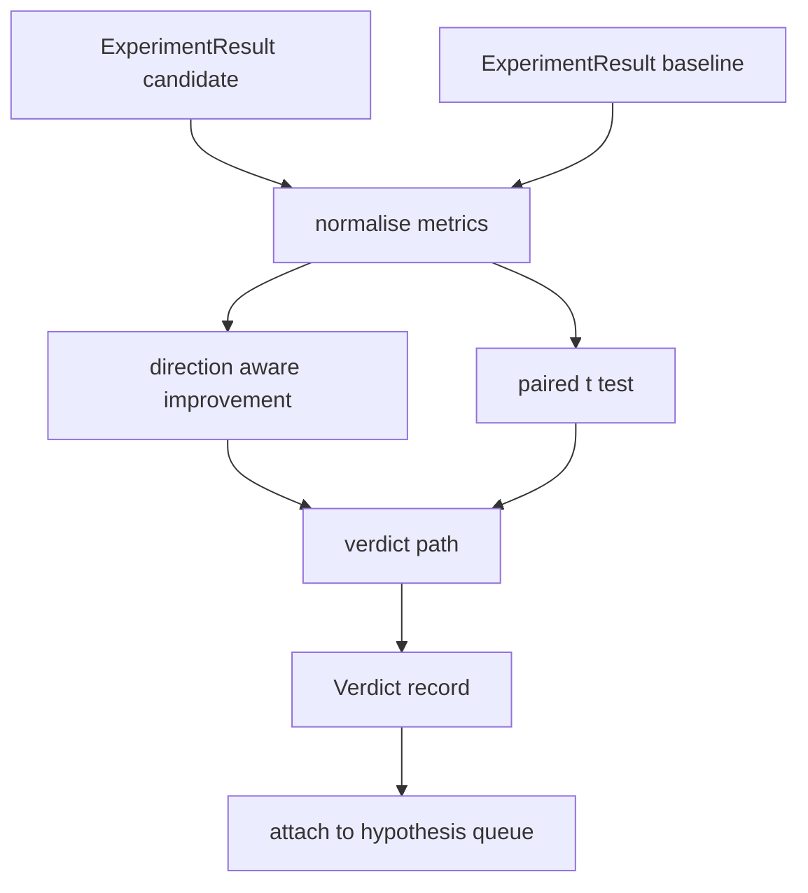

# 结果评估器

> धावक 产出数字──评价者 判断这些数字代表改进,退缩,还是噪音──构建一条判决 路径,把衡量指标 转换成一句结论──

**Type:** Build
**Languages:** Python
**Prerequisites:** Phase 19 Track A lessons 20-29
**Time:** ~90 minutes

## सीखने के लक्ष्य
- उपयोगिता दिशा में सुधार तथा निश्चित सीमा, उम्मीदवार की शुरुआत के साथ तुलना करें
- प्रत्येक बीज के मेट्रिक्स से ऊपर चलकर जोड़ी t परीक्षण,并读取得到的p值──
- लॉग स्केल मेट्रिक्स के लिए सामान्यीकरण करें, उन्हें रैखिक मेट्रिक्स के साथ मिलाएं।
- 输出每一个假设的判决,让乐队长可以将其添加到第五十课的队列中.
-  हर कदम को शुद्ध बनाए रखें, ताकि एक ही प्रविष्टि हमेशा एक ही निर्णय उत्पन्न करे

## क्यों एक जोड़ी परीक्षण

धावक  दिए गए एकल अंक यह नहीं बता सकते कि परिवर्तन वास्तविक है या नहीं। एक ही कॉन्फ़िगरेशन में एक बीज के लिए एक ही परिवर्तन भिन्नता प्राप्त होगी। परिवर्तन केवल शोर हो सकता है। सही तुलना विधि जोड़ी हैः एक ही बीज, एक ही डेटा, एक बार उम्मीदवार के साथ, एक बार मूल रेखा के साथ 运行। प्रत्येक बीज  योगदान एक अंतर मूल्य। इन अंतर मूल्य का अर्थ है प्रभाव। इन अंतर मूल्य के मानक त्रुटि है शोर तल।

इस वर्ग में परीक्षा से प्राप्ति नहीं हुई।`scipy.stats` गणित पर्याप्त छोटा है, एक स्क्रीन पर पढ़ सकूँ

```text
diffs    = [a_i - b_i for i in seeds]
mean     = sum(diffs) / n
variance = sum((d - mean) ** 2 for d in diffs) / (n - 1)
t_stat   = mean / sqrt(variance / n)
df       = n - 1
p_value  = two_sided_p(t_stat, df)
```

दो पक्षीय p मान प्रयोग नियमित अधूरा बीटा फ़ंक्शन。本课附带一个小实现, Lentz निरंतर अंश प्रयोग── संपूर्ण实现只是六十行 stdlib गणित──

## दिशा जागरूक सुधार

कुछ मेट्रिक्स 变大时表示改进(精度、roughput) 其他变小时表示改进(loss、perplexity、wall time)  मूल्यांकनकर्ता प्रत्येक मेट्रिक में एक ले लो `direction`字段──

```text
if direction == "higher_is_better":
    improvement = (candidate - baseline) / abs(baseline)
elif direction == "lower_is_better":
    improvement = (baseline - candidate) / abs(baseline)
```

सुधार है 符号的── उच्च के लिए बेहतर मीट्रिक है, नकारात्मक के सुधार का प्रदर्शन उम्मीदवार 更差──verdict 路径会同时读取符号和幅度──

एक निश्चित सीमा`improvement_threshold=0.02`, %s के 2) निर्णय लेते हैं कि परिवर्तन पर्याप्त रूप से बड़ा है या नहीं, यह निर्णय दिया जा सकता है।


```figure
cg-paired-verdict
```

## वास्तुकला



मूल्यांकनकर्ता 运行三个独立计算, और फैसले 路径中把它们合并──每计算都是没有共享状态的纯函数──

## लॉग सामान्यीकरण

हानि के प्रति भ्रम सूचकांक संबंध है। हानि घटकर 0.1 होगी। भ्रम में बहुत अधिक कमी आएगी। सीधे दो विन्यासों के बीच तुलना में भ्रम में कोई समस्या नहीं है, लेकिन यदि इसे एक ही रिपोर्ट में रैखिक माप के साथ मिलाया जाए तो इसे सामान्यीकरण की आवश्यकता होगी।

इस वर्ग से`scale`字段为 `"log"`के किसी भी मीट्रिक में सुधार गणना में पूर्व प्राप्त प्राकृतिक लॉग―तारे 随后会在 लॉग स्पेस में应用―विभ्रम 32 降至28 低于是更好的 मीट्रिक 上是`log(28) - log(32) = -0.133`, शत प्रतिशत के पार की सीमा से अधिक है।

```text
if scale == "log":
    a = log(candidate)
    b = log(baseline)
else:
    a = candidate
    b = baseline
```

`scale="linear"`(默认) के मापकों को इस परिवर्तन से गुजरना होगा.

## प्रति बीज जोड़ी परीक्षण

第五十二课的跑者会为每次跑 输出一个最终的测量分点――对对测试,评估员 需要候选人 每种子 一种子 一种子 基础线 每种子 一种子 一个块――乐团员会在一组种子 上面使用两个配置运行相同的实验,然后把两组`ExperimentResult`रिकॉर्ड 交给评价者──

मूल्यांकनकर्ता 按种子 配对(种子 位于 `result.metrics["seed"]`), फिर अनुरोध के माप को पार करें. यदि दो समूहों की सूची में बीज असंगत हैं, तो मूल्यांकनकर्ता बाहर निकल जाएगा.`PairingError`◊ आर्केस्ट्रेटर 应重新运行──

## फैसले का आकार

```text
Verdict
  hypothesis_id          : int
  metric                 : str
  direction              : "higher_is_better" | "lower_is_better"
  scale                  : "linear" | "log"
  candidate_mean         : float
  baseline_mean          : float
  improvement            : float       (signed, fraction; see direction rules)
  p_value                : float | None  (None if n < 2)
  significance_threshold : float
  improvement_threshold  : float
  verdict                : "improved" | "regressed" | "noise" | "failed"
  rationale              : str
```

निर्णय 路径 एक张小 निर्णय तालिका हैः

```text
1. If any candidate result has terminal != "ok": verdict = "failed"
2. else if |improvement| < improvement_threshold:  verdict = "noise"
3. else if p_value is None or p_value > significance: verdict = "noise"
4. else if improvement > 0:                          verdict = "improved"
5. else:                                             verdict = "regressed"
```

तर्क एक मानव पठनीय वाक्य है, ऑर्केस्ट्रेटर इसे मान्यता के अनुसार लिख सकता है।

## कोड कैसे पढ़ें

`code/main.py` परिभाषित किया `MetricSpec``Verdict``Evaluator`、t सांख्यिकीय 和 अधूरा बीटा सहायक, साथ ही एक निर्धारात्मक डेमो-टस्ट प्रयोग शुद्ध stdlib गणित 实现;numpy केवल उपयोग के लिए मेट्रिक्स सूची पढ़ने के लिए और गणना का अर्थ 和 भिन्नताएँ

`code/tests/test_evaluator.py`覆盖 सुधारित 路径、पश्चाताप 路径、噪音 路径(छोटा सुधार)、噪音 路径(低 n)、 विफल टर्मिनल 路径、लॉग सामान्यीकृत 路径、 ज्ञात संदर्भ मूल्य के साथ तुलनात्मक t परीक्षण, साथ ही जोड़ी त्रुटि──

## जहां यह स्लॉट में

第五十二课在多种种子上用候选人和基线配置运行实验中. 第五十三课读取这些运行并写出判决.

```text
for hypothesis in queue:
    literature = retrieval.search(hypothesis.text)
    if literature_settles(hypothesis, literature):
        attach(hypothesis, verdict="settled")
        continue
    candidates = runner.run_all(specs_for(hypothesis))
    baselines  = runner.run_all(baseline_specs_for(hypothesis))
    metric_spec = MetricSpec("perplexity", direction=LOWER, scale=LOG)
    verdict = evaluator.evaluate(hypothesis.id, metric_spec, candidates, baselines)
    attach(hypothesis, verdict)
```

यह कक्षाएँ अपने-अपने परिभाषित डेटा कक्षाओं के माध्यम से एकत्रित होती हैं, और किसी अतिरिक्त चिपकने की आवश्यकता नहीं होती है।
