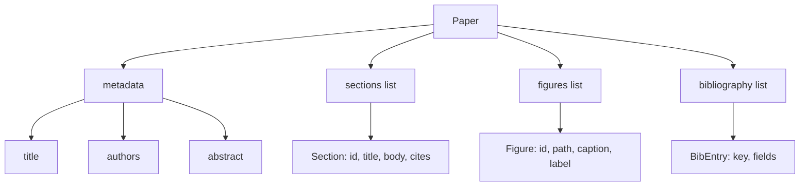
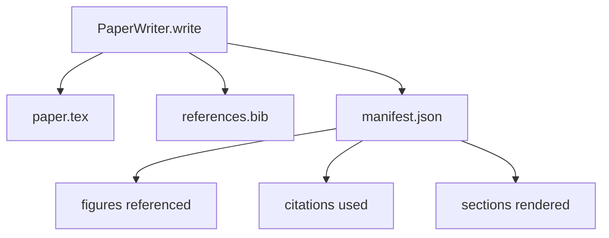

# 论文写作器

> LaTeX कंकाल एक शोधकर्ता और टाइपसेटर के बीच एक अनुबंध है। यदि अनुबंध टूट जाता है, तो दस्तावेज़ को संकलित नहीं किया जा सकता है, और विफलता बहुत स्पष्ट होगी।

**Type:** Build
**Languages:** Python
**Prerequisites:** Phase 19 lessons 50-53
**Time:** ~90 minutes

## सीखने के लक्ष्य

- एक मुक्त रूप के दस्तावेज़ के बजाय एक ज्ञात अनुभाग ग्राफ के साथ एक संरचित कलाकृतियों के रूप में एक शोध पत्र को देखना चाहिए।
- किसी भी गद्य लिखने से पहले, एक घोषणा को उत्पन्न करें अमूर्त, अनुभाग, आकृति स्लॉट और साहित्य की कुंजी के लैटेक्स कंकाल।
- दिमानतावादी स्लॉट तंत्र के माध्यम से, प्रयोग के आउटपुटों में (पथों और कैप्शन) के आंकड़े को जोड़ दिया जाएगा
-  एक मजाकिया गद्य जनरेटर में संलग्न, यह संरचित रूप से रेखाचित्र से  प्रत्येक अनुभाग भरने, हर्नस अनुमति देता है बिना मॉडल के मामले में परीक्षण किया जा सकता है
- 输出单个 `paper.tex`、 एक `references.bib`, पुनः एक सूची प्रत्येक संदर्भित आंकड़ा और प्रत्येक उपयोग उद्धरण के मैनिफेस्ट को जोड़ें


```figure
ch-paper-skeleton
```

## पहले एक कंकाल क्यों

प्रसंस्करण से शुरू होने वाले मसौदे में संरचनात्मक ऋण जमा किया गया है। परिचय में यह उल्लेख किया गया है कि लेखन की लागत लेखन की लागत से अधिक है।

कंकाल 会反转这一点──结构 先以数据 形式声明── धाराएँ 是带名和序的槽──数字是带 ids 和字幕的槽──图书馆钥匙 在顶部声明,并带有它们指向的条目──文章 会一次一个槽 地生成进去──harness 可以在写任何散文 之前验证:每个数字都有槽,每个引用都有条目,每个节都出现在内容表中──

यह पूर्ववर्ती पाठ्यक्रम के साथ योजनाओं, उपकरण कॉल और निशानों पर लागू होता है।

## कागज का आकार



प्रत्येक क्षेत्र सामान्य पायथन डेटा है।`Paper`तक लेटेक्स स्ट्रिंग का शुद्ध कार्य---harness पहले अंतर्दृष्टि पेपर में प्रस्तुत किया जा सकता हैः सांख्यिकीय अनुभागों, सूची गायब आंकड़े फ़ाइलें, जांच प्रत्येक `\cite{key}`सभी के साथ मेल खाते हैं`BibEntry`

## रिटर्न अनुबंध

रेंडरर तीन गुणों को सुनिश्चित करता है. पहला, कंकाल के बीच के प्रत्येक आंकड़े स्लॉट एक आउटपुट हैं.`\begin{figure}`ब्लॉक,并带有稳定标签,格式为 `fig:<id>` दूसरा, प्रत्येक खंड  एक `\section{}`,并带有稳定标签,格式为 `sec:<id>`, इस तरह क्रॉस-रिफरेंस काम कर सकते हैं.`\bibliography`ब्लॉक,其 `references.bib`精确包含纸上声明的条目,不多也不少──

 किसी भी एक अनुच्छेद के विपरीत, यह चेतावनी नहीं है, बल्कि त्रुटि है 

## प्रयोगों से आंकड़ा इंजेक्शन

इस ट्रैक के पहले भाग में दिए गए पाठों में प्रयोग के परिणामों को JSON मैनिफेस्ट में बदल दिया गया है। प्रत्येक मैनिफेस्ट में एक आर्टिफैक्ट सूची है जिसमें पथ और लघु कैप्शन शामिल हैं।`Figure`रिकॉर्डों


इंजेक्शन है निर्धारक 的──आंकड़े आईडीज़ द्वारा प्रयोग नाम 加上 एकादशी काउंटर 派生──Captions from manifest──Paths 会相对于纸的输出目录做正常化, इसलिए यहां तक कि प्रयोग के आउटपुट 位于磁盘其他位置,LaTeX 也能编译──

## व्यंग्य गद्य जनरेटर

इस वर्ग में मॉडल का प्रयोग नहीं किया जाएगा।`MockProseGenerator`读取概要形,并确定性 地输出散文──概要形是每个节 一条短字符串──生成器 会将该字符串扩展成两个短段落,并把节标题 编织进去──生成的散文 只会在概要中 声明时名字-滴数字 和引用──

यह पर्याप्त है परीक्षण लेखक के प्रत्येक व्यवहार को पूरा करेगा। यह वास्तव में जनरेटर को मॉडल कॉल में बदल देगा। इसके आसपास के हर्नस को बदलने की आवश्यकता नहीं है। यह प्रोसा जनरेटर को कॉल करने योग्य के लिए घोषित करेगा।

## प्रकट आउटपुट

writer 会向输出目录 输出三个文件──



manifest is a downstream evaluator or critical loop 读取的内容──它不解析 LaTeX;它读取 manifest──下一课批判循环将这个 manifest 作为输入,并产生反意见列表──这就是为什么 manifest 是合同的一部分,而 LaTeX 不是──

## सत्यापन गेट

लेखक में किसी भी फ़ाइल में लिखें 之前运行四个门──

1. कागज में प्रत्येक आकृति आईडी एक ही है
2. प्रत्येक खंड के `cites`字段引用的图书馆关键已在纸上声明──
3. अमूर्त 非空──
4. शीर्षक 非空──

失败的门会抛出 `PaperValidationError`,并给出精确原因──harness将该原因作为失败模式 暴露出来──没有部分写:要么输出全部三个文件,要么一个也没有输出──

## कोड कैसे पढ़ें

`code/main.py` परिभाषित किया `Paper``Section``Figure``BibEntry``PaperValidationError``MockProseGenerator``PaperWriter`, और एक `render_latex`कार्य`write`विधि 接收 आउटपुट निर्देशिका,并输出 `paper.tex``references.bib`和 `manifest.json``read_experiment_manifest`सहायक 会将 प्रयोग प्रकट सूची 转换为 `Figure`रिकॉर्डों

`code/tests/test_paper_writer.py`覆盖: 时没有节目 时的骨架 render、带两个节目 和两个数字的完整 render、missing-citation gate、 डुप्लिकेट-figure-id gate、manifest content,以及 LaTeX-string contract(प्रत्येक खंड 输出一个`\section{}`, प्रत्येक आंकड़ा  बाहर निकालें एक `\begin{figure}`)。

## आगे बढ़ना

वास्तविकता को पूरा करने के लिए दो एक्सटेंशन की आवश्यकता होगी। पहला, मल्टी-फॉर्मेट रेंडरः एक साथ।`Paper`form को compile किया जा सकता है ब्लॉग लेख के लिए उपयोग किए जाने वाले मार्कडाउन, साथ ही पूर्वावलोकन के साथ HTML.`Paper`ऊपर की रणनीति── दूसरा, उद्धरण संवर्धनः given determin本地 DOI cache,writer from quote key  get BibTeX entries── दोनों में मूल्य है, या यह भी हो सकता है अछूता कंकाल्ट अनुबंध के मामले में जोड़ा जाए──

स्केलेटन है इस बार नीचे注── अनुभाग, आंकड़े और उद्धरण 以 डेटा 形式声明, प्रोसेस 生成到 स्लॉट में, प्रकट के साथ लाटेक्स एक起输出── अन्य प्रत्येक सुधार इसके संयोजन में हो सकता है──
