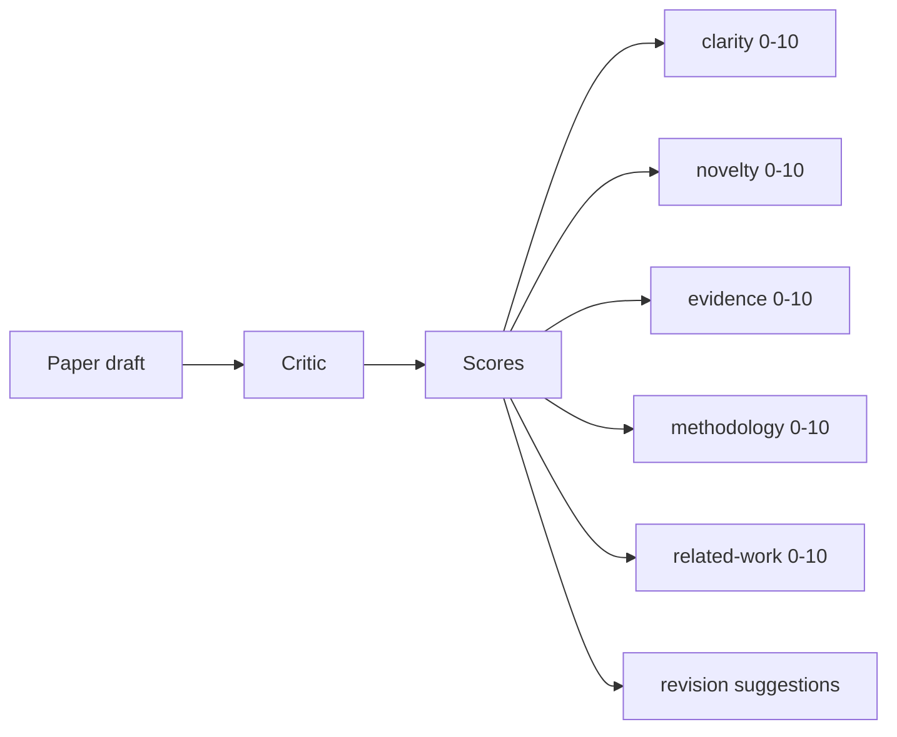
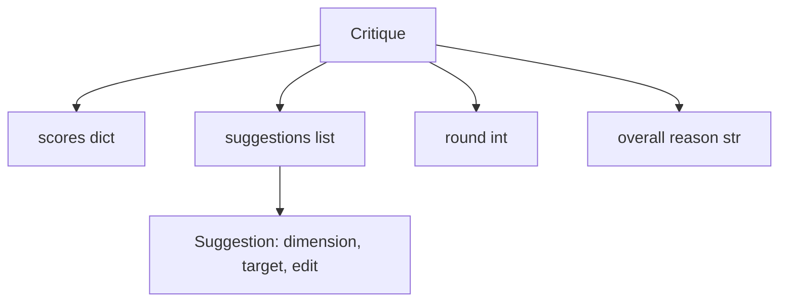
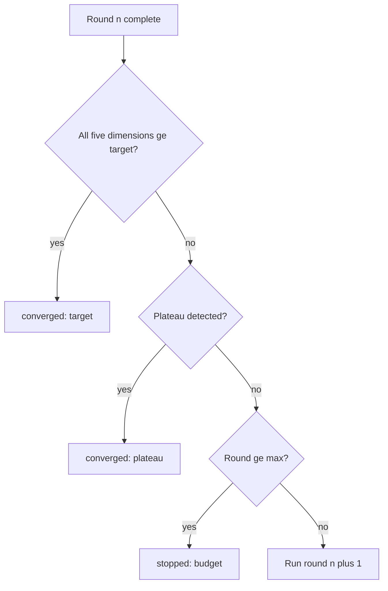
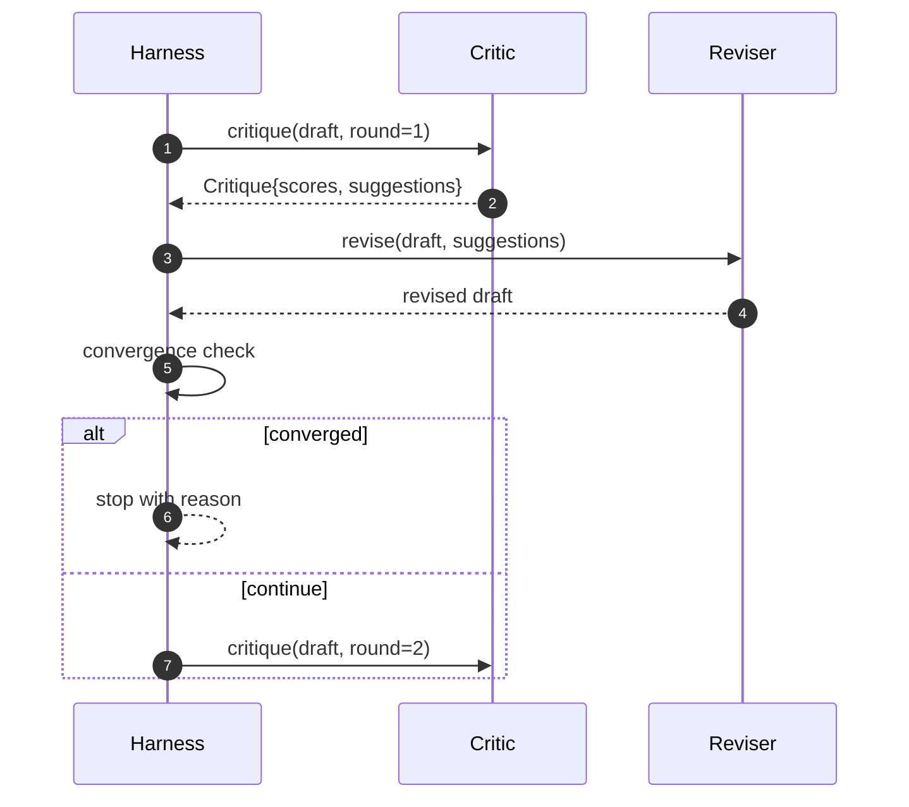

# आलोचनात्मक लूप

> पहली बार जब "अच्छा लग रहा है" का आलोचक लौटता है तो बुरा होता है। हमेशा "काम की जरूरत" का आलोचक लौटता है।

**Type:** Build
**Languages:** Python
**Prerequisites:** Phase 19 lessons 50-53
**Time:** ~90 minutes

## सीखने के लक्ष्य


```figure
ch-critic-converge
```

- 五个固定维度为论文草稿打分:स्पष्टता, नवीनता, साक्ष्य, पद्धति, संबंधित कार्य-
- प्रत्येक आलोचना को संरचनात्मक संशोधन के लिए लागू करना अलग है, बजाय मुक्त रूप के पुनः लेखन के।
-  तुलनात्मक रूप से कई दौर की संख्या में परीक्षण प्राप्त करना; लक्ष्य या बजट की खपत के पूरा होने पर पठार पर रोकना
-  बजट सीमित रेंज संख्या, 避免不收的批评 永远运行──
- 输出逐轮追踪,让仪表板或下一阶段可以染分数轨迹──

## क्यों पांच फिक्स्ड आयाम का उपयोग करें

स्वतंत्रता रूप के आलोचक एक लौटने का सुझाव खंड के मॉडल है। अगला संशोधन इस खंड को पर्यावरण पर नीचे के रूप में लिएगा।

五度给带一个契约――



विभाजन एक वेक्टर है। हरनेस प्रत्येक आयाम में परिवर्तन को देखेंगे। एक स्पष्टता में सुधार करेगा। लेकिन सबूतों को बड़े पैमाने पर गिरावट की समीक्षा करने के लिए, सबूतों को ऊपर की गिरावट, अभिसरण जांच करेगा।

## आलोचना 结构



प्रत्येक सुझाव में सुधार आयाम, लक्ष्य अनुभाग और संशोधित करने योग्य अनुप्रयोग शामिल हैं।`edit`निर्देशः रिवेसर भी एक कॉल करने योग्य है। यह एक निश्चितता रिवेसर प्रदान करता है, यह अनुभाग के अनुलग्नक-से-अनुभाग के लिए निर्देशों को व्याख्या करने के लिए संपादित करता है।

## अभिसरण नियम, क्रमशः निष्पादन

आलोचनात्मक लूप में तीन शर्तों में से किसी एक को स्पर्श करते समय समाप्त होता है।



लक्ष्य सबसे कठोर स्थिति हैः स्पष्टता, नवीनता, साक्ष्य, पद्धति, संबंधित कार्य) के पांच आयामों में से प्रत्येक को प्राप्त करना होगा।`>= target_score`(默认 `8.0`),लूप 才会回归成功──平均值很高但有一个弱度不够── प्लेट डिटेक्शन 会比较当前轮平均值和上轮平均值──如果连续两轮的改善 低于`plateau_epsilon`(默认 `0.1`),loop 会以 `plateau`退出──预算是轮数的硬上限(默认 `5`),并以 `budget`退出──

順序很重要──目標 高原,高原 预算 優先── यदि तीसरा दौर एक ही समय में 代中既既达到目标又触发高原, परिणाम है`target`, नहीं `plateau`

## क्यों पठार का पता लगाने 跨两轮运行

单轮平原是噪音── वास्तविक आलोचक यहां तक कि एक निश्चित मसौदा के सामने भी, प्रत्येक पीढ़ी कुछ अलग-अलग अंक वापस लौटाएगी, क्योंकि निश्चितता स्कोरिंग  अभी भी इस बात पर निर्भर करती है कि किस सुझाव और आवेदन के क्रम में लागू किया गया है── आवश्यकता है कि लगातार दो दौर के पठार इस तरह के शोर को पार कर सकते हैं── यदि हर्न 报告平原, विवरण मसौदा 确实停止了改进──

## 本课中的确定性 आलोचक

本课不调用模型──提供评论是可调用的,会基于三个信号给草案 打分:平均部分 正文长度(澄清) 图数数 和引用数(证据),以及纸质的转载数据上的`originality_tag`字段(नवीनता) ⋅reviser 知道如何把每个分数推上──

```text
clarity      在平均 section 正文长度增加时增长
novelty      在 originality_tag 设置为 "high" 时增长
evidence     在某个 section 的 figure_refs 非空时增长
methodology  在存在标题为 "Method" 且有正文的 section 时增长
related-work 在存在标题为 "Related Work" 且有正文的 section 时增长
```

समीक्षाकर्ता प्रत्येक सुझाव को जोड़ देगा                                                                                                                                                                                                                                                                                                                                                                                                                                                                                                                       

## 完整循环 契约



हर्नस 拥有圆计, 追踪 和 结合检查――批判 拥有评分――审核人 拥有差──三者都不会触碰彼此的状态──

## ट्रैक 输出

प्रत्येक दौर में एक ट्रैक इवेंट का उत्पादन किया जाएगा, जिसमें गोल संख्या, स्कोर वेक्टर, सुझाव गणना और अभिसरण निर्णय शामिल होंगे। पूर्ण ट्रैक बैठक अंतिम ड्राफ्ट के साथ एक आरंभ वापसी।

## 防止坏批判的预算

एक आलोचक जो कभी भी अंक संख्या को बढ़ा नहीं सकता है, उसे अधिकतम इटेरिशन तक लूप लॉक कर देगा।`budget` उपयोगकर्ता इसे एक महत्वपूर्ण बग के रूप में पढ़ेंगे, न कि एक ड्राफ्ट बग के रूप में।

## 如何阅读代码

`code/main.py` परिभाषित किया `Critique``Suggestion``Critic`प्रोटोकॉल`Reviser`प्रोटोकॉल`CriticLoop`, और एक `make_deterministic_critic_pair`कारखाने, यह निश्चितता आलोचक और संगतता संशोधक लौट आएगी.`Paper`结构,让本课可以独立运行――

`code/tests/test_critic_loop.py`覆盖: प्रथम दौर के बाद के एक-आधारित सुधार, सुधारित मसौदा ऊपर के लक्ष्य अभिसरण, दो दौर के बाद के पठार का पता लगाना, कोई सुझाव नहीं  सुधार करने के लिए बजट के समय की समाप्ति, सुझाव के अनुप्रयोग के लिए समीक्षक, साथ ही साथ ट्रैक संरचना

##  आगे की खोज

वास्तविकता को प्राप्त करने के लिए दो विस्तारों की आवश्यकता होगी। पहला, आयाम वजनः कार्यशाला 论文会更重视新品而不是方法; जर्नल 则相反── अभिसरण जाँच 会变成加权平均值── दूसरा, जोड़े आलोचकः एक आलोचक 负责打分, दूसरा आलोचक 在修订者 看到建议 之前对它们做出裁决── दोनों का मूल्य है, और वे एक ही में संकलित हो सकते हैं।`Critique`结构之上──

关键注是分数向量── एक बार आलोचना संरचित हो जाने पर, अन्य सभी सुधार, अभिसरण नियम, डैशबोर्ड, जोड़ी आलोचना, सभी अपरिवर्तित लूप के मामले में जुड़ सकते हैं──
