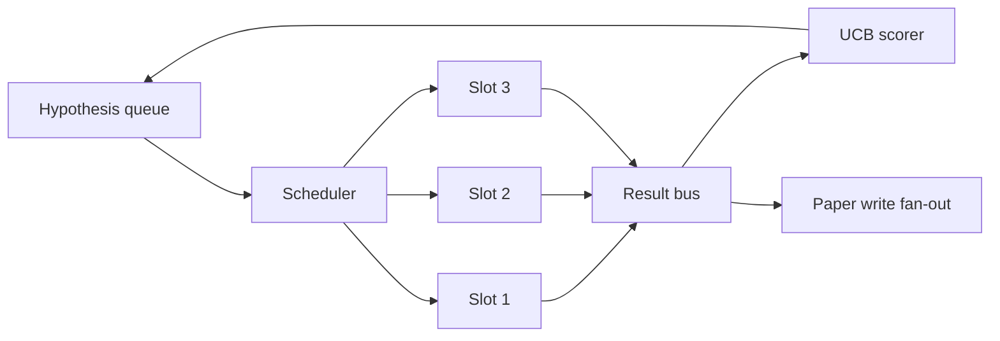
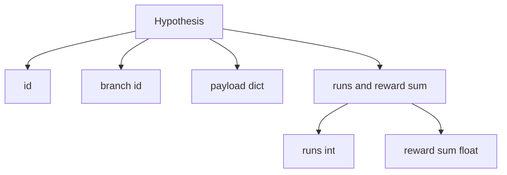
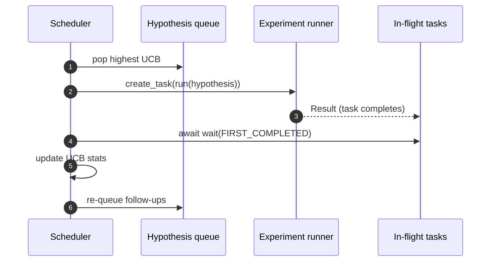

# पुनरावृत्ति अनुसूचक

>  बिना अनुसूचक के शोध लूप, एक भ्रमपूर्ण कतार है  अनुसूचक यह लूप है जो यह निर्णय लेता है कि क्या खोजना बंद कर देना है, जबकि यह निर्णय पूरे खेल का मूल है

**Type:** Build
**Languages:** Python
**Prerequisites:** Phase 19 lessons 50-53
**Time:** ~90 minutes

## सीखने के लक्ष्य


```figure
ch-ucb-scheduler
```

- एक परिकल्पना कतार के रूप में अनुसंधान कार्यप्रवाह को विकसित करना, यह प्रयोगों के स्लॉट को जोड़ देगा, परिणाम फिर से वापस फैन में होगा।
- इस तरह से कई प्रयोगों को चलाएं, ताकि शेड्यूलर सभी स्लॉट व्यस्त रख सके।
- यूसीबी के उपयोग से प्रत्येक परिकल्पना शाखा 打分, अनुसूचक को अनुमति दें अन्वेषण के बिना छोड़ने की स्थिति में शाखाओं का कटाई 低产出
- पूर्ण परिणामों को पेपर-लेखन चरण और पुनरावृत्ति चरण तक फैलाया जाएगा, जिससे अनुवर्ती परिकल्पनाएं उत्पन्न होंगी।
- 暴露 प्रति पुनरावृत्ति निशान, शाखा स्कोर शामिल स्लॉट कब्जा एवं कटिंग निर्णयों

## कार्यसूची के बजाय शेड्यूलर क्यों है

平 कार्यसूची प्रस्तुत क्रम में काम चलाने के लिए किया जाएगा। जब प्रत्येक कार्य स्वतंत्र है, यह कोई समस्या नहीं है। अनुसंधान स्वतंत्र नहीं हैः प्रयोग तीन के निष्कर्षों को बदलेंगे प्रयोग चार और पांच के प्राथमिकताएँ।

有意思的设计选择是得分规则──贪心得分者──总是选择当前领导者,永远不探索──平均得分者──永远不利用──UCB(上层信心界限) 是中间路径:利用领导者,同时为尝试较少的分支保留容量──

## 系统结构



कतार 保存假设── शेड्यूलर 在槽 释放时选择 UCB最高假设── प्रत्येक槽 异步运行一个实验──完成的实验将将结果将将到达车上.

## परिकल्पना 结构



`branch`यह यूसीबी के आंकड़ों की कुंजी है। कई परिकल्पनाएं एक शाखा साझा कर सकती हैं।`runs`                                                                                                                                                                                                                                                              `reward_sum`️️️️️️️️️️️️️️️️️️️️️️️️️️️️️️️️️️️️️️️️️️️️️️️️️️️️️️️️️️️️️️️️️️️️️️️️️️️️️️️️️️️️️️️️️️️️️️️️️️️️️️️️️️️️️️️️️️️️️️️️️️️️️️️️️️️️️️️️️️️️️️️️️️️️️️️️️️️️️️️️️️️️️️️️️️️️️️️️️️️️️️️️️️️️️️️️️️️️️️️️️️️️️️️️️️️️️️️️️️️️️️️️️️️️️️️️️️️️️️️️️️️️️️️️️️️️️️️️️️️️️️️️️️️️️️️️️️️️️️️️️️️️️️️️️️️️️️️️️️️️️️️️️️️️️️️️️️️️️️️️️️️️️️️️️️️️️️️️️️️️️️️️️️️️️️️️️️️️️️️️️️️️️️️️️️️️️️️️️️️️️️️️️️️️️️️️️️️️️️️️️️️️️️️️️️️️️️️️️️️️️️️️️️️️️️️️️️️️️️️️️️️️️️️️️️️️️️️️️️️️️️️️️️️️️️️️️️️️️️️️️️️️️️️️️️️️️️️️️️️️️️️️️️️️

## यूसीबी स्कोरिंग

本课使用的 UCB公式是经典 UCB1──

```math
\text{ucb}(\text{branch}) = \text{mean\_reward}(\text{branch}) + c \sqrt{ \frac{\ln(\text{total\_runs})}{\text{runs}(\text{branch})} }
```

`total_runs`सभी शाखाओं का कुल संख्या ऊपर पूरा हुआ प्रयोगों`c`️️️️️️️️️️️️️️️️️️️️️️️️️️️️️️️️️️️️️️️️️️️️️️️️️️️️️️️️️️️️️️️️️️️️️️️️️️️️️️️️️️️️️️️️️️️️️️️️️️️️️️️️️️️️️️️️️️️️️️️️️️️️️️️️️️️️️️️️️️️️️️️️️️️️️️️️️️️️️️️️️️️️️️️️️️️️️️️️️️️️️️️️️️️️️️️️️️️️️️️️️️️️️️️️️️️️️️️️️️️️️️️️️️️️️️️️️️️️️️️️️️️️️️️️️️️️️️️️️️️️️️️️️️️️️️️️️️️️️️️️️️️️️️️️️️️️️️️️️️️️️️️️️️️️️️️️️️️️️️️️️️️️️️️️️️️️️️️️️️️️️️️️️️️️️️️️️️️️️️️️️️️️️️️️️️️️️️️️️️️️️️️️️️️️️️️️️️️️️️️️️️️️️️️️️️️️️️️️️️️️️️️️️️️️️️️️️️️️️️️️️️️️️️️️️️️️️️️️️️️️️️️️️️️️️️️️️️️️️️️️️️️️️️️️️️️️️️️️️️️️️️️️️️️️`sqrt(2)`◊ रन 为零 के शाखा प्राप्त होगा `+inf`, इसलिए प्रयास न की गई शाखाएँ 总是先调调调――平均奖励高的分支会保持高分,直到其他分支 追上;运行很多次但奖励不高的分支会被运行次数更少的替代品超过──

कटाई गेट से पिकर से अलग हो जाओ।`prune_after_runs`अगला परीक्षण`3`) पश्चात् औसत पुरस्कार 低于绝对 floor (असत्य तल से कम)`0.2`) जब, काटने से शाखा को भविष्य की शेड्यूलिंग से स्थानांतरित कर दिया जाएगा।

## उपयोग करें asyncio के并行 स्लॉट

अनुसूचक 使用 `asyncio.create_task`驱动实验──每一个任务 运行实验运行一个`async def`बुलाया जा सकता है),并返回一个 `Result` मुख्य लूप `asyncio.wait(..., return_when=asyncio.FIRST_COMPLETED)`प्रतीक्षा उड़ान में कार्यों 集合, और प्रत्येक बार पूरा होने पर स्कोरिंग अद्यतन को触发──



तीन स्लॉट और चलना जारी रखें। मुख्य लूप  कभी भी एक ही प्रयोग में अवरुद्ध नहीं होगा।

## फैन्-आउटःपेपर ट्रिगर

किसी शाखा के औसत पुरस्कार पार `paper_threshold`(默认 `0.7`), और इस शाखा  ने अभी तक कागज का उत्पादन नहीं किया है `paper.trigger`घटना प्रशंसक तक आउटपुट सूची──下游会第五十四课的 पेपर लेखक 接手它──在本课中, ट्रिगर会被捕为列表,方便测试断言──

## फैलावः अनुवर्ती परिकल्पनाएं

जब उच्च उत्पादन परिणाम तक पहुँचता है, अनुसूचक उपयोगकर्ता की पेशकश को अनुकूलित कर सकते हैं `expander`, एक ही शाखा में एक या अधिक अनुवर्ती परिकल्पनाओं का उत्पादन करें।`Result`तक `list[Hypothesis]`इस वर्ग में एक निश्चितता विस्तारक प्रदान किया जाता है, जो किसी भी पुरस्कार के लिए पेपर थ्रेश से अधिक परिणाम उत्पन्न करता है।

## बजट

 दो बजट                                                                                                                                                                                                                                                             

```text
max_experiments    : 跨所有 branches 运行的 experiments 总数
max_seconds        : wall-clock cap (asyncio time)
```

जब कोई भी एक टच शुरू होता है, अनुसूचक नए कार्यों को समायोजित करना बंद कर देगा, उड़ान में कार्यों की प्रतीक्षा करेगा  पूरा,并返回 अंतिम निशान── निशान 包含一个 `stop_reason`

## ट्रैक और अंतिम रिपोर्ट

प्रत्येक अनुसूची निर्णय ((पिक, डिस्पैच, रिजल्ट, प्रिंटर, फैन-आउट) सभी एक घटना को आउटपुट करेंगे। अंतिम रिपोर्ट, प्रति शाखा आंकड़े, कुल रन, कुल वॉल-क्लॉक, साथ ही साथ पेपर ट्रिगर को ट्रिगर करेगा।

## 如何阅读代码

`code/main.py` परिभाषित किया `Hypothesis``Result``BranchStats``IterationScheduler`, और एक `make_deterministic_runner`कारखाने, यह एक के साथ वापस आ जाएगा पूर्वानुमान योग्य पुरस्कार के साथ असyncio प्रयोग धावक── धावक नींद मिल  निश्चित `delay_ms`(默认 `5ms`), 让同步可观察──

`code/tests/test_scheduler.py`覆盖:UCB 优先选择未尝试分支,平行槽占用,跨越门时的纸触发器,低产出试验, 后的分支剪,粉丝-out follow-up hypotheses,以及预算出口,实验计数 和墙钟 两者)

##  आगे की खोज

वास्तविकता को तीन विस्तारों की आवश्यकता होगी। पहला, सत्रों के पार UCB के स्थायीकरण के आंकड़े: वर्तमान आंकड़े 存在内存里; वास्तविक अनुसूचक 会チェックポイント 它们,让重启保留已经花掉的探索预算── दूसरा, बहु-उद्देश्यीय स्कोरिंगः प्रत्येक परिणाम एक पैमाने पर पुरस्कार का उत्पादन नहीं करता है, बल्कि एक वेक्टर का उत्पादन करता है, UCB एक पैराटो शैली के चयनकर्ता में बदल जाता है।

अनुसूचक अनुसंधान के लिए एक जगह है 超越工作清单的地方── एक बार जब UCB 接好、slots并行运行, तो अन्य सभी सुधार उस पर जमा हो सकते हैं──
