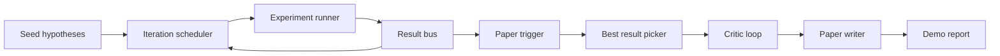
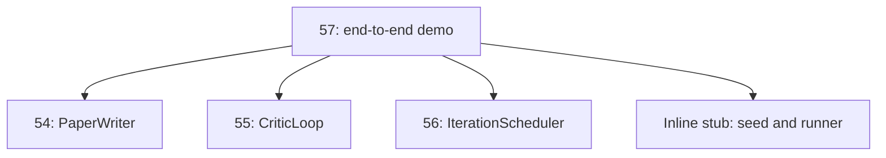
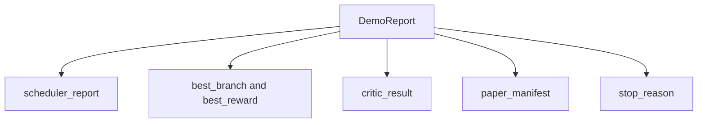

# अंत-से-अंत अध्ययन डेमो

> डेमो वह जगह है जहाँ आपके द्वारा पहले लिखे गए प्रत्येक अनुबंध को एक साथ रखना होगा।

**Type:** Build
**Languages:** Python
**Prerequisites:** Phase 19 lessons 50-53
**Time:** ~90 minutes

## सीखने के लक्ष्य


```figure
ch-research-pipeline
```

- 端到端串连起来:hypothesis seed、 प्रयोग रनर、 शेड्यूलर、 क्रिटिकल लूप、 पेपर राइटर
- 通过普通 Python आयात 组合前四节 ट्रैक डी 课程中的原始, बजाय फ्रेमवर्क के माध्यम से
- 运行循环 until自行终止,并输出一个列出每一个阶段 输出单一示范报告――
-  डेमो निर्धारक बनाए रखें, परीक्षण सूट को अंतिम रूप में निर्धारित कर सकते हैं
- जब किसी भी चरण के अनुबंध 破坏时, expose स्पष्ट विफलता मोड, avoid next stage उपयोग 破损输入 继续运行──

## यह क्या है जो एक साथ है



五个阶段──种子是三条假设的列表──安排器用三个平行槽在它们之间运行六个实验──bus 报告一个或多个纸触发器──picker 选择单个最佳结果──批判循环 基于该结果 构建的草案 进行代──纸作家 输出最终的Latex、BibTeX 和 manifesto──

## क्यों आयात, नकल की बजाय

पिछला पिछला प्रत्येक वर्ग में एक सार्वजनिक डेटा कक्षाओं और कार्यों के साथ दिया जाएगा `main.py`✿ डेमो 通过调整 `sys.path`️️️️️️️️️️️️️️️️️️️️️️️️️️️️️️️️️️️️️️️️️️️️️️️️️️️️️️️️️️️️️️️️️️️️️️️️️️️️️️️️️️️️️️️️️️️️️️️️️️️️️️️️️️️️️️️️️️️️️️️️️️️️️️️️️️️️️️️️️️️️️️️️️️️️️️️️️️️️️️️️️️️️️️️️️️️️️️️️️️️️️️️️️️️️️️️️️️️️️️️️️️️️️️️️️️️️️️️️️️️️️️️️️️️️️️️️️️️️️️️️️️️️️️️️️️️️️️️️️️️️️️️️️️️️️️️️️️️️️️️️️️️️️️️️️️️️️️️️️️️️️️️️️️️️️️️️️️️️️️️️️️️️️️️️️️️️️️️️️️️️️️️️️️️️️️️️️️️️️️️️️️️️️️️️️️️️️️️️️️️️️️️️️️️️️️️️️️️️️️️️️️️️️️️️️️️️️️️️️️️️️️️️️️️️️️️️️️️️️️️️️️️️️️️️️️️️️️️️️️️️️️️️️️️️️️️️️️️️️️️️️️️️️️️️️️️️️️️️️️️️️️️️️️️️



इनलाइन स्टब 代表第50到第53 课: एक लघु बीज परिकल्पना जनरेटर 和 एक समकालिक इनाम फ़ंक्शन── उपयोगकर्ता दो आयातों को समायोजित करके इनलाइन स्टब 替换 करेगा उन कक्षाओं में वास्तविक आदिमों हेतु──

## निर्धारिता 保证

डेमो में निर्माण पर ही निर्धारक है। प्रयोग रनर का उपयोग किया गया NumPy में बीजदार है। आलोचनात्मक लूप का संशोधक 固定 क्रम में तय आयामों में 固定 क्रम में 固定 आयामों में 固定 क्रम में 固定 आयामों में 固定 आयामों में 固定 आयामों में 固定 क्रम में 固定 आयामों में 固定 आयामों में 固定 आयामों में 固定 क्रम में 固定 आयामों में 固定 आयामों में 固定 आयामों में 固定 आयामों में 固定 आयामों में 固定 आयामों में 固定 आयामों में 固定 आयामों में 固定 आयामों में 固定 आयामों में 固定 आयामों में   固定 आयामों में                                                                                                                                                                                                                                                                                                                                               

给定相同种子,Demo会输出相同报告――测试 通过运行Demo 两次并比较显现 来断这一属性――

## डेमो रिपोर्ट का स्वरूप



प्रत्येक क्षेत्र का एक-एक करके उपधारा के चरण से आया है।

## विफलता मोड 处理

प्रत्येक चरण में सफलता या एक टाइप त्रुटि उठाना होगा

```text
Scheduler ........ returns SchedulerReport with stop_reason
                   in {queue_empty, max_experiments, deadline}
Best-result pick . raises NoTriggerError if no paper trigger fired
Critic loop ...... returns LoopResult with status converged or stopped
Paper writer ..... raises PaperValidationError on contract break
```

任意 चरण की विफलता                                                                                                                                                                                                                                                            `test_no_triggers_raises_typed_error`和 `test_best_picker_raises_when_no_triggers`断言当没有分支 触发触发触发 时,Picker会升高 `NoTriggerError`/`BestResultError`, और लेखक 永远不会被调用──

## सर्वोत्तम परिणाम का चयनकर्ता

अनुसूचक शाखा के अनुसार 输出 पेपर ट्रिगरों。picker 选择所有 ट्रिगरों के बीच औसत पुरस्कार 最高的 शाखा──ties 按分支 id 的字母顺序打破,使得Demo deterministic──picker 是一个小型纯函数;test 使用固定的 अनुसूचक रिपोर्ट 固定它的行为──

## 串接 आलोचक लूप

第55 课中的批判循环 作用于`MiniPaper`◊ डेमो द्वारा चुनी गई शाखा 构建一个 `MiniPaper`: Using branch id fill abstract,seed two sections(प्रस्ताव और परिणाम),并根据 branch के औसत इनाम 设置 `originality_tag`(यदि `>= 0.8`                                                                                                                                                                                                                                                                                                                                                                                                                                                                                                                             `>= 0.6`≠ मध्यम, ≠ निम्न) ⋅

 तब रिवीजर 代到融合── आउटपुट 会进入 पेपर लेखक──

## 串接 पेपर लेखक

धारा 54   कक्षा में पेपर लेखक 作用于包含 आंकड़े 和 библиография का पूर्णता `Paper`आकार---डेमो 通过 `mini_to_full_paper`升级 अभिसरण `MiniPaper`, यह चयनित शाखा के लिए एक आकृति जोड़ता है, और आलोचक के सुझाव के अनुसार उद्धरण कुंजी जोड़ता है और एक छोटी सिंथेटिक ग्रंथ संग्रह का निर्माण करता है।

## 如何阅读代码

`code/main.py` परिभाषित किया `BestResultError``NoTriggerError``DemoReport``pick_best_branch``build_mini_paper``mini_to_full_paper`和 `run_demo` शीर्ष भाग के आयात को एक बार में समायोजित किया जाएगा `sys.path`, और अपने-अपने पाठ्यक्रम से ले लिया`PaperWriter``CriticLoop`和 `IterationScheduler`

`code/tests/test_e2e.py`覆盖:Demo 端到端运行并输出一个五个字段 全部填充的报告;两次运行之间的确定性;没有分支 过了门 时的NoTriggerError;作者合同 破坏时的 PaperValidationError;纸质表 包含选定的分支的数字;以及安排器停止理由 是预期值之一――

## 继续扩展

जब डेमो 变绿后,有三个值得串连的扩展──第一,恒久状态: प्रत्येक चरण का परिणाम 写入一个小型JSON स्टोर,使重新启动 可以不重新运行便宜的阶段就恢复──第二,डैशबोर्ड: शेड्यूलर 和 आलोचक लूप के ट्रैक इवेंट्स 染为单一时间线──第三,真实模型调用:将被嘲弄的散文生成器 和确定性评论者 替换为模型驱动的版本;

डेमो का काम रचना को साबित करना है, वास्तुकला है, चार आयात, एक रिपोर्ट है, अगले आप एक चरण जोड़ते हैं, तारिंग केवल एक पंक्ति जोड़ती है।
