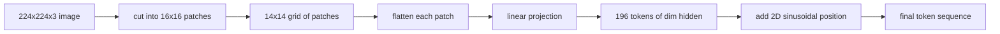

# 视觉编码器 पैच

> 读取像素的视觉模型需要像素分词器──补丁嵌入就是那个分词器──将图像切割成正方形网格,展平每正方形,将其投影到线性层,然后添加2D 位置信号,以便变形器知道每正方形在原始图像中的位置──

**Type:** Build
**Languages:** Python
**Prerequisites:** 第19期第30-37课（B轨基础）
**Time:** ~90 分钟

## 学习目标

- छवि को निश्चित लंबाई के परिमार्जन में परिवर्तित करना
- 实现 आधारित `Conv2d`इस प्रकार, यह एक भौतिक विज्ञान के अनुरूप है।
- 构建确定性 2D 正弦位置嵌入, ताकि टोकन क्रम编码空间位置──
- 验证 संश्लेषण फिटिंग ऊपर की पैच संख्या ∞ आकार और ∞`Conv2d`/उत्पादन और प्रभावशीलता

## 问题

ट्रांसफार्मर 接收一系列向量──图像是一个3通道网格──将每个像素作为代码读取导致序列长度爆炸:224x224 RGB 图像是150,528个代码,这是12层 变体器 无法承受──将图像读取为一个巨大的平面向量会丢弃局部性,而注意层无法从中恢复──编码器前端的工作是将图像网格压缩为数百个代码,每个代码概括一个正方形区域──

补丁嵌入通过一个线性投影解决了这个问题──将224x224 图像切割成16x16块会产生包含196 块的14x14 网格──每补丁都从`(3, 16, 16) = 768`像素值展平为一个向量,然后线性层将其映射到模型的隐藏维度――转变器 见 196 维度为`hidden`(आमतौर पर 768) के टोकन के साथ एक CLS टोकन। यह नेटवर्क के शेष भागों का उधार लेने योग्य क्रम है।

## 概念



### क्यों एक सुधार है, और नहीं एक चित्र है

ध्यान है क्रम लंबाई की दूसरी चौड़ाई। 196 टोकन क्रम प्रत्येक स्तर पर खर्च।`196 * 196 = 38,416`ध्यान शक्ति का अनुपात; 150,528 个代币序列的成本为 `150,528 * 150,528 = 22.6 billion`◊ एक पूरक ध्यान गणना की मात्रा को 590,000 गुना कम कर सकता है, और एक एकल 16x16 क्षेत्र उच्च दृश्य कार्य करने के लिए पर्याप्त संकेत ले सकता है।

### क्यों लाइनीय प्रोजेक्शन ही पर्याप्त है

प्रत्येक पूरक को एक स्वतंत्र आयाम के रूप में देखा जाता है।`768 * 768 = 589,824`参数) और प्रशिक्षण की गति बहुत तेजी से है। इसमें अधिक गहराई से घुमावदार कणों का निर्माण होता है, लेकिन समतल रैखिक प्रक्षेपण मानक है, और अधिकांश आधुनिक ओपनवेट कोडर्स में इस तरह का सटीक आकार होता है।

### `Conv2d`技巧

                                                                                                                                                                                                                                                                                                                                                                                                                                                                                                                             `Conv2d(in_channels=3, out_channels=hidden, kernel_size=patch_size, stride=patch_size)`√ √ √ √ √ √ √ √ √ √ √ √ √ √ √ √ √ √ √ √ √ √ √ √ √ √ √ √ √ √ √ √ √ √ √ √ √ √ √ √ √ √ √ √ √ √ √ √ √ √ √ √ √ √ √ √ √ √ √ √ √ √ √ √ √ √ √ √ √ √ √ √ √ √ √ √ √ √ √ √ √ √ √ √ √ √ √ √ √ √ √ √ √ √ √ √ √ √ √ √ √ √ √ √ √ √ √ √ √ √ √ √ √ √ √ √ √ √ √ √ √ √ √ √ √ √ √ √ √ √ √ √ √ √ √ √ √ √ √ √ √ √ √ √ √ √ √ √ √ √ √ √ √ √ √ √ √ √ √ √ √ √ √ √ √ √ √ √ √ √ √ √ √ √ √ √ √ √ √ √ √ √ √ √ √ √ √ √ √ √ √ √ √ √ √ √ √ √ √ √ √ √ √ √ √ √ √ √ √ √ √ √ √ √ √ √ √ √ √ √ √ √ √ √ √ √ √ √ √ √ √ √ √ √ √ √ √ √ √ √ √ √ √ √ √ √ √ √ √ √ √ √ √ √ √

### 位置嵌入

2D 正弦嵌入 प्रत्येक टोकन के लिए एक निश्चित संकेत प्रदान करता है, को कोड करने के लिए उपयोग किया जाता है `(row, col)`位置── एम्बेड आयाम का आधा भाग कई आवृत्तियों में स्ट्रिंग स्थान पर कोड करने के लिए正弦/余弦 का उपयोग करता है; दूसरा भाग कोड पंक्ति स्थान── कोड निश्चितता है, इसलिए आप रिज़ॉल्यूशन के बिना फिर से प्रशिक्षण कर सकते हैं, और यह शुद्ध रूप से मॉडल में मूल्य को जोड़ सकता है।

|组件|形状|参数|
|-----------|-------|------------|
|补丁投影（`Conv2d`）| `(hidden, 3, patch, patch)` | `3 * P * P * hidden + hidden` |
|位置嵌入（固定）| `(num_patches, hidden)` | 0（计算，未学习）|
| CLS token（已学习）| `(1, hidden)` | `hidden` |

对于 224 分辨率的 ViT-Base/16:投影中有590,592 参数,CLS टोकन中有768 参数,正弦位置为零──下一课 (59)

### समानता की जाँच के समान प्रभावशीलता के रूप में

补丁步骤有两种拼写:`Conv2d`投影和显式展开然后线性──它们必须以相同重量产生相同输出──如果不这样做,则展开数学是错误的,编码器的剩余部分是建立在沙子上──本课中的测试练习了这种等价性──


```figure
ch-patch-tokenizer
```

##  इसे निर्माण

`code/main.py`实现:

- `PatchEmbed`,`nn.Module`包装 `Conv2d`प्रयोग करने के लिए एक सुधार परियोजना
- `sinusoidal_2d(grid_h, grid_w, dim)`, एक निर्माण 2D स्थिति तालिका के 无状态函数──
- `VisionFrontEnd`, यह एक बार पूर्ववर्ती संचरण में CLS पूर्वस्थापना और स्थान जोड़ने के लिए एकीकरण होगा
- एक `synthesize_image(seed)`सहायक, क्यॉज़ `numpy.random`构建确定性 224x224x3 फिटिंग
- एक प्रदर्शन, एन्कोडर फ्रंट-एंड के माध्यम से 运行一张 फिस्टिंग 图像,并印出形状、CLS टोकन 范数和一行位置嵌入──

运行它:

```bash
python3 code/main.py
```

输出:224x224 फिटिंग 编码为形状 `(1, 197, 768)`क्रमशः पहला टोकन CLS है; अगला 196 जोड़ टोकन हैं।

## इसका उपयोग करें

इसी तरह के संशोधन पहले से ही प्रत्येक आधुनिक विडियो भाषा मॉडल में आ रहे हैंः CLIP ViT-L/14、SigLIP、DINOv2、Qwen-VL 系列 और InternVL 堆都从`Conv2d`补丁投影加上位置信号开始──下游各系列之间的差异(CLS और बिना CLS 池化、注册 टोकन、 भिन्न补丁大小 14 और 16、插值位置 से गतिशील संकल्प करें)──本课程中的前端是每个模型的依赖基础──

## 测试

`code/test_main.py`涵盖:

- 补丁数匹配 `(image_size / patch_size) ** 2`
- 输出形形匹配`(batch, num_patches + 1, hidden)`
- `Conv2d`投影等于在小型固定上手动展开然后线性投影 投影等于在小型固定上手动展开然后线性投影
- सही स्थान पर समायोजन के बीच निश्चितता
- CLS टोकन पार批次dim广播 और नहीं लीक

运行它们:

```bash
python3 -m unittest code/test_main.py
```

## अभ्यास

1. उपयोग करने के लिए सीखने के लिए `nn.Parameter`                                                                                                                                                                                                                                                              

2. `Conv2d`替换为显式 `nn.Unfold`加 `nn.Linear`,并断言输出匹配在浮动容量差范围内── इसी प्रकार गणित में, दो प्रकार के लेखन विधि हैं──

3.                                                                                                                                                                                                                                                               

4.                                                                                                                                                                                                                                                               

5.                                                                                                                                                                                                                                                               

## 关键术语

|术语 |这意味着什么 |
|------|---------------|
|补丁|图像的方形子区域，通常为 14x14 或 16x16 |
|补丁嵌入 |一个扁平面片到hidden dim区域的线性投影 |
|序列长度|补丁token化后的 token数量，通常加上 CLS |
|正弦位置 |修复了编码 2D 网格坐标的 sin/cos 信号 |
| CLS token |学习向量作为池化头添加到序列前面 |

##  आगे पढ़ें

- 对于原始补丁嵌入框架,图像值为16x16 个字 ((ViT,2021) ⋅
- ध्यान आपको बस इतना चाहिए (2017) का सही弦 की स्थिति सूत्र इस पर 2D के लिए लागू है।
- पंजीकृत टोकन के DINOv2 论文 के लिए, आप अभ्यास 6 के रूप में एक विस्तार जोड़ सकते हैं
