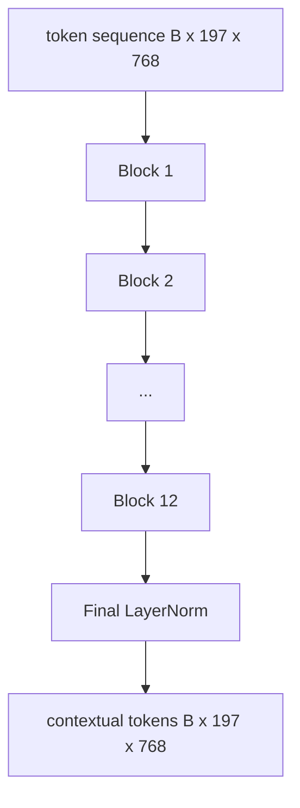
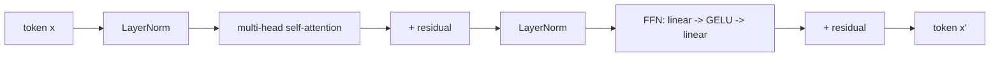

# 视觉 ट्रांसफार्मर 编码器

> 补丁单独看不到── 12 个注意头的 12 层预备 LN Transformer will be converted into up belowtoken sequence, जिसमें CLS टोकन अपनी अंतिम छिपी हुई स्थिति में समूचे छवि लक्षणों को इकट्ठा करेगा── इस कोर्स में प्रत्येक आधुनिक विज़न भाषा मॉडल का इंजनरूम शामिल है──

**Type:** Build
**Languages:** Python
**Prerequisites:** 第19期第30-37课（B轨基础）
**Time:** ~90 分钟

## 学习目标

- 实现具有多头自注意和前子层的预 LN ट्रांसफॉर्मर ब्लॉक──
- 12 个块的块的组叠, ViT-Base编码器的组叠.
-  58                                                                                                                                                                                                                                                                                                                                                                                                                                                                                                                           
- 验证 CLS टोकन ने प्रत्येक सुधार की जानकारी एकत्र की है या नहीं।

## 问题

补丁嵌在生成一系列197 个标记,每个标记都是一个向量,不知道任何其他补丁. एक बिल्ली के चित्र को प्रत्येक补丁 की आवश्यकता होती है ताकि यह पता चल सके कि कौन से补丁胡须, कौन से背景, कौन से आंखें शामिल हैं. Transformer इस प्रकार के चेतना का निर्माण करने का तंत्र है, एक बार एक ध्यान स्तर।

標準配方 12 块深、12 头宽,具有预层Norm 放置、GELU 激活和 4倍前扩展── यह配方 CLIP ViT-L、SigLIP、DINOv2、Qwen-VL 系列、InternVL以及 2025-2026 में सभी अन्य ओपन-अधिकार重视觉编码器 के支柱── यह配方 काफी स्थिर है, आप इन लेखों में से किसी भी को पढ़ सकते हैं और इस आकार के ब्लॉक का अनुमान लगा सकते हैं, जब तक कि वे स्पष्ट रूप से स्पष्ट रूप से स्पष्ट न हों।

## 概念





### पूर्व से पश्च

मूल ट्रांसफार्मर लेयरनॉर्म को शेष के बाद रखा जाएगा। प्री-एलएन (प्रत्येक उप-स्तर के पहले लेयरनॉर्म) प्रत्येक आधुनिक विज़ुअल भाषा मॉडल का उपयोग किया गया संस्करण है, क्योंकि इसमें बिना सीखने की दर के पूर्ववर्ती तकनीक की आवश्यकता नहीं है।

### अधिक ध्यान

प्रत्येक सिर अपने स्वयं के आकार के लिए टोकन वेट्यूम परिकल्पना करेगा`head_dim = hidden / num_heads``(query, key, value)`तीनों समूहों`hidden = 768`和`heads = 12`, प्रत्येक सिर है`dim = 64` 12  प्रमुखों ने भाग लिया, फिर उनके आउटपुट कनेक्शन वापस 768 维并通过 आउटपुट प्रोजेक्शन                                                                                                                                                                                                                                                  

### 4 गुना विस्तार क्यों किया जाए?

FFN `hidden -> 4 * hidden -> hidden`,GELU 位于中间──因子 4 अनुभवजन्य है, 2017 से भाषा और दृश्य में लागू किया गया है।

|组件| ViT-Base 规模的参数 |
|-----------|------------------------------|
|每个块的 qkv 投影 | `3 * 768 * 768 = 1.77M` |
|每个块的输出投影| `768 * 768 = 590K` |
|每块 FFN（4 倍扩展）| `2 * 768 * 4 * 768 = 4.72M` |
|每块的 LayerNorm | `4 * 768 = 3K` |
|每块总计 |约 710 万 |
| 12 块 |约85M |
|加前端|总计约86M |

ViT-Base एक 86M 参数编码器 है। 2026 के मानक के अनुसार, यह मूल्य बहुत छोटा है।

### कारण का आभूषण?

दृष्टि ट्रांसफार्मर  केवल कोडर और दोहरी है `i`किसी भी टोकन में भाग ले सकते हैं`j`◊ बिना मास्क ◊ धारा 61 ◊ कोडरेडर में पाठ स्वयं ध्यान से कारण छिपाओ का उपयोग करेगा ◊ यह छवि पैचों के लिए पारस्परिक ध्यान का उपयोग नहीं करता है), लेकिन दृश्य कोडरेटर के अंदर, ध्यान पूरी तरह से जुड़ा हुआ है ◊

### CLS टोकन सीखा क्या मिला

CLS टोकन सीखने के पैरामीटर से शुरू होता है, अपने स्वयं के संशोधन सामग्री के बिना, और प्रत्येक ब्लॉक के ध्यान से जानकारी इकट्ठा करने के लिए।


```figure
ch-cls-funnel
```

##  इसे निर्माण

`code/main.py`实现:

- `MultiHeadSelfAttention`, के साथ`qkv`和输出投影、缩放点积注意数学和形状断言──
- `FeedForward`,4 倍扩展 GELU MLP
- `Block`, एक पूर्व एलएन 块, ध्यान और साथ में शेष के पूर्ववर्ती परत से बना है।
- `ViT`,12 个块的堆, के साथ अंतिम परतनॉर्म
- `VisionEncoder`, यह होगा `VisionFrontEnd`से第58 课连接到`ViT`堆,并公开返回上下文序列和池化 CLS 向量 `forward()`
- एक प्रदर्शन, पूर्ण एन्कोडर के माध्यम से 运行合成的224x224 फिस्ट 图像,并每隔一层打印输入形状、输出形状、参数计数和CLS 范数──

运行它:

```bash
python3 code/main.py
```

输出:फिक्स्चर 编码为`(1, 197, 768)`张量──CLS 范数 लेयर के संयोजन के साथ ऊपर漂移, फिर स्थिर अंतिम लेयरनॉर्म──总参数报告约为86M──

## इसका उपयोग करें

इस प्रकार परिभाषित कोडर चौड़ाई और गहराई में 2025-2026 के प्रत्येक खुले वजन VLM में उपलब्ध ब्लॉक ढेरों के समान है।

- **宽度和深度。**विट-लार्ज `hidden=1024, depth=24, heads=16`; सिगलिप सो400एम `hidden=1152, depth=27, heads=16` एक ही ब्लॉक
- **池化头。**CLS池(本课) 与平均池(SigLIP) 与注意力池(后来的VLM)
- **位置处理。**固定正弦曲线 (第 58 课) 与学习的1D、ALiBi与2D RoPE──块数学没有变化──
- **注册token。**DINOv2 前置 4 个额外学习的代码.

इस आधार पर अगले पाठ्यक्रम (60-63) का आयोजन किया जाएगा।

## 测试

`code/test_main.py`涵盖:

- 单个块保留形状并且输入批量大小不变
-  ध्यान की संख्या के साथ                                                                                                                                                                                                                                                            
- 剩余路径已连接(零输入 अभी भी CLS टोकन के माध्यम से उत्पन्न非零输出)
- 4 परतें संचयी हुई हैं, जो आगे-पीछे से संचयी होती हैं, जिससे सही रूप प्राप्त होता है
- 梯度 from CLS 输出流向面片投影

运行它们:

```bash
python3 -m unittest code/test_main.py
```

## अभ्यास

1. 添加寄存器token(CLS 后添加 4 学习向量)并重新运行──通过最后层的软max 分布的来比较注意力图的平滑度──

2. LN को पूर्व में बदलकर LN 后 में करना, और एक युग को संश्लेषित रूप से वर्गीकृत करने पर प्रशिक्षण देना।

3. ् ् ् ् ् ् ् ् ् ् ् ् ् ् ् ् ् ् ् ् ् ् ् ् ् ् ् ् ् ् ् ् ् ् ् ् ् ् ् ् ् ् ् ् ् ् ् ् ् ् ् ् ् ् ् ् ् ् ् ् ् ् ् ् ् ् ् ् ् ् ् ् ् ् ् ् ् ् ् ् ् ् ् ् ् ् ् ् ् ् ् ् ् ् ् ् ् ् ् ् ् ् ् ् ् ् ् ् ् ् ् ् ् ् ् ् ् ् ् `attn_mask`参数, ताकि एक ही ब्लॉक को पुनः उपयोग किया जा सके`(seq, seq)`,下三角形──

4. उपयोग `torch.profiler`分析批量大小为 1、8、64 के पूर्ववर्ती संचरण── MLP परत ध्यान के बजाय दीवार समय पर हावी होती है──

5. निम्न स्तर के लोरा 适配器 का उपयोग करके एक ध्यान के सिर के q-k-v 投影 को प्रतिस्थापित करें, शेष भाग को समाप्त करें, और केवल आपकी अपेक्षित स्थिति में गतिशीलता का परीक्षण करें।

## 关键术语

|术语 |这意味着什么 |
|------|---------------|
|预 LN | LayerNorm 应用在每个子层之前而不是之后 |
|自我关注 |每个token都以相同的顺序关注其他所有token |
|多头|隐藏的dim分布在 `H` 独立注意头中 |
| FFN 扩展 |前馈层在收缩之前加宽至 `4 * hidden` |
| CLS 池 |使用第一个token 的最终隐藏状态作为图像摘要 |

##  आगे पढ़ें

-  कोडिंग मशीन के लिए, एक张图像值16x16 个单词(ViT,2021)。
- DINOv2 (2023) उपयोग हेतु पंजीकृत करने के लिए और स्वयं पर्यवेक्षण पूर्व प्रशिक्षण लक्ष्य
- सिग्लिप (2023) के लिए उपयोग किया जाता है 62    कक्षा में उपयोग किए जाने वाले औसत इंच के परिवर्तन और सिगमोइड के लिए अनुपात हानि
