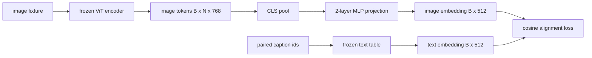

# मॉडल के साथ-साथ परिकल्पना स्तर के साथ

> 视觉编码器生成图像代币――文本解码器消耗文本代币――两者生活在不同的向量空间中―― एक छोटा दो层 MLP छवि代币 को文本嵌入空间 में प्रोजेक्ट करेगा, और शीर्षक के अतिरिक्त弦ों के साथ जुड़े हुए नुकसान के लिए दो स्थानों को एक साथ बनाए रखेगा। यह प्रोजेक्ट विजन भाषा मॉडल का सबसे छोटा हिस्सा है, यह भी पलायन के लिए सबसे महत्वपूर्ण हिस्सा है――

**Type:** Build
**Languages:** Python
**Prerequisites:** 第19期第30-37课（B轨基础）
**Time:** ~90 分钟

## 学习目标

- ् ् ् ् ् ् ् ् ् ् ् ् ् ् ् ् ् ् ् ् ् ् ् ् ् ् ् ् ् ् ् ् ् ् ् ् ् ् ् ् ् ् ् ् ् ् ् ् ् ् ् ् ् ् ् ् ् ् ् ् ् ् ् ् ् ् ् ् ् ् ् ् ् ् ् ् ् ् ् ् ् ् ् ् ् ् ् ् ् ् ् ् ् ् ् ् ् ् ् ् ् ् ् ् ् ् ् ् ् ् ् ् ् ् ् ् ् ् ् ् ् ् ् ् ् ् ् ् ् ् ् ् ् ् ् ् ् ् ् ् ् ् ् ् ् ् ् ् ् ् ् ् ् ् ् ् ् ् ् ् ् ् ् ् ् ् ् ् ् ् ् ् ् ् ् ् ् ् ् ् ् ् ् ् ् ् ् ् ् ् ् ् ् ् ् ् ् ् ् ् ् ् ् ् ् ् ् ् ् ् ् ् ् ् ् ् ् ् ् ् ् ् ् ् ् ् ् ् ् ् ् ् ् ् ् ् ् ् ् ् ् ् ् ् ् ् ् ् ् ् ् ् ् ् ्
- 构建一个模拟文本嵌入表(没有预训练的分词器,没有真正的语料库) 
- 计算投影图像代码和配对标题嵌入之间的余弦对齐损失──
- प्रयोग结视觉编码器和结文表单独训练投影──

## 问题

您有一个视觉编码器 ((第 58-59 课),可生成维度 `vision_hidden = 768` आप एक पाठ डिलीवर है, आप आकार में एम्बेड किया जाना चाहता हूँ तय किया गया है `text_hidden = 512`之上 (任何其他数字也同样合理) 解码器需要文体形的符号──图像代码不是文体形的:它们存在于编码器在仅视觉预训期间学习的基础中,与解码器的词量无关──

两层 MLP 投影(线性、GELU、线性) इस अंतर को भर दिया गया है── यह पर्याप्त रूप से छोटा है`768 * 1024 + 1024 * 512 = 1.3M`参数), एक एकल GPU पर कुछ ही मिनटों में प्रशिक्षण किया जा सकता है, और यह एक ही चरण में सीखने के हिस्से में आवश्यक है।

## 概念



### 投影前池化

视觉编码器发发出 197 个 टोकन──文本侧有单个标题级嵌入──为了对齐它们,每个样本需要一个图像级向量── CLS 池化是最简单的:编码器从获取第一代码并对其投影──对所有197 个 टोकन进行平均池是另一种选择,也是SigLIP使用的方法──要么将197 个向量合并为一个──

### एक परत के बजाय दो परत क्यों है?

 एकल रैखिक परिकल्पना घूम सकती है और फिर से संकुचित हो सकती है, लेकिन यदि दो अंतरिक्ष वक्रता दर असंगत है, तो यह स्थिर आधार नहीं हो सकता है।  दो रैखिक परतों के बीच GELU परिकल्पना के लिए एक गैर रैखिक कण प्रदान करता है, जो अनुभव में CLIP शैली के लक्षणों और भाषा मॉडल को एक साथ एम्बेड करने के लिए पर्याप्त है।  अधिक गहराई से परिकल्पना (LVA-NeXT GLU का उपयोग करता है; Qwen-VL एक ढेर ध्यान स्तर का उपयोग करता है) विस्तारित है; दो परत MLP नियमन की रेखा है, और BLIP-2 के Q-Former  परिकल्पना के साथ संलग्न सामग्री भी है।

|层|形状|参数|
|-------|-------|------------|
| FC1 | `(vision_hidden, projection_hidden)` | `768 * 1024 + 1024` |
|激活|格鲁| 0 |
| FC2 | `(projection_hidden, text_hidden)` | `1024 * 512 + 512` |

एक `768 -> 1024 -> 512`头大约有1.3M 个参数──

### 余弦对齐损失

एक साथ मतलब नहीं है`image_emb == text_emb`                                                                                                                                                                                                                                                              `image_emb`में关节空间中与`text_emb`∞ ∞ ∞ ∞ ∞ ∞ ∞ ∞ ∞ ∞ ∞ ∞ ∞ ∞ ∞ ∞ ∞ ∞ ∞ ∞ ∞ ∞ ∞ ∞ ∞ ∞ ∞ ∞ ∞ ∞ ∞ ∞ ∞ ∞ ∞ ∞ ∞ ∞ ∞ ∞ ∞ ∞ ∞ ∞ ∞ ∞ ∞ ∞ ∞ ∞ ∞ ∞ ∞ ∞ ∞ ∞ ∞ ∞ ∞ ∞ ∞ ∞ ∞ ∞ ∞ ∞ ∞ ∞ ∞ ∞ ∞ ∞ ∞ ∞ ∞ ∞ ∞ ∞ ∞ ∞ ∞ ∞ ∞ ∞ ∞ ∞ ∞ ∞ ∞ ∞ ∞ ∞ ∞ ∞ ∞ ∞ ∞ ∞ ∞ ∞ ∞ ∞ ∞ ∞ ∞ ∞ ∞ ∞ ∞ ∞ ∞ ∞ ∞ ∞ ∞ ∞ ∞ ∞ ∞ ∞ ∞ ∞ ∞ ∞ ∞ ∞ ∞ ∞ ∞ ∞ ∞ ∞ ∞ ∞ ∞ ∞ ∞ ∞ ∞ ∞ ∞ ∞ ∞ ∞ ∞ ∞ ∞ ∞ ∞ ∞ ∞ ∞ ∞ ∞ ∞ ∞ ∞ ∞ ∞ ∞ ∞ ∞ ∞ ∞ ∞ ∞ ∞ ∞ ∞ ∞ ∞ ∞ ∞ ∞ ∞ ∞ ∞ ∞ ∞`1 - cos_sim(image, text)`, श्रेणी 0(पूर्ण रूप से तैयार) से 2(相反) ◦ प्रशिक्षण इसे प्रति प्रति के लिए शून्य ◦ 62 课程概括为对比批次 (InfoNCE), जिनमें से प्रत्येक चित्र को अपने स्वयं के शीर्षक के करीब होना चाहिए, जितना कि किसी अन्य शीर्षक के साथ; इस पाठ्यक्रम में प्रति संस्करण का उपयोग किया जाता है, इसलिए गतिशील दृश्य

### 结编码器是门

视觉编码器 में 86M पैरामीटर हैं। पाठ पर कुछ लाख हैं। इन सभी को अनुकरणात्मक भाषा भंडार में प्रशिक्षित करना असंभव है। 结两者意味着投影的1.3M पैरामीटर एकमात्र परिवर्तनशील है, और संश्लेषण के लिए कुछ सौ कदम पर्याप्त हैं ताकि कम नुकसान हो सके। यह प्रत्येक एडाप्टर आधारित VLM का संचालन आकार हैः भारी भागों को स्थिर रखने, हल्के पुल रेल्वे।


```figure
ch-projection-bridge
```

##  इसे निर्माण

`code/main.py`实现:

- `MLPProjector(in_dim, hidden_dim, out_dim)`, जीएलयू  सक्रिय दो स्तरीय रैखिक एमएलपी
- `MockTextEmbedding(vocab_size, dim)`, एक 结嵌表, बीज से प्राप्त निश्चितता आरंभिकता के साथ
- `make_pair(seed, vocab_size)`, सिंथेट एक पर (图像,标题) नमूना;;标题是短 id 序列;标题嵌入对 टोकन嵌入进行平均值池化;;
- `cosine_alignment_loss(image_emb, text_emb)`, प्रति `1 - cos_sim`आस्तीन
- एक प्रशिक्षण चक्र, 32 सिंथेटिक पर चल रहा है 200 चरणों के साथ चक्र, वीडियो एडिटर और पाठ प्रदर्शन, और प्रत्येक 25 चरणों में एक नुकसान छपाई।

运行它:

```bash
python3 code/main.py
```

输出: प्रशिक्षण रिपोर्ट 200 चरणों में प्रारंभिक हानि से 1.07 तक घटकर 0.80 तक घटती है, यह दर्शाता है कि केवल प्रोजेक्शन पर ही छवि टोकन को पाठ स्थान में खींचा जा सकता है।

## इसका उपयोग करें

प्रत्येक खुला वज़न VLM में एक ही मोड दिखाई देगाः

- **LLaVA 1.5.**क्लिप-विट-एल से लमा तक छिपा हुआ 嵌入的两层 GELU MLP 投影──结视觉编码器,结 LLM,仅训练投影,然后在第二阶段解 LLM) 
- **BLIP-2.**Q-Former ️ ️ ️ ️ ️ ️ ️ ️ ️ ️ ️ ️ ️ ️ ️ ️ ️ ️ ️ ️ ️ ️ ️ ️ ️ ️ ️ ️ ️ ️ ️ ️ ️ ️ ️ ️ ️ ️ ️ ️ ️ ️ ️ ️ ️ ️ ️ ️ ️ ️ ️ ️ ️ ️ ️ ️ ️ ️ ️ ️ ️ ️ ️ ️ ️ ️ ️ ️ ️ ️ ️ ️ ️ ️ ️ ️ ️ ️ ️ ️ ️ ️ ️ ️ ️ ️ ️ ️ ️ ️ ️ ️ ️ ️ ️ ️ ️ ️ ️ ️ ️ ️ ️ ️ ️ ️ ️ ️ ️ ️ ️ ️ ️ ️ ️ ️ ️ ️ ️ ️ ️ ️ ️ ️ ️ ️ ️ ️ ️ ️ ️ ️ ️ ️ ️ ️ ️ ️ ️ ️ ️ ️ ️ ️ ️ ️ ️ ️ ️ ️ ️ ️ ️ ️ ️ ️ ️ ️ ️ ️ ️ ️ ️ ️ ️ ️ ️ ️ 
- **MiniGPT-4.**BLIP-2 Q-Former से 输出到Vicuna 嵌入dim的单线性投影──
- **Qwen-VL.** बहुस्तरीय पार ध्यान अनुकूलक है, लेकिन अंतिम खंड अभी भी LM  में सम्मिलित  के लिए है।

形状不同, लेकिन作用是一样的:池图像token、投影到文本嵌入dim、单独训练──

## 测试

`code/test_main.py`涵盖:

- 投影仪输出形状与配置 `out_dim`匹配
- 结文本嵌入表的 `requires_grad`参数为零
- ⇒ ∞ ∞ ∞ ∞ ∞ ∞ ∞ ∞ ∞ ∞ ∞ ∞ ∞ ∞ ∞ ∞ ∞ ∞ ∞ ∞ ∞ ∞ ∞ ∞ ∞ ∞ ∞ ∞ ∞ ∞ ∞ ∞ ∞ ∞ ∞ ∞ ∞ ∞ ∞ ∞ ∞ ∞ ∞ ∞ ∞ ∞ ∞ ∞ ∞ ∞ ∞ ∞ ∞ ∞ ∞ ∞ ∞ ∞ ∞ ∞ ∞ ∞ ∞ ∞ ∞ ∞ ∞ ∞ ∞ ∞ ∞ ∞ ∞ ∞ ∞ ∞ ∞ ∞ ∞ ∞ ∞ ∞ ∞ ∞ ∞ ∞ ∞ ∞ ∞ ∞ ∞ ∞ ∞ ∞ ∞ ∞ ∞ ∞ ∞ ∞ ∞ ∞ ∞ ∞ ∞ ∞ ∞ ∞ ∞ ∞ ∞ ∞ ∞ ∞ ∞ ∞ ∞ ∞ ∞ ∞ ∞ ∞ ∞ ∞ ∞ ∞ ∞ ∞ ∞ ∞ ∞ ∞ ∞ ∞ ∞ ∞ ∞ ∞ ∞ ∞ ∞ ∞ ∞ ∞ ∞ ∞ ∞ ∞ ∞ ∞ ∞ ∞ ∞ ∞ ∞ ∞ ∞ ∞ ∞ ∞ ∞ ∞ ∞ ∞ ∞ ∞ ∞ ∞ ∞ ∞ ∞ ∞ ∞ ∞ ∞ ∞ ∞ ∞ ∞ ∞ ∞ ∞ ∞ ∞ ∞ ∞ ∞ ∞ ∞ ∞ ∞ ∞ ∞ ∞ ∞ ∞ ∞ ∞ ∞ ∞ ∞ ∞ ∞ ∞ ∞ ∞ ∞ ∞ ∞ ∞ ∞ ∞ ∞ ∞ ∞ ∞ ∞ ∞ ∞ ∞ ∞ ∞ ∞ ∞ ∞ ∞ ∞ ∞ ∞ ∞ ∞ ∞ ∞ ∞ ∞ ∞ ∞ ∞ ∞ ∞ ∞ ∞ ∞ ∞ ∞ ∞ ∞ ∞ ∞ ∞ ∞ ∞ ∞ ∞
- एक बार पीछे की ओर प्रसारण के बाद प्रक्षेपण यंत्रस्तर प्रवाह
- प्रशिक्षण चक्र में चरण 0 और चरण 200 के बीच हानि कम हो गई

运行它们:

```bash
python3 -m unittest code/test_main.py
```

## अभ्यास

1. CLS को 196 पैच टोकन के लिए प्रतिस्थापित करना, 200 चरणों के बाद औसत अंकन के साथ तुलना करना, अंतिम नुकसान करना। औसत अंकन आमतौर पर संश्लेषित डेटा पर अधिक तेज़ी से प्रशिक्षित होता है; CLS प्राकृतिक चित्रों पर नमूना दक्षता अधिक होती है।

2. अभ्यस्त मानदंड तापमान अतिरिक्त स्ट्रिंग हानि में जोड़ा जाएगा (`cos / tau`) 中,并观察当 `tau`                                                                                                                                                                                                                                                              

3. दो स्तरीय एमएलपी को एक ही रैखिक स्तरीय में बदलकर नुकसान के अंतर को मापने से प्राकृतिक छवि विशेषताओं पर गैर-रेखिक प्रभाव अधिक होता है, जबकि सिंथेटिक छवि विशेषताओं पर प्रभाव छोटा होता है।

4. एक छोटे से L2 惩罚 को प्रोजेक्टर के वजन पर जोड़कर देखें कि यह कैसे शेष के साथ एक साथ होता है।

5. प्रोजेक्टर का भार रखकर फिर पुनः लोड करें और चलें, बिना किसी वीडियो एडिटर की आवश्यकता के बाद से प्रसारित करें, केवल तैनाती में सत्यापन के लिए प्रोजेक्टर की आवश्यकता है।

## 关键术语

|术语 |这意味着什么 |
|------|---------------|
|模态对齐 |使图像和文本嵌入在一个共享空间中具有可比性的行为 |
|投影头|将一个空间映射到另一个空间的小模块，通常是 2 层 MLP |
|余弦相似度 |点积除以 L2 范数的乘积 |
|冻结编码器|视觉（或文本）模型的所有参数均带有 `requires_grad=False` |
|模拟语料库|使用合成对，因此训练不依赖于数据集下载 |

##  आगे पढ़ें

- प्रयोग दो चरणों के प्रशिक्षण के LLaVA 论文(प्रोजेक्ट, फिर हल LM)
- Q-Former का BLIP-2 论文作为可学习的投影替代方案──
- Qwen-VL 技术报告,将交叉注意力适配器使用作更深的投影头――
