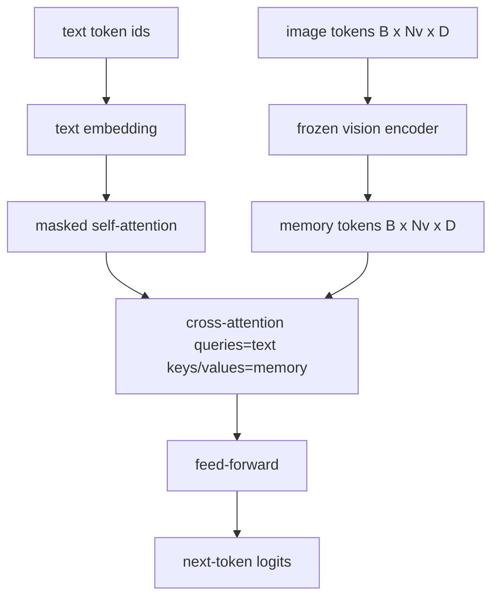
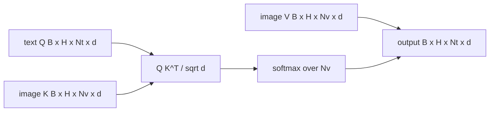

# 交叉注意力融合

> 投影层将图像向量与标题向量对齐. वास्तविक विज़ुअल भाषा解码器 प्रत्येक पाठ टोकन में शामिल होने की आवश्यकता है, इसलिए मॉडल प्रत्येक शब्द को एक क्षेत्र में रख सकता है। 交叉注意是这种接地发生的方式──文字查询; दृश्य कुंजी और मूल्य निर्धारण उत्तर देते हैं। इस वर्ग में交叉注意块,因果文本自注意以及保持两者合法的掩形的构建.

**Type:** Build
**Languages:** Python
**Prerequisites:** 第19期第30-37课（B轨基础）
**Time:** ~90 分钟

## 学习目标

-                                                                                                                                                                                                                                                               
- 组成解码器块:因果自注意力+交叉注意力+前──
- 获得正确的掩模形: स्व-注意力因果掩模,交叉注意力无掩模 हेतु
- उपयोग थोक文本 टोकन和固定图像 टोकन池运行前向传递。

## 问题

इस प्रकार, एक प्रकार का संवर्धन एक क्रम में होता है। एक प्रकार का संवर्धन एक प्रकार का संवर्धन है। एक प्रकार का संवर्धन एक प्रकार का संवर्धन है। एक प्रकार का संवर्धन एक प्रकार का संवर्धन है। एक प्रकार का संवर्धन एक प्रकार का संवर्धन है। एक प्रकार का संवर्धन एक प्रकार का संवर्धन है। एक प्रकार का संवर्धन एक प्रकार का संवर्धन है। एक प्रकार का संवर्धन एक प्रकार का संवर्धन है। एक प्रकार का संवर्धन एक प्रकार का संवर्धन है। एक प्रकार का संवर्धन एक प्रकार का संवर्धन है। एक प्रकार का संवर्धन एक प्रकार का संवर्धन है। एक प्रकार का संवर्धन एक प्रकार का संवर्धन है। एक प्रकार का संवर्धन एक प्रकार का संवर्धन है। एक प्रकार का संवर्धन एक प्रकार का संवर्धन है। एक प्रकार का संवर्धन एक प्रकार का संवर्धन है। एक प्रकार का संवर्धन एक प्रकार का संवर्धन है। एक प्रकार का संवर्धन एक प्रकार का संवर्धन एक प्रकार का संवर्धन है।

后期融合有两个优点――首先,文本流保持干净,模型保留纯文本功能――第二, प्रत्येक छवि पर छवि流 को एक बार और प्रत्येक解码步骤 में दोहराया जाता है, इसलिए यहां तक कि लंबे शीर्षक के लिए भी, उत्पन्न करना बहुत ही सुविधाजनक है―― लागत प्रत्येक ब्लॉक पर एक अतिरिक्त ध्यान देने योग्य परत है――

## 概念





### 面具 आकार

解码器块 के भीतर दो ध्यान आवश्यकताएं अलग-अलग छिपाः

|注意|查询长度 |密钥长度|面膜|为什么 |
|-----------|--------------|------------|------|-----|
|自我关注 | `Nt`（文本）| `Nt`（文本）|因果：下三角 `(Nt, Nt)` |自回归期间文本token可能不会向前看 |
|交叉注意力| `Nt`（文本）| `Nv`（愿景）|没有口罩|整个图像对每个文本位置都是可见的 |

इस पाठ्यक्रम में एक आकार प्रमाणन फ़ंक्शन शामिल है, इसलिए इन्हें मिश्रित करके `ValueError`. . . . . . . . . . . . . . . . . . . . . . . . . . . . . . . . . . . . . . . . . . . . . . . . . . . . . . . . . . . . . . . . . . . . . . . . . . . . . . . . . . . . . . . . . . . . . . . . . . . . . . . . . . . . . . . . . . . . . . . . . . . . . . . . . . . . . . . . . . . . . . . . . . . . . . . . . . . . . . . . . . . . . . . . . . . . . . . . . . . . . . . . . . . . . . . . . . . . . . . . . . . . . . . . . . . . . . . . . . . . . . . . . . . . . . . . . . . . . . . . . . . . . . . . . . . . . . . . . . . . . . . . . . . . . . . . . . . . . . . . . . . . . . . . . . . . . . . . . . . . . . . . . . . . . . . . . . . . . . . . . . . . . . . . . . . . . . . . . . . . . . . . . . . . . . . . . . . . . . . . . . . . . . . . . . . . . . . . . . . . . . . . . . . . . . . . . . . . . . . . . . . . . . . . . . . . . . . . . . . . . . . . . . . . . . . . . . . . . . . . . . . . . . . . . . . . . . . . . . . . . . . . . . . . . . . . . . . . . . . . . . . . . . . . . . . . . . . . . . . . . . . . . . . . . .

### क्यों अंतर ध्यान नहीं छिपाया

किसी भी पाठ को उत्पन्न करने से पहले, पहले चित्रों को पूरी तरह से देखें।`t`चित्र के किसी भी सुधार पर ध्यान दिया जा सकता है; चित्र ब्लॉक समय क्रम में नहीं हैं। कुछ फ्लेमिंगो वेरिएंट्स ने कई चित्रों और पाठ के खंडों में एक दूसरे के साथ प्रत्येक नमूना के ढाल के ढाल को जोड़ा है, लेकिन एक ही छवि के लिए शीर्षक के साथ, एक दूसरे पर ध्यान देने से सब कुछ देखा जा सकता है।

### 键/值缓存

图像键和值在解码开始时计算一次并存存储中── प्रत्येक नए टेक्स्ट टोकन का उपयोग缓存 में किया जाता है और पुनः गणना की आवश्यकता नहीं होती── यही कारण है कि अनुक्रमणिका में सब्सक्रिप्ट तेजी से चल रहा हैः重型 ViT 运行一次;交叉注意在每一步中重用其键和值── इस पाठ्यक्रम में सार्वजनिक缓存并测试缓存中路径──

### 块组成

解码器块运行:预 LN -> 自注意力 -> 残差 -> 预 LN -> 交叉注意力 -> 残差 -> 预 LN -> 前 -> 残差──三个子层, प्रत्येक子层有自己的层Norm。 फ्लेमिंगो 论文在交叉注意力上添加了一个可学习的门,初始化为零,因此结的语言模型一开始保持不变,训练也保持稳定;规范基线在此处使用) 没有门──

```python
class DecoderBlock:
  def forward(self, text_tokens, image_tokens, text_mask, cross_mask):
      text_tokens = text_tokens + self.self_attn(self.ln1(text_tokens),
                                                 mask=text_mask)
      text_tokens = text_tokens + self.cross_attn(self.ln2(text_tokens),
                                                  image_tokens,
                                                  mask=cross_mask)
      text_tokens = text_tokens + self.ffn(self.ln3(text_tokens))
      return text_tokens
```


```figure
ch-crossattn-fan
```

##  इसे निर्माण

`code/main.py`实现:

- `CrossAttention(hidden, heads)`, के साथ अलग`q`和 `kv`投影的多头交叉注意力──
- `CausalSelfAttention(hidden, heads)`, मानक कूटनीतिक उपकरण की प्रतिरक्षा से ध्यान आकर्षित करना
- `DecoderBlock`, पूर्व एलएन शेष के साथ तीन स्तरीय का गठन किया गया है।
- `VisionLanguageDecoder`,आउटपुट और लघु पाठ एम्बेड टेबल द्वारा प्रदान किए गए चार स्तरीय कूटकर्ता।
- `causal_mask(length)` लौटें `(length, length)`नीचे तीनों भागों में से एक है
- एक उदाहरण में, यह एक बैच की लंबाई में 10 के दो पाठ अनुक्रमों को 197 की लंबाई की छवि स्मृति प्रदान करता है, और आउटपुट आकार, स्वयं ध्यान छिपाई के आकार और प्रत्येक स्थान के लिए पारस्परिक ध्यान आउटपुट फ़ैनों को प्रिंट करता है।

运行它:

```bash
python3 code/main.py
```

输出:解码器产生 `(2, 10, text_vocab)`लोगित 张量──面罩形为`(10, 10)` KV 缓存重用检查确认缓存和未缓存路径 के बीच एक ही तर्क

## इसका उपयोग करें

交叉注意力 दो उत्पादन श्रृंखला में दिखाई देती हैः

- **Flamingo 和 IDEFICS。**प्रत्येक K 个语言模型块插入一个交叉注意力层,并使用结结的 LM──视觉语言适配器是交叉注意力块及其门──
- **BLIP-2.**Q-पूर्व उपयोग एक समूह से एक छवि विशेषता में एक निश्चित 32 ′′ क्वेरी टोकन के पारस्परिक ध्यान से चित्रित किया जाता है, तो LM 嵌入空间 में ′′ क्वेरी प्रोजेक्शन होगा।

इस पाठ्यक्रम में खंडों का आकार सीधे दोनों पर चित्रित किया गया है।

## 测试

`code/test_main.py`涵盖:

- कारण छिपावट निम्न त्रिकोण की है और अपेक्षित बुल आकार से मेल खाती है
- चाहे कुंजी लंबाई कैसी भी हो,交叉注意力 आउटपुट आकार हैं।`(B, Nt, hidden)`
- KV कैशिंग पथ और अनकैशिंग पथ के साथ फ़्लोएबिलिटी अंतर के अनुरूप
- लेख और चित्र प्रवाह के बीच आकृति असंगति स्पष्ट रूप से उत्पन्न हुई `ValueError`
- पूर्ण कूटकर्ता पूर्व-प्रसारण सही मात्रा और क्रम आकार उत्पन्न

运行它们:

```bash
python3 -m unittest code/test_main.py
```

## अभ्यास

1.                                                                                                                                                                                                                                                               

2. 交错注意力掩码, जिसमें से एक ही डिलीवर कई छवियों और कई पाठ खंडों का उपभोग करता है।

3. `Nt=64, Nv=576`(अधिक उच्च संकल्प के 24x24 网格) पर विश्लेषण पारस्परिक ध्यान और स्वयं ध्यान स्तर`Nt * Nv`, और उच्च छवि रिज़ॉल्यूशन में प्रमुख स्थान पर है।

4.                                                                                                                                                                                                                                                               

5.                                                                                                                                                                                                                                                               

## 关键术语

|术语 |这意味着什么 |
|------|---------------|
|后期融合|文本和视觉位于不同的流中；交叉注意力在每个区块上架起了桥梁|
|交叉注意力| Q 来自一个流，K 和 V 来自另一个流 |
|因果面具|下三角布尔掩码，可防止在自回归过程中向前看 |
| KV缓存|图像键和值存储一次并在每个解码步骤中重复使用 |
|记忆token|解码器进入的冻结图像token |

##  आगे पढ़ें

- फ्लेमिंगो (2022) में प्रवेश नियंत्रण के लिए एक आदर्श डिजाइन है।
- Q-Former का BLIP-2 (2023), यह एक सीखने के पूछताछ池 के पारस्परिक ध्यान ब्लॉक में एक रूप है।
- आईडीएफआईसीएस (2023) फ्लेमिंगो के लिए उपयोग किया गया
