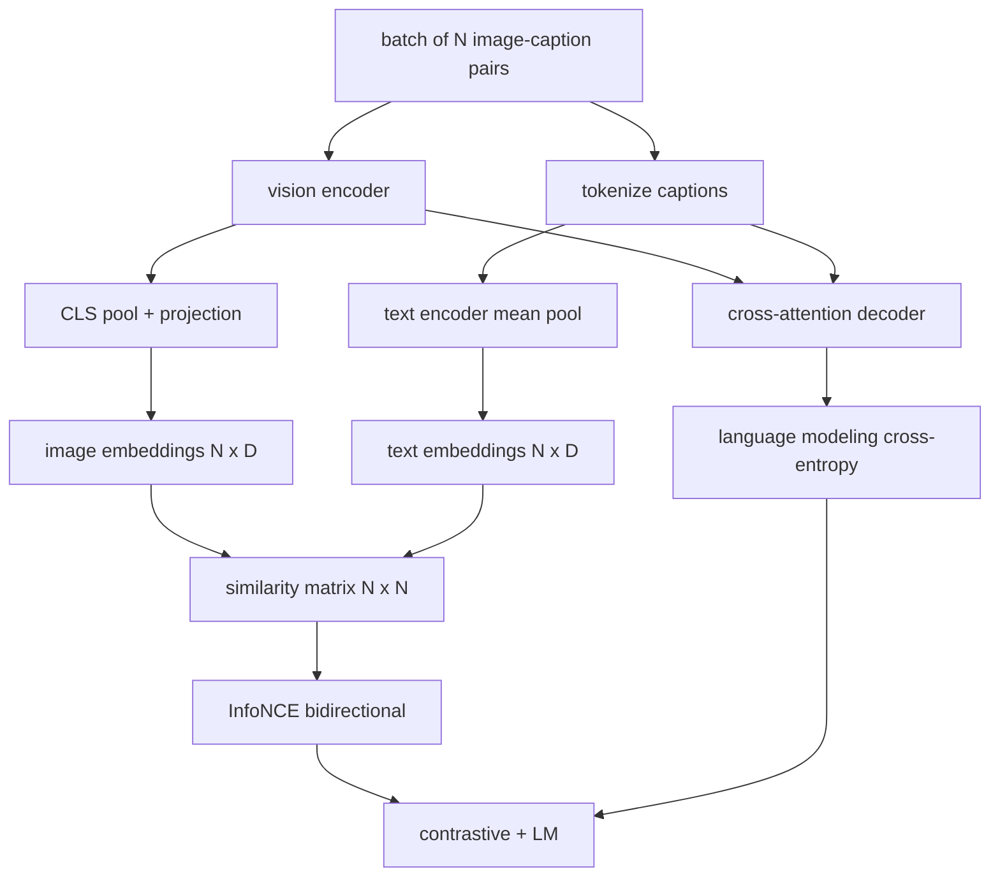

# 视觉语言预训练

> 编码器、投影和码器已接线──现在一起训练他们──两个目标驱动学习:对比图像文本损失(InfoNCE),将匹配在联合嵌入空间中拉拉在一起,以及语言建模损失,要求解码器为每图像添加标题──结合起来,它们教会网络找到合适的图像作为标题并为图像编辑标题──

**Type:** Build
**Languages:** Python
**Prerequisites:** 第19期第30-37课（B轨基础）
**Time:** ~90 分钟

## 学习目标

- एक बैच छवि शीर्षक के लिए एक प्रतिमान हानि के लिए InfoNCE को प्राप्त करना।
- अपघटन के प्रति हानि तथा स्व-प्रस्थान भाषा निर्माण
- 合成 200 प्रतिरूपण छवि साइड इफेक्ट भाषा सामग्री भंडार, बिना डाउनलोड के वास्तविक डेटा संग्रह
- 运行 50 步演示 प्रशिक्षण चक्र并观察损失的减少──

## 问题

视觉语言模型需要两项技能――它必须排名:给定标题,在众多图像中找到正确图像――它必须生成:给定一个图像,写一个标题――只针对一个技能对模型进行预训就可以得到半系统―― CLIP 确定排名,但无法提供字幕―― GPT-4V 添加字幕,但使用单独检索头进行排名――多目标预训一次即可实现这两个目标――

InfoNCE                                                                                                                                                                                                                                                                                                                                                                                                                                                                                                                           `N^2 - N`नकारात्मक उदाहरण के लिए, और उत्पन्न करने के लिए।`(N, N)`समानता रक्छा संचालित पारस्परिक  हानि  LM  हानि प्रसंस्करण उत्पादन का आधाः छवि-आधारित मानदंडों के अनुसार निम्नलिखित टोकन पूर्वानुमान  दो प्रकार के नुकसान सभी क्षुद्र हैं, और एडिटर, प्रोजेक्टर और क्वेरी के अधिकारों को साझा कर सकते हैं 

## 概念



### InfoNCE 在一段话中

N 个图像嵌入堆叠为行, N 个文本嵌入堆叠为行―― L2-将两者归结――计算`N x N`矩阵 `S = I T^T / tau`, उनमें से `tau`️️️️️️️️️️️️️️️️️️️️️️️️️️️️️️️️️️️️️️️️️️️️️️️️️️️️️️️️️️️️️️️️️️️️️️️️️️️️️️️️️️️️️️️️️️️️️️️️️️️️️️️️️️️️️️️️️️️️️️️️️️️️️️️️️️️️️️️️️️️️️️️️️️️️️️️️️️️️️️️️️️️️️️️️️️️️️️️️️️️️️️️️️️️️️️️️️️️️️️️️️️️️️️️️️️️️️️️️️️️️️️️️️️️️️️️️️️️️️️️️️️️️️️️️️️️️️️️️️️️️️️️️️️️️️️️️️️️️️️️️️️️️️️️️️️️️️️️️️️️️️️️️️️️️️️️️️️️️️️️️️️️️️️️️️️️️️️️️️️️️️️️️️️️️️️️️️️️️️️️️️️️️️️️️️️️️️️️️️️️️️️️️️️️️️️️️️️️️️️️️️️️️️️️️️️️️️️️️️️️️️️️️️️️️️️️️️️️️️️️️️️️️️️️️️️️️️️️️️️️️️️️️️️️️️️️️️️️️️️️️️️️️️️️️️️️️️️️️️️️️️️️️️️️️`argmax`沿对角线运行:行 `i`                                                                                                                                                                                                                                                                                                                                                                                                                                                                                                                             `i`मध्य के पास उच्चतम श्रेणीएँ हैं।

### तापमान बहुत महत्वपूर्ण है

 तापमान `tau`控制软max 的峰值程度──太小(उदाहरण के लिए `tau = 0.01`) और तरंग केवल सबसे कठिन नकारात्मक मूल्य से आती है, प्रशिक्षण में शोर होता है, बहुत बड़ा, नरम अधिकतम होता है और तरंग गायब हो जाता है, CLIP सीखना`tau`作为参数; यहाँ प्रस्तुतियाँ भी इसी प्रकार की हैं 

### 语言建模损失

解码器通过交叉注意力消耗图像内存代码,并预测每位置的下一个文本代码. 损失是与下一个位置目标的标准交叉. 填充位置被隐藏在损失之外.

### 合并损失

`total = contrastive + lm_weight * lm`, उनमें से `lm_weight`यह एक बहु-कार्य संयोजन है, जिसका अलग-अलग वजन है। सिगलिप केवल विपरीत 项 को बनाए रखता है, और सिग्मोइड जोड़ी हानि का उपयोग करता है।

|组件|损失面|影响|
|-----------|--------------|---------|
|信息NCE |联合空间中的配对排名 |编码器+投影+文字头|
| LM |以图像为条件的 token预测 |编码器+投影+解码器 |
|合并|多任务 |全栈|

### क्यों 50 चरणों के लिए प्रदर्शन के लिए पर्याप्त है

模拟语料库 एक संश्लेषित 200 सेट है, जिसमें随机图像和随机标题 ID शामिल है। 16 के 50 SGD 步骤 के बाद, भले ही वास्तविक डेटा मॉडल द्वारा प्राप्त स्तर के ऊपर निरपेक्ष मूल्य बनाए रखा जाए, दोनों प्रकार के नुकसान भी स्पष्ट रूप से कम हो जाएंगे। प्रदर्शन का उद्देश्य ट्यूबिंग के अंत से अंत तक काम की डिग्री की पुष्टि करना है, और LM 损失 को जोड़ना लक्ष्य की स्थिरता को प्रभावित नहीं करेगा।


```figure
ch-infonce-diagonal
```

##  इसे निर्माण

`code/main.py`实现:

- `MultimodalModel`, एक छोटे से वीटी 编码器、MLP 投影仪、 एक छोटे से पाठ पक्ष编码器(嵌入式 id 上的平均值池) तथा कक्षा 61 में交叉注意解码器──
- `info_nce_loss(image_emb, text_emb, temperature)`, द्वि-तरफा CLIP 式对比损失──
- `lm_loss(logits, target_ids, padding_id)`,屏蔽的下一个代码交叉──
- `make_mock_corpus(seed, n_pairs)`, लौटें 200 个确定性(图像、caption_ids)对──
-  प्रशिक्षण चक्र चलाना 50 步骤, मात्रा आकार 16 आदम  अनुकूलक और सीखने के लिए संख्यात्मक तापमान पैरामीटर  प्रत्येक 5 步骤 इन दोनों हानि एक बार छपाते हैं

运行它:

```bash
python3 code/main.py
```

输出: लगभग से हानि के मुकाबले `ln(16) = 2.77`2.4 तक गिर गया; LM  घाटा से `ln(512) ≈ 6.24`की रेंज घटकर 4.7 हो गई है। दो बार घटकर यह साबित हुआ है कि रेंज सही है।

## इसका उपयोग करें

यह एक ही नुकसान की संरचना हैः

- **CLIP (2021)。** केवल छवि-पाठ के विरूद्ध, के साथ एक अलग 结编码器字幕探针
- **CoCa (2022).**एक मॉडल में छवि पाठ के प्रति छवि शीर्षक के साथ तुलना LM 损失―― इस वर्ग के निर्माण के सटीक मॉडल――
- **BLIP (2022) 和 BLIP-2.**तुलनात्मक रूप से LM के साथ तुलनात्मक रूप से
- **SigLIP (2023).**InfoNCE को हानि के लिए सिग्मोइड में परिवर्तित करना; समान तुलनात्मक प्रभाव, विभिन्न कार्य प्रारूपों में।
- **LLaVA 系列。**两阶段训练,其中第一阶段是对齐 (结 LM上的余弦),第二阶段使用未结的 LM 添加 LM 损失――第60 课对应第一阶段;本课对应第二阶段――

## 测试

`code/test_main.py`涵盖:

- InfoNCE 损失在图像/文本行之间是对称的
- जब समानता रक्छा बड़ी संख्या के सही कोण के लिए सही है, तो सूचना हानि 0 लौटाता है
- LM हानि सही ढंग से भरा हुआ स्थान को छिपाया
- 模型前向传递 दो प्रकार के नुकसान और कोई त्रुटि उत्पन्न होती है
- 5 चरण प्रशिक्षण चक्र में घटता है संयोजन हानि

运行它们:

```bash
python3 -m unittest code/test_main.py
```

## अभ्यास

1. InfoNCE  को हानि के लिए SigLIP 风格 के सिग्मोइड के रूप में बदलना और इसे भाषा भंडार पर तुलनात्मक रूप से प्राप्त करना

2. 添加硬负挖掘步骤: प्रत्येक खंड में, पहले खंड में से सबसे कठिन गैर-प्रतिबंधात्मक भागों का चयन करना और इसे जोड़ना।

3. संयुक्त में सम्मिलित शीर्ष पर छवि-पाठ मेल खाने का दोयम संयोजन शीर्षक (२)

4. इस प्रकार, मार्कोव श्रृंखला से निकाले गए शीर्षक आईडी अनुक्रमों के लिए प्रतिमागत भाषा सामग्री के भंडार को प्रतिस्थापित करना, जो मार्कोव श्रृंखला के प्रतिमा रूपांतरण रक्कम के लिए हैशी के लिए शर्त है।

5. उपयोग `lm_weight = 0` प्रशिक्षण समान मॉडल, फिर उपयोग `lm_weight = 1`पुनः प्रशिक्षण--- तुलना-प्रति-प्रति हानि; LM 损失不应影响排名目标---

## 关键术语

|术语 |这意味着什么 |
|------|---------------|
|信息NCE |噪声对比估计：相似度矩阵上的交叉熵 |
|温度|控制对比 softmax 的峰值程度的标量 |
|硬阴性|模型发现的非对角线对令人困惑，但对于采样很有用 |
| LM 损失 |字幕侧的标准下一个token交叉熵 |
|联合嵌入空间|投影后图像和文本向量所在的共享空间 |

##  आगे पढ़ें

- मूल के मुकाबले व्यंजनों के लिए उपयोग किया गया कागज
- एक मॉडल में लिपि से तुलना करने के लिए प्रयोग किया जाता है।
- सिग्लिप 论文, ने बिगमोइड के लिए हानि परिवर्तन और विस्तार की बेहतर कारणों की शुरूआत की।
