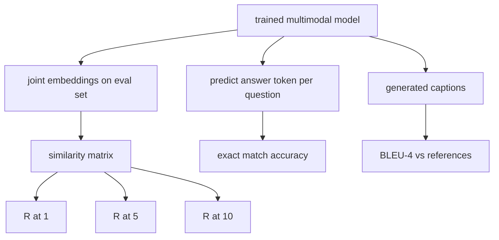

# 多模态评估

> 培训是循环的一半――另一半是测量――本课程从基元构建三个评估表面:图像标题检索报告为R@1、R@5、R@10;视觉问答报告为精确匹配准确性;图像字幕报告为BLEU-4── प्रत्येक सूचक मॉडल आउटपुट फ़ंक्शन और कुछ सेकंड में चलने वाले समग्र मूल्यांकन套件 हैं──

**Type:** Build
**Languages:** Python
**Prerequisites:** 第19期第58-62课（Track E基础：编码器、Transformer、投影、交叉注意力融合、预训练）
**Time:** ~90 分钟

## 学习目标

- 图像和标题嵌入之间的相似性矩阵计算 Recall@K。
-                                                                                                                                                                                                                                                               
- उत्पन्न और संदर्भ टोकन क्रम से BLEU-4 की गणना की जाती है, बिना किसी बाहरी भंडार की आवश्यकता नहीं है।
-  सभी तीन मूल्यांकनों को 62                                                                                                                                                                                                                                                                                                                                                                                                                                                                                                                      

## 问题

जब प्रशिक्षण हानि स्थिर होने की प्रवृत्ति होती है, तो हम बहुआयामी मॉडल को पूरा घोषित करते हैं। प्रशिक्षण हानि का माप प्रशिक्षण वितरण के लिए उपयुक्त है; यह यह माप नहीं सकता है कि क्या मॉडल को आरक्षित बैचों में से किसी के लिए रैंकिंग करने के लिए सक्षम है, प्रश्नों का उत्तर देने या मानव सम्मेलन द्वारा स्वीकार किए गए शीर्षक को लिखने के लिए।

- **检索（R@1，R@5，R@10）。**प्रश्न शीर्षक संयुक्त सम्मिलन का निर्माण; मूल्यांकन तालिका में प्रत्येक छवि को शेष弦 के आधार पर क्रमबद्ध करना; रिपोर्ट मिलान छवि के पहले 1 、 पहले 5 、 पहले 10 名── के लिए
- **视觉问答（完全匹配）。**给定(图像,问题),模型输出一个答案token──精确匹配是每个样本一个:预测答案是否等于参考答案?评估集的平均值──
- **字幕 (BLEU-4)。**生成字幕── संदर्भ शीर्षक के अनुसार गणना 1 克 से 4 克 सटीकता के ज्यामितीय औसत मूल्य,并牺牲简洁性──多重参考是标准形式(一张图像,多个参考题)。

प्रत्येक माप एक पतला फ़ंक्शन है। इस पाठ्यक्रम में वे सभी कोड के साथ बनाए जाएंगे, इसलिए गणित विशिष्ट है, और सतह अभी भी आपके नियंत्रण में है।

## 概念



### से समरूपता矩阵中调用@K

 छवि और शीर्षक के बीच इम्बेड का निर्माण `(N, N)`余弦相似性矩阵── प्रत्येक पंक्ति के लिए, क्रमबद्ध क्रम क्रमबद्ध करने के लिए क्रमबद्ध करना, क्रमबद्धता के अनुसार क्रमबद्ध करना। स्मरण@के = पूर्व K 个位置 के भीतर स्थित रेखाओं के विभाजन के लिए क्रमबद्ध सूचकांक।

### VQA 精确匹配

 प्रत्येक  छवि  प्रश्न  उत्तर के लिए),  छवि को कोड करने, एम्बेड करने,  प्रश्न को हल करने के लिए,  समाहित करने के लिए,  एक टोकन  को पढ़ने के लिए  को पढ़ना ;  अनुमानित टोकन आईडी की तुलना संदर्भ आईडी से करें; यदि समान सही हो तो  मूल्यांकन संग्रह का औसत मूल्य;  वास्तविक वीक्यूए डेटा संग्रह प्रत्येक प्रश्न के साथ कई व्यक्तिगत टिप्पणी के उत्तर,  और  सॉफ्ट सटीकता सूत्र का उपयोग करें यदि 10 टिप्पणीकारों में से कम से कम 3 सहमत हों, तो  1.0, उदाहरण के लिए नीचे;  स्पष्टता प्राप्त करने के लिए, इस पाठ्यक्रम का उपयोग एक ही उत्तर से पूरी तरह मेल खाता है

### ब्लू-4

```math
\text{BLEU-4} = \text{BP} \cdot \exp\big(\text{mean}(\log p_1, \log p_2, \log p_3, \log p_4)\big)
```

उनमें से `p_n`n पूर्वभाषा法 सटीकता (n पूर्वभाषा法 सटीकता) , जो किसी भी संदर्भ में उत्पन्न होने वाले n पूर्वभाषा के परिच्छेद गणना के अलावा उत्पन्न होने वाले n पूर्वभाषा के कुल संख्या में दिखाई देती है,`BP`                                                                                                                                                                                                                                                              

```math
\text{BP} = \begin{cases} 1 & \text{当生成长度} > \text{参考长度} \\ \exp(1 - r/g) & \text{否则，其中 } r \text{ 为参考长度，} g \text{ 为生成长度} \end{cases}
```

 के लिए कुछ `p_n`                                                                                                                                                                                                                                                              

### 综合评估套件

एक 50 नमूनों के मूल्यांकन सेट में अनुच्छेद 62 में उपयोग किए जाने वाले समान अनुकरणीय भाषा संग्रह मॉडल के आधार पर स्मृति में निर्मित, और संरक्षित बीज हैं।

- `pairs`:50 个(图像、caption_ids) के लिए प्रयोग किया जाता है
- `vqa`:50 个(图像、问题 ID、答案 ID) 三元组──
- `caps`:50 个(图像, संदर्भ_शीर्षक_आदेश,...])条目, प्रत्येक图像最多 3 个引用──

यह सेट बीज से निर्धारित और प्रशिक्षण की भाषा सामग्री भंडार में संरक्षित है, इसलिए संकेतक मॉडल के आधार पर डेटा गणना है जो कभी नहीं देखा गया है।

|指标|范围 |随机基线 (N=50) |
|--------|-------|------------------------|
| R@1 | 0 到 1 | 0.02（1/N）|
| R@5 | 0 到 1 | 0.10 |
| R@10 | 0 到 1 | 0.20 |
| VQA EM | 0 到 1 | 1 / 词汇 |
| BLEU-4 | 0 到 1 |小但非零 |

संश्लेषित डेटा पर चल रहे 50 चरणों के प्रशिक्षण के लिए, अनुमानित संकेतकों बहुत अधिक नहीं होंगे; वे अनुमानित आधार रेखा से अधिक होंगे, यह प्रदर्शन जांच की सामग्री है


```figure
ch-recall-window
```

##  इसे निर्माण

`code/main.py`实现:

- `recall_at_k(sim_matrix, k)`, दो दिशाओं में वापसी `[0, 1]`मध्य में浮点数──
- `vqa_exact_match(predictions, references)`, वापसी `int`समान समान का औसत मूल्य
- `bleu4(generated, references, smoothing=True)`, के लिए कई संदर्भ समर्थन है।
- `build_eval_suite(seed, n_samples, vocab_size, max_len)`, तीन निश्चितता मूल्यांकन सूची पर लौटें
- `evaluate(model, suite)`, यह सभी तीन संकेतकों को चला जाता है और वापस आ जाता है ।`dict`संख्याएँ
- एक प्रस्तुति, कक्षा 62 में नए आरंभिक बहुआयामी मॉडल को लोड करें, उसका मूल्यांकन करें, फिर 50 चरणों का प्रशिक्षण करें और फिर उसका मूल्यांकन करें, प्रिंट से पहले/बचे के संकेतकों को।

运行它:

```bash
python3 code/main.py
```

输出: पहले/पछ के मापसूत्र में सुधार से मॉडल सीखने के संकेतों में सुधार, VQA  सुधार से अधिक है, BLEU-4  सुधार

## इसका उपयोग करें

प्रत्येक सूचक का उत्पादन आधार पर प्रत्यक्ष रूप से चित्रण किया जाता हैः

- **检索。**एमएस-कोको 5K वैल व फ्लिकर30K एक ही समानता रक्च पर R@K  समस्या है। ImageNet 零样本 भी इस रक्च पर उपयोग करता है, प्रत्येक श्रेणी में एक शीघ्र एम्बेडिंग है, लेकिन यह शीर्ष-1 分类准确率 की रिपोर्ट करता है, यानि ऊपर के श्रेणी में R@1  के अनुरोधों में।
- **VQA。**VQA v2、GQA、OK-VQA उपयोग समान सटीक मिलान आकारों(उपयोग सॉफ्ट-acc और नहीं VQA v2 के एकल उत्तर EM) 
- **BLEU-4.**MS-COCO 字幕、NoCaps、Flickr30K 字幕均使用BLEU-4加 CIDER 和 METEOR──添加 CIDER 是另一项功能──

 वास्तविक आधारभूत परीक्षण के लिए, कृपया `build_eval_suite`替换为真正的加载程序并保留函数体──数学与基准无关──

## 测试

`code/test_main.py`涵盖:

-recall@k में परफेक्ट स्टेटस समानांतरता矩阵 पर लौट 1.0, में翻转矩阵 पर लौट 0.0 ((k < N)
- recall@k 尊重 `k <= N`ऊपर सीमा
- जब उत्पन्न ब्लू4  पूर्ण रूप से संदर्भ में से एक के बराबर है, वापस 1.0
- ब्लू4 在不相交词汇上返回 0.0
- vqa  सटीक मेल-जोल बराबर बराबर बराबर के अनुपात
- build_eval_suite  वापसी अपेक्षित के लिए संख्या vqa 项 और शीर्षक 条目 संख्या

运行它们:

```bash
python3 -m unittest code/test_main.py
```

## अभ्यास

1. सीआईडीईआर को एन-ग्राम में टीएफ-आईडीएफ के अतिरिक्त अधिकार का उपयोग करके साइन-इन में जोड़ा जाएगा, जो जानकारी समृद्ध के टोकन को पुरस्कृत करेगा।

2. 实施软精度VQA: प्रत्येक प्रश्न के अनेक व्यक्तिगत कार्य उत्तर हैं, यदि कोई मेल खाता है, तो सटीकता के लिए `min(human_count / 3, 1)`复制 VQA v2──

3. 添加 `bleu4`NaN सुरक्षा परिवर्तन, संसाधित किया जा सकता है और टूट नहीं होगा।

4. आर @ के एक से गणना औसत倒数排名 (MRR) 

5. प्रशिक्षण के दौरान छह जांच बिंदुओं ने मॉडल के संचालन का मूल्यांकन किया।

## 关键术语

|术语 |这意味着什么 |
|------|---------------|
| R@K |正确匹配出现在前 K 个结果中的查询比例 |
|精确匹配 |最简单的VQA评分：预测答案等于参考|
| BLEU-4 | 1 到 4 克精度的几何平均值，带有简洁性代价 |
|多参考|字幕指标接受每个图像的多个参考字幕 |
|保留 |评估集是从与训练语料库不相交的种子中采样的 |

##  आगे पढ़ें

- सॉफ्टवेयर सटीकता सूत्रों और डेटासेट सांख्यिकी के VQA v2 论文 पर आधारित है।
- TF-IDF 加权 n-gram 字幕 के सीआईडीईआर 论文
- BLEU 原始版本(Papineni 等人,2002) के लिए प्रयोग किया जाता है平滑变体──
- नियमानुसार कार्यान्वयन के लिए एमएस-सीओसीओ 字幕 मूल्यांकन की पुस्तक
