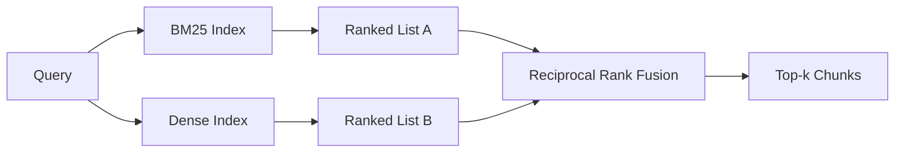

# BM25 और गहन एम्बेडेड मिश्रित जांच

> 词汇和语义检索相反的查询分布上失败──倒数排名融合的混合检索不会插值,而是投票 - 并且投票在每个查询类上获胜──

**Type:** Build
**Languages:** Python
**Prerequisites:** 第 11 阶段课程 04（嵌入）、06（RAG）；第 19 阶段 Track B 基础（第 20-29 课）；第 19 阶段第 64 课（分块策略）
**Time:** ~90 分钟

## 学习目标
- रॉबर्टसन और स्पार्क जोन्स के अनुसार, BM25 के कार्यान्वयन के लिए एक सूत्र है, जिसमें एक अतिरिक्त श्रेणी है, दस्तावेज की लंबाई का मानकीकरण है, और एक और एक को समायोजित किया जा सकता है।
- इस पर एक गहन जांचकर्ता बनाया गया है, ताकि यह लूप ऑफ़लाइन चल सके।
- 完全按照 Cormack、Clarke 和 Buettcher द्वारा 2009 में प्रकाशित की गई रूप में 倒数等级融合 को प्राप्त करना,并解释为什么它占据分数加权插值中的主导地位──
- 调整 RRF k 常数和每种模态权重, और लघु फिटिंग 语料库上读取权重──

## 问题

जब प्रश्न में शब्द सामग्री के संग्रह में शब्द चिन्ह शामिल होते हैं, शब्द विधि खोज जीत-जीत।`AbortMultipartOnFail`प्रश्न BM25 के माध्यम से माइक्रोसेकंड में सही Go फ़ंक्शन को लौटाएगा।

जब पूछताछ को दूर से भाषा भंडार के पाठ टोकन के रूप में समझाया जाता है, तो घनिष्ठ खोज जीत जाएगी। उपयोगकर्ता पूछते हैं कि हम कैसे उपरोक्त उपरोक्त उपरोक्त उपरोक्त उपरोक्त उपरोक्त उपरोक्त उपरोक्त उपरोक्त उपरोक्त उपरोक्त उपरोक्त उपरोक्त उपरोक्त उपरोक्त उपरोक्त उपरोक्त उपरोक्त उपरोक्त उपरोक्त उपरोक्त उपरोक्त उपरोक्त उपरोक्त उपरोक्त उपरोक्त उपरोक्त उपरोक्त उपरोक्त उपरोक्त उपरोक्त उपरोक्त उपरोक्त उपरोक्त उपरोक्त उपरोक्त उपरोक्त उपरोक्त उपरोक्त उपरोक्त उपरोक्त उपरोक्त उपरोक्त उपरोक्त उपरोक्त उपरोक्त उपरोक्त उपरोक्त उपरोक्त उपरोक्त उपरोक्त उपरोक्त उपरोक्त उपरोक्त उपरोक्त उपरोक्त उपरोक्त उपरोक्त उपरोक्त उपरोक्त उपरोक्त उपरोक्त उपरोक्त उपरोक्त उपरोक्त उपरोक्त उपरोक्त उपरोक्त उपरोक्त उपरोक्त उपरोक्त उपरोक्त उपरोक्त उपरोक्त उपरोक्त उपरोक्त उपरोक्त उपरोक्त उपरोक्त उपरोक्त उपरोक्त उपरोक्त उपरोक्त उपरोक्त उपरोक्त उपरोक्त उपरोक्त उपरोक्त उपरोक्त उपरोक्त उपरोक्त उपरोक्त उपरोक्त उपरोक्त उपरोक्त उपरोक्त उपरोक्त उपरोक्त उपरोक्त उपरोक्त उपरोक्त उपरोक्त उपरोक्त उपरोक्त उपरोक्त उपरोक्त उपरोक्त उपरोक्त उपरोक्त उपरोक्त उपरोक्त उपरोक्त उपरोक्त उपरोक्त उपरोक्त उपरोक्त उपरोक्त उपरोक्त उपरोक्त उपरोक्त उपरोक्त उपरोक्त उपरोक्त उपरोक्त उपरोक्त उपरोक्तरोक्तरोक्त उपरोक्तरोक्तरोक्तरोक्तरोक्तरोक्तरोक्तरोक्तरोक्तरोक्तरोक्तरोक्तरोक्तरोक्तरोक्तरोक्तरोक्तरो के रूपरोक्तरो रूपरो रूपरोक्तरोक्तरो रूपरो रूपरो रूपरोक्तरोक्तरो रूपरो रूपरो रूपरो रूपरो रूपरो रूपरो रूपरो रूपरो रूपरो रूपरो रूपरो रूपरो रूपरो रूपरो रूपरो रूपरो रूप

दो के बीच चयन एक पूर्ण अपरिवर्तित नहीं है।                                                                                                                                                                                                                                                         

## 概念



### BM25 一段话

BM25  द्वारा प्रश्न पत्र के लिए प्रश्न पत्र की आवृत्ति कारक को गुणा करके दीर्घता एवं प्रश्न पत्र की आवृत्ति कारक को समाहित करें`k1`控制词频和度;默认值 1.5 已发布的建议,您不应在没有基准的情况下移动它──`b` नियंत्रण दस्तावेज लंबाई का महत्व;默认值 0.75

आईडीएफ 公式使用平滑的 रॉबर्टसन 和 स्पार्क जोन्स 定义,即 `log((N - df + 0.5) / (df + 0.5) + 1)` जब किसी शब्द का आधे से अधिक शब्द संग्रह में प्रयोग होता है, तो 日志 में जोड़ा जाने से IDF का सही मूल्य कायम रहता है यह छोटे शब्द संग्रह के लिए महत्वपूर्ण है, क्योंकि तकनीकी रूप से, शब्द का उपयोग करना बहुत कम होता है

字段加权可让你告诉 BM25,符号名称上的匹配比正文中的匹配更重要── अंजाम देना सूचकांक प्रक्रिया में शब्दावली गिनती का गुणा है, न कि मूल्यांकन के समय शब्दावली गिनती का। इस प्रकार गणित एक जैसा बना रहेगा, तथा प्रत्येक क्षेत्र में अलग-अलग अंक होने से बचना होगा──

### एक段中的密集检索

उपयोग में एम्बेडेड मॉडल प्रत्येक ब्लॉक को फिक्स्ड आयाम के वेक्टर में एम्बेडेड करेगा। जब पूछताछ की जाती है, एम्बेडेड पूछताछ, प्रत्येक ब्लॉक को समानता के आधार पर अतिरिक्त स्ट्रिंग रेंज करती है, और पहले के लिए लौटती है। मॉडल गुणवत्ता की चर को निर्धारित करता है।

इस पाठ्यक्रम में निश्चितता पर आधारित हैश की स्थापना का उपयोग किया गया है, इसलिए आपको नेटवर्क के उपयोग की आवश्यकता नहीं है।

### 倒数秩融合,已公布的公式

两排列榜――任一列表中出现的每一位候选人,将其倒数排列榜贡献相加―― 2009 का论文使用`1 / (k + rank)`,k 60 के बराबर है, जो कि एक मान है।

प्रकाशित की गई सामान्य संख्या k = 60 नहीं है किसी भी प्रकार की। जब k = 60 时,排名 1 का योगदान 1 / 61,排名 10 का योगदान 1 / 70 ⋅ है। योगदान में गिरावट धीमी है, इसलिए गहनता उम्मीदवारों ने अभी भी मतदान किया है।

हमारे दो कामों में से एक को हम पूरा कर सकते हैं।`k`常数── प्रत्येक प्रकार के मॉडल के वजन पर, ताकि जब आपके पास पहले से सबूत हो कि उनमें से एक आपके भाषण संग्रह में बेहतर है, तो आप BM25 या घनत्व में वृद्धि कर सकें।

### क्यों फ्यूजिंग से बेहतर है भाग संख्या + अधिकार जोड़ने मूल्य

बीएम25 का अंश निर्बाध है और भाषा सामग्री के आधार पर निर्भर है।`alpha * bm25 + (1 - alpha) * cosine`需要每语料库的阿尔法调整,并且每次重新索引时都会中断. 级别融合则不然. 两级在不同模式下具有可比性. 2010 से, प्रकाशित आरआरएफ基线在每一个公共TREC赛道上都击败了分数插值.  यह आपके द्वारा वेस्पा और वेविएट 文档 में सुना गया रैंकफ्यूजन और आरआरएफ के बारे में समान तर्क के साथ है।  वे एक ही निष्कर्ष निकालते हैंः जब तक आपके पास बहुत मजबूत सबूत नहीं हैं, तब तक क्रमबद्धता पर आधारित रहें।


```figure
rrf-fusion
```

##  इसे निर्माण

`code/main.py`实现:

- `tokenize(text)`- 快速正则表达式token器──
- `BM25Index`- 场加权,带有 `add`和 `search`तथा क्यूल क्यूल क्यूल क्यूल क्यूल क्यूल क्यूल क्यूल क्यूल क्यूल क्यूल क्यूल क्यूल क्यूल क्यूल क्यूल क्यूल क्यूल क्यूल क्यूल क्यूल क्यूल क्यूल क्यूल क्यूल क्यूल क्यूल क्यूल क्यूल क्यूल क्यूल क्यूल क्यूल क्यूल क्यूल क्यूल क्यूल क्यूल क्यूल क्यूल क्यूल क्यूल क्यूल क्यूल क्यूल क्यूल क्यूल क्यूल क्यूल क्यूल क्यूल क्यूल क्यूल क्यूल क्यूल क्यूल क्यूल क्यूल क्यूल क्यूल क्यूल क्यूल क्यूल क्यूल क्यूल क्यूल क्यूल क्यूल क्यूल क्यूल क्यूल क्यूल क्यूल क्यूल क्यूल क्यूल क्यूल क्यूल क्यूल क्यूल क्यूल क्यूल क्यूल क्यूल क्यूल क्यूल क्यूल क्यूल क्यूल क्यूल कय कय
- `mock_embed``DenseIndex`- धारा 64 के समान निश्चितता में एम्बेड, इसलिए ब्लॉक की तुलनात्मकता है
- `rrf(rankings, k, weights)`- प्रकाशित बहुआयामी अधिकार पुनर्संवर्धन
- `HybridRetriever`- 结合了BM25和密集──
- एक प्रदर्शन`main()`, एक छोटा सा फिस्टिंग 语料库 लोड करें, तीन विशेष रूप से प्रत्येक खोजकर्ता के फायदे और कमियों के बारे में पूछताछ प्रदर्शित करें, और प्रत्येक मॉडल उत्पन्न की रैंकिंग और एकीकरण सूची को प्रिंट करें

运行它:

```bash
python3 code/main.py
```

并排读演示输出──文字标识符查询位于 BM25 排名 1、密集排名 4、RRF 排名 1──释义查询位于 BM25 排名 6、密集排名 1、RRF 排名 1──模糊查询位于 BM25 排名 3、密集排名 3、RRF 排名 1── यह प्रत्येक पूछताछ श्रेणी पर जीत प्रणाली में है──

## 调整旋

|旋钮|默认|何时调高|何时调低|
|------|---------|----------------|------------------|
| BM25 k1 | 1.5 |文档中的术语会重复，且你希望频率更重要 |文档很短，术语重复主要是噪音 |
| BM25 b | 0.75 |长文档确实每个词携带的信息更少 |文档长度与主题无关 |
| RRF k | 60 |较深排名的候选仍应投票 |Top-1 应该占主导 |
| BM25 weight | 1.0 |语料库包含字面标识符，查询也按字面匹配 |查询多为用户改写 |
| Dense weight | 1.0 |查询多为改写或语义表达 |查询多为字面表达 |

 अनुचित रूप से नहीं बल्कि अनुचित रूप से  के लिए अनुचित रूप से  के मूल्यांकन उपकरण को पुनः लागू करके  के लिए आरक्षित प्रश्न संग्रह पर पुनः प्रयोग किया गया है।

## 演示将隐藏的故障模式

**词汇外token。**BM25 का IDF भाषा भंडार के आधार पर गणना की गई है, इसलिए केवल पूछताछ में शब्द योगदान शून्य है। गहन एम्बेडेड एक ही वेक्टर का निर्माण करेगा।

**停止token统治。**BM25 针对单词the在语料库中产生统一的排名──过索引器中停止token或接受高 IDF 术语自然占主导地位──

**跨模态的内容相同。**यदि आपका भाष्य भंडार पर्याप्त छोटा है, तो BM25 का शीर्ष-1 भी गहन शीर्ष-1 है, तो आरआरएफ आपको समान पड़ोसी के समान शीर्ष-1 प्रदान करेगा। यह एक सही व्यवहार है, असफल नहीं है, लेकिन यह एकीकरण को अदृश्य बनाता है। मूल्यांकन में प्रतिरोधी पूछताछ को जोड़ने के लिए यह सत्यापित करें कि क्या एकीकरण वास्तव में प्रभावी है।

## इसका उपयोग करें

生产模式:

- 索引 BM25 正在处理中;瓶是词频字典,而不是向量──
- इस वर्ग में हम क्षैतिज सूची का उपयोग करते हैं; उत्पादन में आप HNSW का उपयोग करेंगे)
- और दो प्रश्नों का संचालन करता है; एकीकरण एक समकक्ष के लिए एक निश्चित समय है।
- प्रत्येक जांच तक के जीवन में मोड को बनाए रखें, ताकि निम्न क्रमबद्धकर्ता यह देख सकें कि किस प्रकार के मोड में मतदान किया जा सकता है।

## 发货

धारा 66  कक्षा में इस कक्षा में संयोग शीर्ष-क और संवर्धित कोडिंगर का उपयोग पुनः क्रमबद्ध करना। धारा 68  कक्षा में सटीकता, कॉल-ट्रीट, एमआरआर और एनडीसीजी का उपयोग करके संपूर्ण प्रक्रिया का आकलन करना।

## अभ्यास

1. `mock_embed`替代为供应商提供的真实模型──重新运行演示并报告 只有密集排名在释义查询上的变化──
2. 添加第三种模式:单独索引的块摘要并融合为第三排列列表──测量增益──
3. RRF को 10、30、60、100、200、 से जोड़ा जाएगा।
4. सही ढंग से BM25F को प्राप्त करें (प्रत्येक खंड की लंबाई को गुणा करने के बजाय मानकीकृत किया गया है) और सबसे महत्वपूर्ण संसाधित सामग्री के आधार पर तुलना करें।

## 关键术语

|术语 |人们怎么说|它实际上意味着什么 |
|------|-----------------|------------------------|
| BM25 | “词汇搜索” | idf x 饱和 tf x 长度归一化的概率排名 |
|参考文献 | “等级融合”|各个排名列表的 1 / (k + 排名) 之和； k = 60 默认 |
| k1 | “TF 饱和度” |控制重复术语停止添加更多分数的速度 |
|乙| “长度惩罚” | 0 表示忽略文档长度，1 表示完全标准化 |
|场加权 | “符号提升”|在索引期间重复token以增强该字段中的匹配|
|基于排名与基于分数的融合 | “为什么 RRF 优于线性”|不同模式下的排名具有可比性；分数不|

##  आगे पढ़ें

- कॉर्मेक, क्लार्क, बटचर, 倒数排名融合优于孔多塞和个人排名学习方法,SIGIR 2009
- रॉबर्टसन、वाकर、बेउलीयू、गेटफोर्ड、पेन,ओकापी, TREC-3(原始 BM25 论文)
- [Vespa：使用 BM25 和 Embeddings](https://docs.vespa.ai/en/tutorials/hybrid-search.html) मिश्रित जांच
- [Weaviate：混合搜索](https://weaviate.io/developers/weaviate/search/hybrid)
- 第 11 阶段第 06 课 - आरएजी 基础知识
- 第19 阶段 第64 课 - 分块器的输出在此编制索引
- 第19 阶段 第66 课 - 消耗融合的顶-k 的交叉编码器重排序器
