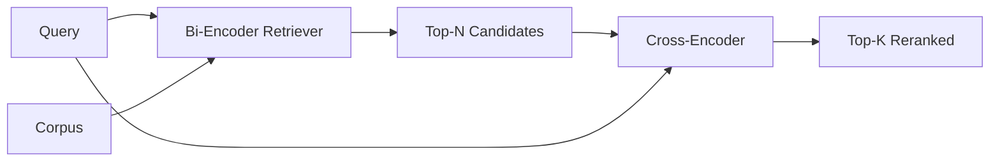

# 交叉编码器重排序

> 双编码器独立嵌入查询和文档――交叉编码器将它们连接起来并同时读取――交叉编码器是最聪明的读者,也是最慢的――双编码器上级的第二级使用,它本身就有价值――

**Type:** Build
**Languages:** Python
**Prerequisites:** 第11期第06课（RAG）、第11期第07课（高级RAG）；第 19 阶段 Track B 基础（第 20-29 课）；第 19 阶段第 65 课（混合检索喂养此阶段）
**Time:** ~90 分钟

## 学习目标
-  इनपुट आकार  पैरामीटर गणना और प्रत्येक क्वेरी के माध्यम से दो कोडिंग मशीनों को अलग करना 
- प्रारंभ से  एक छोटे से पारस्परिक संपादक को ट्रांसफार्मर ब्लॉक के रूप में लागू करना, यह                                                                                                                                                                                                                                                   
- 连接两阶段检索然后重新排序管道: सस्ते检索器检索前 N,交叉编码器使用将 N 重新排序为前 K,返回 K──
- लघु स्थिरता भाषा सामग्री भंडार में देरी और गुणवत्ता के वजन को मापने के लिए, और दिए गए देरी बजट के लिए सही N का चयन करने के लिए।

## 问题

双编码器将查询和文档映射到同一向量空间并按余弦排列中―― ये दो प्रकार के编码永远不会见到对方―― यह मॉडल दस्तावेज़ में सभी उपयोगी सामग्री को एक एकल वेक्टर में संपीड़ित करना चाहिए, बिना पूछताछ पर विचार किए― यह त्वरित索引 है जब प्रत्येक दस्तावेज़ एक बार एम्बेड होता है, जब प्रत्येक प्रश्न एक बार एम्बेड होता है और यह एक मात्र तरीका है जब भाषा सामग्री भंडार के पैमाने पर रैंकिंग होती है

代价就是精度―― एक ही समग्र विषय के दो दस्तावेजों में लगभग एक ही सम्मिलन हो सकता है, भले ही उनमें से एक ने प्रश्न का उत्तर दिया हो और दूसरा कोई उत्तर नहीं दिया हो।

交叉编码器通过一起阅读查询和文件来解决这个问题――该模型接收 `[query] [SEP] [document]`एक ही क्रम के रूप में, पूरे कनेक्शन में पूर्ण ध्यान से चलना, और एक संबंधित संकेत मात्रा उत्पन्न करना दस्तावेज़ के प्रत्येक टोकन में शामिल हो सकते हैं प्रत्येक टोकन में प्रश्नों में भाग लेना

成本就是吞吐量──双编码器嵌入一次并永久查询的情况下,交叉编码器每一次运行──对1000万文件的语料库,每一次查询需要进行1000万次前向传递──在请求预算中无法运行──

 समाधान है分阶段── दोहरे कोडिंग मशीन का उपयोग करें  个前 N 个── दोहरे कोडिंग मशीन का उपयोग करें N 重新排序将 N 重新排序为 top-K── N 很小(50到200), दोहरे कोडिंग मशीन की गुणवत्ता में वृद्धि महत्वपूर्ण स्थानों पर केंद्रित है── कुल देरी अनुरोध बजट में बनी रहे  总质量是交叉 कोडिंग मशीन की गुणवत्ता, इसकी ऊपरी सीमा दोहरे कोडिंग मशीन की N 处召回率 है──

## 概念



### 交叉编码器的输入形状

标准包装为`[CLS] query_tokens [SEP] document_tokens [SEP]`◊ CLS स्थिति आउटपुट  भेजा जाता है  आउटपुट से संबंधित संकेतों की एकल लाइनर headों  कुछ उपयोग करने के लिए औसत मूल्य के बजाय CLS; अंतर बहुत छोटा है 

22M पैरामीटर交叉编码器(प्रकाशित`ms-marco-MiniLM-L-6-v2`权重等级) एक विशिष्ट उत्पादन बिंदु है। ️️️️️️️️️️️️️️️️️️️️️️️️️️️️️️️️️️️️️️️️️️️️️️️️️️️️️️️️️️️️️️️️️️️️️️️️️️️️️️️️️️️️️️️️️️️️️️️️️️️️️️️️️️️️️️️️️️️️️️️️️️️️️️️️️️️️️️️️️️️️️️️️️️️️️️️️️️️️️️️️️️️️️️️️️️️️️️️️️️️️️️️️️️️️️️️️️️️️️️️️️️️️️️️️️️️️️️️️️️️️️️️️️️️️️️️️️️️️️️️️️️️️️️️️️️️️️️️️️️️️️️️️️️️️️️️️️️️️️️️️️️️️️️️️️️️️️️️️️️️️️️️️️️️️️️️️️️️️️️️️️️️️️️️️️️️️️️️️️️️️️️️️️️️️️️️️️️️️️️️️️️️️️️️️️️️️️️️️️️️️️️️️️️️️️️️️️️️️️️️️️️️️️️️️️️️️️️️️️️️️️️️️️️️️️️️️️️️️️️️️️️️️️️️️️️️️️️️️️️️️️️️️️️️️️️️️️️️️️️️️️️️️️️️️️️️️️️️️`bge-reranker-v2-m3`) को ऑनलाइन पुनः श्रेणीबद्ध करने या K 较小的首页 पुनः श्रेणीबद्ध करने के लिए रखा गया है।

### क्यों यह भाग प्रशिक्षण है कि बच्चा

वास्तविक क्रॉस-एडिटर एक सूक्ष्म-संपादित एडिटर है। ट्रांसफार्मर। उत्पादन के दौरान, आप एक चेकपॉइंट लोड करते हैं और इसे चलाते हैं। इस कोर्स में, हमारा लक्ष्य आपको मॉडल के आकार और देरी गुणवत्ता वक्र के आकार को दिखाना है, न कि सबसे उन्नत क्रमबद्ध करने वाले उपकरण का प्रशिक्षण करना है।`nn.Module`, जिसमें एक ट्रांसफार्मर ब्लॉक, कई सिर ध्यान (डीफ़ॉल्ट रूप से 4 सिर) और एक लौटने वाला सिर शामिल है। यह बीज से निश्चित रूप से आरंभ होता है, इसलिए प्रदर्शन को दोहराया जा सकता है, डिस्क पर वजन की आवश्यकता नहीं है।

玩具模型 from fixed speech material library learn correct shape: संबंधित पूछताछ-लेखों के लिए संबंधित नहीं है उच्च अनुमानित अंकों के लिए संबंधित है।

### 延迟与质量

दो चरणों के ट्यूब में एक समायोज्य पैरामीटर हैः N.

|N |第 2 阶段的 recall@1 |每个查询的交叉编码器前向传递 |延迟 |
|---|--------------------|---------------------------------------|---------|
| 5 | 0.62 | 0.62 5 |低|
| 20 | 0.81 | 0.81 20 |中等|
| 50 | 50 0.86 | 0.86 50 | 50高|
| 100 | 100 0.86 | 0.86 100 | 100非常高|

उपरोक्त संख्याएँ केवल आकार का वर्णन करती हैं, न कि इस फिचर्स के माप मूल्य की। आकार वास्तविक है। कुल मिलाकर 20 से 50 उम्मीदवारों के आसपास के मोड़ होते हैं, ताकि पुनर्गठन और उन्नयन के लिए  और  के पार हो जाए।

मूल्यांकन वक्र से N का चयन करना और देरी बजट को जोड़ना।


```figure
rerank-funnel
```

##  इसे निर्माण

`code/main.py`实现:

- `CrossEncoder`- एक छोटा सा `torch.nn.Module`: टोकन एम्बेड, एक बहु-हेड ध्यान और पूर्ववर्ती के साथ ट्रांसफार्मर ब्लॉक, एक संकेत के औसत मूल्य के अंक को उत्पन्न करना
- `tokenize_pair(query, document)`- दो वर्णों को एक आईडी 序列 में संलग्न करना, इसके प्रकार आईडी टोकन सीमाएँ, निश्चितता और stdlib
- `train_tiny(pairs)`- एक बार तीन-वैकल्पिक सूची पर निगरानी प्रशिक्षण आयोजित किया जाए, ताकि मॉडल फिक्स्ड पर उचित अंक उत्पन्न कर सके।
- `rerank(query, candidates, top_k)`- 生产接口──
- `pipeline(query, retriever, top_n, top_k)`- 两级流――
- 演示 `main()`, से पहले N 个, पुनः क्रमबद्ध करने से पहले K 个,并排印两个列表,并报告每阶段的延迟――

运行它:

```bash
python3 code/main.py
```

输出显示双编码器的顶-N、交叉编码器的顶-K以及时间序摘要──交叉编码器 प्रत्येक调用 में अधिक समय की आवश्यकता होती है, लेकिन पूर्ण语料库 पर नहीं चलती── जब दो编码器 रैंकिंग का चयन करें द्वितीय या तृतीय उत्तर, दो चरणों की कुल संख्या अनुरोध बजट के भीतर बनी रहती है──

## 演示将隐藏的故障模式

**交叉编码器不对称。** `rerank(q, d)`和 `rerank(d, q)`️️️️️️️️️️️️️️️️️️️️️️️️️️️️️️️️️️️️️️️️️️️️️️️️️️️️️️️️️️️️️️️️️️️️️️️️️️️️️️️️️️️️️️️️️️️️️️️️️️️️️️️️️️️️️️️️️️️️️️️️️️️️️️️️️️️️️️️️️️️️️️️️️️️️️️️️️

**N 太低，无法暴露该 bug。**यदि N = K सेट करें, तो交叉编码器 पुनः क्रमबद्ध नहीं हो सकता है; यह केवल पुनः पुनः पुनः नामित किया जा सकता है।

**训练数据泄漏到评估中。**यदि किसी भी परीक्षण में मूल्यांकन प्रश्न शामिल हैं, तो यह एक अद्भुत स्थिति है।

**生产权重很密集。**22M 参数交叉编码器                                                                                                                                                                                                                                                          

**批处理很重要。**⇒ ⇒ ⇒ ⇒ ⇒ ⇒ ⇒ ⇒ ⇒ ⇒ ⇒ ⇒ ⇒ ⇒ ⇒ ⇒ ⇒ ⇒ ⇒ ⇒ ⇒ ⇒ ⇒ ⇒ ⇒ ⇒ ⇒ ⇒ ⇒ ⇒ ⇒ ⇒ ⇒ ⇒ ⇒ ⇒ ⇒ ⇒ ⇒ ⇒ ⇒ ⇒ ⇒ ⇒ ⇒ ⇒ ⇒ ⇒ ⇒ ⇒ ⇒ ⇒ ⇒ ⇒ ⇒ ⇒ ⇒ ⇒ ⇒ ⇒ ⇒ ⇒ ⇒ ⇒ ⇒ ⇒ ⇒ ⇒ ⇒ ⇒ ⇒ ⇒ ⇒ ⇒ ⇒ ⇒ ⇒ ⇒ ⇒ ⇒ ⇒ ⇒ ⇒ ⇒ ⇒ ⇒ ⇒ ⇒ ⇒ ⇒ ⇒ ⇒ ⇒ ⇒ ⇒ ⇒ ⇒  ⇒    ⇒  ⇒    ⇒      ⇒           ⇒                                                                                                                                                                                                                                                                                         `_batch_encode`中执行此操作, यह उपयोग `torch.tensor(...)`构建批量 id 和 प्रकार-id 张量并运行一次前向传递──跳过批处理,延迟会乘以 N──

## इसका उपयोग करें

生产模式:

- दोहरे कोडिंग मशीनों को जोड़ना, पारस्परिक कोडिंग मशीनों को जोड़ना और N को एक साथ जोड़ना, किसी भी परिवर्तन से मूल्यांकन निष्क्रिय हो जाएगा।
- 通过 (query, document_id) 哈希缓存重排器的输出──稳定语料库上的相同查询会重排成相同顺序;缓存命中可以免费降低延迟──
- 记录排名第 1 的交叉编码器分数──top-1 分数低于语料库特定值的查询是域外命中;让LLM表达我不确定──

## 发货

धारा 68  कक्षा समाप्ति से समाप्ति तक इस दो चरण के ट्यूब का मूल्यांकन करें  कक्षा 69  कक्षा 65  कक्षा के मिश्रित जांचकर्ता के बाद इस भारोत्तोलन को जोड़ देगा  उत्तर जनरेटर से पहले  कक्षा 69  कक्षा समाप्ति प्रणाली के दूसरे चरण को जोड़ देगा 

## अभ्यास

1. N को 5 से 50 तक साफ़ करें, और पुनः निर्देशांक निकालें।
2.                                                                                                                                                                                                                                                               
3. CLS टोकन के साथ 头替换平均值池──比较该固定的收性──
4.                                                                                                                                                                                                                                                               
5. निर्धारितता अनुरुप द्वि-संपादक को कक्षा 65 में द्वि-संपादक के रूप में प्रतिस्थापित किया जाएगा, और दो चरणों को जोड़ा जाएगा।

## 关键术语

|术语 |人们怎么说|它实际上意味着什么 |
|------|-----------------|------------------------|
|双编码器 | “矢量检索器” |独立编码查询和文档；余弦对它们进行排名 |
|交叉编码器 | “重排” |联合编码(query, doc)；输出一个相关标量 |
|两级管道 | “检索并重排” |便宜的检索器返回 N，昂贵的重排器保留 K |
| N（候选预算）| “重新排列池” |每个查询交叉编码器得分的候选者数量 |
|平均池头 | “最后隐藏的平均值” |将编码器的最后一层输出平均为一个向量 |

##  आगे पढ़ें

- Nogueira, Cho,Passage BERT,2019 साल - 规范的交叉编码器排名论文
- रीमर, गुरेविच,सेंटेंस-BERT: उपयोग सियामी BERT 网络的句子嵌入,2019年 - 关于双编码器与交叉编码器
- [SentenceTransformers 交叉编码器文档](https://www.sbert.net/examples/applications/cross-encoder/README.html)
- [BGE Reranker v2 模型卡](https://huggingface.co/BAAI/bge-reranker-v2-m3)
- 第19 阶段 第65 课 - 混合检索器养此重新排序阶段
- कक्षा 68 - पुनर्गठन के परिणामस्वरूप उन्नति का मूल्यांकन करना
