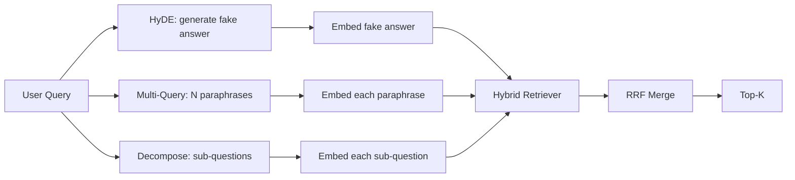

# 查询重写:HyDE、多查询和分解

> उपयोगकर्ता द्वारा दर्ज किए गए प्रश्न आपके अनुक्रमणिका द्वारा वांछित प्रश्न नहीं हैं। पुनर्लेखन से पहले की अंतर को भर दिया गया है, इसलिए अनुक्रमणिका देखने की सामग्री उत्तर के करीब है।

**Type:** Build
**Languages:** Python
**Prerequisites:** 第 11 阶段课程 04（嵌入）、06（RAG）；第 19 阶段 Track B 基础（第 20-29 课）；第 19 阶段第 64 和 65 课
**Time:** ~90 分钟

## 学习目标
- 实现假设文档嵌入 (HyDE): एक假答案 उत्पन्न करें, इसे嵌入 करें, इस वेक्टर के आधार पर जांच करें, न कि पूछताछ वेक्टर के आधार पर।
- 实现多查询扩展: एक प्रश्न को पुनः N个释义, व्यक्तिगत जांच के रूप में लिखना,倒数等级融合合并并集──
- 实现查询分解:将复杂问题分为子问题,按子问题检索,合并──
- तुलना करें एक खेल में तीनों लेखकों के प्रदर्शन,并解释每种策略何时胜──
- एक अनुरूप LLM, निश्चित निश्चित स्थिर आउटपुट उत्पन्न करने के लिए, ताकि पुनःलेखक चक्र ऑफ़लाइन चल सके

## 问题

उपयोगकर्ता इनपुट जब अपलोड विफल हो जाता है और बजट समाप्त हो जाता है, तो हमारी टीम क्या करेगी?── एक दस्तावेज में लिखा हैःAbortMultipartOnFail आयोजित S3 विभाजन अपलोड को बंद कर देगा, और अपलोड विफल होने पर प्रत्येक बाल्टी के पुनः परीक्षण बजट को कम करेगा── पूछताछ और दस्तावेज़ में कोई साझा नाम शब्द नहीं है──BM25 अप्रयुक्त है── द्वि-संपादक दस्तावेज़ को तीसरे या चौथे स्थान पर रखता है, क्योंकि खोज की ओर रुख एम्बेड स्पेस में अधिक विकृत है फ़ाइल के क्षेत्र में, न कि दस्तावेज़ के क्षेत्र में रोकना। यदि उत्तर पहले N में प्रवेश कर चुका है, तो 66 वीं कक्षा के दो चरणों में पुनः अनुक्रमित किया जा सकता है; लेकिन यदि मूल रूप से N में प्रवेश नहीं करता है, तो नामकरणकर्ता हमेशा इसे नहीं देख सकता──

修复方法在查询触及检查器之前重写查询.2023 साल के पेपर Precise Zero-Shot Dense Retrieval without Relevance Labels(गाओ 等人) ने हाइडे की शुरूआत की: LLM की आवश्यकता 编写一篇能回答查询的文档,嵌入 इस假设文档,并将其嵌入用于检查向量.

两种近亲技术与HyDE相结合――多查询扩展(Microsoft के GraphRAG 术语 का उपयोग करके) 个释义并检索的查询的 N 个释义并检索每个释义,然后合并――分解(2024 में स्टेनफोर्ड DSPy 工作中流行为子查询分解) 上传失败时和预算耗尽时我们的团队会做什么分为两个问题:上传失败时会发生什么和重试预算耗尽时会发生什么──两次检索,一次合并结果,两部分答案均可达成──

यह पाठ्यक्रम इन तीनों परियोजनाओं को पूरा करेगा और उन्हें एक ही निश्चित भाषा भंडार पर चलाएगा।

## 概念



### HyDE 详细信息

HyDE उपयोग LLM 编写的假设文档向量替换用户的查询向量──提示很短:

```text
You are a domain expert. Write a one-paragraph passage that answers the question
below. Use the same vocabulary and phrasing the documentation in this domain would
use. Do not refuse. Do not say you do not know.

Question: {user_query}

Passage:
```

LLM का उत्तर तथ्य उत्तर के रूप में गलत है, क्योंकि LLM आपके语料库 को नहीं जानता है। यह बहुत अच्छा है।

उत्पादन में, आप दो से तीन वाक्यों में संकलित किए गए दस्तावेजों को सीमित करेंगे। लंबे संकलित शब्दों से अधिक शोर एकत्र होगा।

### 多查询扩展详解

生成用户查询的 N 个释义──最简单的提示:

```text
Rewrite the following question in {N} different ways. Each rewrite must preserve
the original intent. Number them 1 to {N}. Do not add explanations.
```

检索每释义的顶-k――将 N个排名列表与RRF 合并(第65 课程中的算法相同) 廉价、并行、确定性──

जब उपयोगकर्ता का वाक्यांश प्रश्नों को उठाने के कई समान रूप से प्रभावी तरीकों में से एक है, तो कई प्रश्न जीतते हैं, और कोई भी पुनः लेखन बेहतर तरीके से इसे प्रस्तुत करेगा।

### 详细分解

单一检索不能满足多方面问题――分解要求 LLM 将问题拆成子问题,系统再检索每个子问题――提示:

```text
The following question may require information from multiple distinct topics.
Decompose it into a list of sub-questions. Each sub-question must be answerable
independently. If the question is already atomic, return it unchanged.

Question: {user_query}
```

检索每个子问题――合并――连词、多从句比较或两个不相关主题的问题,分解是正确的工具――原子问题的工具错误;分解器 का काम एकल प्रश्न पर लौटना है, न कि आविष्कार假子问题――

### ये तीनों क्यों मौजूद हैं?

三者是互补的──HyDE 弥补查询代币与语料库代币之间的差距──多查询覆盖释义方差──分解覆盖多主题查询──生产系统会运行这三种策略,并为每一个查询选择合适策略(第69 课程的端到端系统会展示选器)

## 模拟 LLM

इस कोर्स को ऑनलाइन किया जाता है। एमएलएम एक है जिसमें उपयोगकर्ता के प्रश्नों के लिए महत्वपूर्ण लघु खोज पत्र, साथ ही अदृश्य प्रश्नों के लिए एक बाद का सेट हैः

- 对于每一个固定 查询:书面假设段落、三个释义和分解结果──
- 对于未知查询:确定性转换: प्राप्त查询的内容词,通过同义词映射对其进行扩展,然后返回结果──

模拟的形状才是重要的,而不是数据――生产中, आप 模拟的替换为真实模型调用――检查器不会改变――


```figure
cd-hyde-vector
```

##  इसे निर्माण

`code/main.py`实现:

- `MockLLM`- उपर्युक्त निश्चितता प्रतिस्थापन
- `HyDERewriter`- 调用LLM编写假设文档,将重写机输出返回为`RewriteResult`, जिसमें परिकल्पनाएँ और जांच उपकरण प्रयोग किए जाने वाले प्रश्न शामिल हैं।
- `MultiQueryRewriter`- 调用LLM进行N个释义,返回查询列表――
- `DecomposeRewriter`- 调用LLM进行分解,返回子问题――
- `retrieve_with_rewriter`- 采用重写器和检索器,运行重写,融合结果──
- एक प्रदर्शन, तीन पुनःलेखक पर चलाने और प्रिंट करने के लिए जो रणनीति पहले वापस लौटने के लिए है।

पुनः प्रयोग करें第 65 课中的检索器形状(混合 BM25 + घन) 融合 अभी भी एक ही RRF है── एकमात्र नया आकार है重写器接口, यह बहुत छोटा है──

运行它:

```bash
python3 code/main.py
```

输出是每策略的排名和最终摘要―― HyDE 在措辞不匹配的查询中获胜──多查询在释义方差查询上获胜──分解在多主题查询上获胜──后备方案 (无重写机) कम से कम तीन में से एक में असफल──

## 演示将隐藏的故障模式

**HyDE 对语料库特定标识符的幻觉是错误的。**इस मॉडल ने एक फ़ंक्शन नाम का आविष्कार किया है। दाईं ओर के दस्तावेज़ का मानदंड BM25 分数崩, क्योंकि आविष्कार का नाम अब एक उच्च शक्ति भार टोकन है, सूचकांक में नहीं दिखाई दिया है।

**多查询重写全部收敛。**弱模型 उत्पन्न होगा तीन लगभग समान रिलीजें── N 次检索返回相同的顶-k── RRF 合并并不是比单个检索好──重写提示中添加显式多样性指令并通过Jaccard 检测重复项──

**分解过度分割。**विघटनकर्ता परमाणु प्रश्न को सूची में बदल देगा। सभी प्रश्न एक ही दस्तावेज़ को लौटेंगे, लेकिन रैंकिंग कम होगी।

**延迟成倍增加。**HyDE 需要花费一次LLM 通话费用──多查询花费一次LLM 调用生成 N 次重写,然后生成 N 次检索──分解需要一次LLM 调用分解,然后进行M 次检索──检索并行进行;LLM 电话是发言权──

## इसका उपयोग करें

生产模式:

-                                                                                                                                                                                                                                                               
- 通过查询哈希缓存重写器输出──许多查询重复──
- तथा क्रमशः सभी तीन परिणामों को संचालित करने के लिए, तथा आरआरएफ का उपयोग करके तीन परिणामों को एक में मिलाकर संश्लेषित करने के लिए किया गया है।

## 发货

धारा 69  कक्षा को पुनःलेखक चरण को 65  कक्षा के पुनःलेखक से पहले ले जाएगा, और इसे 66  कक्षा के पुनःलेखक से पहले रखेगा  कक्षा 68  कक्षा मूल्यांकन पुनःलेखक को पुनःलेखक को पुनःलेखक को याद करने के लिए  सुधार लाएगा 

## अभ्यास

1. 实现 RAG-Fusion (多查询的 2024年变体), जिसमें重写器的释义有意多样化,然后重新排序步骤 (第 66 课) 选择最终列表──
2. 添加第四种策略:step-back prompting(向LLM 问问更一般问题,检索该问题,然后再缩小范围)
3. 通过添加问题是原子的头来训练分解器识别原子查询――测量前后的过分率――
4. वास्तविक मॉडल का उपयोग करके प्रतिस्थापन करें।
5. प्रति प्रति प्रति प्रति प्रति प्रति प्रति प्रति प्रति प्रति प्रति प्रति प्रति प्रति प्रति प्रति प्रति प्रति प्रति प्रति प्रति प्रति प्रति प्रति प्रति प्रति प्रति प्रति प्रति प्रति प्रति प्रति प्रति प्रति प्रति प्रति प्रति प्रति प्रति प्रति प्रति प्रति प्रति प्रति प्रति प्रति प्रति प्रति प्रति प्रति प्रति प्रति प्रति प्रति प्रति प्रति प्रति प्रति प्रति प्रति प्रति प्रति प्रति प्रति प्रति प्रति प्रति प्रति प्रति प्रति प्रति प्रति प्रति प्रति प्रति प्रति प्रति प्रति प्रति प्रति प्रति प्रति प्रति प्रति प्रति प्रति प्रति प्रति प्रति प्रति प्रति प्रति प्रति प्रति प्रति प्रति प्रति प्रति प्रति प्रति प्रति प्रति प्रति प्रति प्रति प्रति प्रति प्रति प्रति प्रति प्रति प्रति प्रति प्रति प्रति प्रति प्रति प्रति प्रति प्रति प्रति प्रति प्रति प्रति प्रति प्रति प्रति प्रति प्रति प्रति प्रति प्रति प्रति प्रति प्रति प्रति प्रति प्रति प्रति प्रति प्रति प्रति प्रति प्रति प्रति प्रति प्रति प्रति प्रति प्रति प्रति प्रति प्रति प्रति प्रति प्रति प्रति प्रति प्रति प्रति प्रति प्रति प्रति प्रति प्रति प्रति प्रति प्रति प्रति प्रति प्रति प्रति प्रति प्रति प्रति प्रति प्रति प्रति प्रति प्रति प्रति प्रति प्रति प्रति प्रति प्रति प्रति प्रति प्रति प्रति प्रति प्रति प्रति प्रति प्रति प्रति प्रति प्रति प्रति प्रति प्रति प्रति प्रति प्रति प्रति प्रति प्रति प्रति प्रति प्रति प्रति प्रति प्रति प्रति प्रति प्रति प्रति प्रति प्रति प्रति प्रति प्रति प्रति प्रति प्रति प्रति प्रति प्रति प्रति प्रति प्रति प्रति प्रति प्रति प्रति प्रति प्रति प्रति प्रति प्रति प्रति प्रति प्रति प्रति प्रति प्रति प्रति प्रति प्रति प्रति प्रति प्रति प्रति प्रति प्रति प्रति प्रति प्रति प्रति प्रति प्रति प्रति प्रति प्रति प्रति प्रति प्रति प्रति प्रति प्रति प्रति प्रति प्रति प्रति प्रति प्रति प्रति प्रति प्रति प्रति प्रति प्रति प्रति प्रति प्रति प्रति प्रति प्रति प्रति प्रति प्रति प्रति प्रति प्रति प्रति प्रति प्रति प्रति प्रति प्रति प्रति प्रति प्रति प्रति प्रति प्रति प्रति प्रति प्रति प्रति प्रति प्रति प्रति प्रति प्रति प्रति प्रति प्रति प्रति प्रति प्रति प्रति प्रति प्रति प्रति प्रति प्रति प्रति प्रति प्रति प्रति प्रति प्रति प्रति प्रति प्रति प्रति प्रति प्रति प्रति प्रति प्रति प्रति प्रति प्रति प्रति प्रति प्रति प्रति प्रति प्रति प्रति प्रति प्रति प्रति प्रति प्रति प्रति प्रति प्रति प्रति प्रति प्रति प्रति प्रति प्रति प्रति प्रति प्रति प्रति प्रति प्रति प्रति प्रति प्रति प्रति प्रति प्रति प्रति प्रति प्रति प्रति प्रति प्रति प्रति प्रति प्रति प्रति प्रति प्रति प्रति प्रति प्रति प्रति प्रति प्रति प्रति प्रति प्रति प्रति प्रति प्रति प्रति प्रति प्रति प्रति प्रति प्रति प्रति प्रति प्रति प्रति प्रति प्रति प्रति प्रति प्रति प्रति प्रति प्रति प्रति प्रति प्रति प्रति प्रति प्रति प्रति प्रति प्रति प्रति प्रति प्रति प्रति प्रति प्रति प्रति प्रति प्रति प्रति प्रति प्रति प्रति प्रति प्रति प्रति प्रति प्रति प्रति प्रति प्रति प्रति प्रति प्रति प्रति प्रति प्रति प्रति प्रति प्रति प्रति प्रति प्रति प्रति प्रति प्रति प्रति प्रति प्रति प्रति प्रति प्रति प्रति प्रति प्रति प्रति प्रति प्रति प्रति प्रति प्रति प्रति प्रति प्रति प्रति प्रति प्रति प्रति प्रति प्रति प्रति प्रति प्रति प्रति प्रति प्रति प्रति प्रति प्रति प्रति प्रति प्रति प्रति प्रति प्रति प्रति प्रति प्रति प्रति प्रति

## 关键术语

|术语 |人们怎么说|它实际上意味着什么 |
|------|-----------------|------------------------|
|海德 | “伪造文件检索”| LLM写出答案；嵌入并检索它而不是查询 |
|多查询 | “释义扩展”| N次重写查询；检索N次，按RRF合并|
|分解 | “子查询分割” |多主题查询拆分为子问题，单独检索 |
|原子查询 | “单一主题” |如果不发明假子问题就无法分解 |
|后退一步| “抽象查询”|提出更一般性的问题，检索，然后缩小范围 |

##  आगे पढ़ें

- 高、马、林、Callan,无相关标签精确零样本密集检索(HyDE),2023
- 微软研究院,检索的多查询扩展
- 斯坦福大学 DSPy,多跳 QA 的子查询分解
- [LlamaIndex 查询转换文档](https://docs.llamaindex.ai/en/stable/optimizing/advanced_retrieval/query_transformations/)
- 第11 阶段第07 课 - उच्च श्रेणी RAG 模式
- 第19 阶段 第65 课 - 重写器 द्वारा प्रदान की जाने वाली जांच
- 第19 阶段 第68 课 - 测重写器提升的评估
