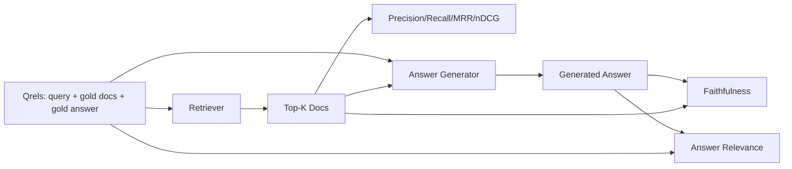

# आरएजी  मूल्यांकन: सटीकता  वापसी  एमआरआर  एनडीसीजी  निष्ठा  उत्तर संबंधी

> यदि आप एक ही समय में जांच और उत्तर का मूल्यांकन नहीं कर सकते हैं, तो आप एक ही समय में एक ही बिंदु पर विफल नहीं हो सकते हैं।

**Type:** Build
**Languages:** Python
**Prerequisites:** 第11期第06课（RAG）、10（评估）；第 19 阶段 Track B 基础（第 20-29 课）；第 19 阶段课程 64, 65, 66, 67
**Time:** ~90 分钟

## 学习目标
- 根据黄金 qrel 计算四个检索指标: सटीकता@k、recall@k、MRR(平均倒数排名) और nDCG@k。
- 计算两个答案等级指标:忠实度 (प्रत्येक प्रस्ताव ऊपर से नीचे तक के प्रश्नों पर आधारित है) और उत्तर संबंधीता (答案解决了问题)
-  एक                                                                                                                                                                                                                                                              
- 读取指标值 检索,排名, उत्पादन या接地: निदान नली में खराबी का स्थान

## 问题

RAG प्रणाली में कम से कम चार गतिविधि भाग हैंः विभाजन ब्लॉक यंत्र, जांच यंत्र, पुनः क्रमबद्ध यंत्र, जनरेटर। इनमें से कोई भी गलत उत्तर का कारण बन सकता है। यदि प्रत्येक चरण के लिए कोई सूचक नहीं है, तो आप वर्तमान में अंधे होंगे।

उपयोगकर्ता रिपोर्ट त्रुटि उत्तर। क्या यह इसलिए है क्योंकि विभाजन ब्लॉक ने उत्तर को पार कर दिया है? क्या यह इसलिए है क्योंकि खोजकर्ता ने भाग को शीर्ष-के में नहीं रखा है? क्या यह इसलिए है क्योंकि पुनः क्रमबद्धकर्ता ने सही भाग को पहले स्थान पर धकेल दिया है? क्या यह इसलिए है क्योंकि जनरेटर ने उस भाग को अनदेखा कर दिया है और सामग्री बनाई है? केवल उत्तर के आधार पर निर्णय नहीं किया जा सकता है। आपको आवश्यकता हैः

- 检索指标, जो जांचकर्ता के परिणामों का मूल्यांकन करने के लिए प्रयोग किया जाता है
- सूचक को क्रमबद्ध करने के लिए, क्रम में सही ब्लॉक की स्थिति का मूल्यांकन करने के लिए।
- 忠实地对生成器是否停留在检查到的上下文中进行评价──
- क्या उत्तर और मूल्यांकन के संबंध में पूरी तरह से समस्या हल हो गई है?

इस पाठ्यक्रम में सभी छह सूचक दस्तावेजों पर आधारित हैं। मूल्यांकन अनलाइन और निश्चित है। उत्पादन के दौरान, आप वास्तविक न्यायाधीश के रूप में एमएलएम न्यायाधीश की नक्कल करेंगे।

## 概念



### 精度@k

यदि गोल्ड में 3 दस्तावेज़ हैं, और शीर्ष 3 में से दो दस्तावेज़ और एक गलत दस्तावेज़ हैं, तो सटीकता@3 2 / 3 है। जब अनौपचारिक खोज ब्लॉक की लागत बहुत अधिक होती है, तो उत्पादक उस पर टोकन बर्बाद कर देता है, या यह ब्लॉक उत्तर को खराब कर देता है), कृपया सटीकता का उपयोग करें।

### याद करना

यदि सोने के तीन दस्तावेज हैं और शीर्ष पांच में ये तीन दस्तावेज हैं, तो याद रखें कि 5 के लिए 1.0। जब गलत उत्तर की लागत बहुत अधिक होती है, तो कृपया याद रखें कि आप एक अतिरिक्त त्रुटि ब्लॉक देखना चाहते हैं, न ही पूरी तरह से त्रुटि ब्लॉक देखना चाहते हैं।

उत्पादन आरएजी में, आमतौर पर उपयोग किए जाने वाले संकेत का उपयोग करने वाले व्यक्ति को याद किया जाता है।

### MRR( औसत倒数排名)

 प्रत्येक प्रश्न के लिए, रैंकिंग सूची में प्रथम संबंधित दस्तावेज की स्थिति को ढूंढें― रैंकिंग का उलटा संख्या 1/ स्थान है― पूरे प्रश्न संग्रह का औसत मूल्य― MRR है।

MRR पर 1 स्थान का भार बहुत बड़ा है।

### nDCG@k

标准化贴现累积收益―― प्रत्येक जांच तक के दस्तावेजों के वितरण में वृद्धि के लिए पूर्ण सूत्र ((आमतौर पर 1 से संबंधित, 0 से संबंधित नहीं), स्थान के आधार पर प्रतिद्वंद्वियों की संख्या पर छूट, मांग और फिर आदर्श डीसीजी के रूप में विभाजित करें(यदि आपकी रैंकिंग पूरी हो जाती है, तो आपके पास डीसीजी) ◊ दायरा 0 से 1 है।

nDCG 适应分级相关性:黄金可以说文档 A 是 3,文档 B 是 2,文档 C 是 1──MRR 和recall@k 将所有内容平化为二进制──当语料库每查询有多部分相关文档时,请使用 nDCG──

### 忠诚

 प्रत्येक उत्तर में जो बयान दिया गया है, उसके लिए जाँच की जाए कि क्या यह कथन अनुमोदित है️️️️️️️️️️️️️️️️️️️️️️️️️️️️️️️️️️️️️️️️️️️️️️️️️️️️️️️️️️️️️️️️️️️️️️️️️️️️️️️️️️️️️️️️️️️️️️️️️️️️️️️️️️️️️️️️️️️️️️️️️️️️️️️️️️️️️️️️️️️️️️️️️️️️️️️️️️️️️️️️️️️️️️️️️️️️️️️️️️️️️️️️️️️️️️️️️️️️️️️️️️️️️️️️️️️️️️️️️️️️️️️️️️️️️️️️️️️️️️️️️️️️️️️️️️️️️️️️️️️️️️️️️️️️️️️️️️️️️️️️️️️️️️️️️️️️️️️️️️️️️️️️️️️️️️️️️️️️️️️️️️️️️️️️️️️️️️️️️️️️️️️️️️️️️️️️️️️️️️️️️️️️️️️️️️️️️️️️️️️️️️️️️️️️️️️️️️️️️️️️️️️️️️️️️️️️️️️️️️️️️️️️️️️️️️️️️️️️️️️️️️️️️️️️️️️️️️️️️️️️️️️️️️️️️️️️️️️️️️️️️️️️️

忠诚度 ने मॉडल के आविष्कार सामग्री के जनरेटर दोष मोड को पकड़ लिया है। यहां तक कि अगर खोजकर्ता सही ब्लॉक वापस करता है, तो उत्पन्न होने वाली धारणा के जनरेटर को भी नुकसान होगा।

इस पाठ्यक्रम में सत्यता को प्राप्त करने के लिए निश्चितता अनुकरणीय निर्णय के माध्यम से, यह निर्णय प्रत्येक कथन के टोकन की जांच करना चाहिए कि क्या वह खोजे गए उपरोक्त उपरोक्त के साथ ओवरले मूल्य है।

### 答案相关性

答案是否真正解决了问题?忠诚问答案是否基于上下文?──答案相关性问答案是否基于问题?──一个忠诚但偏离主题的答案在忠诚度上得分高,相关性方面得分低──一个简短的题,切题的、忽视下文的答案在相关性上得分高,但忠诚度上得分低──标准实现也使用M作为判断:

## फिक्स्ड क्यार

```python
{
  "qid": "q1",
  "query": "what is the abort threshold for multipart uploads",
  "gold_doc_ids": ["d1", "d3"],
  "gold_answer_substring": "three failed parts",
  "graded_relevance": {"d1": 3, "d3": 2},
}
```

प्रत्येक पूछताछ के साथः
- 查询字符串,
- एक समूह स्वर्ण दस्तावेज आईडी (डिफ़ॉल्ट रूप से उपयोग किया जाता है),
- 分级相关性字典( nDCG के लिए),
- 黄金答案字串( प्रत्येक क्यार के संदर्भ के रूप में डेटा सहेजें; इस वर्ग में निष्ठा जांच के ऊपर दिए गए उपरोक्त के आधार पर है न कि इस वर्ण के लिए निर्णय लेने के लिए बयानों को गणना करने के लिए) 

इस कोर्स में एक हाथ से निर्मित फिटिंग प्रदान की जाती है, इसलिए मूल्यांकन तुरंत किया जा सकता है।


```figure
ci-rag-metric-ladder
```

##  इसे निर्माण

`code/main.py`实现:

- `precision_at_k(retrieved, gold, k)`- 字面定义──
- `recall_at_k(retrieved, gold, k)`- 字面定义──
- `mean_reciprocal_rank(retrieved_list_of_lists, gold_list)`- 查询 का औसत मूल्य
- `ndcg_at_k(retrieved, graded_relevance, k)`- डीसीजी/आईडीसीजी दोहरी व्यवस्था या वर्ग वृद्धि 
- `extract_claims(answer)`- उत्तर को वाक्य के आकार में विभाजित करना
- `faithfulness(claims, context_texts, judge)`- - समर्थन के दावे का हिस्सा
- `answer_relevance(question, answer, judge)`- 判断答案是否解决问题──
- `MockJudge`- 确定性token重叠判断, ताकि ऑनलाइन परिचालन का मूल्यांकन किया जा सके।
- `evaluate_pipeline(pipeline_fn, qrels, ks)`- प्रत्येक सूचक के समन्वयक को संचालित करना
- 针对 qrel 运行三种管道变体(分块基线、混合检索、混合 + 重新排名)并印标签表的演示──

运行它:

```bash
python3 code/main.py
```

输出显示单个指标中每个变体的精度@k、recall@k、MRR、nDCG@k、忠诚度和答案相关性──混合检索行在召唤方面击败分块器基线;重新排序在MRR上击败混合行──

## 读取标志来诊断故障

|症状|可能的原因 |修复什么问题 |
|---------|-------------|-------------|
|低召回率@k，低精度@k |分块剪切答案或检索器找不到它 |分块边界（第 64 课）或检索器模态（第 65 课） |
|不错的召回率@k，低 MRR |右块位于 top-k 中但不在位置 1 |重新排序（第 66 课）|
|高MRR，低忠诚度|尽管上下文正确，生成器仍然发明内容 |生成提示；强制引用或拒绝 |
|忠诚度高，相关性低 |答案有根据但偏离主题 |查询重写器（第 67 课）或生成提示 |
|均四高，用户仍抱怨|评估集不具有代表性 |使用真实用户查询扩展 qrels |

## 演示将隐藏的故障模式

**LLM-as-judge 偏差。**模型 अपने आउटपुट का न्याय करते समय, यह अक्सर वास्तविक स्थिति से अधिक विश्वसनीय माना जाता है।

**Qrel 腐烂。**语料库 के परिवर्तन के साथ, स्वर्ण उत्तर भी बदल जाएगा ️️️️️️️️️️️️️️️️️️️️️️️️️️️️️️️️️️️️️️️️️️️️️️️️️️️️️️️️️️️️️️️️️️️️️️️️️️️️️️️️️️️️️️️️️️️️️️️️️️️️️️️️️️️️️️️️️️️️️️️️️️️️️️️️️️️️️️️️️️️️️️️️️️️️️️️️️️️️️️️️️️️️️️️️️️️️️️️️️️️️️️️️️️️️️️️️️️️️️️️️️️️️️️️️️️

**忠诚度微观检查错过了宏观声明。**प्रत्येक वाक्य की निष्ठा पारित हो सकती है, जबकि समग्र उत्तर की संरचना गलत दिशा उत्पन्न करती है।

**Recall@k 掩盖了每个查询的失败。**90% की औसत रिटर्न दर एक पूछताछ श्रेणी को हमेशा खोए हुए स्थिति में छिपा सकती है।

## इसका उपयोग करें

生产模式:

- प्रत्येक जांचकर्ता या जनरेटर के लिए परिवर्तन संचालन मूल्यांकन हेतु,
- प्रत्येक प्रश्न का सूचक ट्रैक रखें। जब उपयोगकर्ता शिकायत करते हैं, तो उपयुक्त प्रश्नों की खोज करें, देखें कि क्या यह पकड़ा जाएगा।
- Qrel  आयोजित किया गयाः 20 QI में चल रहे fumigogets के पूछताछ; प्रति रात्रि चल रहे 200 regressionets; प्रति सप्ताह चल रहे 2000 深组──

## 发货

धारा 69 课连接整个管道 ((分块器、检索器、重排器、生成器),并针对端到端系统运行此评估──

## अभ्यास

1. 添加第五个检索指标:hit-rate@k。将其与recall@k 进行比较──当它们不同时进行解释──
2. 实行分级忠诚度:0(不支持) 、1(部分支持) 、2(完全支持) ∼相应地更新指标──
3. वास्तविक मॉडल का उपयोग करके प्रतिस्थापन के लिए प्रयोग करें।
4. 添加查询类片(字面、释义、多主题) 报告──每片标点──
5. 添加答案长度标标并将其与忠诚性相关联──绘曲线──

## 关键术语

|术语 |人们怎么说|它实际上意味着什么 |
|------|-----------------|------------------------|
|精度@k | “命中率超过检索” | top-k 中黄金的比例 |
|recall@k | “命中了 gold 吗”| top-k 中包含 gold chunk 的比例 |
| MRR | “第一击位置”| 1 的平均值/第一个相关文档的排名 |
| nDCG@k | “分级排名质量”| top-k 上的 DCG 除以理想 DCG |
|诚信| “接地气” |检索到的上下文支持的答案声明的比例 |
|答案相关性 | “它解决了这个问题吗？” |答案是否符合问题的意图 |
|问题 | “金标”|带标签的查询集及其黄金文档和答案 |

##  आगे पढ़ें

- बक्ली, वोरही, मूल्यांकन मूल्यांकन माप स्थिरता,SIGIR 2000 - 关于排名指标的规范论文
- Jarvelin、Kekalainen,IR 技术 के आधार पर संचित लाभ के मूल्यांकन - nDCG 论文
- [Ragas：RAG 管道的自动评估](https://docs.ragas.io)
- [人择，评估 RAG](https://www.anthropic.com/news/evaluating-rag)
- 第11 阶段第10 课 - 评估框架基础
- 第19 阶段课程 64-67 - यहाँ मूल्यांकन घटक
- कक्षा 69 - इस सत्र में मूल्यांकन मूल्यांकन के अंत से अंत तक
