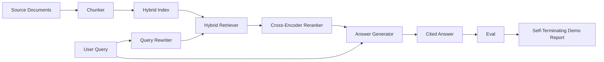

# 端到端 RAG 系统

> 组件的六课――一根管道――一评估循环――一个自动终止的演示――这是您交付的系统――

**Type:** Build
**Languages:** Python
**Prerequisites:** 第11期第06课（RAG）、10（评估）；第 19 阶段 Track B 基础（第 20-29 课）；第 19 阶段课程 64, 65, 66, 67, 68
**Time:** ~90 分钟

## 学习目标
- विभाजन ब्लॉक यंत्र, मिश्रित जांच यंत्र, खोज पुनः लिखने यंत्र, क्रॉस-कोडिंग पुनः क्रमबद्ध यंत्र और उत्तर जनरेटर को एक एकल अंत से अंत तक पाइपलाइन के रूप में संकलित करना।
-  एक उत्तर जनरेटर को प्राप्त करना, ब्लॉक बिंदुओं के माध्यम से अपनी घोषणा का हवाला देते हुए, तथा कम विश्वास के साथ रिटर्न रिटर्न फ़ंक्शन को अस्वीकार करना
-  अच्छी संरचना के लिए 68  कक्षा के संचालन का मूल्यांकन, और प्रत्येक सूचक पर एक ही घटक से बेहतर निर्माण के चरणों का प्रमाणन।
-  एक स्वचालित समाप्ति सीएलआई प्रदर्शन का निर्माण, जो स्थिर भाषा सामग्री भंडार को कैप्चर करेगा, स्थिर पूछताछ सेट को चलाएगा, और संक्षिप्त रिपोर्ट के साथ शून्य से बाहर निकल जाएगा।

## 问题

孤立的六成分不能证明什么――分块机可以在recall@5上战胜语料库上,但在系统的recall@5上失败,因为检查机无法对分块机的发射内容进行排名――重排机可以提高合成候选池上的MRR,但无法处理真正的双编码机候选人,因为重排预算下双编码机的召回率太低――查询重写机可以在单个查询上提升黄金文档,然后在下一个查询上断断,因为LLM 模拟返回退化假设――

 एकीकृत परीक्षण एक ही ट्यूब के लिए एक ही फिक्स्ड के लिए एक ही संकेतक के साथ काम करता है, एक ही संकेतक के साथ, और एक एडिटर फ़ाइल का उपयोग करता है जो सभी सामग्री को एक साथ जोड़ देगा। यह इस कक्षा का विषय है।

## 概念



### 接线选择

管道 एक लघुचित्र है। प्रत्येक चरण एक स्पष्ट हस्ताक्षरित कार्य है।

|舞台|输入|输出|
|-------|-------|--------|
|块块|文档正文 |块记录列表 |
|检索器 |查询字符串 | Top-N chunk 记录 |
|重写器（可选）|查询字符串 |重写列表+假设|
|重新排序 |查询，候选人 |带有交叉分数的 Top-K 块记录 |
|发电机|查询，top-K Chunk 记录 |带有引文的答案字符串 |

जब प्रत्येक हस्ताक्षर स्थिर होता है, तो संरचना बहुत सरल होती है।`Pipeline`类包含五阶段和顺序运行它们的 `query`方法── प्रत्येक चरण विनिमय योग्य हैः विभिन्न विभाजन यंत्र, जांच यंत्र, पुनः लिखने यंत्र, पुनः क्रम या जनरेटर में प्रवेश, ट्यूब अभी भी चल सकते हैं──

### 带引文的答案生成器

发电机 अंतिम श्रेणी है, यह भी सबसे खराब है। इस पाठ्यक्रम में एक निश्चितता के लिए एक अनुकरणीय जनरेटर प्रदान किया गया है, जो कि जनरेटर हैः

1. 取出前 K 个重新排序的块──
2. अधिकतम चयन दो पाठों में शामिल है और पूछताछ ओवरले के उच्चतम स्तर के सामग्री टोकन के ब्लॉक
3.  एक उत्तर जारी करें, यह उत्तर प्रत्येक चयनित खंड में एक वाक्य का एक संबद्ध है, प्रत्येक वाक्य के बाद एक `[doc_id:chunk_index]`点──
4. यदि कोई खंड अधिभारित नहीं होता है, तो उसे अस्वीकार करना चाहिए।

उत्पादन में, आप उपयोग कर सकते हैं सुझाव मॉडल होगा वास्तविक LLM के लिए बदलना

```text
You are answering a question using only the snippets below.
Cite every claim with the anchor in parentheses.
If the snippets do not answer the question, say "I do not know".

Question: {query}

Snippets:
{enumerated chunks with anchors}

Answer:
```

低信度拒绝路径是记录跨编码器排名 1 分数的全部原因──如果它低于语料库值,则生成器会拒绝──这是防止幻觉答案的安全──

### से समापन प्रदर्शन

यह एक प्रश्न के प्रत्येक चरण के विवरण को छापता है, चार निश्चित Qrel 运行 मूल्यांकन पर, एक सूचकांक छापता है, यदि कक्षा 68 के सभी सूचकांक प्रस्तुत में सेट किए गए मूल्य को पूरा करते हैं, तो स्थिति में शून्य से बाहर निकल जाता है। यदि कोई सूचकांक मूल्य से कम है, तो प्रदर्शन बाहर निकल जाएगा और शून्य स्थिति नहीं दिखाएगा, और एक संदेश दिखाएगा, विफलता के संकेतों को इंगित करेगा।

यह सीआई 冒烟测试的形式 है। यह पाइपलाइन ऑफलाइन चल रहा है, तेजी से, निश्चित रूप से, निश्चित है। फिक्स्चर का मूल्य जानबूझकर कठोर है, इसलिए छह भागों के पाठ्यक्रम में से किसी भी कक्षा का पुनरावृत्ति प्रदर्शन विफलता का कारण बनती है।


```figure
rag-pipeline-flow
```

##  इसे निर्माण

`code/main.py`实现:

- `Chunk`- 贯穿所有阶段的记录 (→ सभी चरणों के रिकॉर्ड)                                                                                                                                                                                                                                                       
- `Chunker`- से第 64 课中选择策略 (默认递归分割)
- `HybridIndex`- 捆绑 BM25 + 密集 + RRF से第65 课─
- `Rewriter`(可选) - प्रश्न की लंबाई और कनेक्शन शब्द के अस्तित्व के आधार पर कक्षा 67 में चयन HyDE、多查询、分解之一──
- `Reranker`- 第66 课中训练过的交叉编码器, उपयोग से छोटे फिटिंग 训练集, इसलिए कुछ सेकंड में प्राप्त किया जा सकता है
- `Generator`- 引用 एवं कम विश्वास से इनकार करने वाले निश्चितता के प्रतिरूपण जनरेटर
- `Pipeline`- उपयोग वापसी `Result(answer, top_k, latency_ms_per_stage)``query(question)`方法组成五个阶段――
- `run_demo()`- 摄取语料库,运行三个固定 查询,运行评估,印结果,并按值设置退出代码──

运行它:

```bash
python3 code/main.py
```

输出 एक मुद्रित प्रश्न का पता लगाएँ, पूर्ण मूल्यांकन表和最终通过/失败状态――

## 演示将隐藏的故障模式

**分块器边界漂移。**यदि आप मूल्यांकन प्रक्रिया और प्रदर्शन के बीच आदान-प्रदान करते हैं तो, एक कंक्रीट रणनीति को एक कंक्रीट फ़ाइल में लॉक किया जाएगा।

**Reranker 训练集泄漏到 eval 中。**धारा 66 में 14 प्रशिक्षण त्रिकोण समूहों में मूल्यांकन प्रश्नों के समान प्रश्न शामिल हैं। उत्पादन के दौरान, मूल्यांकन प्रश्नों को सख्ती से संरक्षित किया गया है।

**模拟生成器隐藏了幻觉风险。**模拟 नहीं उत्पन्न हो सकता है, क्योंकि यह केवल खोज के ब्लॉक से पाठ जारी करता है। इस पाठ्यक्रम में इस बात का ध्यान रखा गया है और वास्तविक मॉडल के उत्पादन में बदलाव के तरीकों पर ध्यान दिया गया है।

**无流式传输。**管道在每阶段结束时返回完整答案――生产系统将传输发电机的输出――流媒体超出范围; चाहे जो भी तरीका हो, उत्तर के स्तर के सूचक अंतिम स्ट्रिंग पर प्रभाव डालेंगे――

**延迟是离线的。**模拟LLM 调用是恒定时间──真正的LLM电话占主导地位──在请求范围内规划延迟预算;本课程的每阶段计时只测量CPU工作──

## इसका उपयोग करें

生产模式:

- एक संयोजक के नीचे एक पाइपलाइन फ़ाइल को एक विशिष्ट चरण के इंटरफेस के साथ भेजें।
- प्रत्येक चरण में शामिल समावेशीकरण से पहले मूल्यांकन को चलाया जाता है। यदि मूल्यांकन नीचे गिरता है, तो समावेशीकरण नहीं गिरता है।
- प्रत्येक CI 运行 के सूचक का पालन रखें, ताकि आप चरणों में लौट सकें।
-  20                                                                                                                                                                                                                                                              

## 发货

इस पाठ्यक्रम में पाइपलाइन दस्तावेज 19 वें चरण के ट्रैक एफ पाठ्यक्रम के शेष भागों द्वारा अपनाए गए आकार हैं। इसके बाद के पाठ्यक्रम में कैप्चर ऑटोमेशन, वृद्धि पुनः सूचकांक, दूर परीक्षण और शीर्ष सेवा स्तरों का उपयोग किया जाएगा।

## अभ्यास

1. में重写器中添加每一个查询策略选择器:第67 课的启发式 (长度,连词,行话比例) 选择 HyDE,多查询,解析,
2. 调用──默认为模拟──测量延迟增量──
3.  विस्तार प्रदर्शन वास्तविक भाषा सामग्री संग्रह का लोड करने के लिए `--corpus path`标志──重新运行评估和值检查──
4.                                                                                                                                                                                                                                                                                                                                                                                                                                                                                                                              `--strategy`标志── प्रत्येक रणनीति के अंत से अंत तक स्मरण करने के योगदान को मापें──
5. 添加流生成器接口并将其输入到 eval 中──确认忠实度是根据最终字符串而不是流式前计算的──

## 关键术语

|术语 |人们怎么说|它实际上意味着什么 |
|------|-----------------|------------------------|
|管道| “RAG 管道”|从摄取到引用答案的撰写阶段|
|引文锚| “来源链接” |每个声明附加的 (doc_id, chunk_index) 引用 |
|低置信度拒答| “我不知道” |当重排器 top-1 分数低于阈值时，生成器不返回答案 |
|smoke set | “CI 评估”|每次 PR 检查中运行的最小 qrels 子集 |
|阶段接口| “函数签名”|各个管道阶段的稳定输入输出类型 |

##  आगे पढ़ें

- [人择、建筑搜索与检索](https://www.anthropic.com/news/contextual-retrieval)
- [Pinterest，MCP 内部搜索](https://medium.com/pinterest-engineering)- 参考生产架构
- [Ragas：RAG 管道的自动评估](https://docs.ragas.io)
- 第 11 阶段第 06 课 - आरएजी 基础知识
- 第19 阶段课程 64-68 - 组成组件
