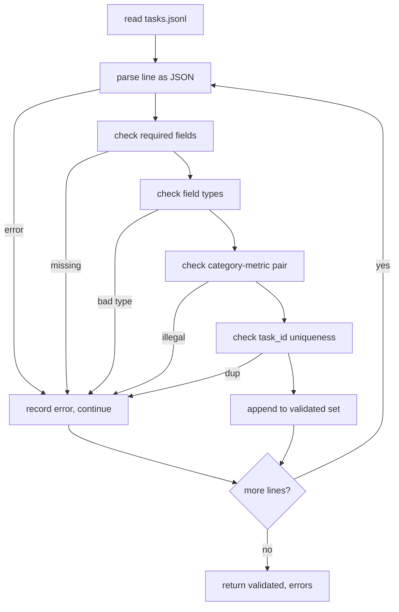

# 任务规范格式

> 评估安全带的好坏取决于其任务执行的合同──  Before writing a single rating function, please 结 JSONL 形状和量词汇──

**Type:** Build
**Languages:** Python
**Prerequisites:** 19期B轨地基
**Time:** ~90 分钟

## 学习目标


```figure
ci-task-spec-gate
```

-  define a JSONL 任务记录模式, एक रूप में शामिल है गणितीय 多项选择、代码执行、分类和自由文本摘要──
- 固定度量名称的封闭词汇表, ताकि निम्नक्रम (71-73) को एकल सेगमेंट में विभाजित किया जा सके
- कुछ नमूना उदाहरण और बाद के प्रसंस्करण नियमों को रनर के भाग के बजाय एक कार्य के भाग के रूप में निर्धारित किया जाता है, इसलिए एक ही सुझाव मॉडल के बीच एक ही लक्ष्य उत्पन्न करेगा।
-  कठोर प्रमाणन यंत्र को लागू करना, प्रारूप त्रुटि के रिकॉर्ड को परिचालक तक पहुंचने से पहले इसे अस्वीकार करना
-  एक फिक्स्चर सेट जारी करें जिसमें 10 कार्य शामिल हैं, परीक्षण नियमों के प्रत्येक शाखा के लिए उपयोग किया जाता है, ताकि सत्यापितकर्ता कुछ वास्तविक हो सकता है──

## नियमन का अंत क्यों करना है

अध्ययन कोड पुस्तकालय संचय मूल्यांकन 脚本 की गति संचय परीक्षण की गति से भी तेज है। छह महीने बाद, प्रत्येक नोटबुक का अपना JSON 形状 होता है, प्रत्येक सूचक को दो बार पुनः लागू किया जाता है, और इसके बीच तुलना नहीं की जा सकती है।

इस आकार ने BIG-bench、HELM 和 lm-eval 风格线束 के विचार से उधार लिया है, लेकिन字段名称是我们的── प्रत्येक字段有一个所有者──runner读取任务──指标读取目标──后处理步骤使生成正常化──管道中没有字段是可变的──

## 记录形状

任务是单行上 JSON对象──线束读取 `tasks.jsonl`并独立验证每条线──坏线会停止该记录,而不是运行──

```json
{
  "task_id": "arith_001",
  "category": "arithmetic",
  "prompt": "Compute the result. Question: 17 + 24\nAnswer:",
  "targets": ["41"],
  "metric_name": "exact_match",
  "few_shot_examples": [
    {"prompt": "Question: 2 + 2\nAnswer:", "completion": "4"}
  ],
  "post_process": "strip_whitespace",
  "metadata": {"difficulty": "easy"}
}
```

अनिवार्य字段为 `task_id``category``prompt``targets``metric_name``post_process``few_shot_examples`和 `metadata`️️️️️️️️️️️️️️️️️️️️️️️️️️️️️️️️️️️️️️️️️️️️️️️️️️️️️️️️️️️️️️️️️️️️️️️️️️️️️️️️️️️️️️️️️️️️️️️️️️️️️️️️️️️️️️️️️️️️️️️️️️️️️️️️️️️️️️️️️️️️️️️️️️️️️️️️️️️️️️️️️️️️️️️️️️️️️️️️️️️️️

## 字段规则

`task_id`यह एक रिक्त वर्ण है।

`category``arithmetic``mcq``code_exec``classification``summary`之一── इस श्रेणी में किस उपाय और बाद के प्रसंस्करण के लिए कानूनी है, इसकी सीमा है।`code_exec`任务必须使用 `metric_name = code_exec`,`mcq`任务必须使用 `metric_name = exact_match`

`prompt`एक गैर-खाली字串──验证器禁止尾随空格并拒绝提示正文中已包含少数镜头块的记录──少镜头染发生在运行者身上,而不是作者身上──

`targets`एक अफ़िरीक वर्ण सूची है।`exact_match`, किसी भी उपयुक्त तत्वों को शामिल किया गया है।`f1`和`rouge_l`, स्कोर उच्चतम लक्ष्य जीत के लिए`mcq`, सूची में केवल एक तत्व शामिल है

`metric_name``exact_match``f1``bleu_4``rouge_l``accuracy``code_exec`之一──词汇是封闭的── नये संकेतकों को नये उपदेशों और नये条例 की आवश्यकता है──

`few_shot_examples``{prompt, completion}`                                                                                                                                                                                                                                                              

`post_process``none``strip_whitespace``lower``extract_letter``extract_code_block``extract_first_line`之一── प्रत्येक नियम में एक निश्चितता व्यवहार है── सत्यापितकर्ता प्रतिबंधित组合规则──

## 验证器 व्यवहार



验证器 दो सूची में लौटाः सत्यापित रिकॉर्ड और त्रुटि रिकॉर्ड, जिसमें अवैध प्रथाएँ शामिल हैं、 अवैध नियम और त्रुटि खण्डों।`--allow-bad-tasks`标志──

## कम दृश्य

धावक को पहले के कुछ उदाहरणों को रिक्त स्थान से जोड़ने का सुझाव दिया जाएगा। प्रत्येक मॉडल एक ही कोड पथ पर चलता है, इसलिए एकमात्र अंतर मूल रूप से मॉडल स्वयं है। लेखक एक उदाहरण को एक बार लिखता है, न कि प्रत्येक प्रदाता एक बार लिखता है।

```python
def render(task):
    parts = []
    for ex in task.get("few_shot_examples", []):
        parts.append(ex["prompt"] + " " + ex["completion"])
    parts.append(task["prompt"])
    return "\n\n".join(parts)
```

## 后处理规则

后处理步骤在生成后、指标之前运行── यह निश्चितता और अनिश्चितता है──

- `none`返回字符串不变──
- `strip_whitespace`                                                                                                                                                                                                                                                              
- `lower`小写字符串──
- `extract_letter`返回与 `[A-E]`匹配的第一个字符, MCQ हेतु प्रयोग किया जाता है
- `extract_code_block`返回第一个三重反引号隔离块的主体,用于代码执行──
- `extract_first_line`返回第一个非空行,用于汇总分类──

需要本列表以外的规则的任务属于新课程──

## 本课不做什么

यह अनुच्छेद 71, 72 और 75 में प्रस्तुत है। इस अनुच्छेद में सभी अनुबंधों का पालन किया गया है।

10 个任务固定 覆盖两个算术项,两个 MCQ项,两个代码执行项,两个分类项和两个摘要项,验证器通过所有10条规则,一个单独的固定 (`tasks_bad.jsonl`) प्रत्येक नियम को संचालित करेगा, और सत्यापितकर्ता द्वारा लौटाए गए त्रुटियों की संख्या ठीक इन त्रुटियों के समान है।

## 如何阅读代码

`main.py` परिभाषित किया `TaskSpec``validate_task``validate_file`和 CLI प्रवेश बिंदु──फिक्स्चर 加载器是 `load_fixtures`染和后处理 सहायक 验证逻辑旁边 स्थित है, इसलिए第75 课中的 धावक को केवल एक एकल मॉड्यूल को आयात करने की आवश्यकता है

ऊपर से नीचे तक पढ़ना`main.py`然后读取 `code/tests/test_spec.py`परीक्षा प्रत्येक परीक्षण नियम तथा प्रत्येक बाद में प्रसंस्करण व्यवहार को तय करेगी`main.py`底部的演示会验证捆绑的固定并印摘要──

## और आगे

वास्तविक मूल्यांकन सेट मॉडल में वृद्धि की गई श्रेणी को विकसित करने के तरीके से विकसित किया गया है। स्पष्ट कदम है कि एक वर्ग को जोड़ने से इनकार किया जाए, बिना किसी मापदंड को जोड़ने के बाद के प्रसंस्करण नियमों और कम से कम एक निश्चित कार्य के साथ।
