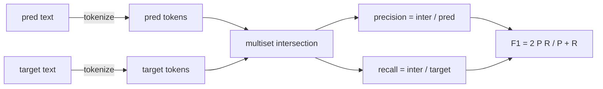
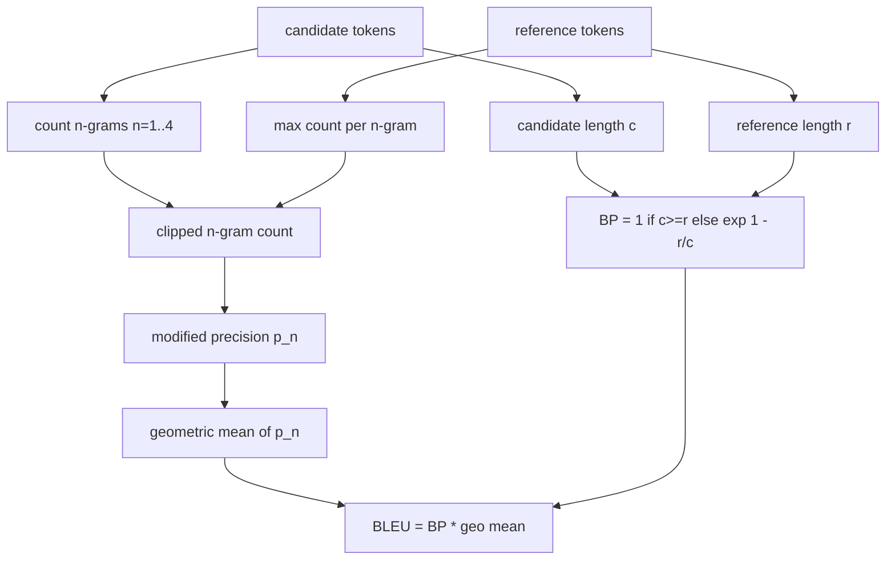

# 经典指标

> BLEU、ROUGE-L、F1、 सटीक मिलान、 सटीक दर。 पांच संकेतक अभी भी अधिकांश प्रकाशित LLM  मूल्यांकन संख्याओं को शामिल करते हैं。 प्रत्येक संकेतक को प्रथम प्रकृति के सिद्धांत से प्राप्त करने से, आप केवल संख्याओं के अर्थ को जानते हैं。

**Type:** Build
**Languages:** Python
**Prerequisites:** 第 19 期 Track B 基础，第 70 课
**Time:** ~90 分钟

## 学习目标


```figure
cd-bleu-overlap
```

-  स्पष्ट टोकनकरण नियमों के माध्यम से टोकन स्तर सटीक मेल मिलाप  F1 和准确性
-                                                                                                                                                                                                                                                                                                                                                                                                                                                                                                                              
- ROUGE-L को प्राप्त करने के लिए सबसे लंबी सार्वजनिक उपक्रम तथा सटीकता और पुनरावृत्ति दर के F-beta संयोजन का उपयोग करना
- 调度第70 课中的 metric_name 字段, ताकि धावक सूचक से संबंधित नहीं हो सके।
- कार्य उदाहरणों से नहीं, बल्कि तीसरे पक्ष के भंडार से निकाले गए संदर्भ वेटर्स का उपयोग करके निश्चित व्यवहार करना।

## क्यों पुनर्जीवित करना है

您将读到 BLEU 28.3 के论文和另一篇BLEU 0.283 के论文. 您将发现两库的 ROUGE-L 分数差距为10分,因为一个库截断为小写,而另一个库则不截断. 停止混的最快方法是自己编写指标,然后指向决定标记的行程和应用平滑的行程. 之后, तुलना论文之间的数字就变成了读量设置问题,而不是争论图书馆.

स्ट्लिब प्लस नम्पय है पर्याप्त है। ब्लू है क्वेन्ट और बिट। ROUGE-L है गतिशील नियोजन। F1 है टोकन पर संग्रह交集। सबसे मुश्किल हिस्सा है चयन टोकन यंत्र और इसके लिए प्रयास करते हैं।

## प्रतीकात्मक

分词器是 `re.findall(r"\w+", text.lower())`◊小写、字母数字运行、删除标点符号── इस कोर्स में प्रत्येक सूचक इस सटीक分词器 का उपयोग करता है── धावक का कोई विकल्प नहीं है── यदि आप分词器 का आदान-प्रदान करते हैं, तो आप अलग-अलग基准测试──

```python
TOKEN_RE = re.compile(r"\w+", re.UNICODE)
def tokenize(text):
    return TOKEN_RE.findall(text.lower())
```

यह एक सार्थक सरलीकरण है। उत्पादन सेटिंग सीजेके पर केंद्रित होगी। संक्षिप्त और कोड पहचानकर्ता। इस कक्षा का मुख्य बिंदु यह है कि टोकन जनरेटर एक संधि है, एक घुमावदार नहीं।

## 精确匹配

```python
def exact_match(pred, targets):
    return float(any(pred.strip() == t.strip() for t in targets))
```

प्रत्येक कार्य 1.0 या 0.0 पर लौटता है। डेटासेट का एकीकरण औसत मूल्य है। यह गणितीय √MCQ और लघु वर्ग कार्य की मुख्य शक्ति है।

## टोकन श्रेणीF1

 पूर्वानुमान और लक्ष्य के लिए सेट टोकन बहुवचन  सटीकता बहुवचन सेक्शन सेक्शन सेक्शन सेक्शन सेक्शन की पूर्वानुमान  पुनरावृत्ति दर एक ही सेक्शन सेक्शन सेक्शन सेक्शन सेक्शन सेक्शन सेक्शन सेक्शन की पूर्वानुमान  F1 है समायोजन और औसत मूल्य  यह लागू करने के लिए है प्रसंस्करण空预测 और空 लक्ष्य किनारे स्थिति 



ढ़ाई लक्ष्य के लिए, हम लक्ष्य सूची में सर्वश्रेष्ठ F1 का चयन करते हैं। यह साहित्य में व्यापक रूप से रिपोर्ट किए गए SQuAD के व्यवहार के अनुरूप है।

## ब्लू-4

BLEU एक विनियमन मशीन अनुवाद संकेतक है, यह अभी भी संक्षेप में काम में दिखाई देता है। हमारे द्वारा उपयोग किया जाने वाला सूत्र ब्लू-4 भाषा भंडार श्रेणी का है, जिसमें मानक सरलता दंड है और संशोधित के बाद के n पूर्व भाषा मानदंडों की संख्या में वृद्धि की जाती है, इसलिए एकल अनुपस्थित 4 पूर्व भाषाओं का अंक शून्य तक नहीं पहुंचाया जाएगा।

 प्रत्येक उम्मीदवार- संदर्भ के लिए, हम n के लिए 1 ̊2 ̊3 ̊4  के संशोधन के बाद n पूर्वभाषा के सटीकता की गणना करते हैं  सुधार के बाद की सटीकता किसी भी संदर्भ के माध्यम से n पूर्वभाषा के अधिकतम गणना के माध्यम से  उम्मीदवार को संपादित करते हैं  पूर्वभाषा के संख्या, इसलिए उम्मीदवार एक संक्षिप्त वाक्य को दोहराकर विस्तार नहीं कर सकता  चार सटीकता के ज्यामितीय औसत को सरलता की सजा से प्रभावित किया जाता है



समतुल्य नियम लिन और ओच द्वारा कहा गया विधि 1 है: प्रतिफल संख्या से पहले, प्रत्येक n तत्व के सटीकता के अणु और तत्वों को 1 से जोड़ें।`log 0`

## 脂-L

ROUGE-L उम्मीदवार टोकन अनुक्रम और संदर्भ टोकन अनुक्रम की सबसे लंबी सार्वजनिक उप-अनुक्रम की तुलना करें। LCS शब्द क्रम को पकड़ने और बाध्यकारी निरंतरता नहीं, यही कारण है कि यह डिफ़ॉल्ट सारांश मात्रा है।`lcs / reference length`, सटीकता के लिए`lcs / candidate length`,并与F-beta 结结合,其中对称F1 形式的β等于1──

```python
def lcs_length(a, b):
    n, m = len(a), len(b)
    dp = numpy.zeros((n + 1, m + 1), dtype=int)
    for i in range(n):
        for j in range(m):
            if a[i] == b[j]:
                dp[i+1, j+1] = dp[i, j] + 1
            else:
                dp[i+1, j+1] = max(dp[i+1, j], dp[i, j+1])
    return int(dp[n, m])
```

numpy 表使实现清晰易读;纯 Python 列表也可以工作──选择 ROUGE-L 的任务为每任务支付 $O(n m)$成本── ⇒ ⇒ ⇒ ⇒ ⇒ ⇒ ⇒ ⇒ ⇒ ⇒ ⇒ ⇒ ⇒ ⇒ ⇒ ⇒ ⇒ ⇒ ⇒ ⇒ ⇒ ⇒ ⇒ ⇒ ⇒ ⇒ ⇒ ⇒ ⇒ ⇒ ⇒ ⇒ ⇒ ⇒ ⇒ ⇒ ⇒ ⇒ ⇒ ⇒ ⇒ ⇒ ⇒ ⇒ ⇒ ⇒ ⇒ ⇒ ⇒ ⇒ ⇒ ⇒ ⇒ ⇒ ⇒ ⇒ ⇒ ⇒ ⇒ ⇒ ⇒ ⇒ ⇒ ⇒ ⇒ ⇒ ⇒ ⇒ ⇒ ⇒ ⇒ ⇒ ⇒ ⇒ ⇒ ⇒ ⇒ ⇒ ⇒ ⇒ ⇒ ⇒ ⇒ ⇒ ⇒ ⇒ ⇒ ⇒ ⇒ ⇒ ⇒ ⇒ ⇒ ⇒ ⇒ ⇒ ⇒ ⇒ ⇒ ⇒ ⇒ ⇒ ⇒ ⇒ ⇒ ⇒ ⇒ ⇒ ⇒ ⇒ ⇒ ⇒ ⇒ ⇒ ⇒ ⇒ ⇒ ⇒ ⇒ ⇒ ⇒ ⇒ ⇒ ⇒ ⇒ ⇒ ⇒ ⇒ ⇒ ⇒ ⇒ ⇒ ⇒ ⇒ ⇒ ⇒ ⇒   ⇒ ⇒    ⇒    ⇒ ⇒    ⇒ ⇒    ⇒ ⇒      ⇒    ⇒   ⇒                                                                                                                                                                                         

## 准确度

 बहु-उद्देश्य वर्गीकरण कार्य के लिए, सटीकता को एक एकल मानकीकरण लक्ष्य के साथ सटीक मेल खाने तक कम किया जाएगा।`metric_name`ऊपर करने के लिए समायोजन, और वहाँ कोई जरूरत नहीं है में रनर करने के लिए एक स्ट्रिंग तुलना

## 派遣合同

单一入口点是 `score(metric_name, prediction, targets)` यह वापस आ गया `[0, 1]`मध्य浮点数── धावक को सूचक नाम के अनुसार विभाजन नहीं किया जाएगा── यह कॉल और परिणामों को लिखकर स्थानांतरित होगा── यह 75वीं कक्षा के कार्य नियमानुसार सतह पर चिपकाया जाएगा──

```python
def score(metric_name, pred, targets):
    if metric_name == "exact_match":
        return exact_match(pred, targets)
    if metric_name == "f1":
        return max(f1_score(pred, t) for t in targets)
    if metric_name == "bleu_4":
        return max(bleu4(pred, t) for t in targets)
    if metric_name == "rouge_l":
        return max(rouge_l(pred, t) for t in targets)
    if metric_name == "accuracy":
        return accuracy(pred, targets)
    raise ValueError(f"unknown metric_name: {metric_name}")
```

`code_exec`अनुच्छेद 72 में प्रसंस्करण एवं प्रसंस्करण के लिए प्रसंस्करण एवं प्रसंस्करण के लिए प्रसंस्करण एवं प्रसंस्करण के लिए प्रसंस्करण एवं प्रसंस्करण के लिए प्रसंस्करण एवं प्रसंस्करण के लिए प्रसंस्करण एवं प्रसंस्करण के लिए प्रसंस्करण एवं प्रसंस्करण के लिए प्रसंस्करण एवं प्रसंस्करण के लिए प्रसंस्करण एवं प्रसंस्करण के लिए प्रसंस्करण एवं प्रसंस्करण के लिए प्रसंस्करण एवं प्रसंस्करण के लिए प्रसंस्करण एवं प्रसंस्करण के लिए प्रसंस्करण एवं प्रसंस्करण के लिए प्रसंस्करण एवं प्रसंस्करण के लिए प्रसंस्करण एवं प्रसंस्करण के लिए प्रसंस्करण एवं प्रसंस्करण के लिए प्रसंस्करण एवं प्रसंस्करण के लिए प्रसंस्करण एवं प्रसंस्करण के लिए प्रसंस्करण एवं प्रसंस्करण के लिए प्रसंस्करण एवं प्रसंस्करण के लिए प्रसंस्करण एवं प्रसंस्करण के रूप में प्रसंस्करण तथा प्रसंस्करण तथा प्रसंस्करण के रूप में प्रसंस्करण तथा प्रसंस्करण के रूप में।

## 本课不做什么

यह मॉडल का उपयोग नहीं करता है। यह मानककरण को 70 वीं कक्षा में बाद के प्रसंस्करण नियमों से परे नहीं करता है। यह एक निश्चित सीमा के भीतर नहीं करता है। यह BLEURT या BERTScore को निष्पादित नहीं करता है।

## 如何阅读代码

`main.py`प्रत्येक सूचक को एक मुक्त फ़ंक्शन के रूप में परिभाषित करें।`_reference_examples`块中── इस प्रस्तुति में आठ उदाहरणों के लिए एक संचयन प्रक्रिया का प्रयोग किया गया है और प्रत्येक सूचक की संख्या को छापा गया है──`code/tests/test_metrics.py`मध्य परीक्षण स्थिर संदर्भ तरक्की并 प्रत्येक किनारे स्थिति पर जोर दिया गया है ((空预测、空参考、无共享代码、精确匹配、重复短语剪辑)

ऊपर से नीचे तक पढ़ना`main.py` ये कार्य जटिलता के अनुसार क्रमबद्ध हैं सटीक मिलान और सटीकता प्रत्येक पंक्ति में होती है F1 है  पंक्ति BLU और ROUGE-L मुख्य भाग हैं, जिनमें समतलता नियम और LCS के लिए विवरण शामिल हैं

## और आगे

经典指标是必要的,但还不够的──它们奖励表面重叠而忽略意义──一旦你信任经典底层,解决方法就是将基于模型的指标分层BLEURT、BERTScore、GEval) ──那就是后面的课程──现在: इन पांच कामों को सामान्य बनाएं, परीक्षण करके उन्हें तय करें, फिर आपके पास एक आडिट योग्य、快速且可重复的指标堆
