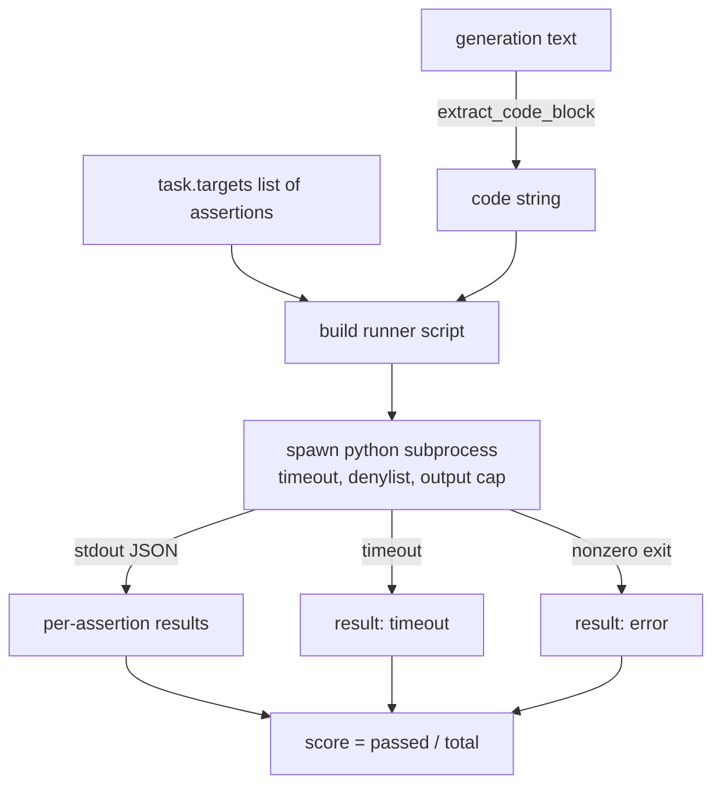
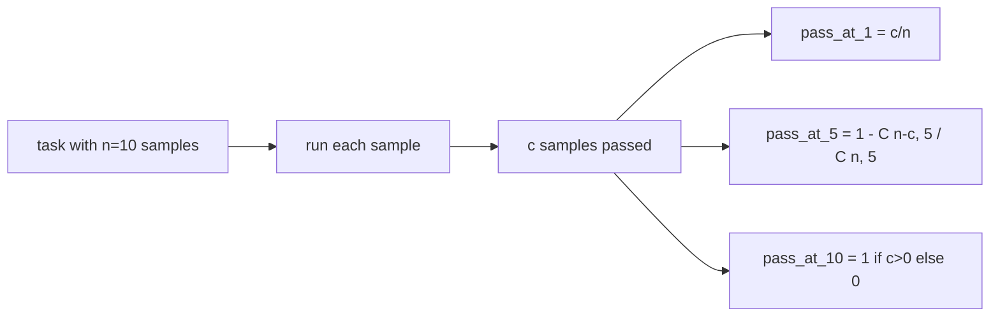

# 代码 निष्पादन सूचक

> उत्पादन के कोड परीक्षण के बाद सही है। मूल्यांकन उपकरण को कोड निकालना होगा, इसे मुख्य मशीन के क्रैश के बिना चलाना होगा, और तथ्यात्मक रूप से इसकी दर को पार करना होगा।

**Type:** Build
**Languages:** Python
**Prerequisites:** 第 19 期 Track B 基础，第 70 和 71 课
**Time:** ~90 分钟

## 学习目标


```figure
sandbox-runner
```

- इस प्रकार से 70वीं कक्षा में पोस्ट प्रोसेसिंग नियमों के अनुरूप मुक्त स्वरूप उत्पन्न में提取代代码块──
-                                                                                                                                                                                                                                                               
-  दिए गए निष्कर्षों के आधार पर उम्मीदवारों के अंशों के माध्यम से कार्य का मूल्यांकन किया जाना चाहिए
- 计算从一个模型进行多代采用任务的通过-到-k---
- इस प्रकार, एक रनिंगर को एक बार फिर से एक बार फिर से एक बार फिर से एक बार फिर से एक बार फिर से एक बार फिर से एक बार फिर से एक बार फिर से एक बार फिर से एक बार फिर से एक बार फिर से एक बार फिर से एक बार फिर से एक बार फिर से एक बार फिर से एक बार फिर से एक बार फिर से एक बार फिर से एक बार फिर से एक बार फिर से एक बार फिर से एक बार फिर से एक बार फिर से एक बार फिर से एक बार फिर से एक बार फिर से एक बार फिर से एक बार फिर से एक बार फिर से एक बार फिर से एक बार फिर से एक बार फिर से एक बार फिर से एक बार फिर से एक बार फिर से एक बार फिर से एक बार फिर से एक बार फिर से एक बार फिर से एक बार फिर से एक बार फिर से एक बार में एक बार फिर से एक बार फिर से एक बार फिर से एक बार में एक बार फिर से एक बार में एक बार फिर से एक बार में एक बार में एक बार फिर से एक बार में एक बार में एक बार में एक बार में एक बार में एक बार फिर से एक बार में एक बार में एक बार में एक बार में एक बार में एक बार में एक बार में एक बार में एक बार में एक बार में एक बार में एक बार में एक बार में एक बार में एक बार में एक बार में एक बार में एक बार में एक बार में एक बार में एक बार में एक बार एक बार के साथ एक बार में एक बार में एक बार में एक बार में एक बार में एक बार के साथ एक बार में एक बार में एक बार के साथ एक बार में एक बार के साथ एक बार में एक बार के साथ एक बार में एक बार में एक बार में एक बार के साथ एक बार के साथ एक बार में एक बार के साथ एक बार में एक बार के साथ एक बार में एक बार के साथ एक बार में एक बार के साथ एक बार के साथ एक बार में एक बार के साथ एक बार के साथ एक बार के साथ एक बार में एक बार के साथ एक बार में एक बार के साथ एक बार में एक बार के साथ एक बार में एक बार के साथ एक बार के साथ एक बार में एक बार के साथ एक बार के साथ एक बार में एक बार के साथ एक बार में एक बार के साथ एक बार के साथ एक बार के साथ एक बार में एक बार के साथ एक बार के साथ एक बार में एक बार के साथ एक बार के साथ एक बार के साथ एक बार में एक बार के साथ एक बार में एक बार के

## क्यों एक अलग प्रक्रिया की आवश्यकता है

आंतरिक`exec` सुरक्षा एवं स्थिरता `while True: pass`永远阻止 eval──生成的 `import shutil; shutil.rmtree('/')`确实像听起来一样灾难性── समाधान प्रत्येक उम्मीदवार के लिए एक नया पायथन व्याख्याता उत्पन्न करना है, जो स्टीडिन पर संचरण कोड, निष्कर्ष परिणामों को लिखना होगा stdout, और प्रुफ आउट पर समाप्त करने के लिए प्रक्रिया── मुख्य मशीन मूल्यांकन 进程 चलना जारी रखें──

HumanEval、MBPP、BigCodeBench 和 LiveCodeBench आदि वास्तविक मूल्यांकन भी उपयोग करते हैं उपक्रम ढांचे। कुछ स्तरों Docker  शीर्ष पर स्थित है। हम उपक्रम पर रुकने के लिए एक कारण हैः यह ट्रांसपोर्ट करने योग्य है, यह stdlib है, और यह शिक्षा मूल्यांकन के लिए महत्वपूर्ण दोष मोड को पकड़ लिया है।

## 代码执行任务的形状

`code_exec`任务携带 `targets`मध्य फ़रमान字符串──运行器 से उत्पन्न中提取隔离的代码块, इसके चारों ओर निर्माण परीक्षण उपकरण, फिर परिचालन परिणाम──



 分数是 `[0, 1]`मध्य अंकः- तीन निष्कर्षों के साथ, जिनमें से दो बार 0.667 के स्कोर पर पारित किए गए।- जो भी त्रुटि हुई, धावक सभी समान रूप में वापस आ जाएगाः प्रक्रिया के टूटने को मानकीकृत त्रुटि कोड में मैप किया जाएगा, बजाय ऊपर उभरने के लिए लाइन बंडल के पायथन वापस लौटने के लिए।

## 拒绝名单

 अस्वीकार सूची आयात पर आधारित है ️️️️️️️️️️️️️️️️️️️️️️️️️️️️️️️️️️️️️️️️️️️️️️️️️️️️️️️️️️️️️️️️️️️️️️️️️️️️️️️️️️️️️️️️️️️️️️️️️️️️️️️️️️️️️️️️️️️️️️️️️️️️️️️️️️️️️️️️️️️️️️️️️️️️️️️️️️️️️️️️️️️️️️️️️️️️️️️️️️️️️️️️️️️️️️️️️️️️️️️️️️️️️️️️️️️️️️️️️️️️️️️️️️️️️️️️️️️️️️️️️️️️️️️️️️️️️️️️️️️️️️️️️️️️️️️️️️️️️️️️️️️️️️️️️️️️️️️️️️️️️️️️️️️️️️️️️️️️️️️️️️️️️️️️️️️️️️️️️️️️️️️️️️️️️️️️️️️️️️️️️️️️️️️️️️️️️️️️️️️️️️️️️️️️️️️️️️️️️️️️️️️️️️️️️️️️️️️️️️️️️️️️️️️️️️️️️️️️️️️️️️️️️️️️️️️️️️️️️️️️️️️️️️️️️️️️️️️️️️️️️️️️️️️️️️️️️️️️️️️`ImportError("denied")`                                                                                                                                                                                                                                                              `os.system``subprocess``socket``requests``urllib``urllib.request``urllib.error``urllib.parse``ctypes``shutil`、 `http.client``asyncio.subprocess`

हम यह नहीं मानेंगे कि यह एक हथियार है। निश्चित प्रतिरोध कोड पायथन में किसी भी प्रक्रिया से बच सकता है।

```python
DENIED = {
    "os.system": True,
    "subprocess": True,
    "socket": True,
    "shutil": True,
    "requests": True,
    "urllib": True,
    "ctypes": True,
}
```

हम पहले से ही आगे बढ़ रहे हैं`import sys`और एक के माध्यम से 子补丁 `os.system`आवेदक के लिए एक गार्ड तैयार करें।`main.py`मध्य में

## 挂钟超时

प्रत्येक प्रक्रिया में एक तीन घंटे सेकंड का डिफ़ॉल्ट बजट है।`subprocess.run(..., timeout=t)`यदि ओवरटाइम हो तो धावक को पकड़ लिया जाएगा `TimeoutExpired`, समाप्त प्रक्रिया,并记录任务的 `timeout`退出原因──该任务的分数为零── धावक आगे बढ़े──

超时是 `run_candidate``timeout_s`参数;第75 课的跑者 通过 `code_exec_timeout_s`प्रति प्रयाग एक बार सेट करें।`run_candidate`इस मूल्य को 0.1 से 30 सेकंड के बीच सीमित कर दिया जाएगा, ताकि सेट की सीमा को बनाए रखा जा सके।

## 输出上限

子进程可能会淹没标准输出,耗尽主机内存──runner will stdout 流式传输到缓冲区, और运行总数超过256 KB 时立即终止子进程──结果记录为`exit_code = error`, विस्तृत जानकारी `"output overflow"` जब एक पीढ़ी ने एक मुद्रित अनंत चक्र का लेखन किया, तो यह व्यवहार में ही दिखाई देता है

## 通过-के

पास-ए-के मानव-मानक और मित्र-उपयोगी निष्पक्ष आकलन यंत्र है।`n`独立样本和其中的 `c`通过, से `n``k`के नमूने में कम से कम एक समाधान पारित करने की संभावना हैः

```
pass_at_k(n, c, k) = 1 - C(n - c, k) / C(n, k)
```

`n - c < k`时, सामान्य रूप से निर्धारित, अणु `C(n - c, k)`零(आपसे कम से कम नहीं कर सकते `k`个失败中选出 `k`个), इसलिए मूल्य为 `1`                                                                                                                                                                                                                                                              `pass_at_k(n, c, k)`供排行榜层使用──



## 退出代码

धावक प्रत्येक कार्य के पांच परिणामों में से एक पर लौटता हैः

- जब हर एक निर्णय के माध्यम से समय के लिए `pass`
- `assertion_fail`जब कोड चल रहा है लेकिन कम से कम एक बयान विफलता के समय
- `syntax_error`जब कोड अनइडक्ट या कोई भाषा विधि त्रुटि हो।
- `timeout`जब मैं रुक गया तो...
- `error`किसी भी अन्य दुर्घटना के लिए, जिसमें सूची से इनकार करने और बाहर निकालने के लिए शामिल हैं`"output overflow"`(का)

विभाजन अभी भी शून्य है। रिटर्न कोड एक डेटा है। निम्न पाठ्यक्रम यह तय कर सकता है कि क्या यह डेटा के लिए या खोने के लिए निर्धारित किया जाएगा।

## 本课不做什么

यह आपको एक वास्तविक साबुन नहीं देगा। यह खुले नेटवर्क से अविश्वसनीय कोड नहीं चलाएगा। यह मौजूदा कार्यों जैसे फ़ाइल I/O या नेटवर्क कॉल को संभालता नहीं है। इन सभी को कंटेनर या माइक्रोवीएम की आवश्यकता है। इस पाठ्यक्रम का मुख्य बिंदु अनुबंध हैः एक स्वतंत्र उप-प्रक्रियाः सूची को अस्वीकार करना, समय से अधिक समय, आउटपुट अप-सीमा, शुद्ध आउटपुट कोड शब्द और पास-एट-के गणित।

## 如何阅读代码

`main.py` परिभाषित किया `extract_code``run_candidate``score_code_exec`和 `pass_at_k`△子进程runner脚本构建为字符串,并作为 `-c`传递给新的python 解释器――`code/tests/test_exec.py`मध्य परीक्षण में मानव स्तर से 风格中提取 से काम करने के उदाहरणों को चार वापसी कोड तथा पास-एट-के द्वारा निष्पादित किया गया।

ऊपर से नीचे तक पढ़ना`main.py`流道模板是承重件──着断言循环,直到你能预测它写回父进程的JSON信封──

## और आगे

एक बार जब एक प्रक्रिया का आकार काम करता है, तो अगला मुद्दा ट्रांसपोर्ट करने योग्य है। अलग-अलग पायथन संस्करण विंडोज में SIGKILL को संसाधित करने के तरीके से अलग हैं। सबसे स्वच्छ समाधान ऑपरेटर को डॉकर 镜像 में डालना है। अगला काम यह है कि वास्तविक इकाई परीक्षण फ़ाइल के साथ फ़ोटो स्ट्रिंग को बदल दिया जाए, ताकि यह मूल्यांकन और उत्पादन CI के कार्य के साथ मेल खाए। इस समय फ़ोटो स्ट्रिंग परीक्षण का उपयोग करना बंद कर दिया जाए; वे खिलौना परीक्षण हैं, और खिलौना दोष हैं।
