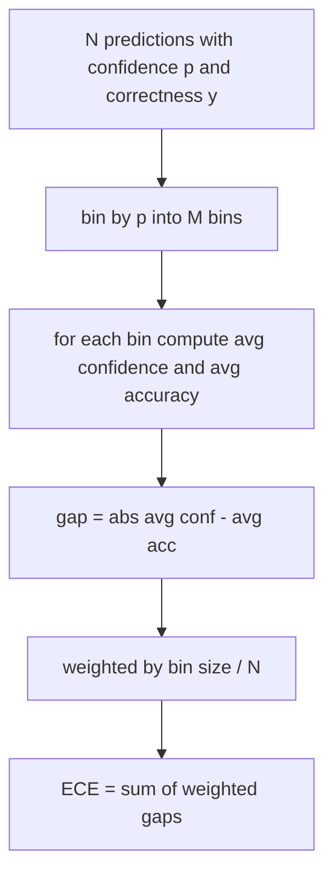
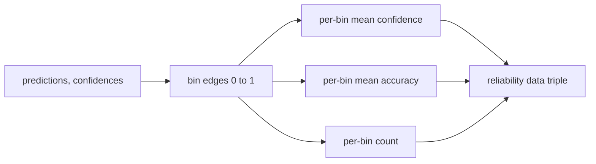

# 困惑度和校准

> यदि आपके मॉडल में 1000 उत्तरों में 90% विश्वास है और 600 सही उत्तर दिए हैं, तो यह दर्शाता है कि यह अच्छी तरह से सही नहीं रहा है।

**Type:** Build
**Languages:** Python
**Prerequisites:** 第 19 期 Track B 基础，第 70 和 71 课
**Time:** ~90 分钟

## 学习目标


```figure
cd-reliability-diagram
```

- 模型适配器 द्वारा प्रदान किए गए टोकन नकारात्मक पर संख्या संभावना गणना भाषा सामग्री भंडार पर टोकन स्तर उलझन में रखना
- 分箱预测概率 गणना分类器或多项选择评估的预期校准误差 (ईसीई) 
- 計算 Brier 分数 (उच्चतम सटीकता सूचक के लिए औसत त्रुटि)并解释它何时执行 ECE 不执行操作──
- निर्माण के लिए विश्वसनीयता और सटीकता के लिए आवश्यक चित्रण डेटा
- सभी तीनों को मूल्यांकन लाइन के बीच जोड़ा जाएगा, ताकि धावक हो सकता है।`perplexity``ece`和 `brier`编号附加到模型报告中──

## 困惑 बताओ क्या

困惑度是每代币的指数平均负对数似然──越低越好──困惑度为 1 意思模型为每代币的实际分配概率 1 语汇量大小的困惑意味着模型是统一的并且没有学到任何东西──实际数字介于两者之间:विकिटेक्स-103 上的强大 2026年基本模型大约为8至12──同一文本上一个坏的则为五十多──

यह उपकरण स्वयं संख्यात्मक संभावनाओं पर गणना नहीं करता है। ये मॉडल अनुकूलक से आते हैं। यह उपकरण संश्लेषण करता हैः यह संख्यात्मक संभावनाओं पर प्रत्येक टोकन की सूची प्राप्त करता है, प्रत्येक क्रम की टोकन गणना सूची, और फिर से सामग्री के भ्रम में लौटता है।

```python
def perplexity(neg_log_probs, token_counts):
    total_nll = sum(neg_log_probs)
    total_tokens = sum(token_counts)
    return math.exp(total_nll / total_tokens)
```

इस पर अमल करने के लिए शून्य टोकन के किनारे स्थिति तथा दावा नकारात्मक संख्या के लिए संभावनाओं के लिए नकारात्मक नहीं है।`log p`नहीं `-log p`1. अनुकूलनकर्ता 1 से कम की उलझन पैदा करेगा, यह असंभव है।

## ईसीई  उपाय क्या है

预期校准差异 预测分组在信度根据信度中,固定数量盒中,然后测量各盒的信度和准确度之间的平均差距,并按盒大小加权──



标准公式在 `[0, 1]`ऊपर उपयोग करें 10 等宽的bin── 应实现支持任何正整数计数── 我们公开一个 `bins`参数, ताकि ऑपरेटर नियम (10) और तुलना नियम (15) के बीच चयन कर सके।

ईसीई के कारण बॉक्स संख्या और नमूना आकार में अंतर होता है। 10 बिन्स और 100 ों का उपयोग करके, आप 0.02 ईसीई और साथ में शोर को अलग नहीं कर सकते हैं।

## Brier 分数是 ECE 没有的

ईसीई केवल औसत अंतर पर ध्यान केंद्रित करता है। यदि मॉडल आधे डेटा बॉक्स में आत्मविश्वास से अधिक है, जबकि दूसरे में आत्मविश्वास की कमी है, तो इसका ईसीई कम हो सकता है, जबकि स्थानीय परिशुद्धता भी बहुत खराब है।

                                                                                                                                                                                                                                                              `mean((p_i - y_i)^2)`यह विश्वसनीयता, संकल्प और अनिश्चितता में विघटित होता है हम गणना करते हैं कि रेचक संख्या और विघटन रनर रिपोर्ट मानदंडों में, लेकिन रिकॉर्डिंग उपकरण बोर्ड के विघटन

```python
def brier(p, y):
    return float(np.mean((p - y) ** 2))
```

## विश्वसनीयता

विश्वसनीयता चित्र प्रत्येक बॉक्स में अनुभव सटीकता के आधार पर पूर्वानुमान सटीकता चित्रित किया गया है।



返回的元组是调用层绘图或计算自定义 ECE 变体(自适应 ECE、扫描 ECE等) आवश्यक元组──我们返回 numpy 数组,因此下游代码不必进行转换──

## 置信来源

यह उपकरण नह ं परिकल्पना विश्वसनीयता से softmax से आया है  प्रत्येक पूर्वानुमान इसे स्वीकार करता है `[0, 1]`मध्य में कोई भी संख्याएँ।`softmax over option log-likelihoods` मुक्त ग्रंथ के लिए, प्राकृतिक विश्वास मॉडल की स्व-रिपोर्ट संभावना या औसत संख्यात्मक समानता के लिए संकेतक है  मूल्यांकन केवल खपत संख्याएँ यह एक अनुकूलक का काम है

## 边缘 स्थिति

- सभी भविष्यवाणियां गलत हैंः ईसीई औसत विश्वास है, ब्रियर उच्च मूल्य है, उलझन है मॉडल पर पाठ के दृष्टिकोण है।
- सभी पूर्वानुमान औसत उच्च विश्वास सटीक:ईसीई  शून्य के करीब, ब्रियर  शून्य के करीब
- p=0.5 时完全不确定预测因子: प्रत्येक预测都落入同一个垃圾,所以ECE为`|0.5 - accuracy|`Brier 恰好为0.25,因为无论 `y`है 0 या है 1,`(0.5 - y)^2 = 0.25`
- 空输入:ईसीई、Brier 和可靠性返回 `0.0`(या शून्य भर भरने के लिए संख्या) ◊ शून्य टोकन स्थिति के लिए, भ्रम  वापसी `NaN` इन मार्गों में कोई चेतावनी नहीं है; धावक इन मानों की जांच करता है और यह तय करता है कि रिपोर्ट या कूद गया है या नहीं।

इन मामलों को परीक्षणों में शामिल किया गया है। वास्तविक आधारभूत परीक्षणों में वास्तविक मॉडल उन्हें नहीं मारेंगे, लेकिन कोई दोषपूर्ण एडेप्टर या छोटा नमूना उन्हें मार देगा, और ऑपरेटर को दुर्घटनाग्रस्त नहीं होना चाहिए।

## 调度

校准不像F1那样是针对每任务的指标――这是每模型的报告――运行者在整个评估过程中积累`(confidence, correct)`के लिए,并计算一次 ECE、Brier 和可靠性数据──困惑度, प्रति व्यक्ति कार्य के साथ, आरक्षित ग्रंथ सामग्री के आधार पर गणना की गई है।

界面是:

```python
report = CalibrationReport.from_predictions(confidences, correct)
report.ece          # float
report.brier        # float
report.reliability  # tuple of three numpy arrays
report.populated_bins  # int
```

`PerplexityResult.from_token_nll(neg_log_probs, token_counts)`返回 प्रत्येक टोकन के उलझन度和平均负对数似然──

## 本课不做什么

यह मॉडल का उपयोग नहीं करता है। यह सॉफ्टमैक्स को प्राप्त नहीं करता है। यह आउटपुट टोकन की विश्वसनीयता का अनुमान नहीं करता है। यह एडिटर का काम है। यह तापमान संकुचन या पूर्ण संकुचन का संचालन नहीं करता है। ये घटनाओं के बाद सुधार हैं, जो विभिन्न पाठ्यक्रमों में मौजूद हैं। इस पाठ्यक्रम का मुख्य उद्देश्य तीन अंकों को उलझन में डालना है।

## 如何阅读代码

`main.py` परिभाषा `perplexity``expected_calibration_error``brier_score``reliability_diagram`和 `CalibrationReport`/`PerplexityResult`डेटा वर्गः यह प्रदर्शन ज्ञात मूलभूत तथ्यों के समग्र पूर्वानुमान पर चलता हैः एक अच्छी तरह से स्थापित मॉडल, एक अत्यधिक आत्मविश्वास वाला मॉडल और एक अपर्याप्त आत्मविश्वास वाला मॉडल।`code/tests/test_calibration.py`मध्य परीक्षण प्रत्येक किनारे स्थिति तथा समग्र पूर्वानुमान चर के संदर्भ मूल्य को तय करता है।

ऊपर से नीचे तक पढ़ना`main.py`◊ फ़ंक्शन क्रम से मान से लेकर वेक्टर तक रिपोर्ट करने हेतु। प्रत्येक फ़ंक्शन में एक संक्षिप्त दस्तावेज वर्णमाला है, जिसमें गणित एवं अनुबंध शामिल है।

## और आगे

校准 (Certification) एक प्रूफिकल नंबर है और इसे पूरा करने के लिए कहा जाता है। 校准 (Certification) एक प्रूफिकल नंबर है जो एक प्रूफिकल नंबर पर जीतता है और एक प्रूफिकल मॉडल है जो एक प्रूफिकल नंबर पर जीतता है। 校准 (Certification) एक प्रूफिकल मॉडल है जो कुछ कम सटीकता पर स्कोर करता है लेकिन विश्वसनीयता से रिपोर्ट करता है।
