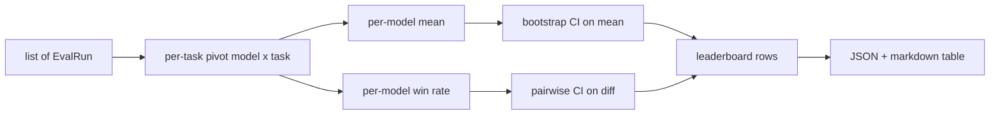
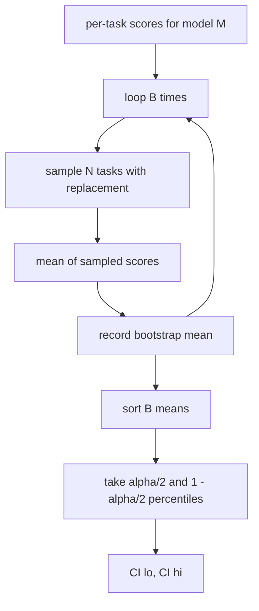

# 排行榜聚合

> प्रत्येक कार्य का अंक आसान है। प्रत्येक कार्य के विभिन्न प्रकार के मॉडल को क्रमबद्ध करना अधिक कठिन है।

**Type:** Build
**Languages:** Python
**Prerequisites:** 第19期B轨基础，第70、71、73课
**Time:** ~90 分钟

## 学习目标


```figure
ci-leaderboard-ci
```

- अनेक मॉडल और अनेक कार्य के प्रत्येक कार्य के अंश को एक संपूर्ण प्रत्येक मॉडल पथ में एकजुट करना।
-  मानककृत गुण分数, ताकि पारित दर और BLEU मूल्य कुल गणना को अत्यधिक प्रभावित न करें
- 平均值和胜率 के अनुसार मॉडल को क्रमबद्ध करें,并解释每模型何时是正确的总结──
- 计算每个模型的平均分和成对差异的引导置信区间──
- JSON  रिपोर्ट और मार्कडाउन  表 के लिए रैंकिंग सूची को आउटपुट करना, 75 वें  कक्षा में धावक इसे CI  टिप्पणी में पेस्ट कर सकता है

## 输入的形状

聚合器 उपयोग `EvalRun`记录列表:

```python
@dataclass
class EvalRun:
    model_id: str
    task_id: str
    metric_name: str
    score: float          # in [0, 1]
    category: str
```

第 75 课中 धावक प्रत्येक `(model, task)`एक रिकॉर्ड जारी करने के लिए।`[0, 1]`मध्य में

## 输出

出来三张表:



排行榜行包含:`model_id``mean_score``mean_ci_lo``mean_ci_hi``win_rate``tasks_completed`तथा प्रत्येक श्रेणी के औसत मूल्य के लिए विकल्प`categories`नक्शा

## 标准化

यदि एक मिशन के स्कोर के लिए `[0, 1]`, एक और मिशन के लिए स्कोर किया गया था`[0, 100]`, तो दूसरा कार्य मौनता से प्रमुख औसत मूल्य---聚合器 सत्यापित करें कि प्रत्येक इनपुट अंक संख्या क्या स्थित है`[0, 1]`मध्य, अन्यथा अस्वीकार करें। संशोधन स्थित है।

## औसत मूल्य एवं जीत दर

इन दो श्रेणीकरण योजनाओं का उद्देश्य अलग-अलग है।

औसत अंक प्रत्येक कार्य अंक के औसत मूल्य का एक मॉडल है। यह शीर्षक संख्यात्मक रैंकिंग रिपोर्ट है। यह असामान्य मूल्य और कार्य असंतुलन के प्रति संवेदनशील है।

胜率计算模型在同一任务上击败所有其他模型的频率── प्रत्येक任务 पर, सर्वाधिक स्कोर वाला मॉडल जीतता है平局时, प्रत्येक并列模型都算完整一次胜)──胜率等于胜次除了模型的任务数──它对异常值和尺度差异不太敏感,但会丢失信息──

```python
def win_rate(model_id, runs_by_task, all_models):
    wins, total = 0, 0
    for task_id, runs in runs_by_task.items():
        scores = {r.model_id: r.score for r in runs if r.model_id in all_models}
        if model_id not in scores:
            continue
        total += 1
        best = max(scores.values())
        if scores[model_id] >= best:
            wins += 1
    return wins / total if total else 0.0
```

harness 会同时报告两者──第 75 课中的 धावक 默认按平均排名排序; विजय दर के मार्कडाउन 列 भी वहीं बरकरार रहे, ताकि उपयोगकर्ता इस दृष्टिकोण को पसंद करे जब उपयोग करे──

## स्वयंविस्थापना क्षेत्र

प्रत्येक मॉडल का औसत मूल्य है, जो कि एक मिशन के माध्यम से पुनर्प्राप्ति के लिए एक अनुमान का नेतृत्व करता है।`B`और फिर`alpha`级别获取百分位间隔──



 तुलना के लिए, हम प्रत्येक कार्य के अंतर का मार्गदर्शन `score_A - score_B`यदि यह वास्तव में है, तो अंतर अल्फा जलपात पर स्पष्ट है। यदि नहीं, तो रैंकिंग मॉडल को समतल माना जाएगा।

低级助手`bootstrap_mean_ci``bootstrap_pairwise_diff`) मानता है`B=1000`; सार्वजनिक聚合器`aggregate``pairwise_diffs`) मर्मतः`b=500`, इसलिए प्रदर्शन और परीक्षण बनाए रखें तेजी से. . . . . . . . . . . . . . . . . . . . . . . . . . . . . . . . . . . . . . . . . . . . . . . . . . . . . . . . . . . . . . . . . . . . . . . . . . . . . . . . . . . . . . . . . . . . . . . . . . . . . . . . . . . . . . . . . . . . . . . . . . . . . . . . . . . . . . . . . . . . . . . . . . . . . . . . . . . . . . . . . . . . . . . . . . . . . . . . . . . . . . . . . . . . . . . . . . . . . . . . . . . . . . . . . . . . . . . . . . . . . . . . . . . . . . . . . . . . . . . . . . . . . . . . . . . . . . . . . . . . . . . . . . . . . . . . . . . . . . . . . . . . . . . . . . . . . . . . . . . . . . . . . . . . . . . . . . . . . . . . . . . . . . . . . . . . . . . . . . . . . . . . . . . . . . . . . . . . . . . . . . . . . . . . . . . . . . . . . . . . . . . . . . . . . . . . . . . . . . . . . . . . . . . . . . . . . . . . . . . . . . . . . . . . . . . . . . . . . . . . . . . . . . . . . . . . . . . . . . . . . . . . . . . . . . . . . . . . . . . . . . . . . . . . . . . . . . . . . . . . .

## 类别

यदि सेट किया गया है `EvalRun.category`, polymer भी प्रत्येक श्रेणी के औसत मूल्य की रिपोर्ट करेगा। यह प्रत्येक रैंकिंग पर एक है, ऊपर लिखा है।`math``reasoning``code``safety` यह रनर को यह पता लगाने में मदद कर सकता है कि मॉडल समग्र रूप से अच्छा है या नहीं, लेकिन कोड कमजोर है, यह शीर्षक औसत मूल्य छिपे हुए जानकारी है

## मार्कडाउन 染

排行榜呈现为 मार्कडाउन 表:

```text
| Rank | Model | Mean | 95% CI | Win rate | Tasks |
|------|-------|------|--------|----------|-------|
| 1    | gpt   | 0.78 | 0.74-0.82 | 0.62 | 50 |
| 2    | claude| 0.75 | 0.71-0.79 | 0.34 | 50 |
| 3    | random| 0.10 | 0.07-0.13 | 0.04 | 50 |
```

इस पर औसत क्रमबद्धता के अनुसार छपाई की गई है।

## 本课不做什么

यह काम नहीं करता मॉडल। यह माप स्तरों को नहीं अनुकूलित करता है। यह ईसीई या अन्य परिष्कृत चर को आत्म-अनुकूलित नहीं करता है। ये 73 वीं कक्षा हैं। इसमें प्रत्येक कार्य समान रूप से महत्वपूर्ण है।`weight`字段将该子保持开状态, लेकिन聚合器 में इसे अनदेखा करना. यदि आवश्यक हो, तो बाद के पाठ्यक्रम में वजन जोड़ सकते हैं।

## 如何阅读代码

`main.py` परिभाषित किया `EvalRun``LeaderboardRow``aggregate``bootstrap_mean_ci``bootstrap_pairwise_diff`和 `render_markdown` इस प्रदर्शनी में तीन मॉडल और बारह कार्यों से मिलकर एक समग्र सेट बनाया गया है, जिसमें एक साथ एक क्रमबद्ध और मुद्रित रैंकिंग और एक पूर्ण भिन्नता सूची शामिल है`code/tests/test_leaderboard.py`मध्य परीक्षण में बूटस्ट्रैप, मार्कडाउन, जीत की दर, सीमा और अंतरिक्ष प्रविष्टि व्यवहार तय किए गए हैं।

ऊपर से नीचे तक पढ़ना`main.py` डाटा आकार`EvalRun``LeaderboardRow`) पहले दिखाई देता है, फिर एक聚合器, तीसरा एक बूटस्ट्रैप है, अंतिम एक 染── प्रत्येक कार्य में एक聚焦 का अनुबंध होता है──

## और आगे

प्रत्येक मॉडल के क्षेत्र में असमानता होती है, लेकिन मॉडल के बीच तुलना असमानता होनी चाहिए। यदि मॉडल ए और बी एक ही सौ कार्यों को संचालित करते हैं, तो उचित परीक्षण प्रत्येक कार्य के अंतर के लिए एक असमानता निर्देशक कार्यक्रम है।`bootstrap_pairwise_diff`已实现它── इसके अलावा, आपको एक सम्मान कार्य श्रृंखला के एक विभाजनकारी मार्गदर्शन कार्यक्रम की आवश्यकता है। गणित के प्रश्न एक दूसरे से स्वतंत्र नहीं हैं; गणितीय त्रुटि मॉडल उनमें से दस को प्रभावित करेगा।
