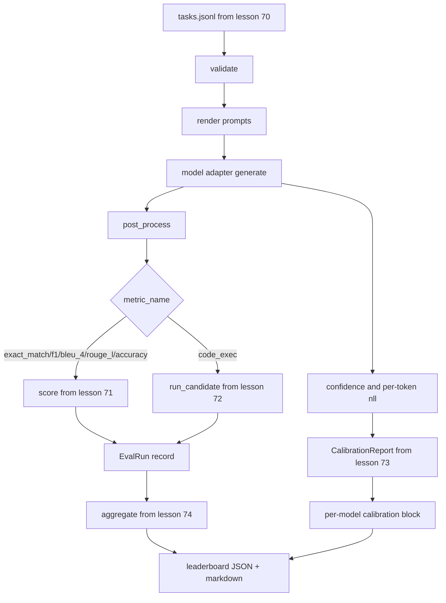

# 端到端评估运行器

> 五堂管道安装课,一堂水课, धावक पढ़ ले 70 课中的任务规范,通过适配器调用模型, 71 课和 72 课进行评价,附加第 73 课中的校准报告,并发发出 74 课中的排行列――演示自动终止──

**Type:** Build
**Languages:** Python
**Prerequisites:** 第 19 期 Track B 基础，第 70 至 74 课
**Time:** ~90 分钟

## 学习目标


```figure
eval-grid
```

- 定义任何模型(模拟、本地、API) को सतह पर संतुष्ट करने के लिए छोटे तरीकों से किया जा सकता है `ModelAdapter`接口──
- JSONL फ़ाइलों पर परिचालन मूल्यांकन में स्थिर, और कार्य池 में并行执行任务──
- एक बार में एक स्तर को एक साथ मिलाकर एक स्तर को एक साथ मिलाया जाएगा।
- 发出 प्रत्येक मॉडल का `EvalRun`记录并将其直接输入排行榜聚合器──
- साथ ही JSON रिपोर्ट और मार्कडाउन टेबल का आउटपुट; शुद्ध परिचालन में शून्य से समाप्त होने पर, सत्यापन या परिचालन में विफल होने पर शून्य से बाहर निकलने पर।

## 管道



धावक एक समग्र बिंदु है। कक्षा 70 से 74 तक के प्रत्येक वर्ग में एक मॉड्यूल होता है जिसे धावक द्वारा लिखित किया जाता है।

## 适配器接口

适配器是 धावक और किसी भी मॉडल के बीच का संपर्क 接口故意很小──

```python
class ModelAdapter:
    model_id: str

    def generate(self, prompt: str, task: TaskSpec) -> Generation: ...
```

`Generation`एक डेटा वर्ग है, जिसमें हैः

- `text`मॉडल का मुक्त स्वरूप आउटपुट
- `confidence`:`[0, 1]`मध्य में अवयव अंक संख्या, मॉडल स्व-रिपोर्ट के उत्तर की संभावना को दर्शाता है
- `token_nll`: उत्पन्न टोकन के लिए चयनात्मक संख्या के लिए समान है कुल
- `token_count`: उत्पन्न टोकन की चयन संख्या

运行器中的模拟适配器 प्रदान करते हैंः`RuleBasedAdapter`(确定性, लगभग完美),`NoisyAdapter`(ओवर ओवर आत्मविश्वास, अक्सर गलत) और`BiasedAdapter`(擅长一个类别,糟糕于另一个类别) 

## और निष्पादित

धावक उपयोग `concurrent.futures.ThreadPoolExecutor`按模型并行运行任务──工作线程数据认为8 和任务数中较小的──线程就足够了,因为实际模型调用瓶是网络 I/O──代码执行路径在任务内生成自己的子进程,执行器只安排等着──

 अनिश्चितता परीक्षण के लिए, धावक सार्वजनिक `run_eval(adapters, tasks, parallel=False)`, ताकि परीक्षण से निष्पादन क्रम निर्धारित किया जा सके।

## 单遍评分循环

 प्रत्येक कार्य के लिए:

1. 染提示(कुछ-शॉट 前加上提示正文)
2. 呼叫适配器并为呼叫计时──
3. उत्पादन के लिए कार्य नियमन के अनुसार, उत्पादन के बाद प्रसंस्करण हेतु 
4. 调度到度量层──
5. उपयोग करें सूचकांक और सूचक डेटा संरचना`EvalRun`记录──
6. `(confidence, correct)`विद्यालय के लिए अतिरिक्त प्रशिक्षण के लिए

对于精确匹配样式指标(`exact_match``accuracy``code_exec`),`correct`信号是 `score >= 1.0`, वर्ग वर्ग के लिए,`score >= 0.5`信号是 `score >= 0.5`मूल्य स्थित `_correct_from_score`मध्य, तथा ऑपरेटर सार्वजनिक रूप से सार्वजनिक नहीं होगा।

## 聚合

प्रत्येक कार्य के परिणाम प्राप्त करने के बाद, धावक 74 कक्षा में भर्ती होगा।`aggregate`和 `pairwise_diffs`और धारा 73 में`CalibrationReport.from_predictions`△输出 एक JSON 信封:

```json
{
  "leaderboard": [...],
  "pairwise": [...],
  "calibration": {
    "model_id_a": {"ece": 0.04, "brier": 0.10, "populated_bins": 8, ...},
    ...
  },
  "summary": {
    "tasks": 10,
    "models": 3,
    "wall_seconds": 1.2
  }
}
```

runner भी markdown expres write in standard output, ताकि उपयोगकर्ता परिणाम को PR 评论中 में पेस्ट कर सके।

## से समापन प्रदर्शन

यह प्रदर्शन 70वीं कक्षा के 10 फिक्स्ड 任务 पर चलेगा तीन模拟适配器──壁表 时间应减少于10秒──干净运行时退出代码为零──

清洁运行标准是:

- धारा 70 课中验证 के प्रत्येक कार्य
- धारा 71 और धारा 72 में प्रत्येक कार्य के लिए औसत अंक।
- अनुच्छेद 73 课下汇总校准报告没有错误――
- 排列榜将基于规则的适配器严格排列在随机适配器之上.

यदि इनमें से कोई भी टूट जाए, तो धावक गैर-शून्य मूल्य से वापस आ जाएगा, और JSON पत्र में संरचनात्मक त्रुटि दिखाई देगी।

## 本课不做什么

यह वास्तविक मॉडल का उपयोग नहीं करता है। यह एपीआई की कुंजी प्रवाह या गति सीमा प्रसंस्करण को लागू नहीं करता है। यह प्रवाह या भाग उत्पन्न करने का काम नहीं करता है। यह प्रत्येक बार एक बार एक बार पुनः प्रयोग करने के लिए एक पीढ़ी में लौटता है। यह पुनः परीक्षण या कैशिंग का काम नहीं करता है। ये समस्याएं एक बार में एक बार में एक बार में एक बार में एक बार में एक बार में एक बार में एक बार में एक बार में एक बार में एक बार में एक बार में एक बार में एक बार में एक बार में एक बार में एक बार में एक बार में एक बार में एक बार में एक बार में एक बार में एक बार में एक बार में एक बार में एक बार में एक बार में एक बार में एक बार में एक बार में एक बार में एक बार में एक बार में एक बार में एक बार में एक बार में एक बार में एक बार में एक बार में एक बार में एक बार में एक बार में एक बार में एक बार में एक बार में एक बार में एक बार में एक बार में एक बार में एक बार में एक बार में एक बार में एक बार में एक बार में एक बार में एक बार में एक बार में एक बार में एक बार में एक बार में एक बार में एक बार में एक बार में एक बार में एक बार में एक बार में एक बार में एक बार में एक बार में एक बार में एक बार में एक बार में एक बार में एक बार में एक बार में एक बार में एक बार में एक बार में एक बार में एक बार में एक बार में एक बार में एक बार में एक बार में एक बार में एक बार में एक बार में एक बार में एक बार में एक बार में एक बार में एक बार में एक बार में एक बार में एक बार में एक बार में एक बार में एक बार में एक बार में एक बार में एक बार में एक बार में एक बार में एक बार में एक बार में एक बार में एक बार में एक बार में एक बार में एक बार में एक बार में एक बार में एक बार में एक बार में एक बार में एक बार में एक बार में एक बार में एक बार में एक बार में एक बार में एक बार में एक बार में एक बार में एक बार में एक बार में एक बार में एक बार में एक बार में एक बार में एक बार में एक बार में एक बार में एक बार में एक बार में एक बार में एक बार में एक बार में एक बार में एक बार में एक बार में एक बार में एक बार में एक बार में एक

## 如何阅读代码

`main.py`यह एक छोटे से माध्यम से होता है`_load_sibling` मदद कार्यक्रम अन्य पांच पाठ्यक्रम मॉड्यूल से आयात करता है, यह सहायता कार्यक्रम उन्हें पारस्परिक मार्गों से हल करता है।`Generation``EvalReport`和 `ModelAdapter`                                                                                                                                                                                                                                                              

ऊपर से नीचे तक पढ़ना`main.py`                                                                                                                                                                                                                                                              `run_eval`, फिर यह है`_score_one`, फिर एक अनुकूलन उपकरण है. अंतिम प्रदर्शन एक काटने बिंदु है.

`code/tests/test_runner.py`मध्य परीक्षण फिक्स्ड एडॉबेटर इंटरफेस, एकल-मार्ग चक्र, क्रम और इक्विटी के साथ संगत, प्रसंस्करण कांच क्षेत्र और JSON 包网形――

## और आगे

यह रनिंगर है                                                                                                                                                                                                                                                             `(task_id, model_id, model_version)`键控 के परिणाम कैशिंग ✓ प्रत्येक ऑपरेशन के लिए डॉलर और टोकन की लागत का अनुगमन ✓ रिटर्न रेट सीमा के भारी परीक्षण परत ✓ पास-ए-के ✓ कार्य की नमूना रणनीति तथा दीर्घ सूट के प्रवाह आउटपुट प्रारूप ✓ इनमें से प्रत्येक एक अलग ध्यान बिंदु है, यह ऑपरेटर को पैक करता है, और किसी भी परिवर्तन के लिए संकेत या संलयन परतों ✓ नहीं है।

模拟工作后,为真正的提供程序添加适配器──选择一个免费级别,写三十行水,看排列清亮起──然后添加第二个提供程序并让线束完成工作──
