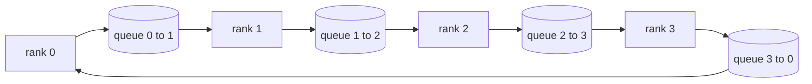

# सामूहिक संचालन को शून्य से प्राप्त करना

> चार सामूहिक संचालन जो एक साथ वितरित प्रशिक्षण को जोड़ते हैं, वे सभी को कम करते हैं, प्रसारित करते हैं, एकत्र करते हैं और कम करते हैं। प्रशिक्षण ढांचे प्रदान करते हैं।`multiprocessing.Queue`网格上构建一次它们,根据参考实现验证它们,轨道的其余部分就变成了管道──

**Type:** Build
**Languages:** Python
**Prerequisites:** 第 19 阶段 Track C 课程 42-49
**Time:** ~90 分钟

## 学习目标

- में दो प्रसवों में पूरा करने के लिए एक रिंग सभी घटाने, पहले घटाने, फिर सभी इकट्ठा) और प्रत्येक तत्व के लिए प्रत्येक श्रृंखला संचार मात्रा 2 ((N-1) / N 字节〕
- `multiprocessing.Queue`ऊपर का बिन्दु ऊपर का बिन्दु भेजें ऊपर का निर्माण प्रसारण, सभी को इकट्ठा करना तथा कम करना
-  उसी इनपुट के अनुसार `torch.distributed`ग्लू 参考验证 प्रत्येक मूल भाषा。
-                                                                                                                                                                                                                                                               

## 问题

N 级上简单 सभी घटाएँ 将张量 N 次发送到根并广播 N 次。 प्रत्येक रैंक का带宽缩放为$O(N)$, जड़ बन बैटल, और लटकता है घड़ी के ऊपर सबसे धीमी कड़ी है गुणा N.$T/N$की$2(N-1)$块, इसलिए प्रत्येक रैंक字节下降到$2T(N-1)/N$, के साथ集群大小无关── पेड़ सभी कम करते हैं ,$\log_2(N)$跳 बजाय $2(N-1)$                                                                                                                                                                                                                                                              

आप इस ट्यूटोरियल में पढ़ने वाले प्रत्येक वितरित प्रशिक्षण ढांचे पर निर्भर करता है इन चार मूल भाषाओं में।  PyTorch DDP प्रत्येक पैरामीटर बैरल के साथ एक सभी-रिड्यूस एक साथ चरणों में ले जाएगा। ZeRO  reduc_scatter के माध्यम से अनुकूलक स्थिति पर विभाजन करता है, और सभी-गेरिटर 广播更新的参数 के माध्यम से ले जाएगा।  FSDP पूर्ण-आगे बढ़कर सभी-गेरिटर_reduc_scatter में बदल जाएगा। ट्यूब समयात्रा को क्रॉस-स्टेज समूह में सक्रिय करने की आवश्यकता है। यदि आप इन चार सेटों को प्राप्त नहीं कर सकते हैं, तो आप यह अनुमान नहीं लगा सकते कि प्रशिक्षण क्यों रुक जाएगा, क्यों स्तर 3 में दिखाई देगा, या क्यों विनिमय में ट्यूब बुलबुला बढ़ जाएगा।

## 概念



### 分两次进行全减

                                                                                                                                                                                                                                                              

|原语|每 rank 字节 |步骤|何时使用 |
|-----------|---------------|-------|-------------|
|Ring allreduce| 2T(N-1)/N | 2(N-1) |大 T、fat-pipe 同构集群 |
|Tree allreduce | T log2(N) | 2 log2(N) |小 T 或高延迟链路 |
|广播| T | log2(N) 树 |参数初始化，标量配置|
|allgather| T(N-1)/N | N-1 |分片转发，ZeRO 取消分片 |
|reduce_scatter | T(N-1)/N | N-1 | ZeRO 梯度分片 |

### एनसीसीएल के विकल्प के रूप में 队列网格

एनसीसीएल पीसीआई और एनवीलिंक पर काम करता है, और हार्डवेयर ढोने में कमी आती है।`multiprocessing.Queue`आपको एकल उत्पादक और एकल उपभोक्ता के साथ ऑर्डर पॉइंट टू पॉइंट डिलीवरी प्रदान करने के लिए।

### 针对 gloo 进行验证

प्रत्येक मूल भाषा का परीक्षण किया जाएगा, इसका आउटपुट उसी विश्व के समान मात्रा में उपयोग के साथ किया जाएगा।`torch.distributed` तुलना करें यदि आपकी रिंग में सभी ग्लू के साथ विकृति का फ़्लोट32 एपिसिलोन से अधिक कम हो जाता है, तो परीक्षण विफल हो जाता है; यदि यह नहीं है, तो वास्तविक प्रशिक्षण में चल रहे 10,000 चरणों से पहले यह सही प्रतीत होता है


```figure
ci-ring-allreduce
```

##  इसे निर्माण

`code/main.py`实现:

- `Mesh`类,将 N 个 `multiprocessing.Queue` उदाहरण                                                                                                                                                                                                                                                                                                                                                                                                                                                                                                                            `send(dst, tensor)`和 `recv(src)`
- `ring_allreduce(mesh, rank, world_size, tensor)`运行两遍算法──
- `broadcast(mesh, rank, world_size, tensor, src)`
- `allgather(mesh, rank, world_size, tensor)`प्रयोग N-1 轮换──
- `reduce_scatter(mesh, rank, world_size, tensor)`作为allreduce的前半部分──
- `_gloo_reference(op, world_size, tensor)`   के माध्यम से `torch.distributed`运行相同的输入,并使用 gloo 进行字节相等比较──

运行它:

```bash
python3 code/main.py
```

输出: तुलना करें क्रमांक 格和 gloo 输出 प्रत्येक आधार को सत्यापित करें, इसके बाद एक प्रमाण के साथ 2T(N-1) /N 缩放的每列节计计器──

## 野外生产模式

तीन प्रकार के तरीके से आधार को पर्याप्त रूप से मजबूत बनाया जा सकता है,

**在 allreduce 之前对梯度进行分桶。**1B 参数 मॉडल में हजारों 梯度张量── प्रत्येक 张量 को एक बार सभी घटाएं 会支付 N 倍的延迟下限── डीडीपी 梯度 भंडारण को लगभग 25 एमबी के ब्लॉक के रूप में बनाएगा, और प्रत्येक भंडारण桶 के लिए एक सभी घटाएगा; 小张量骑大张量的后面── यदि कोई भी 张量 नहीं होता तो देरी से बिक्री का वर्चस्व होगा──

**通信与计算重叠。**पिछड़े से विपरीत क्रम में क्रमशः गणना की तरफ़ ले जाने वाली तरंगों में से एक है। जब अंतिम तरंग की तरंग तैयार हो जाती है, तो सभी को कम करना शुरू कर दिया जाता है, जबकि निम्न स्तर गणना जारी रखता है।

**根据消息大小而不是宗教来选择环或树。**एनसीसीएल  ने एक टोप्पर परीक्षक प्रदान किया, जो ~ 1 एमबी से अधिक के लिए समाचार चयन कण, 1 एमबी से कम के लिए समाचार चयन कण, 交叉是带宽与延迟: 1 एमबी से अधिक,带宽项 2T(N-1) /N 占主导地位,环获胜; 1 एमबी से कम,log2(N) 跳数获胜;; एक टोप्पर के लिए हार्ड कोडिंग एक त्रुटि संदेश के बड़े पैमाने पर संचलन को कम करती है।

## इसका उपयोग करें

生产模式:

- **PyTorch DDP。**                                                                                                                                                                                                                                                              `dist.all_reduce`斗大小可调; 100Gbit 以太网 के लिए,默认 25 MB है उचित
- **DeepSpeed ZeRO。**发出减_scatter 发出_scatter 发出_scatter 发出_scatter 发出_scatter 发出_scatter 发出_scatter 发出_scatter 发出_scatter 发出_scatter 发出_scatter 发出_scatter 发出_scatter 发出_scatter 发出_scatter 发出_scatter 发出_scatter 发出_scatter 发出_scatter 发出_scatter 发出_scatter 发出_scatter 发出_scatter 发出_scatter 发出_scatter 发出_scatter 发出_scatter 发出_scatter 发出_scatter 发出_scatter 发出_scatter 发_scatter 发_scatter 发_scatter 发_scatter 发_scatter 发_scatter 发_scatter 发_scatter 发_scat_scat_scat_scat_scat_scat_scat_scat_scat_scat_scat_scat_scat_scat_scat_scat_scat_scat_scat_scat_scat_scat_scat_scat_scat_scat_scat_scat_scat_scat_scat_scat_scat_scat_scat_scat_scat_scat_scat_scat_scat_scat_scat_scat_scat_scat_scat_scat_scat_scat_scat_scat_scat_scat_scat_scat_scat_scat_scat_scat_scat_scat_scat_scat_scat_scat_scat_scat_scat_s_s_s_scat_s_s_s_s_s_s_s_s_s_s_s_s_s
- **FSDP.**पूर्ववत से सभी एकत्रित करें  लेयर पर हटाने का काम शुरू करें, गणना करें, फिर reduce_scatter का उपयोग करें  संकुचित करें और हटाने का काम शुरू करें

## 发货

प्रयोग第 77-81 课中队列网格原语──第 77 课把所有减少 接入 DDP──第 78 课把减少_散射 接入 ZeRO──第 79 课用点对点发送和回复(而不是集体)传递管道激活──第 81 课把这四者组合成端到端演示──

## अभ्यास

1. जोड़ वृक्ष सभी चरों को कम करता है, और सूचना के अनुसार आकार और आकार के बीच में परिवर्तन करता है।
2. 添加 `recv_timeout_ms`, ताकि स्थिर रैंकिंग में अंतरिम तिथि की त्रुटि उत्पन्न हो, हमेशा के लिए नहीं।
3. चार मूल भाषाओं के`multiprocessing.Queue`替换为 TCP 套接字──相同的测试,真线──
4. 添加带宽检测挂, ताकि प्रत्येक श्रेणी के लिए गणना यंत्र को JSONL में रिकॉर्ड किया जा सके
5. तुलनात्मक रूप से 1KB ∼ 1MB ∼ 16MB के आकार के 4 स्तरीय रिंग और पेड़ के झुकाव के समय ∼ अनुभव से रक्षा करते हुए ∼

## 关键术语

|术语 |人们怎么说|它实际上意味着什么 |
|------|----------------|------------------------|
|allreduce| “跨等级总和”|调用后，每个等级都保留相同的简化张量 |
|戒指| “快速拓扑”| N-1 个大小为 T/N 的块绕周期流动两次 |
|树| “日志拓扑”|归约遵循二叉树；深度为 log2(N) 跳 |
|allgather| “连接碎片”|每个等级都以其他等级的碎片结束 |
|reduce_scatter | “平分总和”|每个排名仅以一个块的总和结束 |
|桶| “融合小张量”|将N个小的全部合并为一个大的|

##  आगे पढ़ें

- [PyTorch 分布式：NCCL 集体](https://pytorch.org/docs/stable/distributed.html#collective-functions)
- [Horovod环全减纸](https://arxiv.org/abs/1802.05799)
- NCCL拓和算法选择](https://docs.nvidia.com/deeplearning/nccl/user-guide/docs/index.html)
- [Patarasuk 和 Yuan，带宽最优 allreduce 算法](https://www.cs.fsu.edu/~xyuan/paper/09jpdc.pdf)
- 第10 阶段第05 课 - 分布式训练概述
- 第19 阶段 第77 课 - DDP 连接在这些原语之上
