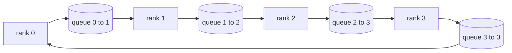

# सामूहिक संचालन को शून्य से प्राप्त करना

> 支分布式训练的四种集体通信(集体)操作是全reduce、broadcast、allgather 和 reduce_scatter── प्रशिक्षण ढांचे द्वारा प्रदान की जाने वाली अन्य मूल भाषाएं लगभग सभी इन चारों की पैकेजिंग हैं──先在`multiprocessing.Queue`मेश ऊपर एक बार पूरा करें, पुनः परीक्षण करें, इस ट्रैक का शेष भाग सिर्फ कनेक्शन है।

**Type:** Build
**Languages:** Python
**Prerequisites:** Phase 19 Track C lessons 42-49
**Time:** ~90 分钟

## 学习目标

- दो बार एल्गोरिथ्म प्रयोग करके रिंग को कम करना, पहले कम करना, फिर इकट्ठा करना, और प्रत्येक रैंक के लिए प्रत्येक तत्व का संचार मात्रा साबित करना$2(N-1)/N$字节──
- `multiprocessing.Queue`                                                                                                                                                                                                                                                              
- उसी इनपुट के लिए, उपयोग करें`torch.distributed`                                                                                                                                                                                                                                                              
- समूह आकार 延迟下限和带宽上限 से निकलते हुए,论证该选环 还是树

## 问题

N 个级上做朴素 allreduce,将把张量向根发送 N 次,再广播回来 N 次── प्रत्येक रैंक के带宽按 $O(N)$ बढ़ाएँ, जड़  बोतल  बनें, दीवार घड़ी समय  नीचे सीमा  सबसे धीमी कड़ी है  N  रिंग सभी कम करें  इसे समतल करें $2(N-1)$个大小为 $T/N$का टुकड़ा, तो है प्रत्येक रैंक के अक्षर संख्या घट जाती है $2T(N-1)/N$, जैसे-जैसे बढ़ता है ,$2T$且永不超出,集群规模无关.  वृक्ष सभी में कम होता है, क्योंकि गहराई $\log_2(N)$跳, बजाय $2(N-1)$拓选错, सबसे धीमी GPU का टुकड़ा तय करेगा कदम 时间

आप इस ट्रैक में पढ़ेंगे प्रत्येक वितरित प्रशिक्षण ढांचे, सभी इस चार मूल भाषाओं पर निर्भर करते हैं। पाइटॉर्च डीडीपी प्रत्येक पैरामीटर बाल्ट के साथ एक बार सभी को कम करके एक साथ लेटेंडर करें। ZeRO के साथ reduce_scatter, split optimizer state, फिर से सभी को एकत्र करें। प्रसारण अपडेट के बाद के पैरामीटर। FSDP को पूरा आगे लेटें, सभी को एकत्र करें और कम करें_scatter। पाइपलाइन समानांतर को पार-चरण समूह प्रसारण की आवश्यकता है। प्रसारण सक्रिय करें।

## 概念



### 两遍完成的环全减

张量分成N 个等的大块,索引为0..N-1──每级 拥有与自身级 号相同的块索引──第 1遍是减少散射,跑N-1 步──在第 步,排列r 把块$(r - s) \bmod N$                                                                                                                                                                                                                                                                                                                                                                                                                                                                                                                             $(r + 1) \bmod N$, रैंक से नहीं$(r - 1) \bmod N$接收 टुकड़ा $(r - s - 1) \bmod N$, प्राप्त भाग को अपने भाग में जोड़ें। N-1 चरण के बाद, रैंक r                                                                                                                                                                                                                                                                                                                                                                                                                                                                                                           

| 原语 | 每 rank 字节数 | 步数 | 何时使用 |
|-----------|---------------|-------|-------------|
| Ring allreduce | 2T(N-1)/N | 2(N-1) | 大 T、同构 fat-pipe 集群 |
| Tree allreduce | T log2(N) | 2 log2(N) | 小 T 或高延迟链路 |
| Broadcast | T | log2(N) tree | 参数初始化、标量配置 |
| Allgather | T(N-1)/N | N-1 | 分片 forward、ZeRO unshard |
| Reduce_scatter | T(N-1)/N | N-1 | ZeRO 梯度分片 |

### एनसीसीएल के बजाय कतार मेष

एनसीसीएल  PCIe और NVLink पर चलता है, फिर से हार्डवेयर को उतारया जा सकता है `multiprocessing.Queue`, केवल एकल जीवन उत्पादक और एकल उपभोक्ता को ही क्रमबद्ध बिंदु-प्रति-बिंदु वितरण प्राप्त करने में सक्षम है। यह उपयोगकर्ता के रूप में होता है, इसलिए पायथन के लिए भुगतान करना है, लेकिन लाइनरूट मॉडल और एनसीसीएल रिंग सभी को कम करता है।

### परिक्षण करने के लिए

प्रत्येक मूल भाषा में एक इकाई परीक्षण होती हैः एक ही विश्व आकार में, एक ही मात्रा में, इसका आउटपुट उपयोग के साथ शुरू होता है`torch.distributed`️️️️️️️️️️️️️️️️️️️️️️️️️️️️️️️️️️️️️️️️️️️️️️️️️️️️️️️️️️️️️️️️️️️️️️️️️️️️️️️️️️️️️️️️️️️️️️️️️️️️️️️️️️️️️️️️️️️️️️️️️️️️️️️️️️️️️️️️️️️️️️️️️️️️️️️️️️️️️️️️️️️️️️️️️️️️️️️️️️️️️️️️️️️️️️️️️️️️️️️️️️️️️️️️️️️️️️️️️️️️️️️️️️️️️️️️️️️️️️️️️️️️️️️️️️️️️️️️️️️️️️️️️️️️️️️️️️️️️️️️️️️️️️️️️️️️️️️️️️️️️️️️️️️️️️️️️️️️️️️️️️️️️️️️️️️️️️️️️️️️️️️️️️️️️️️️️️️️️️️️️️️️️️️️️️️️️️️️️️️️️️️️️️️️️️️️️️️️️️️️️️️️️️️️️️️️️️️️️️️️️️️️️️️️️️️️️️️️️️️️️️️️️️️️️️️️️️️️️️️️️️️️️️️️️️️️️️️️️️️️️️️️️️️️️️️️️️️️️️️️️️️️️️️️

```figure
ci-ring-allreduce
```

##  इसे निर्माण

`code/main.py`实现:

- `Mesh`类:把 N 个 `multiprocessing.Queue`接成环,并按排名 暴露 `send(dst, tensor)``recv(src)`
- `ring_allreduce(mesh, rank, world_size, tensor)`: दो बार चलना
- `broadcast(mesh, rank, world_size, tensor, src)`एक पेड़ के लिए जानाः
- `allgather(mesh, rank, world_size, tensor)`: N-1 अगला दौर में परिवर्तित
- `reduce_scatter(mesh, rank, world_size, tensor)`: के रूप में सभी घटाएँ के पहले आधा段──
- `_gloo_reference(op, world_size, tensor)`:  समान डालने के साथ अंदर भेज दिया `torch.distributed`,做字节级对比──

运行:

```bash
python3 code/main.py
```

输出:按原语对比排列网与 gloo 输出验证表,以及证明 $2T(N-1)/N$缩放的每级 字节计数器──

## 生产环境中的实践

तीन प्रकार के तरीके इन मूल भाषाओं को कठोरता से ऊपर की रेखा तक कर सकते हैं।

**allreduce 前先对梯度分桶。**एक 10 अरब के पैरामीटर मॉडल में 10 हजार तक तरंगें हैं। प्रत्येक तरंग एक बार सभी को कम करना है, N 倍延迟下限 देना है।

**让通信与计算重叠。**पिछड़ा परत परत परत परत परत परत परत परत परत परत परत परत परत परत परत परत परत परत परत परत परत परत परत परत परत परत परत परत परत परत परत परत परत परत परत परत परत परत परत परत परत परत परत परत परत परत परत परत परत परत परत परत परत परत परत परत परत परत परत परत परत परत परत परत परत परत परत परत परत परत परत परत परत परत परत परत परत परत परत परत परत परत परत परत परत परत परत परत परत परत परत परत परत परत परत परत परत परत परत परत परत परत परत परत परत परत परत परत परत परत परत परत परत परत परत परत परत परत परत परत परत परत परत परत परत परत परत परत परत परत परत परत परत परत परत परत परत परत परत परत परत परत परत परत परत परत परत परत परत परत परत परत परत परत परत परत परत परत परत परत परत परत परत परत परत परत परत परत परत परत 

**按消息大小选 ring 或 tree，不要教条。**एनसीसीएल स्व带拓检测:大约1 MB以上选戒,以下选树──交叉点是带宽对延迟超过1 MB 时带宽项 $2T(N-1)/N$占主导,ring 胜出; कम से कम 1 MB 时$\log_2(N)$跳数占优──写死一种拓,会在错误的消息大小上损失吞吞──

## इसका उपयोग करें

生产中的使用法:

- **PyTorch DDP。**पिछड़ा  इसके बाद से 分桶梯度调调`dist.all_reduce`◊ बाल्ट ⋅ 100Gbit 以太网下默认 25 MB 合理──
- **DeepSpeed ZeRO。**发 reduce_scatter 分片梯度,forward 前再 सब एकत्र 重建完整参数──本课的原语正是 ZeRO 实际发射调用──
- **FSDP。**आगे पहले सबको इकट्ठा करो, इस परत को टुकड़ा-टुकड़ा करके, फिर से उपयोग करो, कम करो, फिर से उपयोग करो, फिर से उपयोग करो, फिर से उपयोग करो, फिर से उपयोग करो, फिर से उपयोग करो, फिर से उपयोग करो, फिर से उपयोग करो, फिर से उपयोग करो, फिर से उपयोग करो, फिर से उपयोग करो, फिर से उपयोग करो, फिर से उपयोग करो, फिर से उपयोग करो, फिर से उपयोग करो, फिर से, फिर से, फिर से, फिर से, फिर से, फिर से, फिर से, फिर से, फिर से, फिर से, फिर से, फिर से, फिर से, फिर से, फिर से, फिर से, फिर से, फिर से, फिर से, फिर से, फिर से, फिर से, फिर से, फिर से, और फिर से, फिर से, फिर से, फिर से, और फिर से, फिर से, फिर से, और फिर से, फिर से, और फिर से, और फिर से, और फिर से, और फिर से, और फिर से, और फिर से, और फिर से, और फिर से, और फिर से, और फिर से, और फिर से, और फिर से, और फिर से, और फिर से, और फिर से, और फिर से, और फिर से, और, और, और, और, और, और, और, और, और, और, और, और, और, और, और, और, और, और, और, और, और, और, और, और, और, और, और, और, और, और, और, और, और, और, और, और, और, और, और, और, और, और, और, और, और, और, और, और, और, और, और, और, और, और, और, और, और, और, और, और, और, और, और, और, और, और, और, और, और, और, और, और, और, और, और, और, और, और, और, और, और, और, और, और, और, और, और, और, और, और, और, और, और, और, और, और, और, और, और, और, और, और, और, और, और, और, और, और, और, और, और, और, और, और, और, और, और, और, और, और, और,

## 交付 यह

⇒ 77. ⇒ 78 ⇒ 79. ⇒ 79. ⇒ 79. ⇒ 79. ⇒ 79. ⇒ 79. ⇒ 79. ⇒ 79. ⇒ 79. ⇒ 79. ⇒ 79. ⇒ 79. ⇒ 79. ⇒ 79. ⇒ 79. ⇒ 79. ⇒ 79. ⇒ 79. ⇒ 79. ⇒ 79. ⇒ 79. ⇒ 79. ⇒ 79. ⇒ 79. ⇒ 79. ⇒ 79. ⇒ 79. ⇒ 79. ⇒ 79. ⇒ 79. ⇒ 79. ⇒ 79. ⇒ 79. ⇒ 79. ⇒ 79. ⇒ 79. ⇒ 79. ⇒ 79. ⇒ 79. ⇒ 79. ⇒ 79. ⇒ 79. ⇒ 79. ⇒ 79. ⇒ 79. ⇒ 79. ⇒ 79. ⇒ 79. ⇒ 79. ⇒ 79. ⇒ 79. ⇒ 79. ⇒ 79. ⇒ 79. ⇒ 79. ⇒ 79. ⇒ 79. ⇒ 79. ⇒ 79. ⇒ 77. ⇒ 77. ⇒ 77. ⇒ 77. ⇒ 77. ⇒ 77. ⇒ 77. ⇒ 77. ⇒ 77. ⇒ 77. ⇒ 77. ⇒ 77. ⇒ 77. ⇒ 77. ⇒ 77. ⇒ 77. ⇒ 77. ⇒ 77. ⇒ 7. ⇒ 7. ⇒ 7. ⇒ 7. ⇒ 7. ⇒ 7. ⇒ 7. ⇒ 7. ⇒ 7. ⇒ 7. ⇒ 7. ⇒ 7. ⇒ 7. ⇒ 7. ⇒ 7. ⇒ 7. ⇒ 7. ⇒ 7. ⇒ 7. ⇒ 7. ⇒ 7. ⇒ 7. ⇒ 7. ⇒ 7. ⇒ 7. ⇒ 7. ⇒ 7. ⇒ 7. ⇒ 7. ⇒ 7. ⇒ 7. ⇒ 7. ⇒ 7. ⇒ 7. ⇒ 7. ⇒ 7. ⇒ 7. ⇒ 7. ⇒ 7. ⇒ 7. ⇒ 7. ⇒ 7. ⇒ 7. ⇒ 7. ⇒ 7.

## अभ्यास

1. 增加 tree allreduce 变体,并按消息大小在 ring 与树之间切换──测出交叉点──
2. 增加 `recv_timeout_ms`,                                                                                                                                                                                                                                                               
3. चार मूल भाषाओं को निकालें`multiprocessing.Queue`换成TCP插座──同一套测试,真实线路──
4. 加带宽探测 हुक,把每级字节计数器记到JSONL──
5. ४ 个级别上,对 1KB、1MB、16MB 张量比较环与树的墙钟时间──用实测为交叉点辩护──

## 关键术语

| 术语 | 人们常说 | 实际含义 |
|------|----------------|------------------------|
| Allreduce | “跨 rank 求和” | 调用结束后每个 rank 持有相同的归约张量 |
| Ring | “更快的拓扑” | N-1 个大小为 T/N 的 chunk 绕环流两圈 |
| Tree | “对数拓扑” | 归约沿二叉树进行；深度为 log2(N) 跳 |
| Allgather | “拼接分片” | 每个 rank 最终持有所有其他 rank 的分片 |
| Reduce_scatter | “把求和切开” | 每个 rank 最终只持有某一个 chunk 的求和 |
| Bucket | “融合小张量” | 把 N 次小 allreduce 合并成一次大的 |

## 延伸阅读

- [PyTorch Distributed: NCCL collectives](https://pytorch.org/docs/stable/distributed.html#collective-functions)
- [Horovod ring allreduce paper](https://arxiv.org/abs/1802.05799)
- [NCCL topology and algorithm selection](https://docs.nvidia.com/deeplearning/nccl/user-guide/docs/index.html)
- [Patarasuk and Yuan, Bandwidth optimal allreduce algorithms](https://www.cs.fsu.edu/~xyuan/paper/09jpdc.pdf)
- चरण 10 पाठ 05 - वितरित प्रशिक्षण का अवलोकन
- चरण 19 पाठ 77 - इन आदिमों के ऊपर डीडीपी तार
