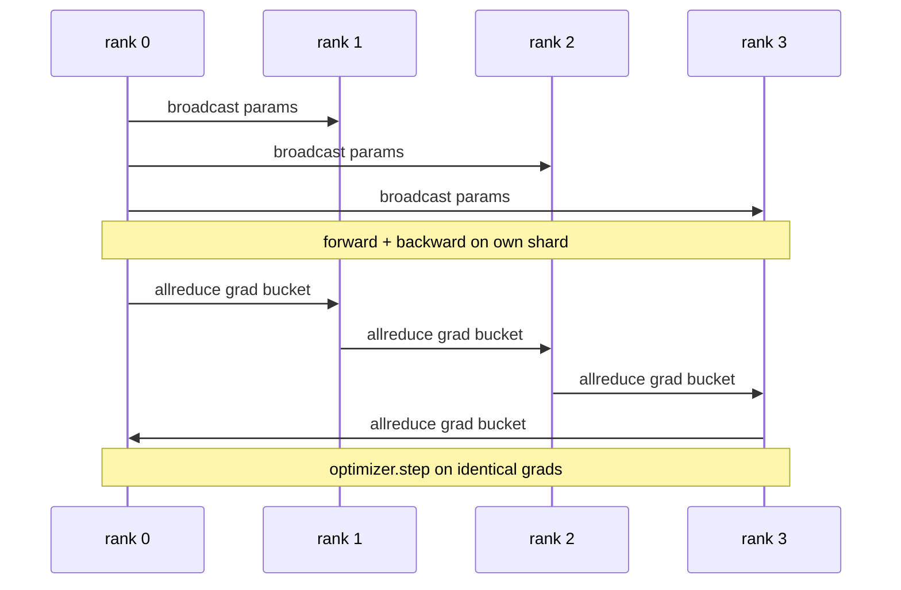

# आरंभ से डेटा और डीडीपी

> वितरित डेटा समानांतर सभी घटकों पर एक 子 है। एक मॉडल को पैक करें, 0 से शुरू होने वाले प्रारंभिक तत्वों को प्रसारित करें, ताकि प्रत्येक स्तर एक ही प्रकार से शुरू हो जाए, प्रत्येक उत्सर्जन के स्तर पर सभी घटकों के तत्वों पर एक से पीछे 子 स्थापित करें, शेष नीचे नीचे नीचे 子 है।

**Type:** Build
**Languages:** Python
**Prerequisites:** 第 19 期 Track C 课程 42-49
**Time:** ~90 分钟

## 学习目标

- 连接一个 `DistributedDataParallel`形包装器, इस包装器 प्रसारण प्रारंभिक तत्व और पीछे पीछे पीछे घटती梯度
- स्पाउन एन CPU में फ़ाइल आधारित बैठक के ग्लो  पिछली छोर पर क्रमबद्ध `torch.multiprocessing.spawn`
-  समान डेटा पर क्रमबद्ध प्रशिक्षण के माध्यम से समान प्रकार और प्रत्येक चरण के पैरामीटर की समानता को प्रदर्शित करके डिग्री समक्रमण की सत्यता को साबित करना
- 捍卫储桶 (梯度融合) और重叠 (重叠) के उपयोग को, DDP के दो परिवर्तनों के रूप में काम करने के लिए DDP के उत्पादन में परिवर्तित किया जाएगा।

## 问题

 12GB  सक्रियण क्षमता वाले 10 अरब पैरामीटर मॉडल एक उपभोग्य ग्रेड GPU के लिए उपयुक्त नहीं हैं भले ही उपयुक्त हों, प्रशिक्षण के लिए भी कुछ सप्ताह का समय लगता है डेटा并行 को N 个级别 में विभाजित किया जाएगा, प्रत्येक स्तर अपने विभाजन पर आगे और पीछे की ओर गणना करेगा, और प्रत्येक चरण में, प्रत्येक स्तर की डिग्री एक साथ होगी, ताकि सभी N 个副本 समान रहें                                                                                                                                                                                                                 

यदि कोई तराजू समक्रमण नहीं है, तो दूसरा चरण में विभाजन होगा। यह मॉडल अधिक डेटा पर प्रशिक्षित एक मॉडल नहीं है, बल्कि संयोग से प्रारंभिक भार के साथ साझा किया गया है। यदि प्रत्येक पैरामीटर को एक सभी घटाने, कोई ओवरलोडिंग, कोई डिस्पेलर नहीं है, तो नेटवर्क बोतल बन जाएगा, जीपीयू बैठक रिक्त है।

## 概念



### डीडीपी के लिए तीन ऑपरेशन की आवश्यकता है

|舞台|集体|为什么 |
|-------|-----------|-----|
|初始化|从排名 0 开始广播 |每个排名都以相同的参数开始 |
|后退|各梯度的 allreduce |平均梯度是优化器所采用的 |
|有时|缓冲区广播| Batchnorm 运行统计数据保持同步 |

### कुल के बजाय औसत मूल्य क्यों है?

सभी घटाएँ-समुम को दुनिया के आकार से अलग करके औसत स्तर पर प्राप्त करें। दुनिया के आकार के लिए औसत मूल्य अपरिवर्तित हैः प्रथम श्रेणी समायोजन में सीखने की दर चौथी श्रेणी में प्रभावी है, क्योंकि प्रत्येक चरण में वृद्धि नहीं बदलेगी।

### बैरल टेंडर का उपयोग क्यों करें

ट्रांसफार्मर में हजारों पैरामीटर हैं। प्रत्येक खंड में एक बार सभी का भुगतान किया जाएगा। 延迟下限 में हजारों गुना की लागत। 延迟下限 में हजारों गुना की लागत। 延迟下限. डीडीपी ने लगभग 25 एमबी के भंडारण桶 में एक सभी का विभाजन किया है।

### क्यों फिक्स्ड बीज

प्रत्येक रैंक को समायोजित किया जाना चाहिए`torch.manual_seed(seed + rank)`                                                                                                                                                                                                                                                                                                                                                                                                                                                                                                                             `torch.manual_seed(seed)`参数初始化. 参数初始化. 参数初始化. 参数初始化. 参数初始化. 参数初始化. 参数初始化. 参数初始化. 参数初始化. 参数初始化. 参数初始化. 参数初始化. 参数初始化. 参数初始化. 参数初始化. 参数初始化. 参数初始化. 参数初始化. 参数初始化. 参数初始化. 参数初始化. 参数初始化. 参数初始化. 参数初始化. 参数初始化. 参数初始化. 参数初始化. 参数初始化. 参数初始化. 参数初始化. 参数初始化. 参数初始化. 参数初始化. 参数初始化. 参数初始化. 参数初始化. 参数初始化. 参数初始化. 参数初始化. 参数初始化. 参数初始化. 参数初始化. 参数初始化. 参数初始化. 参数初始化.


```figure
ci-ddp-grad-sync
```

##  इसे निर्माण

`code/main.py`实现:

- `MiniMLP`3: स्तर MLP, छोटे से पर्याप्त है कुछ ही सेकंड में प्राप्त, बड़े से पर्याप्त है के लिए उजागर करने के लिए लाइनों
- `DistributedDataParallel(model, world_size)`:                                                                                                                                                                                                                                                               `sync_grads`️️️️️️️️️️️️️️️️️️️️️️️️️️️️️️️️️️️️️️️️️️️️️️️️️️️️️️️️️️️️️️️️️️️️️️️️️️️️️️️️️️️️️️️️️️️️️️️️️️️️️️️️️️️️️️️️️️️️️️️️️️️️️️️️️️️️️️️️️️️️️️️️️️️️️️️️️️️️️️️️️️️️️️️️️️️️️️️️️️️️️️️️️️️️️️️️️️️️️️️️️️️️️️️️️️️️️️️️️️️️️️️️️️️️️️️️️️️️️️️️️️️️️️️️️️️️️️️️️️️️️️️️️️️️️️️️️️️️️️️️️️️️️️️️️️️️️️️️️️️️️️️️️️️️️️️️️️️️️️️️️️️️️️️️️️️️️️️️️️️️️️️️️️️️️️️️️️️️️️️️️️️️️️️️️️️️️️️️️️️️️️️️️️️️️️️️️️️️️️️️️️️️️️️️️️️️️️️️️️️️️️️️️️️️️️️️️️️️️️️️️️️️️️️️️️️️️️️️️️️️️️️️️️️️️️️️️️️️️️️️️️️️️️️️️️️️️️️️️️️️️️️️️️️️
- `worker(rank, world_size, ...)`: Gloo 、前进 、后退 、同步 、步进 करने के लिए`torch.distributed`init का पूर्ण प्रशिक्षण चक्र
- `_reference_single_process_loop(...)`: एक स्तर पर क्रमशः एक ही डेटा पर प्रशिक्षण एक ही मॉडल प्रकार, प्रयोग में प्रत्येक चरण के बाद परीक्षण तत्व चरण और तत्वों के बराबर प्रभावशीलता।

运行它:

```bash
python3 code/main.py
```

输出: प्रत्येक चरण प्रशिक्षण पत्र, एकल प्रक्रिया हानि और पैरामीटर परीक्षण और 4 स्तरों पर चल रहे डीडीपी के साथ तुलना करना।

## 野外生产模式

तीन प्रकार के तरीके से डीडीपी को सख्त किया जाता है।

**查找未使用的参数。** कुछ ट्रांसफर मार्गों में ️️️️️️️️️️️️️️️️️️️️️️️️️️️️️️️️️️️️️️️️️️️️️️️️️️️️️️️️️️️️️️️️️️️️️️️️️️️️️️️️️️️️️️️️️️️️️️️️️️️️️️️️️️️️️️️️️️️️️️️️️️️️️️️️️️️️️️️️️️️️️️️️️️️️️️️️️️️️️️️️️️️️️️️️️️️️️️️️️️️️️️️️️️️️️️️️️️️️️️️️️️️️️️️️️️️️️️️️️️️️️️️️️️️️️️️️️️️️️️️️️️️️️️️️️️️️️️️️️️️️️️️️️️️️️️️️️️️️️️️️️️️️️️️️️️️️️️️️️️️️️️️️️️️️️️️️️️️️️️️️️️️️️️️️️️️️️️️️️️️️️️️️️️️️️️️️️️️️️️️️️️️️️️️️️️️️️️️️️️️️️️️️️️️️️️️️️️️️️️️️️️️️️️️️️️️️️️️️️️️️️️️️️️️️️️️️️️️️️️️️️️️️️️️️️️️️️️️️️️️️️️️️️️️️️️️️️️️️️️️️️️️️️️️️️️️️️️️️️️️️`find_unused_parameters=True` डीडीपी को बताएं कि घटने से पहले देखें कि किस पैरामीटर को डिग्री मिली है  लागत प्रत्येक चरण के आरेख का मार्ग है, इसलिए जब तक आप अपनी पूर्व दिशा में नहीं बढ़ते, तब तक इसे ध्यान में न रखें

**静态图优化。**जब परिवर्तन के माध्यम से कदम स्थिरता,`static_graph=True`让DDP 预先计算储备桶调度―― आकार में अनुकूलन महत्वपूर्ण हैः पूर्व गणना प्रत्येक चरण में कुछ मिलीसेकंड बचाता है, जो 10000 चरणों में जटिल है――

**梯度累积需要小心。**प्रत्येक लघु समूह में 10 गुना संचय वृद्धि हो सकती है।`no_sync()`सार्वजनिक लिए उपरोक्त प्रबंधक, के लिए प्रयोग किया जाता है अस्थायी के बाद सभी को कम करना.

## इसका उपयोग करें

生产模式:

- **PyTorch DDP。**规范的实现──`torch.nn.parallel.DistributedDataParallel(model)`连接分桶、重叠和 no_sync 上下文──
- **HuggingFace Accelerate。**添加一个处理 `torchrun`环境变量和模型包装的启动器──底层的DDP相似──
- **Megatron-LM 数据并行。**बड़े मॉडल के लिए डीडीपी और चेंज मात्रा के साथ संयोजन करना; डेटा के साथ संयोजन का हिस्सा एक ही सभी-कम करने के बाद-पछाड़ने के लिए है।

## 发货

第 78 课程)  ZeRO 分片) प्रत्येक घटक के सभी घटाव  को घटाकर  के रूप में प्रतिस्थापित करेगा, इसलिए प्रत्येक स्तर केवल अपने अनुकूलक की स्थिति के अंशों को संग्रहीत करेगा 第 81 课程 DDP और ZeRO 组合成端到端演示

## अभ्यास

1.                                                                                                                                                                                                                                                               
2. `no_sync()`                                                                                                                                                                                                                                                              
3. 添加`find_unused_parameters`模式, जिसमें से पूर्व में कभी कभी एक MLP लेयर से कूदता है; यदि यह संकेत नहीं है, तो परिचालन फंस जाएगा 局
4. इसे बदलना`torch.distributed.barrier()`- केवल एक ही समय में, सभी को कम करने के लिए एक ही समय में एक ही समय में एक ही समय में एक ही समय में एक ही समय में एक ही समय में एक ही समय में एक ही समय में एक ही समय में एक ही समय में एक ही समय में एक ही समय में एक ही समय में एक ही समय में एक ही समय में एक ही समय में एक ही समय में एक ही समय में एक ही समय में एक ही समय में एक ही समय में एक ही समय में एक ही समय में एक ही समय में एक ही समय में एक ही समय में एक ही समय में एक ही समय में एक ही समय में एक ही समय में एक ही समय में एक ही समय में एक ही समय में एक ही समय में एक ही समय में एक ही समय में एक ही समय में एक ही समय में एक ही समय में एक ही समय में एक ही समय में एक ही समय में एक ही समय में एक ही समय में एक ही समय में एक ही समय में एक ही समय में एक ही समय में एक ही समय में एक ही समय में एक ही समय में एक ही समय में एक अंतर है।
5. ️️️️️️️️️️️️️️️️️️️️️️️️️️️️️️️️️️️️️️️️️️️️️️️️️️️️️️️️️️️️️️️️️️️️️️️️️️️️️️️️️️️️️️️️️️️️️️️️️️️️️️️️️️️️️️️️️️️️️️️️️️️️️️️️️️️️️️️️️️️️️️️️️️️️️️️️️️️️️️️️️️️️️️️️️️️️️️️️️️️️️️️️️️️️️️️️️️️️️️️️️️️️️️️️️️️️️️️️️️️️️️️️️️️️️️️️️️️️️️️️️️️️️️️️️️️️️️️️️️️️️️️️️️️️️️️️️️️️️️️️️️️️️️️️️️️️️️️️️️️️️️️️️️️️️️️️️️️️️️️️️️️️️️️️️️️️️️️️️️️️️️️️️️️️️️️️️️️️️️️️️️️️️️️️️️️️️️️️️️️️️️️️️️️️️️️️️️️️️️️️️️️️️️️️️️️️️️️️️️️️️️️️️️️️️️️️️️️️️️️️️️️️️️️️️️️️️️️️️️️️️️️️️️️️️️️️️️️️️️️️️️️️️️️️️️️️️️️️️️️️️️️️️️️️

## 关键术语

|术语 |人们怎么说|它实际上意味着什么 |
|------|----------------|------------------------|
|DDP | “数据并行” |广播参数并减少每一步梯度的包装器 |
|桶| “保险丝梯度”| N组小都化为一大|
|重叠| “隐藏通讯” |当后面的层仍在向后计算时发出 allreduce |
|无同步 | 「积累」|跳过后向 allreduce 进行梯度累积 |
|查找未使用的 | “分支前进”|减少之前检测无梯度的参数 |

##  आगे पढ़ें

- [PyTorch 分布式数据并行文档](https://pytorch.org/docs/stable/generated/torch.nn.parallel.DistributedDataParallel.html)
- PyTorch DDP内部教程](https://pytorch.org/tutorials/intermediate/ddp_tutorial.html)
- [Li等人，PyTorch分布式：加速数据并行训练的经验](https://arxiv.org/abs/2006.15704)
- 第19 阶段 第 76 课 - डीडीपी द्वारा स्थापित समूह
- 第19 阶段 第78 课 - ZeRO 分片 प्रत्येक घटक के सभी घटाएँ  बदलाएँ  reduce_scatter के लिए
