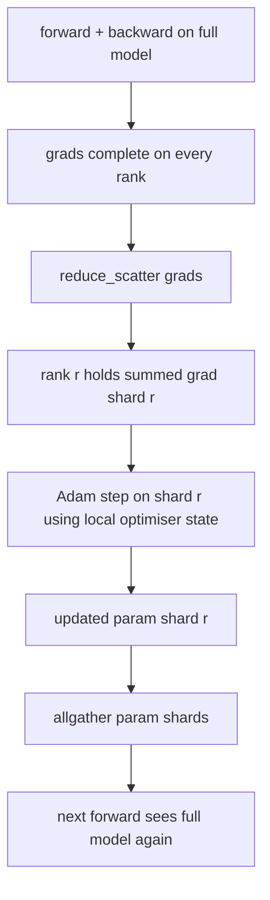

# ZeRO 优化器 स्थिति分片

> आदम ने प्रत्येक पैरामीटर भंडारण के लिए दो रक्कम अनुमान लगाए, सभी फ्लोट32 प्रारूप में भंडारण के साथ। 7 बी पैरामीटर मॉडल 56 जीबी के अनुकूलक की स्थिति के साथ हैं। ZeRO प्रथम चरण विभाजन N 个级别跨越 N 个级别; प्रत्येक स्तर के पास 1/N 个级别优化器── स्थानीय चरण के बाद, अद्यतन घटक विभाजन प्रसारित होता है, प्रत्येक स्तर पूर्ण मॉडल का पुनर्निर्माण करता है, फिर अगले चरण शुरू होता है। विजय प्रशिक्षण ढेर में सबसे बड़ा एकल वितरण के लिए रैखिक स्मृति में कमी है।

**Type:** Build
**Languages:** Python
**Prerequisites:** 第 19 期 Track C 课程 42-49
**Time:** ~90 分钟

## 学习目标

- N 个级别的碎片优化器状态(第一时刻、第二时刻、fp32 主副本), इसलिए प्रत्येक श्रेणी में 1/N ⋅ होता है।
- उपयोग करें_reduce_scatter केवल प्रत्येक स्तर पर उसके टुकड़े के gradient और, फिर सभी एक साथ अपडेट किया जाएगा पैरामीटर टुकड़े प्रसारण वापस आओ.
- 根据普通 DDP 计算阶段 1 阶段 2 阶段 3 के内存节省表
- 1. चरण 2, चरण 3 और चरण 3 के विकल्पों की रक्षा करना।

## 问题

वैनिला डीडीपी ने सभी को कॉपी किया हैः पैरामीटर, डिग्री और अनुकूलक स्थिति प्रत्येक स्तर पर पूरी तरह से मौजूद है। fp16 में 7B पैरामीटर मॉडल के लिए, इसका मतलब है कि प्रत्येक स्तर 14 GB पैरामीटर, 14 GB डिग्री और 28 GB अनुकूलक स्थिति है।

ZeRO प्रथम चरण में अनुकूलक की स्थिति पर विभाजन किया जाता है। प्रत्येक स्तर में 1 N का एडम 时刻 है। इसके बाद, ZeRO पूरे स्तर को कम नहीं करता है और स्थानीय चरण में प्रवेश करता है, बल्कि प्रसारण को कम करता है, इसलिए प्रत्येक स्तर केवल अपने विभाजन के स्तर को प्राप्त करता है। रैंक अनुकूलक चरणों को अपने मुख्य घटक के विभाजन में लागू करेगा। अद्यतन के बाद के घटक टुकड़े फिर सभी को एकत्रित करेगा, ताकि प्रत्येक स्तर में अगला उन्नत पूर्ण मॉडल हो।

## 概念



### ज़ेरो का चरण

|阶段|分片对象 |每 rank 内存|每 step 通信|
|-------|----------------|------------------|---------------|
| DDP |无 |params + grads + optim | 1x allreduce |
| ZeRO-1 |optimizer state |params + grads + optim/N | 1x reduce_scatter + 1x allgather |
| ZeRO-2 |optim + grads |params + grads/N + optim/N | 1x reduce_scatter + 1x allgather |
| ZeRO-3 |optim + grads + params |params/N + grads/N + optim/N |每层 1x allgather + 每层 1x reduce_scatter |

प्रथम चरण कम लागत का लाभ है, क्योंकि अनुकूलन राज्य बजट पर हावी है। द्वितीय चरण में तराजू के विभाजन की आवश्यकता होती है, लेकिन बैंडविड्थ समान है।

### 记忆数学,实数

 आदम के प्रयोग के लिए मिश्रित सटीकता प्रशिक्षण के लिए P 参数 वाले मॉडलः

|术语 |vanilla|ZeRO-1 |为什么 |
|------|---------|--------|-----|
| fp16 参数 | 2P字节| 2P字节|需要转发|
| FP16 梯度 | 2P字节| 2P字节|需要落后|
| fp32 母版 | 4P字节| 4P/N 字节 |只有最优化的人才会使用它 |
| fp32 第一时刻 | 4P字节| 4P/N 字节 |只有最优化的人才会使用它 |
| fp32 第二时刻 | 4P字节| 4P/N 字节 |只有最优化的人才会使用它 |
|总计 | 16P字节| 4P + 12P/N 字节 |   |

N=8 时:वैनिला 16P,ZeRO-1 5.5P,% 65% गिरावट

### क्यों कम_खेलने  बेहतर सभी कम-तो-खिलाफ़ से

सभी घटाने के लिए प्रत्येक स्तर पर पूर्ण मांग और तरफ़दारी प्रदान करें। यदि केवल भागों की आवश्यकता हो तो घटने की तरफ़दारी की मात्रा में वृद्धि हो जाती है।


```figure
cd-zero-shard
```

##  इसे निर्माण

`code/main.py`实现:

- `flatten_params(module)`和 `unflatten_into(module, flat)`मॉडल के पैरामीटर को एक निरंतर चेंज मात्रा में पैक करके फिर से हल किया जाए।
- `ZeroOptimizer(model, world_size, rank, lr)` मुख्य उपन्यासी और  के  के  के  के  के  के  के  के  के  के  के  के  के  के  के  के  के  के  के  के  के  के  के  के  के  के  के  के  के  के  के  के  के  के  के  के  के  के  के  के  के  के  के  के  के  के  के  के  के  के  के  के  के  के  के  के  के  के  के  के  के  के  के  के  के  के  के  के  के  के  के  के  के  के  के  के  के  के  के  के  के  के  के  के  के  के  के  के  के  के  के  के  के  के  के  के  के  के  के  के  के  के  के  के  के  के  के  के  के  के  के  के  के  के  के  के  के  के  के  के  के  के  के  के  के  के  के  के  के  के  के  के  के  के  के  के  के  के  के  के  के  के  के  के  के  के  के  के  के  के  के  के  के  के  के  के  के  के  के  के  के  के  के  के  के  के  के 
- `step()`क्षैतिज स्तर पर संचालित कम_खण्डन, क्रमबद्ध विभाजन के लिए एडम 应用于,并将更新参数全部 एकत्रित करें पुनः
- एक प्रस्तुति, प्रशिक्षण 3 स्तरीय एमएलपी 20 步骤,并印印每步内存预算以及普通DDP基线──

运行它:

```bash
python3 code/main.py
```

输出: प्रति चरण हानि और मेमोरी चार्ट ZeRO-1 की पूर्ण प्रति के साथ DDP की तुलना में, प्रत्येक स्तर पर 1/N के अनुकूलक की स्थिति को बनाए रखने के लिए दिखाता है।

## 野外生产模式

三种模式使 ZeRO 足以交付──

**分片检查点很重要。**ZeRO-1 के अनुकूलक की स्थिति को श्रेणीबद्ध किया गया है; जांच बिंदुओं को रिकॉर्ड करना चाहिए कि किस श्रेणी के पास क्या है।

**混合精度是重点。**ZeRO एक मिश्रित सटीकता तकनीक है; fp32 主副本是分片的. मिश्रित सटीकता के बिना ZeRO कार्य करता है, ZeRO fp32 मास्टर को 带来内存税, जबकि fp16 के बिना अनुकूलन के लिए अग्रिम में जीत प्राप्त करता है।

**第一阶段几乎是免费的。**通信在带宽方面与DDP相同──内存节省与N 成线性关系── एकमात्र लागत अनुकूलन यंत्र के टुकड़े के बुकिंग है── उत्पादन堆默认为阶段1,除非参数分片内存也是一个问题;然后第二或第三阶段用通信换取内存──

## इसका उपयोग करें

生产模式:

- **DeepSpeed ZeRO。**参考实现―― `deepspeed_config.json`选择阶段 1/2/3 和分区大小──
- **PyTorch FSDP。**पिटर्च 原生等效项`ShardingStrategy.SHARD_GRAD_OP``FULL_SHARD`यह ZeRO-3 है
- **HuggingFace Accelerate。**डीप स्पीड और एफएसडीपी को एकजुट रूप से कॉन्फ़िगर किया जाएगा।

## 发货

第 79 课 管道并行) 正交分片轴:管道不是跨同一模型对优化器状态进行分片,而是跨等级进行分片.

## अभ्यास

1.  विभाजन की तरफ़ से ZeRO-2 तक विस्तारः प्रत्येक रैंक केवल अपने विभाजन की तरफ़ से ही संग्रहीत करता है, इसके विपरीत में भागों की स्पष्टता को प्राप्त करने के लिए 
2. ⇒ 0                                                                                                                                                                                                                                                                                                                                                                                                                                                                                                                           
3. ️ सामान्य डीडीपी को ज़ेरो-1 के साथ प्रति चरण घंटों के समय पर मापें, और इसे पूर्व दिशा ̊ पश्च दिशा ̊ संचार में विभाजित करें
4. ZeRO-1 में निम्न स्तर काटाई को प्राप्त करना: सभी को घटाना होगा।
5. उपयोग सभी घटाएँ न कि घटाएँ_विखारें नई ZeRO को प्राप्त करें, लाइन समय अंतर को मापें नगिनत के साथ घटाएँ_विखारों के चयन को बचाने के लिए 

## 关键术语

|术语 |人们怎么说|它实际上意味着什么 |
|------|----------------|------------------------|
|ZeRO-1 | “优化器分片”|每个等级拥有 1/N 的 fp32 master + Adam 时刻 |
| ZeRO-2 | “grads 也分片”|每个 rank 在 reduce_scatter 后也会丢弃非本分片的梯度 |
|ZeRO-3 | “分片参数” |每个等级保存 1/N 的 fp16 参数；向前每层allgather |
|master copy| “fp32 权重”|高精度参数复制优化器更新|
|reduce_scatter | “平分总和”|仅提供每个等级其分片的梯度总和 |

##  आगे पढ़ें

- [Rajbhandari 等人，ZeRO：训练万亿参数模型的内存优化](https://arxiv.org/abs/1910.02054)
- [DeepSpeed ZeRO 文档](https://www.deepspeed.ai/tutorials/zero/)
- [PyTorch FSDP 文档](https://pytorch.org/docs/stable/fsdp.html)
- 第19 阶段 第76 课 - 本课涉及的减少_散播和全集
- 第19 阶段 第80 课 - ZeRO 状态必须使用的分片检查点
