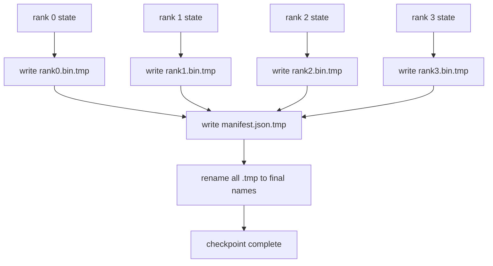

# 分片检查点和原子恢复

> प्रत्येक दो घंटे में एक इकाई के टूटने के कारण 70B पैरामीटर के प्रशिक्षण कार्य को रोक दिया जाता है। जांच बिंदु का प्रारूप निर्धारित करता है कि आप 30 मिनट या 30 घंटे के नुकसान में हैं। जांच बिंदु प्रत्येक इकाई के विभाजन में लिखता है और सूची में स्वामित्व को रिकॉर्ड करता है। फिर से प्रत्येक इकाई के अपने स्वयं के फ़ाइलों से लोड करता है, एक ही विश्व में फिर से स्थापित होता है, और अनुकूलक जैसे कुछ भी नहीं हुआ है। परमाणु प्रविष्टि से आधे की जांच समाप्त हो सकती है।

**Type:** Build
**Languages:** Python
**Prerequisites:** 第 19 期 Track C 课程 42-49
**Time:** ~90 分钟

## 学习目标

- विभिन्न स्तरों के जाँच बिंदुओं को प्रत्येक स्तर के लिए अलग-अलग दस्तावेजों के साथ-साथ रिकॉर्ड करने के लिए रखा जाएगा कि किस स्तर के पास क्या है।
- प्रयोग原子写入模式 (अंतिम मार्ग में लिखने के बाद पुनः नामित किया जाना) इसलिए लेखन प्रक्रिया में विफलता कभी भी आधे पूर्ण चेक पॉइंट नहीं उत्पन्न होगी।
- से cle单中恢复, सत्यापन प्रत्येक स्तर पर fp16 参数 और ZeRO 优化器状态的字节相等状态──
- 保护清单架构免受三种故障模式的影响:全局大小变更、分片计数不匹配和部分写入──

## 问题

सामान्य जांच बिंदु सभी पैरामीटर और अनुकूलक की स्थिति को स्तर 0 तक पढ़ता है, एकत्र करता है और एक एकल फ़ाइल में लिखता है। 70B मॉडल के लिए, प्रथम श्रेणी के नेटवर्क पोर्ट के माध्यम से 1.1TB  स्थिति प्रदान की जाती है। लेखन सभी अन्य स्तरों को रोकता है, क्योंकि वे रिक्त हैं  संग्रह की प्रतीक्षा करते हैं। IO 带宽 सबसे धीमा एकल GPU  नेटवर्क लिंक है, बजाय संवर्धन 带宽। वास्तविक समूह में,  संग्रह और फिर  चरणों को लिखने के लिए पहले से अधिक समय की आवश्यकता हो सकती है, जिसका अर्थ है कि प्रत्येक प्रशिक्षण दिन के लिए काम करने के लिए प्रेषित की जाँच बिंदु एक से कम है।

विभाजन जाँच बिंदु ने मोड को बदल दियाः प्रत्येक स्तर अपना विभाजन और अपने फ़ाइल में लिखता है। सूची रिकॉर्ड करता है कि किस स्तर के पास कौन से विभाजन हैं, इसलिए पुनर्प्राप्ति प्रत्येक विभाजन को अपने स्रोत पर वापस भेज सकती है। संग्रहण में शामिल होने के लिए 4 घंटे की आवश्यकता होती है।

## 概念



### 清单架构

```json
{
  "world_size": 4,
  "step": 1234,
  "wall_clock_seconds": 4521,
  "shards": [
    {"rank": 0, "path": "rank0.bin", "sha256": "...", "param_shard_offset": 0, "param_shard_numel": 65536},
    {"rank": 1, "path": "rank1.bin", "sha256": "...", "param_shard_offset": 65536, "param_shard_numel": 65536}
  ],
  "schema_version": 1
}
```

तीनों ही भारी हैं।`world_size`ताकि विभिन्न आकारों के इतिहास को चुपचाप क्षतिग्रस्त न करें।`sha256`捕获部分或损坏的写入── प्रत्येक टुकड़ा `param_shard_offset`和 `param_shard_numel`让载体在正确位置重建平面参数张量――

### 原子写入

标准模式:将每个分片写入 `<name>.tmp`,将清单写入 `manifest.json.tmp`,fsync प्रत्येक फ़ाइल, पुनः नामित विभाजन, अंतिम पुनः नामित सूची। उसी फ़ाइल प्रणाली के भीतर एकल POSIX पुनः नामित परमाणु हैः या तो नया फ़ाइल पूरी तरह से मौजूद है, या पुराने फ़ाइल पूरी तरह से मौजूद है। एक समूह पुनः नामित एक मामला नहीं है, इसलिए सूची का नामकरण एक प्रस्तुत बिंदु है, लोडर प्रत्येक टुकड़े को सूची में हसी जाँच करेगा। प्रत्येक जाँच बिंदु को अपने स्वयं के वर्तमान चरण में लिखता है। इस प्रकार सूची के नामकरण से पहले हुए दुर्घटनाएं एक पिछले जाँच बिंदु को सक्रिय जाँच बिंदु बनाती हैं।

### 模式 must defend ⇒ तीन प्रकार की विकार

|失败|症状|防御|
|---------|---------|---------|
|世界规模的变化|在 N=8 上恢复，并从 N=4 开始清单 |清单中的 world_size 不匹配，大声失败 |
|分片数量不匹配 |resume 看到的 rank*.bin 文件少于 manifest 中的分片 |枚举分片，验证每个分片都存在 |
|部分写入|分片文件在刷新过程中被截断|加载时进行 sha256 验证 |

प्रत्येक रक्षा हर समय खराब भार को अस्वीकार करती है; दूसरा विकल्प है चुपचाप क्षति, जब क्षति NaN                                                                                                                                                                                                                                                    

### क्यों एक बड़े दस्तावेज़ की बजाय प्रत्येक स्तर के दस्तावेज़

   के माध्यम से `O_APPEND`एक फ़ाइल के लिए एक ही संस्करण में लिखने के लिए उपयुक्त है, लेकिन वास्तव में, एक टुकड़े के भीतर विचलन की मात्रा एमबी के बड़े क्षेत्र में पार होती है, और एक ही स्थान पर कब्जा करती है।


```figure
ci-sharded-checkpoint
```

##  इसे निर्माण

`code/main.py`实现:

- `ShardManifest`डेटा वर्ग, उपरोक्त संरचनाओं के साथ`to_json`/`from_json`
- `save_sharded(state_dict_per_rank, dir, step)`प्रयोग परमाणु अस्थायी फिर पुनः नामकरण मोड प्रत्येक स्तर के द्वितीयक राज्य को अपने स्वयं के दस्तावेजों में लिखेंगे, फिर इसे सूची में लिखेंगे
- `load_sharded(dir, expected_world_size)`读取清单,验证每个分片的 sha256,并返回每个级别的状态字典──
- 往返测试:构建每列状态、保存、加载、断言字节相等──

运行它:

```bash
python3 code/main.py
```

输出:4 个分片文件以及写入的清单, फिर 字节相等验证重新加载──

## 野外生产模式

तीन प्रकार के तरीके से परिवहन के लिए पर्याप्त रूप से मजबूत चेकपॉइंट बनाया जाता है।

**异步写入。**उत्पादन ढेर  एक अलग लाइन या प्रक्रिया पर जांच बिंदु लिखना जारी करें, ताकि प्रशिक्षण जारी रहे  बाधा अगले जांच बिंदु पर स्थित हैः पहले एक को सहेजने के पूरा होने से पहले अगला एक को सहेजने से शुरू न करें `async_io`标志正是这样做──本课程保持写入同步,因此步骤可见──

**先本地快速磁盘，然后异步上传。**写入本地 NVMe(快速), फिर异步上传到S3 अथवा GCS── दो स्तरीय मोड से集群内检查点能够快速恢复,同时将持久副本发送到集群外进行存档──清单携带本地路径;上传清单携带远程路径──

**轮换很重要。**उत्पादन संचालन अंतिम K 个检查点 (आमतौर पर 3-5 个) को बनाए रखता है और सबसे पहले जांच बिंदु को बदल देता है। यदि यह नहीं बदलता है, तो डिस्क चालू में भरा जाएगा, और अगला जांच बिंदु विफल हो जाएगा।

## इसका उपयोग करें

生产模式:

- **DeepSpeed 检查点。** `deepspeed.save_checkpoint(tag=step)` प्रत्येक स्तर के दस्तावेज और गतिविधि के लिए संकेत पत्र `latest`文件──
- **PyTorch FSDP 检查点。** `torch.distributed.checkpoint`उपयोग निर्णय प्रत्येक स्तर के लिए `Planner`保存分片状态──
- **NeMo.**उपयोग करें अतिरिक्त डेटा का एकीकरण`save_to_checkpoint`एपीआई 封装 डीपस्पीड तथा एफएसडीपी

## 发货

第 81 课 保存端到端 DDP+ZeRO 运行分片检查点, और उसी विश्व小小重载它, ताकि साबित हो सके कि पुनर्प्राप्ती समझौता स्थापित है।

## अभ्यास

1. 添加异步写入:在线程中启动保存并让训练继续──阻止下一次保存,直到上一次保存完成──
2. 添加 `last_5_steps`轮换: 5 个最近的检查点保留, सबसे पुराने चेक点 को हटाना, फिर नए चेक点 को सहेजना
3. इसके लिए चक्र पुनः लोड करें केवल सीआरसी के त्वरित परीक्षण मार्गों को जोड़ें।
4. 添加跨世界小的负载: पढ़取清单、连接和重新分片,将分片重新平衡从N=4到N=8──
5. अपलोड करें और गलत S3 में जोड़ें (दोस्रो अनुक्रमणिका)

## 关键术语

|术语 |人们怎么说|它实际上意味着什么 |
|------|----------------|------------------------|
|分片检查点 | “按等级保存”|每个rank并行写入自己的分片文件|
|清单 | “索引”|记录分片路径、偏移量和 sha256 的 JSON 文件 |
|原子写| “tmp 然后重命名” |写入 .tmp，然后 POSIX 重命名，以便崩溃使先前的文件保持活动状态 |
|部分写入| “截断的碎片” |写入过程中的崩溃会产生损坏的分片； sha256 抓住它 |
|旋转| “保留最后 K”|在写入新检查点以限制磁盘使用量之前删除最旧的检查点 |

##  आगे पढ़ें

- [DeepSpeed 检查点](https://www.deepspeed.ai/tutorials/checkpointing/)
- [PyTorch torch.distributed.checkpoint](https://pytorch.org/docs/stable/distributed.checkpoint.html)
- [POSIX重命名原子性](https://pubs.opengroup.org/onlinepubs/9699919799/functions/rename.html)
- 第19 阶段 第78 课 - 此检查点旨在保存的ZERO 状态
- 第19 阶段 第81 课 - 端到端演示往返保存的状态
