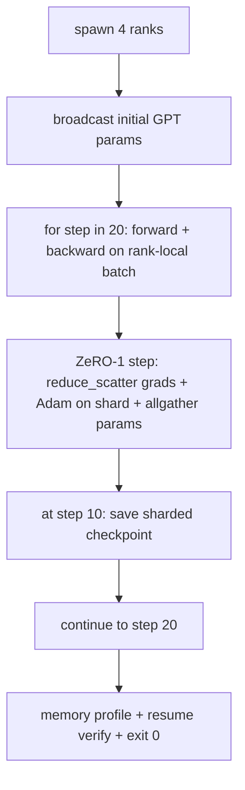

# 端到端分布式 प्रशिक्षण

> 第 76 课到第 80 课各拼 一件作品──这是组件:一个微型GPT,训练在4模拟队列上,使用DDP进行梯度同步,ZeRO-1用于优化器状态分片,以及中间token处的分片检查点──这个演示运行20个步骤,自动终止,印失曲线和内存配置文件,并写入可恢复检查点──

**Type:** Build
**Languages:** Python
**Prerequisites:** 第 19 期 Track C 课程 42-49
**Time:** ~90 分钟

## 学习目标

- डीडीपी (डीडीपी) (第77 课) + ZeRO-1 (第78 课) +分片检查点 (第80 课) + एक प्रशिक्षण चक्र बनाएं
- लघु संश्लेषित भाषा सामग्री भंडार में प्रशिक्षण 2 स्तरों ट्रांसफार्मर भाषा मॉडल, 4 模拟 स्तरों के पार 20 步骤进行.
- प्रिंट प्रत्येक चरण खोई हुई सूची  प्रत्येक श्रेणी में मेमोरी विन्यास फ़ाइलें तथा उसी विश्व में पुनः प्राप्ति के लिए साइट चरणों आदि की जाँच बिंदु सूची 
- 捍卫作文: प्रत्येक रचना को पूर्ववर्ती पाठ्यक्रम में स्वतंत्र रूप से परीक्षण किया जा सकता है, यह पाठ्यक्रम उन्हें रचना के रूप में साबित करता है।

## 问题

कैपस्टोन एक साथ संयोजन के साक्ष्य है।  76  अनुच्छेद कार्यान्वयन सामूहिक  77  अनुच्छेद उन्हें डीडीपी में शामिल करेगा।  78  अनुच्छेद उपयोग कम_प्रसारण विभाजन अनुकूलक स्थिति  79  अनुच्छेद विश्लेषण ट्यूबों  80  अनुच्छेद एक विभाजन जाँच बिंदु को सहेजता है।  प्रत्येक अनुच्छेद का अपना परीक्षण है।  वास्तविक प्रशिक्षण प्रत्येक मूल भाषा का उपयोग करते हुए एक साथ चला जाता है; यदि संयोजन त्रुटि, हानि फैलती है, जाँच बिंदुओं को पुनः प्राप्त करने से इनकार करता है, या प्रत्येक अनुच्छेद में अस्तित्व को संकुचित करना चाहिए, लेकिन वृद्धि करना चाहिए।

इस पाठ्यक्रम के अंत-अन्त प्रदर्शन और परीक्षण चार अपरिवर्तनीय तत्वों में से हैंः (a) फव्वलित शोर में 20 चरणों में हानि में एक विन्यास में कमी, (b) प्रत्येक चरण में प्रत्येक चरण में समान पैरामीटर पैटर्न संख्या बनाए रखने, (c) प्रत्येक स्तर अनुकूलक इन-डिपॉजिट ZeRO-1 के बराबर है सूत्र 12P/N 字节, तथा (d) चरण 10 के अनुभाग में चेक पॉइंट में पुनः आरंभ करते समय पुनः लोड होने वाले 字节 चरण आदि।

## 概念



### 迷你 जीपीटी

यह मॉडल जानबूझकर बहुत छोटा हैः 2 个Transformer ब्लॉक, सम्मिलित में 32、4 个注意力头、词汇 64、序列长度 16、批次 4。 कुछ हज़ार पैरामीटर── प्रत्येक कनेक्शन निर्णय को निष्पादित करने के लिए पर्याप्त बड़ा है(बहु-केंद्रित ध्यान चलाने मानक प्रतिरक्षा मार्ग;LayerNorm के पास समवर्ती भार होना चाहिए;LM 头是返回词汇的单独线性投影)── पर्याप्त छोटा, 4 CPU स्तर पर 20 个步骤可以在几秒内完成──

### 组成规则

|课程片段 |它拥有什么 |它留给循环什么？
|--------------|--------------|----------------------------|
| DDP广播 |初始参数同步 |构建时一次调用 |
| ZeRO-1 步骤 |梯度同步、母版更新、参数广播 |每一步调用一次，替换 optimiser.step |
|分片检查点 |保持每等级状态，用 sha256 体现 |通过 allgather 收集状态，调用等级 0 |
|训练循环 |向前、向后、丢失记录 |按顺序调用以上三个 |

इस चक्र में कम करने या रिडेंडर करने के बारे में जानकारी नहीं है।

### क्यों छोटे जीपीटी और सिर्फ एमएलपी नहीं

第77 课程中的 MLP 足以验证梯度同步── एक छोटा GPT 添加了三件事:词汇上一个单独的 LM 头在本课程中,为了清晰起见,将其解开; पूर्ण GPT 常常将头与代码嵌入联系起来 (起来) 软max+交叉作为损失 (MSE 更多数值边缘情况),以及一个不对称的前向嵌入然后是注意力,然后是每层的 MLP) 坚持使用 MLP 作为Capstone 藏藏藏藏藏藏藏藏藏是否正确处理 LayerNorm或嵌层的渐变形状.

### से अंततः बाहर निकलना

循环运行 固定的 20 步并退出──没有`while True`, कोई हस्तक्षेप नहीं, कोई बाहरी स्थिति से पुनर्प्राप्त नहीं है। आप बिना किसी व्यक्ति के मूल्य की स्थिति में चल सकते हैं और पूरा ईतिहास के कैपस्टोन को पूरा करने के बाद सही कैपस्टोन का पता लगा सकते हैं। यदि कोई भी भाग 局 में फंस जाता है, तो प्रदर्शन कभी वापस नहीं आएगा, और परीक्षण फिक्स्चर इसे पकड़ लेगी।


```figure
ci-distributed-assembly
```

##  इसे निर्माण

`code/main.py`实现:

- `MiniGPT`: स्वायत्त ध्यान और स्वतंत्र एलएम  के 2 स्तरीय ट्रांसफार्मर के साथ
- `make_corpus(seed, total_tokens)`: निश्चितता के निम्न एक टोकन पूर्वानुमान डेटा
- `_train_worker`: क्रमशः उत्पन्न; प्रसारण प्रारम्भिककरण पैरामीटर, परिचालन चक्र,调用 ZeRO 步骤,在步骤 10 写入分片检查点──
- `verify_resume`मुख्य कार्य के बाद, पुनः लोड प्रक्रिया में 10 वें चरण का जाँच बिंदु, तथा कथन सहेजें मुख्य भागों के साथ स्मृति में तेजी से चित्रण प्रत्येक भाग मेल खाने के लिए।
- `main`: पूरे प्रदर्शन को व्यवस्थित करना, प्रिंट खोने का पत्र, मेमोरी कॉन्फ़िगरेशन फाइल और सत्यापन परिणाम

运行它:

```bash
python3 code/main.py
```

输出:20 行丢失表、4 行每列内存配置文件、检查点清单以及成功时的RESUME VERIFIED行──

## 野外生产模式

तीन प्रकार के काम का पूरा किया गया है।

**每 K 分钟检查一次，而不是每 K 步骤一次。**步骤时间 长度和微批次计数随着变化而变化──模型大小如何,10分钟的检查点节奏都捕获相同的计算──为了简单而言之,本课程使用步骤式方式;生产采用挂钟为主──

**及早检测分歧。**उत्पादन क्रम में आगे बढ़ते हुए एनएएन  रक्षा और हानि शिखर परीक्षक; यदि चरण में नुकसान 2 गुना से अधिक कूदता है, तो अनुकूलक को गिरावट की स्थिति में प्रवेश करने के बजाय पहले जांच बिंदु पर वापस रोल करें।

**跨等级聚合内存配置文件。**प्रत्येक श्रेणी के भीतर वास्तविक परिचालन में श्रेणी के अनुसार भिन्न होते हैं।

## इसका उपयोग करें

生产模式:

- **DeepSpeed.**एक कॉन्फ़िगरेशन में DDP + ZeRO + 管道 +  सक्रिय जांच बिंदु को जोड़ा गया है। इस पाठ्यक्रम का निर्माण डीपस्पीड  आकार का संक्षिप्त रूप है।
- **PyTorch FSDP。**本机等效项──`FullyShardedDataParallel`和 `ShardingStrategy.SHARD_GRAD_OP`यह ज़ेरो-2 है।
- **NeMo 和 Megatron-LM。**ऩो अधिकतम मॉडल ऩो ऩो ऩो ऩो ऩो ऩो ऩो ऩो ऩो ऩो ऩो ऩो ऩो ऩो ऩो ऩो ऩो ऩो ऩो ऩो ऩो ऩो ऩो ऩो ऩो ऩो ऩो ऩो ऩो ऩो ऩो ऩो ऩो ऩो ऩो ऩो ऩो ऩो ऩो ऩो ऩो ऩो ऩो ऩो ऩो ऩो ऩो ऩो ऩो ऩो ऩो ऩो ऩो ऩो ऩो ऩो ऩो ऩो ऩो ऩो ऩो ऩो ऩो ऩो ऩो ऩो ऩो ऩो ऩो ऩो ऩो ऩो ऩो ऩो ऩो ऩो ऩो ऩो ऩो ऩो ऩो ऩो ऩो ऩो ऩो ऩो ऩो ऩो ऩो ऩो ऩो ऩो ऩो ऩो ऩो ऩो ऩो ऩो ऩो ऩो ऩो ऩो ऩो ऩो ऩो ऩो ऩो ऩो ऩो ऩो ऩो ऩो ऩो ऩो ऩो ऩो ऩो ऩो ऩो ऩो ऩो ऩो ऩो ऩो ऩो ऩो ऩो ऩो ऩो ऩो ऩो ऩो ऩो ऩो ऩो ऩो ऩो

## 发货

完整曲目到此结束── इन 6 पाठ्यक्रमों में एक वास्तविक टीम का गठन किया गया है जो डीप स्पीड को अपनाने से पहले एक वितरित प्रशिक्षण प्रणाली का निर्माण करेगी; इस सार को वैश्विक स्तर पर लक्षित किया गया है, और विफलता मॉडल को लागू किया गया है──第17 阶段 (संरचना और उत्पादन) यह एक वास्तविक समूह में बदल जाएगा।

## अभ्यास

1.  ध्यान के सिर की मात्रा और क्रमशः विभाजन और सत्यापन हानि के साथ एक क्रमबद्ध आधार रेखा मेल खाती दो स्तरः प्रत्येक स्तर में आधा व्यक्ति सिर, ध्यान आउटपुट में भी कमी
2.  4 छोटे-छोटे बैचों के ग्रेड जमा करें, और ग्रेड को एक बड़े बैचों के बराबर साबित करें
3. 添加一条步骤10 开始恢复的路径,该路径实际上继续训练到步骤20,并产生与原始运行相同的最终损失──
4.                                                                                                                                                                                                                                                               
5. एक एनएएन  रक्षा जोड़ें, एक खोए हुए शिखर पर फिर से पहले के चेकपॉइंट पर रोल करें, और एक चरण एलआर का उपयोग करें  गुणा करने के लिए मजबूर शिखर पर वापस रोल करें।

## 关键术语

|术语 |人们怎么说|它实际上意味着什么 |
|------|----------------|------------------------|
|端到端| “将一切连接起来”|一次运行构成了每个部分，而不是每个部分的单元测试 |
|内存简介 | “每级 GB”|每个等级上保存的参数、梯度、优化器状态的字节数 |
|简历合同 | “保存并加载”|检查点往返后每列状态字节相等 |
|自动终止 | “有界奔跑”|固定步数，完成后退出 0，循环中没有人 |

##  आगे पढ़ें

- DeepSpeed端到端 प्रशिक्षण प्रशिक्षण प्रशिक्षण](https://www.deepspeed.ai/getting-started/)
- PyTorch FSDP进阶教程](https://pytorch.org/tutorials/intermediate/FSDP_advanced_tutorial.html)
- मेगाट्रॉन-एलएम प्रशिक्षण脚本参考](https://github.com/NVIDIA/Megatron-LM)
- 第19 阶段 第76-80 课 - 本课组成的每首曲子
- 第17 阶段 - 组合将移动到真实集群
