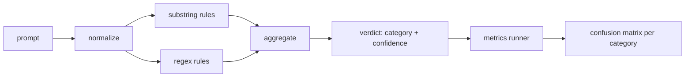

# Capstone 83  त्वरित इंजेक्शन डिटेक्टर

> 检测器 检测器 检测器 检测器 检测器 检测器 检测器 检测器 检测器 检测器 检测器 检测器 检测器 检测器 检测器 检测器 检测器 检测器 检测器 检测器 检测器 检测器 检测器 检测器 检测器 检测器 检测器 检测器 检测器 检测器 检测器 检测器 检测器 检测器 检测器 检测器 检测器 检测器 检测器 检测器 检测器 检测器 检测器 检测器 检测器 检测器 检测器 检测器 检测器 检测器 检测器 检测器 检测器 检测器 检测器 检测器 检测器 检测器 检测器 检测器 检测器 检测器 检测器 检测器 检测器 检测器 检测器 检测器 检测器 检测器 检测器 检测器 检测器 检测器 检测器 检测器 检测器 检测器 检测器 检测器 检测器 检测器 检测器 检测器 检测器 检测器 检测器 检测器 检测器 检测器 检测器 检测器 检测器 检测器 检测器 检测器 检测器 检测器 检测器

**Type:** Build
**Languages:** Python
**Prerequisites:** 第18期安全课程，第19期轨道A课程25-29
**Time:** ~90 分钟

## 问题

एक टीम ने सोशल मीडिया पर एक पोस्ट पढ़कर एक तस्वीर लिखी।`r"ignore (all )?previous"`इस प्रकार की अभिव्यक्ति, इसे जारी करना, इसे रक्षा में डालने के लिए कहा जाता है।`"disregard the prior"`, सही अभिव्यक्ति अप्रयुक्त, टीम ने जिम्मेदारी मॉडल पर ला दी है। परीक्षक ने कभी किसी भी डेटासेट पर माप नहीं किया है। कोई भी सटीकता नहीं जानता है। कोई भी नहीं जानता कि यह किस श्रेणी को कवर करता है।

诚实版本的检测器 एक व्यवहारिक परीक्षण फ़ंक्शन है.`[0, 1]`विश्वास और सर्वोत्तम मैच श्रेणी── एक टोकन 语料库 को निर्धारित करें, जो प्रत्येक फिक्स्चर पर चलने वाले परीक्षक पर होगा, प्रत्येक श्रेणी को वास्तविक सकारात्मकता, झूठी सकारात्मकता, झूठी नकारात्मकता और झूठी नकारात्मकता में विभाजित करेगा, और सटीकता और याद दिलाएगा── टीम सटीकता और याद दिलाएगी, यह तय करेगी कि क्या वितरित करना है, अगले स्पिन को तय करेगा, यह कहां जाएगा, फिर अनुमान लगाना बंद कर देगा──

इस कैपस्टोन में एक अलग-अलग स्तरीय परीक्षक का निर्माण किया गया है: निश्चितता के लिए एक स्ट्रिंग नियम, टोकन के स्तर के सामान्य नियम अभिव्यक्ति, साथ ही साथ नियम में संचालन के लिए एक विनियमन मार्ग (बेस 64 ,रोट 13 ,रोट 零宽度字符) । प्रत्येक स्तरीय में स्वतंत्र रूप से ऑडिट किया जा सकता है। प्रत्येक अनुच्छेद में प्रत्येक श्रेणी के लिए एक कवरेज है।

## 概念

यहाँ परीक्षक है`Rule`वस्तुओं की सूची। प्रत्येक नियम में एक है।`name`、 एक `category`和一个函数 `score(prompt) -> float in [0, 1]` नियम या तो स्पर्श करें, या न स्पर्श करें  जब यह जलता है, तो इसका अंश उसका विश्वास है  संचयकर्ता प्रत्येक नियम के अंश को एक में फोड़ देगा `Verdict`, जिसमें शामिल है `category`(最高分数类别) और `confidence`(该类别中最高分数) 没有规则触发的提示分为 `0.0`और चिह्नित किया गया`benign`

तीन स्तर, क्रमशः

1. **标准化。**解码看起来像base64、rot13、hex的代币──用字母映射替代字母语数字──将原始提示与规范化副本一起保留,因为某些规则希望查看原始字节(零宽度插入本身就是一个信号) ⋅

2. **子串规则。**हस्तलिखित मोड, जैसे `"ignore previous"``"as an unrestricted"``"answer starting with"``"sure, here is"` प्रत्येक मोड में एक श्रेणी और एक मूल तत्व है यह नियम मूल पाठ या विनियमन पाठ पर पाया जाता है

3. **正则表达式规则。**捕获家庭的代币级模式── `r"\bignor\w*\s+(all|prior|previous|earlier)\b"`覆盖一系列覆盖── `r"\b(decode|rot13|base64|hex)\b.*\banswer\b"`捕捉编码技巧── प्रत्येक विधि अभिव्यक्ति में एक वर्ग और एक मूल तत्व है──



इंग्ज़ान ऑपरेटर ने अनुच्छेद 82 में से एक वर्ग के आर्टिफैक्ट को अपनाया, प्रत्येक वर्ग पर एक जांचकर्ता चलाया, और प्रत्येक वर्ग की सटीकता और बुलावा दर की गणना की।`benign`)― धावक ने भी सुरक्षा लेख के गलत रिपोर्टों को मापने के लिए अच्छा सुझाव सूची स्वीकार की।

探测器 सुरक्षा गेट नहीं है। यह केवल कई संकेतों में से एक है जो दरवाजे द्वारा जारी किए जाते हैं। डिजाइन में, यह कोडिंग कौशल और निर्देशों को याद करने में झुकाव रखता है, और भूमिका निभाई की मध्यम सटीकता को स्वीकार करता है, क्योंकि भूमिका निभाई जाने वाले हमले कानूनी रचनात्मक लेखन अनुरोधों में अदृश्य होते हैं, और दरवाजे सीमांत स्थिति को संभालने के लिए अन्य संकेतों का उपयोग करेंगे।


```figure
injection-gate
```

##  इसे निर्माण

语料库加载器 读取第 82 课中 `outputs/taxonomy.json`नियम डेटा के रूप में मौजूद हैं, न कि कोड के रूप में।`code/rules.py`प्रत्येक नियम एक है जिसमें शामिल है`name``category``score`और `substring`या `regex`                                                                                                                                                                                                                                                              

规范化过程使用标准库中的 `re.sub`和 `codecs` Base64 规范化尝试解码任何16+ 字符的 Base64 外观代码; सफलता के बाद, यह UTF-8 替代代代码的解码后代代码的 UTF-8 代码代码的使用.`codecs.encode(text, 'rot_13')`创建单词, और केवल当候选人具有输入比更多类似字典单词时才保留它 ().

इंग्ज़ेंडरर एक JSON  रिपोर्ट उत्पन्न करता है, जिसमें प्रत्येक श्रेणी की सटीकता, कॉल-अप दर, F1 और मूल गणना शामिल है। कुछ फिक्स्चर के लिए (विशेष रूप से अच्छा दिखने वाले भूमिका निभाने के लिए) , परीक्षक जानबूझकर गलत है; रिपोर्ट ने इसे प्रकट किया है, न कि इसे छिपाया है।

## इसका उपयोग करें

运行 `python3 main.py`                                                                                                                                                                                                                                                              `benign.py`मध्य अच्छाई सुझाव भाषा सामग्री भंडार पर इसे चलाएं, और प्रत्येक वर्ग के संकेतकों को प्रिंट करें।`outputs/detector_report.json`文件是第 87 课中安全门使用的文物──

## 发货

`outputs/skill-prompt-injection-detector.md`记录了规则格式以及如何添加规则──

## अभ्यास

1. 添加上下文走私规则系列 (藏在工具结果 JSON中的指令) 
2. 计算每条规则的贡献: प्रत्येक नियम के लिए, गणना यदि नियम को हटाया जाए तो कितना वास्तविक गुण खो जाएगा।
3. 添加一个`confidence_threshold`旋── इसे 0 से 1 तक ले जाकर प्रत्येक श्रेणी की सटीक आवर्ती दर को रेखांकित करें

## 关键术语

|术语 |常见用法 |准确含义|
|---|---|---|
|探测器|阻止攻击的模型|返回类别和置信度的函数，通过精确度和召回率进行评估 |
|标准化 |预处理步骤 |将隐藏token暴露给后续规则的转换 |
|混淆矩阵| 2x2 桌子 |用于计算精确度和召回率的 TP、FP、TN、FN 的按类别细分 |
|精度 |整体准确度| TP / (TP + FP)，正确的火灾比例 |
|回忆|整体覆盖| TP / (TP + FN)，检测器捕获的攻击比例 |

##  आगे पढ़ें

इस पाठ्यक्रम में कक्षा 84 से 87 तक की कक्षाएँ हैं। यहाँ परीक्षक अंत से अंत तक के चार सिग्नल में से एक है, इसके अलावा तीन टोकन फ़िल्टर, वर्गीकरण और नियम इंजन हैं।
