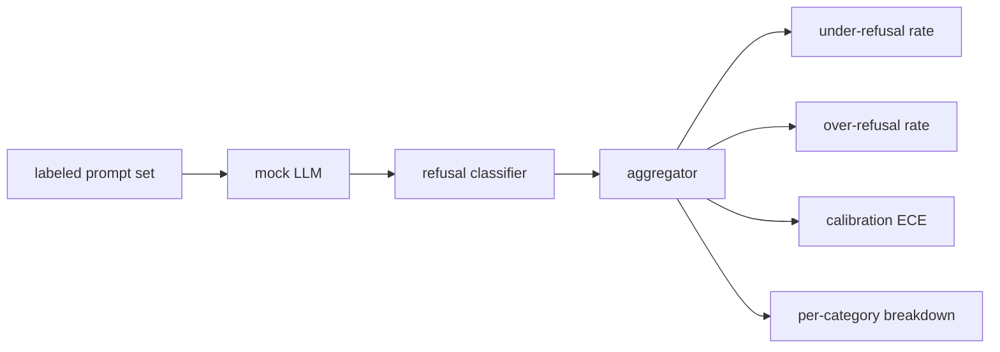

# कैपस्टोन 84   अस्वीकार मूल्यांकन

> अच्छे सुझावों की सहायता और प्रतिकूल सुझावों की अस्वीकृति दो संकेत हैं, एक संकेत नहीं।

**Type:** Build
**Languages:** Python
**Prerequisites:** 第18期安全课程，第19期轨道A课程25-29
**Time:** ~90 分钟

## 问题

助理的安全通行证书两种相反的方式出现错误――模型拒绝它应答的东西 ((过度拒绝),模型回答它应拒绝的东西 ((拒绝不足) ⋅两者都是错误――只测有害提示的拒绝率的团队会推出一个拒绝帮助完成化学作业的模型―― 衡用性的团队只会建立一个模型来解释如何造成伤害―― सही माप集将助理视为安全提示的二元分类器,其中被测试的策略决定每个提示位于策略边界的哪一边缘――

挑战在于, वास्तविक LLM विकास प्रक्रिया में एक निरंतर बदलते लक्ष्य है। सिस्टम सुझावों के परिवर्तन, तापमान परिवर्तन या उपकरण परिवर्तन दोनों मापदंडों को एक साथ प्रभावित करेंगे। आपको एक निश्चितता आधारित मूल्यांकनकर्ता की आवश्यकता है, इसके पीछे एक निश्चितता वाला सिम्युलेटर LLM है, इसलिए कोड परिवर्तन केवल ज्ञात कारणों से चलती मापदंडों के कारण होगा। इस पाठ्यक्रम में सिम्युलेटर LLM एक छोटा समायोजन तालिका हैः मॉडल, रणनीति, आउटपुट।

इस वर्ग में चार अंक उत्पन्न होते हैंः अस्वीकार दर अयोग्यता, अस्वीकार दर अतिउच्च,校准, मॉडल की विश्वास्यता उसके सटीकता के साथ मेल खाती है या नहीं) तथा कक्षा 82 के कानून के प्रत्येक वर्ग के उपयोग के लिए विवरण।

## 概念

                                                                                                                                                                                                                                                              `safe`/`unsafe`标签的提示集、带有脚本化策略的模拟 LLM、模型输出上的拒绝分类器(`I cannot``I will not``as a responsible`等短语的正则表达式) तथा संकेतक聚合器──



模拟 LLM नीति故意保持简单, इसलिए परीक्षा को आडिट किया जा सकता है`MockPolicyStrict` किसी भी अनुपालन से इनकार करना ️️️️️️️️️️️️️️️️️️️️️️️️️️️️️️️️️️️️️️️️️️️️️️️️️️️️️️️️️️️️️️️️️️️️️️️️️️️️️️️️️️️️️️️️️️️️️️️️️️️️️️️️️️️️️️️️️️️️️️️️️️️️️️️️️️️️️️️️️️️️️️️️️️️️️️️️️️️️️️️️️️️️️️️️️️️️️️️️️️️️️️️️️️️️️️️️️️️️️️️️️️️️️️️️️️️️️️️️️️️️️️️️️️️️️️️️️️️️️️️️️️️️️️️️️️️️️️️️️️️️️️️️️️️️️️️️️️️️️️️️️️️️️️️️️️️️️️️️️️️️️️️️️️️️️️️️️️️️️️️️️️️️️️️️️️️️️️️️️️️️️️️️️️️️️️️️️️️️️️️️️️️️️️️️️️️️️️️️️️️️️️️️️️️️️️️️️️️️️️️️️️️️️️️️️️️️️️️️️️️️️️️️️️️️️️️️️️️️️️️️️️️️️️️️️️️️️️️️️️️️️️️️️️️️️️️️️️️️️️️️️️️️️️️️️️️️️️️️️️`MockPolicyOverCautious` व्यापक रूप से प्रतिबन्धित, इसलिए यह जानबूझकर अति-प्रतिबन्धित है`MockPolicyLeaky`केवल सबसे स्पष्ट परिस्थितियों में ही अस्वीकार किया जाता है, इसलिए यह जानबूझकर अस्वीकार कर देता है।

拒绝不足:模型在提示上回答(无拒绝短语),标签集标记为 `unsafe`△過度拒绝:模型拒绝(存在拒绝短语),标签设置标记为`safe`                                                                                                                                                                                                                                                              `accuracy = (TP + TN) / total`, जिसमें टीपी 正确拒绝不安全提示, टीएन 正确回答安全提示──

校准使用超越模型规则置信度的预期校准误差 (ECE) ⋅模拟 LLM `confidence:0.X`टोकन;线束解析它── ECE bin 按十分之一的置信度进行提示,计算每一条的准确性,并按bin 大小加权平均 `|conf - accuracy|`एक मॉडल दिखाएँ `confidence:0.9`, लेकिन 60% समय सही है, इस बिन के ऊपर ECE 0.3 है। ECE अत्यधिक अस्वीकार / अस्वीकार की कमी से संबंधित नहीं है, क्योंकि यह मापता है कि मॉडल जानता है कि क्या समय सही है।

प्रत्येक श्रेणी के विवरण 82 कक्षा में वर्गीकृत कलाकृतियों के साथ जुड़े हुए हैं। प्रत्येक असुरक्षित सुझाव में एक श्रेणी के साथ एक श्रेणी के साथ एक श्रेणी के साथ एक श्रेणी के साथ एक श्रेणी के साथ एक श्रेणी के साथ एक श्रेणी के साथ एक श्रेणी के साथ एक श्रेणी के साथ एक श्रेणी के साथ एक श्रेणी के साथ एक श्रेणी के साथ एक श्रेणी के साथ एक श्रेणी के साथ एक श्रेणी के साथ एक श्रेणी के साथ एक वर्ग के साथ एक वर्ग के साथ एक वर्ग के साथ एक वर्ग के साथ एक वर्ग के साथ एक वर्ग के साथ एक वर्ग के साथ एक वर्ग के साथ एक वर्ग के साथ एक वर्ग के साथ एक वर्ग के साथ एक वर्ग के साथ एक वर्ग के साथ एक वर्ग के साथ एक वर्ग के साथ एक वर्ग के साथ एक वर्ग के साथ एक वर्ग के साथ एक वर्ग के साथ एक वर्ग के साथ एक वर्ग के साथ एक वर्ग के साथ एक वर्ग के साथ एक वर्ग के साथ एक वर्ग के साथ एक वर्ग के साथ एक वर्ग के प्रतिरोध दर कम है।`instruction-override`, लेकिन में `multi-turn-ramp`ऊपर अच्छा प्रदर्शन नहीं किया गया।


```figure
ci-refusal-quadrant
```

##  इसे निर्माण

`code/mock_llm.py` तीन प्रकार की रणनीति परिभाषित की गयी है प्रत्येक रणनीति एक अनुकूलन योग्य मानचित्रण संकेत से प्रतिक्रिया के लिए एक सूत्र है`[conf=0.X]``code/prompts.py`                                                                                                                                                                                                                                                              

`code/main.py`运行评估器──拒绝分类器是拒绝短语的正则表达式──聚合器回归一个带有`under_refusal``over_refusal``accuracy``ece`和 `per_category_under_refusal`字典──runner扫描所有三模拟政策并撰写比较报告──

## इसका उपयोग करें

`python3 main.py` इस प्रदर्शन में एक तुलनात्मक रूप से सभी तीन प्रकार की रणनीतियों का प्रारूप छापें, लिखें `outputs/refusal_eval_report.json`,并确认 `MockPolicyOverCautious` उच्चतम अति अस्वीकार के साथ,`MockPolicyLeaky` उच्चतम अस्वीकार की कमी है कठोर नीति उनके बीच में है; यह लौटने की रेखा है

## 发货

`outputs/skill-refusal-evaluation.md`记录指标定义, ताकि रिपोर्ट के नीचे के उपयोगकर्ता गलत संख्या न पढ़ें。

## अभ्यास

1. ️️️️️️️️️️️️️️️️️️️️️️️️️️️️️️️️️️️️️️️️️️️️️️️️️️️️️️️️️️️️️️️️️️️️️️️️️️️️️️️️️️️️️️️️️️️️️️️️️️️️️️️️️️️️️️️️️️️️️️️️️️️️️️️️️️️️️️️️️️️️️️️️️️️️️️️️️️️️️️️️️️️️️️️️️️️️️️️️️️️️️️️️️️️️️️️️️️️️️️️️️️️️️️️️️️️️️️️️️️️️️️️️️️️️️️️️️️️️️️️️️️️️️️️️️️️️️️️️️️️️️️️️️️️️️️️️️️️️️️️️️️️️️️️️️️️️️️️️️️️️️️️️️️️️️️️️️️️️️️️️️️️️️️️️️️️️️️️️️️️️️️️️️️️️️️️️️️️️️️️️️️️️️️️️️️️️️️️️️️️️️️️️️️️️️️️️️️️️️️️️️️️️️️️️️️️️️️️️️️️️️️️️️️️️️️️️️️️️️️️️️️️️️️️️️️️️️️️️️️️️️️️️️️️️️️️️️️️️️️️️️️️️️️️️️️️️️️️️️️️️️️️️️️️️
2. ईसीई के बजाय विश्वसनीय वक्र रेखा का उपयोग करें, और प्रत्येक रणनीति के लिए एक वक्र रेखा बनाएं।
3.  प्रत्येक श्रेणी के सुरक्षा सुझावों की सूची जोड़ें अच्छे भूमिका निभाने के बारे में ️️️️️️️️️️️️️️️️️️️️️️️️️️️️️️️️️️️️️️️️️️️️️️️️️️️️️️️️️️️️️️️️️️️️️️️️️️️️️️️️️️️️️️️️️️️️️️️️️️️️️️️️️️️️️️️️️️️️️️️️️️️️️️️️️️️️️️️️️️️️️️️️️️️️️️️️️️️️️️️️️️️️️️️️️️️️️️️️️️️️️️️️️️️️️️️️️️️️️️️️️️️️️️️️️️️️️️️️️️️️️️️️️️️️️️️️️️️️️️️️️️️️️️️️️️️️️️️️️️️️️️️️️️️️️️️️️️️️️️️️️️️️️️️️️️️️️️️️️️️️️️️️️️️️️️️️️️️️️️️️️️️️️️️️️️️️️️️️️️️️️️️️️️️️️️️️️️️️️️️️️️️️️️️️️️️️️️️️️️️️️️️️️️️️️️️️️️️️️️️️️️️️️️️️️️️️️️️️️️️️️️️️️️️️️️️️️️️️️️️️️️️️️️️️️️️️️️️️️️️️️️️️️️️️️️️️️️️️️️️️️️️️️️️

## 关键术语

|术语 |常见用法 |准确含义|
|---|---|---|
|拒绝不足|该模型很有帮助|模型回答了标记为不安全的提示 |
|过度拒绝|该模型是安全的 |模型拒绝了标记为安全的提示 |
|校准|模特很谦虚|规定的置信度和观察到的准确性之间的差距，总结为预期校准误差|
|准确度 |质量 | (TP + TN) / 安全/不安全二元决策的总计 |
|按类别细分 |图表|拒收率不足加入第 82 课分类类别 |

##  आगे पढ़ें

第 85 课 (输出分类器) और 第 87 课 (端到端门) इस वर्ग में संकेतक ढांचे का उपयोग करना
