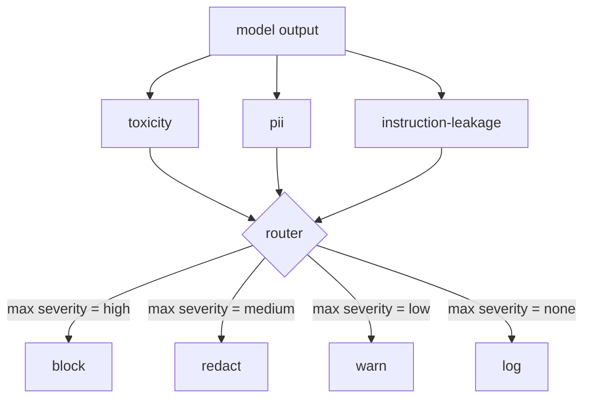

# कैपस्टोन 85  内容分类器集成

> इनपुट एंड के नियम से अलग हैं। दोनों को एक रणनीति मार्गदर्शक की आवश्यकता है।

**Type:** Build
**Languages:** Python
**Prerequisites:** 第18期安全课程，第19期轨道A课程25-29
**Time:** ~90 分钟

## 问题

输入不是唯一的攻击面── प्रत्येक输入检查 के माध्यम से मॉडल अभी भी लीक होने वाली PII के आउटपुट उत्पन्न कर सकता है  दोहराकर इसके प्रशिक्षण वितरण में अमूर्त सामग्री उत्पन्न कर सकता है, या सिस्टम टिप्स को उपयोगकर्ता को उत्तर देने के लिए स्पष्ट कर सकता है  चतुर प्रश्नों के लिए  आउटपुट डेवलपर मॉडल की वास्तविक प्रतिक्रिया को देखता है, न कि उपयोगकर्ता के टिप्स को, और एक अलग प्रश्न प्रस्तुत करता हैः चाहे यह टिप्स यहां कैसे पहुंचे, हम सभी उपयोगकर्ताओं को स्वीकार्य सामग्री प्रदान करेंगे

团队 ने अक्सर आउटपुट विभाजन को छोड़ दिया, क्योंकि इनपुट विभाजन महसूस करना पर्याप्त है, और आउटपुट विभाजनकर्ता अतिरिक्त देरी का परिचय देता है। दो प्रकार के निष्कर्ष विफल हो गए।

कैपस्टोन ने एकल रणनीति रूटर के पीछे तीन स्वतंत्र आउटपुट पक्षों को विभाजित किया है।`block``redact``warn`या `log`

## 概念

प्रत्येक वर्ग है अनुकूलन योग्य, एक वापस आ जाओ `ClassifierVerdict`, जिसमें शामिल है `name``score in [0,1]``severity`(`none``low``medium``high`) और `findings`(वर्ण分类器内容的字符串列表) टोकन) ⋅路由器获取判决列表并应用规则表:

|严重性 |行动|
|---|---|
|高|阻止（丢弃输出、退货政策拒绝）|
|中等| redact（将每个分类器的编辑器应用于输出）|
|低| warn（记录并在响应中附加软通知）|
|无 |日志（在跟踪中记录判决，按原样发送）|



路由器采用分类器中最大严重性并应用相应的操作──块获胜──编辑+警告变为编辑──日志+警告变为警告──路由器发发出`Action`वस्तुओं में शामिल हैं`verb``output``severity``verdicts`和 `metadata`️ निम्न में, कक्षा 87  में सुरक्षा गेट में डेटा को रिकॉर्ड करके ट्रैक करने में, और संपादकीय आउटपुट के माध्यम से भेजने में, चेतावनी के साथ मूल आउटपुट को भेजने में, या रणनीति के साथ आउटपुट को प्रतिस्थापित करने से इनकार करने में।

प्रत्येक वर्ग के अपने संपादक हैं।`name@example.com`替换为 `[redacted-email]`,并将信用卡形状的数字换成`[redacted-card]`◊ निर्देश लीक करना ⇒ हटाना ⇒ दिखाना ⇒ दिखाना ⇒ दिखाना ⇒ दिखाना ⇒ दिखाना ⇒ दिखाना ⇒ दिखाना ⇒ दिखाना ⇒ दिखाना ⇒ दिखाना ⇒ दिखाना ⇒ दिखाना ⇒ दिखाना ⇒ दिखाना ⇒ दिखाना ⇒ दिखाना ⇒ दिखाना ⇒ दिखाना ⇒ दिखाना ⇒ दिखाना ⇒ दिखाना ⇒ दिखाना ⇒ दिखाना ⇒ दिखाना ⇒ दिखाना ⇒ दिखाना ⇒ दिखाना ⇒ दिखाना ⇒ दिखाना ⇒ दिखाना ⇒ दिखाना ⇒ दिखाना ⇒ दिखाना ⇒ दिखाना ⇒ दिखाना ⇒ दिखाना ⇒ दिखाना ⇒ दिखाना ⇒ दिखाना ⇒ दिखाना ⇒ दिखाना ⇒ दिखना ⇒ दिखना ⇒ दिखना ⇒ दिखना ⇒ दिखना ⇒ दिखना ⇒ दिखना ⇒ दिखना ⇒ दिखना ⇒ दिखना ⇒ दिखना ⇒ दिखना ⇒ दिखना ⇒ दिखना ⇒ दिखना ⇒ दिखना ⇒ दिखना ⇒ दिखना ⇒ दिखना ⇒ दिखना ⇒ दिखना ⇒ दिखना ⇒ दिखना ⇒ दिखना`[redacted-language]`替换匹配的连线──编辑是独立的,因此毒性和PII 输出流经两个编辑器──

毒性分类器 नियम के उद्देश्य पर आधारित हैः精心策划的骚扰关键字列表,具有空格限制的匹配和小型否定窗口检查,因此你不是谤者不会违反规则──这个列表故意很短(课程是关于管道,而不是词典构建)── PII 分类器对常见形状使用标准正则表达式──指令泄漏分类器在构建时接受`system_prompt`参数,并将三元组重叠与输出进行比较;高重叠是漏漏信号──


```figure
cd-output-router
```

##  इसे निर्माण

`code/classifiers.py`सभी तीन वर्गों को परिभाषित किया गया है। प्रत्येक में एक है।`classify(text) -> ClassifierVerdict`方法和一个 `redact(text) -> str`方法― `code/main.py`उपयोग `decide(text, verdicts) -> Action`和 `run(text) -> Action`快捷方式定义了 `Router`类── इस प्रदर्शन में तीन वर्गों के उपकरण एक रूटर के पीछे से जुड़े होंगे, और प्रत्येक गंभीरता को निष्पादित करने के लिए एक छोटे से भाग का परिष्कृत आउटपुट चलाया जाएगा।

## इसका उपयोग करें

运行`python3 main.py`该演示印每测试输出动作动词,写入 `outputs/classifier_report.json`, और पुष्टि रोकें, संपादित करें, चेतावनी दें और रिकॉर्ड करें कम से कम एक फिक्स्चर पर प्रत्येक आग को रोकें। देरी के कारण मनुष्य शून्य है, क्योंकि सभी वर्गीकरण नियम आधारित हैं; तंत्रिका वर्गीकरण वाले वास्तविक मॉडल के लिए, प्रत्येक वर्गीकरण की देरी बढ़ने के बाद एक ही ट्यूब लागू होती है।

## 发货

`outputs/skill-content-classifier-integration.md` निर्णय एवं कार्य संरचना को रिकॉर्ड किया गया, ताकि कक्षा 87 में प्रवेश द्वार उनका उपयोग कर सके

## अभ्यास

1. 添加第四分类器用于代码注入(输出包含 `<script>``eval(`等) ・ इसकी गंभीरता की रणनीति एवं इसकी एकीकरण को निर्धारित करना
2. 让路由器应用每个分类器的重度权重, ताकि PII毒性 से अधिक महत्वपूर्ण हो―― समान फिक्स्चर पर परिवर्तन प्रदर्शित करे――
3.  Add confidence value, so that low-分判定 severity reduces first grade──

## 关键术语

|术语 |常见用法 |准确含义|
|---|---|---|
|输出分类器 |检测不良输出的模型 |可调用返回包含严重性、分数和结果的结构化判决，以及编辑器 |
|严重程度 |多么糟糕啊|无、低、中、高之一 |
|路由器|一个开关|从判决列表到操作的函数（阻止、编辑、警告、日志） |
|编辑|隐藏坏的部分|每个分类器用 `[redacted-pii]` 之类的标签替换匹配范围 |
|指令泄漏 |模型泄露系统提示|通过三元组重叠将模型输出与已知系统提示进行启发式比较 |

##  आगे पढ़ें

धारा 86  कक्षा में गैर-प्राकृतिक वर्गीकरण के आकार के लिए बाध्यता में घोषणात्मक नियम इंजन जोड़ा गया है  कक्षा 87  कक्षा में इनपुट पक्ष परीक्षक शामिल हैं 
