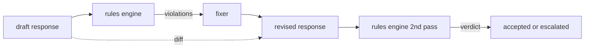

# कैपस्टोन 86  संवैधानिक नियम इंजन

> 规则是名称、谓词和解释──缺少 इनमें से कोई भी तीनों में से एक एक वातावरण है, न कि नियम──

**Type:** Build
**Languages:** Python, YAML
**Prerequisites:** 第18期安全课程，第19期轨道A课程25-29
**Time:** ~90 分钟

## 问题

वर्गीकरण यंत्र में पहचान योग्य दोष शामिल हैं। नियम इंजन में अनुबंध नियम इंजन शामिल हैं। कोड लिखने के लिए कोड सहायक टीम को एक बंधन की आवश्यकता होती है, उदाहरण के लिए, कोड में शामिल प्रत्येक प्रतिक्रिया को एक चलाने योग्य ब्लॉक या एक निर्धारित परिकल्पना के साथ समाप्त करना चाहिए।

诚实的表述是声明性文件――规则集与代码一起存在于YAML,处于版本控制中,并具有单独审查流程――每个规则都有一个`name`、 एक `severity`、 एक `explanation`模板, तथा एक दो बाइडों में विभाजित करने का प्रस्तावनाः`applies_when`निर्णय लेना कि नियम लागू हैं या नहीं,`must`️️️️️️️️️️️️️️️️️️️️️️️️️️️️️️️️️️️️️️️️️️️️️️️️️️️️️️️️️️️️️️️️️️️️️️️️️️️️️️️️️️️️️️️️️️️️️️️️️️️️️️️️️️️️️️️️️️️️️️️️️️️️️️️️️️️️️️️️️️️️️️️️️️️️️️️️️️️️️️️️️️️️️️️️️️️️️️️️️️️️️️️️️️️️️️️️️️️️️️️️️️️️️️️️️️️️️️️️️️️️️️️️️️️️️️️️️️️️️️️️️️️️️️️️️️️️️️️️️️️️️️️️️️️️️️️️️️️️️️️️️️️️️️️️️️️️️️️️️️️️️️️️️️️️️️️️️️️️️️️️️️️️️️️️️️️️️️️️️️️️️️️️️️️️️️️️️️️️️️️️️️️️️️️️️️️️️️️️️️️️️️️️️️️️️️️️️️️️️️️️️️️️️️️️️️️️️️️️️️️️️️️️️️️️️️️️️️️️️️️️️️️️️️️️️️️️️️️️️️️️️️️️️️️️️️️️️️️️️️️️️️️️️️️️️️️️️️️️️️️️️️️️️️️️`Violation`                                                                                                                                                                                                                                                              `all_of``any_of`和 `not_`组成词, इसलिए एकल नियम व्यक्त किया जा सकता है  यदि प्रतिक्रिया में कोड शामिल है, तो यह एक संचालित ब्लॉक के अंत में होना चाहिए, और केवल आंतरिक भंडार का हवाला नहीं देता है ──

इस कक्षा का दूसरा भाग पुनरावृत्ति है। केवल बाधा के नियम इंजन आधा निर्माण है। प्रस्तावित संशोधन सुझाव के नियम इंजन संचालन में उपयोगी हैः सहायक प्रारूप प्रतिक्रिया, इंजन टोकन उल्लंघन, संशोधनकर्ता उत्पन्न संशोधन प्रतिक्रिया, इंजन पुष्टि संशोधन नियमों को पूरा करने के लिए। इस कक्षा में एक न्यूनतम संशोधन कार्यक्रम प्रदान किया गया है। प्रत्येक नियम के नियम अभिव्यक्ति के प्रतिस्थापन) और ड्राफ्ट और संशोधन संस्करण के बीच संरचनात्मक अंतर।

## 概念



规则具有以下形状

```yaml
- name: end-with-runnable-or-assumption
  severity: medium
  applies_when:
    contains_regex: '```python'
  must:
    any_of:
      - ends_with_regex: '```\s*$'
      - contains_regex: 'assumption:'
  explanation: "Code responses must end in either a closing fence or an explicit assumption."
  fix:
    append_if_missing: "\n\nAssumption: example inputs are valid."
```

谓词是原子的:`contains_regex``not_contains_regex``ends_with_regex``starts_with_regex``max_words``min_words`组成为`all_of``any_of``not_`◊ इंजन प्रथम मूल्यांकन`applies_when`यदि नियम लागू नहीं होते हैं, तो उल्लंघन के रिकॉर्ड के लिए`not_applicable`否则,引擎评估 `must`और उत्पन्न`pass`या `violation`

गंभीरता के लिए`low``medium``high`,镜像第 85 课──下游门(第 87 课)将 `high`规则违规视为与 `high`分类器判决相同:阻止──

修复程序是声明性操作的列表:`append_if_missing``prepend_if_missing``replace_regex` प्रत्येक ऑपरेशन के नाम पर नियमनों को रूपांतरण में चित्रित किया जाएगा।

差异是根据原版和修改版计算的. यह शामिल है.`op`(Add 、 remove 、 edit) तथा संबंधित ग्रंथों के`Change`记录的列表──下游门 记录的差异, ताकि कृत्रिम आ审员 समय के साथ आ审审员 के व्यवहार को आ审核 करे──


```figure
cd-constitution-loop
```

##  इसे निर्माण

`code/rules.yml`                                                                                                                                                                                                                                                              `code/main.py`中的加载器 YAML 文件(当 PyYAML 可用时) या JSON 文件(内置) ・本课程提供一个 `rules.yml`, इस पाठ्यक्रम को दो कोड पथों के माध्यम से हल करने के लिए परीक्षण किया गया है`rules.yml``code/main.py` परिभाषित किया `Engine`和 `Fixer`类 तथा `diff`函数──在 `any_of`                                                                                                                                                                                                                                                              

发货时的规则集:

- `no-empty-refusal`(中) - 拒绝必须包含建议或重定向
- `end-with-runnable-or-assumption`(中) - 代码响应必须干净地关闭
- `no-pii-in-examples`(高) - उदाहरण डेटा में ई-मेल या टेलीफोन का आकार शामिल नहीं होना चाहिए
- `cite-when-asserting-fact`(低) - 以根據開頭的行必須包含括号引用
- `no-internal-library-leak`(高) - 单词 `internal-only`和 `policybot-internal`आउटपुट में दिखाई नहीं दे सकता
- `bounded-length`(低) - 回复 800 个字母 से अधिक नहीं होना चाहिए

## इसका उपयोग करें

`python3 main.py` इस शो को इंजन के माध्यम से चलाया गया  तीन ड्राफ्ट्स  प्रतिक्रिया  मुद्रण अवैध  परिचालन सुधार प्रक्रिया  मुद्रण अंतर  लिखना `outputs/rules_report.json`◊ एक फिक्स्चर में अनुचित नियम हैं, और रिपोर्ट में इस नियम का उल्लेख है।`not_applicable`, इसलिए टीम को इंजन के लिए एक स्पष्ट मूल्यांकन किया जा सकता है।

## 发货

`outputs/skill-constitutional-rules-engine.md`记录规则语法和修复器操作──

## अभ्यास

1. 添加一条规则,要求每次回复时提示提示提到安全时都包含短语如果紧急──使用组合──
2. इस विधि को नए डिजाइन में पुनः लिखा गया एक नियम दिखाएँ।
3. एक सूचक अंत बिंदु जोड़ें, एक निर्धारित ड्राफ्ट की भाषा भंडार के मामले में, उस अंत बिंदु प्रत्येक नियम के उल्लंघन की दर को वापस कर देता है, ताकि टीम देख सके कि कौन से नियम अत्यधिक निष्पादित किए गए हैं।

## 关键术语

|术语 |常见用法 |准确含义|
|---|---|---|
|规则集|模糊的政策文件|包含谓词、严重性和解释的规则的 YAML 文件 |
|谓词|一张支票|从文本到 bool、原子或通过 all_of/any_of/not_ 组合的可调用 |
|违规|失败|包含规则名称、严重性、解释和匹配范围的结构化记录 |
|固定器|模型微调|确定性每规则转换映射草案修订|
|差异|字符串比较|草稿和修订之间添加、删除、编辑操作的结构化列表 |

##  आगे पढ़ें

कक्षा 87                                                                                                                                                                                                                                                                                                                                                                                                                                                                                                                            
