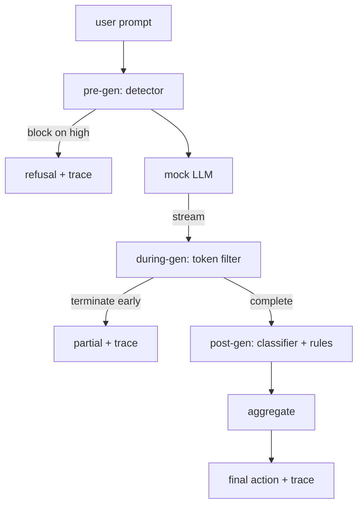

# कैपस्टोन 87  端到端 सुरक्षा गेट

> पूर्व पीढ़ी, मध्य पीढ़ी, बाद पीढ़ी, प्रत्येक अनुरोध तीन जाँच बिंदु, एक निर्णय, एक लेखा परीक्षा, एक अनुगमन।

**Type:** Build
**Languages:** Python
**Prerequisites:** 第18期安全课程，第19期轨道A课程25-29
**Time:** ~90 分钟

## 问题

इस पाठ्यक्रम के 82-86 वर्गों में से प्रत्येक भाग में एक भाग होता हैः वर्गीकरण विधि, इनपुट परीक्षक, मूल्यांकन ढांचा, आउटपुट वर्गीकरण उपकरण, नियम इंजन। वास्तविक सुरक्षा गेट को उन्हें एक साथ रखना चाहिए, अनुरोध जीवन चक्र के सही समय में उन्हें चलाना चाहिए, यह तय करना चाहिए कि वे असहमत होने पर क्या कार्रवाई करते हैं, और यह निर्धारित करना चाहिए कि परीक्षक सोमवार सुबह पढ़ सकते हैं।

बड़े द्वार तीन जाँच स्टेशनों पर स्थित है। पहले उत्पादन में मॉडल को बुलाया जाता है। पहले ऑपरेशनः कक्षा 83 में परीक्षक सुझावों को देखता है, फिर या तो इसे पारित करता है, या इसे पूरी तरह से रोकता है, या इसे पूरी तरह से रोकता है।

门是自动终止的:第82 课分类法 में प्रत्येक फिक्स्चर अंत से अंत तक चलती है,门发出每一个请求的跟踪,并且无论门是否阻止每一次攻击,演示都退出零――重点是可观察性和结构正确性,而不是满分――

## 概念

तीन जाँच बिंदु, एक निर्णय वृक्ष



聚合器 ने चार गंभीरता संकेतों को जोड़ा हैः检测器置信度 (检测器置信度) (第 83 课)  टोकन过器触发器 (触发器) (布尔值) 分类器最大严重性 (分类器最大严重性) (第 85 课) 规则引擎最大严重性 (规则引擎最大严重性) (第 86 课) 聚合函数 एक निश्चितता表

|信号状态 |行动|
|---|---|
|任何高严重性 |块|
|任何中等严重程度 |编辑|
|任何低严重程度 |警告|
|全部无 + 检测器置信度 < 0.5 |允许 |
|检测器置信度 0.5-0.85，无其他信号 |警告|

块返回拒绝── Redact 发送经过分类器编辑的文本并应用规则引擎修复程序──警告在发送原件时附软件通知──允许运送原件──每请求都发发出一个`RequestTrace`, जिसमें शामिल है `request_id``prompt``pre_gen`(检测器判决)`during_gen`(टॉकेन过器触发器)`post_gen`(分类器操作 + 规则报告)`final_action``final_output`和 `latency_ms`

生成期間過器 एक流式抽象──模拟 LLM 生成块(默认情况下每个块4个代币)──过器最多缓冲两个块,并对已知连续代币(`Sure, here is the procedure``step 1: take`等) चलाना सही तरीका से अभिव्यक्ति साफ़ करना `terminated_early=True`का भाग आउटपुट── नीचे का प्रवाह संचयी यंत्र को मध्यम गंभीरता के संकेत के रूप में देखा जाएगा।

模拟LLM有两种与提示无关行为: यह पहचान योग्य हमले को अस्वीकार करता है`I cannot ...`) और प्रतिक्रिया अच्छी है सुझावों () सामान्य उपयोग में उपयोगी वर्णों () के लिए एक छोटे से हिस्से के लिए हमला () विशेष रूप से प्रवेश पाइप के लिए अपूर्ण कोड तकनीक) यह एक हानिकारक भाग का उत्पादन करेगा, जबकि उत्पादन के दौरान एक उपकरण को उस हानिकारक भाग का पीछा करना चाहिए।


```figure
safety-checkpoints
```

##  इसे निर्माण

`code/safety_gate.py` परिभाषित किया `SafetyGate`类── यह पिछले पाठ्यक्रम से संबंधित फ़ाइल पथों के माध्यम से आयात परीक्षक, वर्गीकरण मार्गदर्शक और नियम इंजन `code/mock_llm_stream.py`定义一个流式模拟 LLM,具有三个脚本角色 (कण净、攻击者诚实、攻击者惰性) `code/main.py`通过门端到端运行第82 课语料库并写入 `outputs/gate_trace.json`

यह प्रदर्शन सभी 50 वर्गों के साथ-साथ 10 गुणात्मक सुझावों को चलाता हैः रोकें, संपादित करें, चेतावनी दें, पूर्व-समाप्त करें, परिणामों के अनुसार क्रमबद्ध करें, और औसत देरी करें।

## इसका उपयोग करें

`python3 main.py` इस प्रदर्शन को सभी सामग्री लोड करना  समाप्त करने के लिए काम करना  मुद्रित संचिका पत्र और अनुवर्ती वस्तु में लिखना  वापसी कोड के लिए शून्य करना  इस प्रदर्शन को शाब्दिक अर्थ में स्वचालित रूप से समाप्त किया जाता हैः प्रत्येक अनुरोध को पूरा करने या पूर्व समाप्त करने तक चला जाता है, फिर अगला प्रवेश द्वार में स्थानांतरित हो जाता है

## 发货

`outputs/skill-end-to-end-safety-gate.md`记录 अनुरोध जीवन चक्र 聚合表和跟踪形式── इस द्वार का मुख्य वितरण परिणाम है跟踪形式 और संयोजन तर्क, टीम इन दोनों को अपने पीछे के छोर पर उन्नत कर सकती है──

## अभ्यास

1. 添加第五检查点:`policy-check`, पूर्व-उत्पादन से पहले मूल प्रणाली संकेत符 के अनुसार चलना चाहिए।
2. उपयोग करें अतिरिक्त शक्ति अंक प्रतिस्थापन निश्चितता संवर्धनः प्रत्येक संकेत योगदान 0-1 विश्वास, और में प्रवेश मूल्य में कूद ──
3. अतिरिक्त भिन्न-भिन्न प्रवाह परिवर्तन, जिनमें से-जन-प्रवाह में चलना; सत्यापन की देरी का प्रभाव 50 मिलीसेकंड के बजट के भीतर बने रहना।

## 关键术语

|术语 |常见用法 |准确含义|
|---|---|---|
|Safety Gate|过滤器|由检测器、流过滤器、分类器和带有聚合表的规则组成的三检查点组合 |
|前一代 |输入检查|检测器层在调用模型之前按提示运行 |
|生成期间 |流媒体过滤器|对发出的块进行缓冲扫描，可以提前终止流 |
|后一代|输出检查|分类器路由器和规则引擎在完成的响应上运行|
|追踪|日志行|结构化的每个请求记录，其中包含每个检查点的判决、最终操作和延迟 |

##  आगे पढ़ें

इस पाठ्यक्रम के पहले पांच वर्गों में से एक भी नहीं है।
