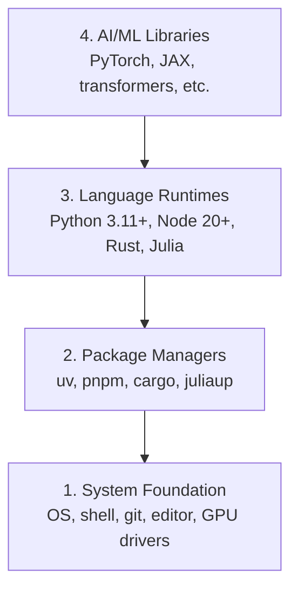

# Ambiente de desenvolvimento

> As tuas ferramentas moldam o teu modo de pensar.

**Type:** Build
**Languages:** Python, Node.js, Rust
**Prerequisites:** None
**Time:** ~45 分钟

## Objectivo de aprendizagem

- Desde zero construir Python 3.11+、Node.js 20+ 和 Rust 工具链
- Configuração de ambiente virtual e gerenciador de embalagens, garantia de construção reprodutiva
- Utilize CUDA/MPS 验证 GPU 访问,并跑一次测试张量运算
- Compreender quatro níveis de tecnologia: sistemas, gestão de conteúdos, operações,

## 问题

Você vai usar Python, TypeScript, Rust e Julia para completar 500+ sessões de engenharia de IA. Se o ambiente estiver ruim, cada sessão se tornará um conjunto de ferramentas, em vez de aprender.

A maioria das pessoas saltam o ambiente construído. Depois, gastam algumas horas para depurar a importância de erros. Conflitos de versão e ausência de CUDA.

## 概念

Uma engenharia de IA  ambiente tem quatro níveis:



Nós estamos instalados de baixo para cima. Cada camada depende dela.

```figure
s0-env-stack
```

## Construí-lo

### 步骤 1: sistema base

Verifique o seu sistema e instale os componentes básicos.

```bash
# macOS
xcode-select --install
brew install git curl wget

# Ubuntu/Debian
sudo apt update && sudo apt install -y build-essential git curl wget unzip

# Windows (use WSL2)
wsl --install -d Ubuntu-24.04
```

### 步骤 2: Use uv instalar Python

Nós usamos`uv` É 10 100 vezes mais rápido do que o pip , e irá processar automaticamente o ambiente virtual

```bash
curl -LsSf https://astral.sh/uv/install.sh | sh

uv python install 3.12

uv venv
source .venv/bin/activate  # or .venv\Scripts\activate on Windows

uv pip install numpy matplotlib jupyter
```

验证:

```python
import sys
print(f"Python {sys.version}")

import numpy as np
print(f"NumPy {np.__version__}")
a = np.array([1, 2, 3])
print(f"Vector: {a}, dot product with itself: {np.dot(a, a)}")
```

### 步骤 3: Use pnpm instalar Node.js

Utilizado em TypeScript 课程(agentes、MCP servidores、aplicativos web)

```bash
curl -fsSL https://fnm.vercel.app/install | bash
fnm install 22
fnm use 22

npm install -g pnpm

node -e "console.log('Node', process.version)"
```

Fnm Instalação Processo`unzip`, falta de tempo`Not installing fnm due to missing dependencies.`退出: em Linux 上它需要解压一个zip 归档, em macOS 上则通过 Homebrew 安装──macOS自带 `unzip`O Ubuntu、Debian 和 WSL2 会通过步骤 1 的 apt 命令安装它(Se você saltar esse passo, executar `sudo apt install -y unzip`)。

**macOS / Apple Silicon（M1/M2/M3/M4）：**Se instalá-lo`Error: Cannot install under Rosetta 2 in ARM default prefix (/opt/homebrew)`停止, explicar o teu terminal operando em Rosetta 2`arch`                                                                                                                                                                                                                                                                                                                                                                                                                                                                                                                             `i386`), enquanto Homebrew é um arm64 original.`fnm install 22`Comece a re-cargar as instruções acima:

```bash
arch -arm64 brew install fnm
echo 'eval "$(fnm env --use-on-cd)"' >> ~/.zshrc
source ~/.zshrc
```

### 步骤 4:Rust

Utilizado para cursos sensíveis ao desempenho (inferência, sistemas)

```bash
curl --proto '=https' --tlsv1.2 -sSf https://sh.rustup.rs | sh

rustc --version
cargo --version
```

### 步骤 5: Julia(可选)

Usou a Julia para fazer um curso de matemática.

```bash
curl -fsSL https://install.julialang.org | sh

julia -e 'println("Julia ", VERSION)'
```

### 步骤 6:GPU 设置( se você tiver)

**NVIDIA（Linux / Windows）：**

```bash
nvidia-smi

# Install PyTorch with CUDA
uv pip install torch torchvision torchaudio --index-url https://download.pytorch.org/whl/cu124
```

**macOS / Apple Silicon（M1/M2/M3/M4）：**Mac 上 没有 CUDA这是预期情况,不是故障**不要**传入 `--index-url .../cuXXX`(Estas rodas só são aplicáveis para Linux/Windows, instalável)

```bash
uv pip install torch torchvision torchaudio
```

验证(Aplica-se a qualquer plataforma):

```python
import torch
print(f"CUDA available: {torch.cuda.is_available()}")           # False on macOS — expected
print(f"MPS available:  {torch.backends.mps.is_available()}")   # True on Apple Silicon
if torch.cuda.is_available():
    print(f"GPU: {torch.cuda.get_device_name(0)}")
```

没有GPU?没有问题──大多数课程可在CPU上运行──对训练很重课程,使用Google Colab或云GPU──

### Passo 7: Verifique o caminho que você vai começar

Cada ordem nesta aula é executada no Registro de Depósitos, ou seja, contém`README.md`和 `phases/`O primeiro passo é verificar o conteúdo da rota escolhida. Ele é um instrumento usado para ajudar os novos a perceber que é uma conclusão clara, e não um aviso.

開始完整的入门序列:

```bash
python3 phases/00-setup-and-tooling/01-dev-environment/code/verify.py --route beginner
```

Ou apenas verificar o caminho que queres seguir:

```bash
python3 phases/00-setup-and-tooling/01-dev-environment/code/verify.py --route ml-foundations
python3 phases/00-setup-and-tooling/01-dev-environment/code/verify.py --route llm-engineering
python3 phases/00-setup-and-tooling/01-dev-environment/code/verify.py --route agents
python3 phases/00-setup-and-tooling/01-dev-environment/code/verify.py --route mcp
python3 phases/00-setup-and-tooling/01-dev-environment/code/verify.py --route agent-skills
python3 phases/00-setup-and-tooling/01-dev-environment/code/verify.py --route certification
```

Se quisermos que o mesmo pre-exame também o exame de curso posterior seja usado para ferramentas opcionais e dependências, adicionem-se`--show-later`                                                                                                                                                                                                                                                              

Cada exame necessário falhado fornece o caminho ou erro de introdução verificado, bem como uma ordem de reparação definida.

Quando entrarmos no pre-exame, imprimiremos a primeira ordem do curso:

```text
Ready to start Beginner course.
Next: python3 phases/01-math-foundations/01-linear-algebra-intuition/code/vectors.py
```

## Use-o

O seu ambiente já pode começar a verificar as rotas que você tem feito. As ferramentas posteriores, tais como a aula, precisam de ser reinstaladas, não é necessário deixar um conjunto completo de técnicas bloquear a sua primeira aula.

| Language | Used In | Package Manager |
|----------|---------|-----------------|
| Python | Phases 1-12 (ML, DL, NLP, Vision, Audio, LLMs) | uv |
| TypeScript | Phases 13-17 (Tools, Agents, Swarms, Infra) | pnpm |
| Rust | Phases 12, 15-17 (Performance-critical systems) | cargo |
| Julia | Phase 1 (Math foundations) | Pkg |

## Entrega-o

Este curso é produzido por um livro de testes que qualquer pessoa pode usar para verificar seu ambiente.

- Não .`outputs/prompt-env-check.md`, um deles é um problema de diagnóstico de IA, que pode ser ajudado.

## 练习

1. 运行验证脚本并修复 qualquer falha
2. Para este curso criar um Python 虚拟环境,并安装 PyTorch
3. Usando todas as quatro línguas escrever um "olá mundo", e executar

### 提示

**练习 1。**Em depósito`python3 phases/00-setup-and-tooling/01-dev-environment/code/verify.py --route beginner`, primeiro corrigir o primeiro erro, re-consulte o seguinte, re-executar o guião, todos os exames necessários são passados, para que seja concluído.

**练习 2。**Em armazém`uv venv` criar ambiente e ativar, reutilizar passo 6                                                                                                                                                                                                                                                                                                                                                                                                                                                                                                                 `python -c "import torch; print(torch.__version__)"`• Transposição de textos e textos;

**练习 3。**Utilize概念部分技术中的四种运行时:Python、运行到 Node.js' TypeScript、Rust 和 Julia──分别编写一个小文件,用`python3`- Não.`npx tsx`(Node.js 不能直接运行 `.ts`文件) 、`cargo run`Ou `rustc`- Não.`julia`运行──每次运行都必须印印你的消息,并以退出码 0 结束──
