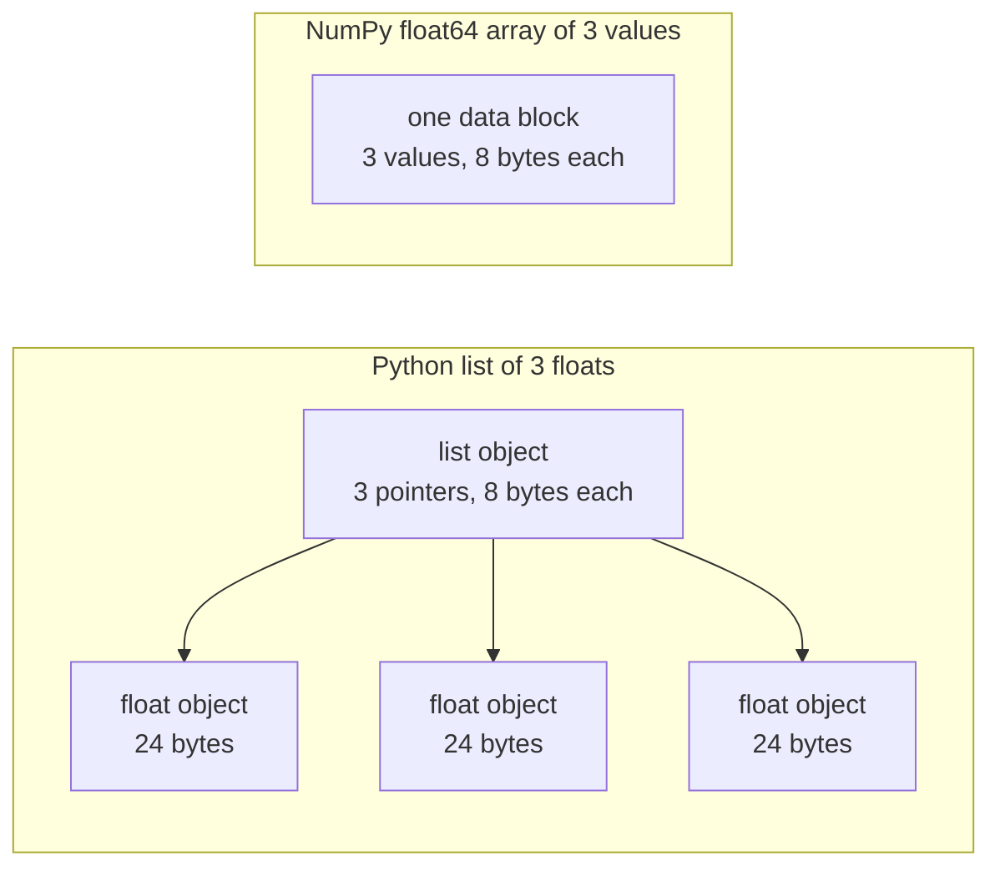

# 面向 AI 工程的Python

> A maioria dos códigos deste curso usa o mesmo grupo de Python. Antes de os cursos de matemática e modelos posteriores dependerem deles, primeiro os aprenda.

**Type:** Build
**Languages:** Python
**Prerequisites:** 开发环境、Python 环境
**Time:** ~120 分钟

## Objectivo de aprendizagem

- 阅读课程代码中最常见的习惯用法, de decompressão e f 字符串 até dados e tipologias de introdução:
- Python  problema: compartilhamento de listas  valores padrão e geradores esgotados
-  Utilize apenas base de padrões, construção de CSV com JSON carregador                                                                                                                                                                                                                                                    
- Usar Python para escrever pontos, valores e valores de diferença, e medir velocidade e volume de memória.
- Explicar por que o ciclo puro de Python de um valor numérico é mais lento, bem como como como o ciclo de NumPy 广播 será transferido para o código de composição posterior.

## 问题

Neste estágio, o curso segue o Python normal para realizar cálculos matemáticos e modelos.`dataclasses` Além disso, 187 documentos estão disponíveis `random.seed`Ou criar`random.Random`Se você não está familiarizado com estes hábitos de uso, você está ocupado em entender linguagem quando você quer entender matemática.

Python também tem alguns que não dão informações erradas, mas que levam a comportamentos errados. Dois nomes podem se referir à mesma lista, por isso, através de um nome alterar a lista, também mudará o conteúdo visto por outro nome.

O último problema é a velocidade. Nos nossos testes em computadores de notas, o ciclo puro Python para um milhão de movimentos de pontos calculados, requer cerca de 30 milissegundos; NumPy  completar o mesmo cálculo não chega a um milissegundo.

## 概念

### 课程代码使用哪些写法

Nós usamos`ast`- Não .`phases/*/*/code/`No meio, todos os 541 Python 文件──下表统计至少曾经使用过相应结构文件的文件数──统计来自编写本课当天,将随着新课加入而变化──

| 结构 | 文件数 | 占比 |
|-----------|-------|-------|
| 函数定义 | 541 | 100% |
| `if __name__ == "__main__":` | 529 | 98% |
| f 字符串 | 517 | 96% |
| 元组解包 | 448 | 83% |
| 类 | 379 | 70% |
| 列表推导式 | 375 | 69% |
| 函数类型标注 | 342 | 63% |
| 生成器表达式 | 326 | 60% |
| 切片 | 314 | 58% |
| `lambda` | 175 | 32% |
| `try` 与 `except` | 120 | 22% |
| `with` 语句 | 96 | 18% |
| 字典推导式 | 93 | 17% |
| 使用 `yield` 的生成器函数 | 14 | 3% |

A situação de importação reflete quais são os módulos de padrão mais importantes.`from __future__ import annotations`- O que é isso?`dataclasses`- Não.`math`- Não.`random`和 `json`模块分别出现在187、175 和 126 文件中──`collections`Aparece em 70 documentos, e...`itertools`Só aparecem em 4 documentos.

没有课程调用 `map()`Ou `filter()`• As actividades de investigação e desenvolvimento de projetos de investigação e desenvolvimento de investigação e desenvolvimento de tecnologias de informação e de informação`sorted`- Não.`min`- Não.`max`Ou `.sort`时使用了                                                                                                                                                                                                                                                                                                                                                                                                                                                                                                                          `key=`Função: Esta aula passará o maior tempo em classificar-se entre estas listas por meio de práticas de uso habitual.

### 名称引用对象

Em Python, a variação é o nome de um objeto. O nome é ligado a um objeto, não é duplicado. Quando dois nomes citam a mesma lista, a modificação feita através de um nome é impossível.

### Lista de indicadores de conservação, número de valores de conservação

A lista de Python não é um valor de armazenamento numérico direto, mas um índice de armazenamento, cada índice citando um objeto Python completo.`float`Objectivo: 24 字节──NumPy `float64`O número de números será colocado em um bloco de memória.



O sistema de roteiro deve fazer um monte de trabalho ao processar cada elemento. Para cada elemento, ele encaminha-se para encontrar um objeto, verificar o tipo de cada operação, reutilizar o código de floating point multiplication, e criar um Python floating point object para salvar os resultados.

NumPy para o ciclo de operação de valores primários, completa o mesmo cálculo. Ele só verifica um tipo de dados para todo o conjunto de dados, não cria Python para cada elemento.`(x - mean) / std`, re by library execution cycle. A função de vector desta aula também segue este princípio: cada função só realiza uma operação de um conjunto, depois pode ser substituída por uma NumPy 调用.

### Lista de todos os elementos, gerador por vez

A lista de introdução irá construir todos os elementos antes de executar a linha seguinte. O gerador irá construir um elemento em cada pedido do usuário. O uso de memória da lista aumentará com o número de elementos; independentemente de há muitos elementos, o uso de memória do gerador é praticamente inalterável.

O gerador só pode atravessar uma vez. Depois do último elemento, cada pedido é tocado.`StopIteration`, portanto, o segundo atravessou-o.`for`O ciclo não chega a qualquer elemento. Cada rodada de código de treinamento é lida por um conjunto de dados, portanto, é necessário criar um novo gerador para cada rodada.

 Em código de curso raramente aparecem funções de gerador, mas os carregadores de dados usados em cursos de aprendizagem profunda são objetos geráveis de dados em série, por isso essa ideia existe em cada ciclo de treinamento.

```figure
s0-list-vs-generator
```

## Você precisa de aprender a usar os hábitos

Cada bloco de código nesta secção pode ser executado de forma independente.`python3`运行──代码块需要Python 3.11或更新版本,这是我们在开发环境课程中安装的版本──

### 1. Valor, contêiner e desembaraço

Python tem quatro tipos de contêineres embutidos.

| 类型 | 示例 | 有序 | 可变 | 在课程中的典型用途 |
|------|---------|---------|------------|---------------------------|
| `list` | `[0.5, 1.2]` | 是 | 是 | 样本、损失、权重 |
| `tuple` | `(32, 784)` | 是 | 否 | 形状、固定记录、字典键 |
| `dict` | `{"lr": 0.01}` | 按插入顺序 | 是 | 配置、词表、JSON 行 |
| `set` | `{"cat", "dog"}` | 否 | 是 | 唯一 token、重叠检查 |

O código abaixo mostra que o valor atribuído não será copiado na lista:

```python
weights = [0.5, -1.2, 3.0]
alias = weights
alias[0] = 99.0
print(weights)

independent = list(weights)
independent[1] = 0.0
print(weights, independent)

grid = [[0] * 3] * 2
grid[0][0] = 1
print(grid)

grid = [[0] * 3 for _ in range(2)]
grid[0][0] = 1
print(grid)
```

```text
[99.0, -1.2, 3.0]
[99.0, -1.2, 3.0] [99.0, 0.0, 3.0]
[[1, 0, 0], [1, 0, 0]]
[[1, 0, 0], [0, 0, 0]]
```

Expressão`[[0] * 3] * 2` Crie uma lista de nível externo, dos quais duas citações são direcionadas para a mesma lista de nível interno                                                                                                                                                                                                                                                 

解包在一行中将序列元素赋予多个名称──带星号的名称收集剩余元素──f 字符串将表达式的值嵌入字符串, também pode ser designado em formato após o início 号──

```python
shape = (32, 784)
batch_size, n_features = shape
first, *middle, last = [1, 2, 3, 4, 5]
x, y = 1.0, 3.0
x, y = y, x

config = {"lr": 0.01, "epochs": 5}
config["seed"] = 7
tokens = ["the", "cat", "sat", "on", "the", "mat"]
vocab = set(tokens)

print(batch_size, n_features, first, middle, last, x, y)
print(config.get("momentum", 0.9), "cat" in vocab, len(vocab))
print(f"lr={config['lr']:.0e} loss={0.123456:.3f} n={60_000:,} {batch_size=}")
```

```text
32 784 1 [2, 3, 4] 5 3.0 1.0
0.9 True 5
lr=1e-02 loss=0.123 n=60,000 batch_size=32
```

Não há nada.`dict.get`返回默认值──无论集合大小如何,集合上的 `in`O tempo necessário para a inspecção é o mesmo.`{batch_size=}`Forma simultânea de imprimir nome e valor, para ajudar a调试──

切片 `a[start:stop:step]`包含 `start`, não contém`stop` Negativo índice de cálculo de início de fim. O número de cópias da lista é uma nova lista, portanto, todas as indicações no âmbito da lista de cópias de cópias serão aplicadas a tópicos de cópias de cópias de cópias.

```python
tokens = ["<s>", "the", "cat", "sat", "on", "the", "mat", "</s>"]
print(tokens[1:-1])
print(tokens[:3], tokens[-3:])
print(tokens[::2])
print(tokens[::-1][:2])
windows = [tokens[i:i + 3] for i in range(len(tokens) - 2)]
print(len(windows), windows[0])
```

```text
['the', 'cat', 'sat', 'on', 'the', 'mat']
['<s>', 'the', 'cat'] ['the', 'mat', '</s>']
['<s>', 'cat', 'on', 'mat']
['</s>', 'mat']
6 ['<s>', 'the', 'cat']
```

### 2. 推导式

推导式通过一个表达式,从可代对象构建列表、字典或集合──它的读法接近其描述的数学运算──

```python
scores = [0.91, 0.42, 0.77, 0.15, 0.66]
labels = [1 if s >= 0.5 else 0 for s in scores]
high = [s for s in scores if s > 0.6]
squares = {i: i * i for i in range(4)}
lengths = {len(word) for word in ["a", "bb", "cc", "ddd"]}
sum_sq = sum(s * s for s in scores)

matrix = [[1, 2, 3], [4, 5, 6]]
transposed = [list(column) for column in zip(*matrix)]
flat = [v for row in matrix for v in row]

print(labels, high, squares, lengths, round(sum_sq, 4))
print(transposed, flat)
```

```text
[1, 0, 1, 0, 1] [0.91, 0.77, 0.66] {0: 0, 1: 1, 2: 4, 3: 9} {1, 2, 3} 2.0555
[[1, 4], [2, 5], [3, 6]] [1, 2, 3, 4, 5, 6]
```

末尾的 `if`Apenas retém parte dos elementos.`for`A expressão anterior pode ser expressação condicional, ou seja:`a if condition else b`- Dois.`for`O ciclo de funcionamento é igual a dois círculos em conjunto.

圆括号创建生成器表达式──在 `sum(s * s for s in scores)`- Não.`sum`Cada vez que você lê um valor quadrado, Python não vai construir uma lista.`zip(*matrix)`No meio, cada linha será transmitida como um elemento independente,`zip`O mesmo elemento de posição é o mesmo.

### 3. Função ∞

默认值让参数变为可选. 关键字实参在调用时明确指定形参名称. 参数列表中单独的. 默认值让参数变为可选. 关键字实参在调用时明确指定形参名称. 参数列表中单独的. 默认值让参数变为可选. 关键字实参在调用时明确指定形参名称. 参数列表中单独的. 默认值`*`, será que os seguintes parâmetros são definidos apenas através de passagens de chave.

```python
def clip(value, low=0.0, high=1.0):
    return max(low, min(high, value))


def train(data, *, lr=0.01, epochs=3):
    return f"{len(data)} samples, lr={lr}, epochs={epochs}"


def make_scaler(factor):
    def scale(values):
        return [v * factor for v in values]
    return scale


print(clip(1.7), clip(-3.0, low=-1.0), clip(0.4, high=0.3))
print(train([1, 2, 3], lr=0.1))
to_percent = make_scaler(100)
print(to_percent([0.25, 0.5]))
```

```text
1.0 -1.0 0.3
3 samples, lr=0.1, epochs=3
[25.0, 50.0]
```

Usando apenas os parâmetros de palavras-chave,`train(data, 0.1, 3)`É assim que se faz.`TypeError`◊调用者 must write out `lr=0.1`, portanto, dois valores não significam mudança de posição.

内部函数  função interna`scale`Use criar sua função `factor`- Só que...`scale`Ainda existe, o Python vai ficar.`factor` manter a função de variação do criador é chamado de closed.

`lambda`Não há nome, contém apenas uma função expressa.`key=`Função,第 8 部分会介绍这种用法──

Python em execução`def`语句时, calcula apenas uma vez o valor de referência.

```python
def add_bad(item, bucket=[]):
    bucket.append(item)
    return bucket


def add_good(item, bucket=None):
    if bucket is None:
        bucket = []
    bucket.append(item)
    return bucket


add_bad("a")
print(add_bad("b"))
add_good("a")
print(add_good("b"))
```

```text
['a', 'b']
['b']
```

Lista, alfabeto ou conjunto de valores padrão deve ser usado`None`, e criar novos objetos dentro da função.

### 4. Classe e dados

`@dataclass`装饰器根据带类型标注的字段,生成 `__init__`- Não.`__repr__`和 `__eq__`- Configuração.`frozen=True`后, objetos criados 后不可修改, pode ser usado como um código de código ou colocado em conjunto.

```python
from dataclasses import dataclass, field


@dataclass(frozen=True)
class Example:
    features: tuple[float, ...]
    label: int


@dataclass
class TrainConfig:
    lr: float = 0.01
    epochs: int = 5
    hidden: list[int] = field(default_factory=lambda: [64, 32])

    def describe(self):
        return f"lr={self.lr} epochs={self.epochs} hidden={self.hidden}"


ex = Example((1.5, 2.0), 1)
print(ex)
print(ex == Example((1.5, 2.0), 1), len({ex, Example((1.5, 2.0), 1)}))
print(TrainConfig(epochs=10).describe())
try:
    ex.label = 0
except AttributeError as err:
    print(type(err).__name__)
```

```text
Example(features=(1.5, 2.0), label=1)
True 1
lr=0.01 epochs=10 hidden=[64, 32]
FrozenInstanceError
```

`field(default_factory=...)`Para cada exemplo, fornece uma nova lista. Resolve problemas de valor padrão compartilhado semelhantes ao da parte 3 dentro da classe de dados.

特殊方法将类与Python 语法连接起来──`len(ds)`调用 `__len__`- Não .`ds[2]`调用 `__getitem__`- Não.

```python
class SquaresDataset:
    def __init__(self, n):
        self.n = n

    def __len__(self):
        return self.n

    def __getitem__(self, index):
        if not 0 <= index < self.n:
            raise IndexError(index)
        return index, index * index


ds = SquaresDataset(4)
print(len(ds), ds[2])
print(list(ds))
```

```text
4 (2, 4)
[(0, 0), (1, 1), (2, 4), (3, 9)]
```

Mesmo assim não há`__iter__`- Como?`list(ds)` interno `for`循环也能工作──Python De acordo com 0、1、2 等索引调用 `__getitem__`Até que receba .`IndexError` O conjunto de dados de mapeamento do PyTorch também usa dois métodos similares:`__len__`和 `__getitem__`- Não.

### 5. 代器与生成器

O objeto é qualquer coisa que possa ser`for`O objeto de aceitação de ciclo:`iter()`A partir de um processo de obtenção de`next()`Para o gerador pedir um elemento. Quando o gerador não tiver mais elementos, ele vai tocar.`StopIteration`- Não.`for`循环替你调用 `next()`E ele encontrou-me .`StopIteration`- Não.

```python
numbers = [10, 20, 30]
it = iter(numbers)
print(next(it), next(it), next(it))
try:
    next(it)
except StopIteration:
    print("no more items")


def countdown(n):
    while n > 0:
        yield n
        n -= 1


gen = countdown(3)
print(type(gen).__name__)
print(list(gen))
print(list(gen))
```

```text
10 20 30
no more items
generator
[3, 2, 1]
[]
```

函数体中包含 `yield`A função é a função do gerador. Não executará qualquer código do corpo da função, mas retornará a um objeto do gerador.`next()`A cidade vai executar o seguinte .`yield`,并暂停在那里.`list(gen)`Por que não, porque a primeira vez o gerador de energia já está esgotado.

O gerador pode ler e fazer o processo.

```python
import os
import tempfile


def read_rows(path):
    with open(path, encoding="utf-8") as fh:
        header = fh.readline().rstrip("\n").split(",")
        for line in fh:
            yield dict(zip(header, line.rstrip("\n").split(",")))


with tempfile.TemporaryDirectory() as tmp:
    path = os.path.join(tmp, "rows.csv")
    with open(path, "w", encoding="utf-8") as fh:
        fh.write("x,label\n")
        fh.writelines(f"{i * 0.5},{i % 2}\n" for i in range(5))
    rows = read_rows(path)
    print(next(rows))
    print(sum(1 for _ in rows))
```

```text
{'x': '0.0', 'label': '0'}
4
```

`read_rows`Cada vez que um arquivo é guardado na memória, é no gráfico.`read_rows`◊ Para fazer um exemplo mais curto, aqui em directo em um número de bits.`csv`- Não.

```python
import sys

as_list = [i * i for i in range(1_000_000)]
as_generator = (i * i for i in range(1_000_000))
print(sys.getsizeof(as_list), sys.getsizeof(as_generator))
print(sum(as_list) == sum(as_generator))
```

Em 64 lugares CPython, lista de relatórios de cerca de 8 MB, gerador de cerca de 200 字节──`sys.getsizeof`Apenas a lista de indicadores própria, o número total de objetos também ocupará extra-in-memória.`tracemalloc`∆ medir o valor máximo real, já usamos em cursos de análise de desempenho e de teste.

### 6. 上下文管理器与异常

`with`语句先执行准备代码,再运行语句体,最后执行清理代码──即使语句体抛出异常,清理也会执行──`open()`O objeto do documento de devolução é um gerenciador de texto responsável pelo fechamento do documento.

No curso de análise de desempenho, escreviamos um bando.`__enter__`和 `__exit__`de `Timer`类──`contextlib.contextmanager`O equipamento de decoração pode ser criado a partir de um gerador.`yield`之前的代码负责准备,`finally`- É o meu trabalho.

```python
import time
from contextlib import contextmanager


@contextmanager
def timer(label):
    start = time.perf_counter()
    try:
        yield
    finally:
        print(f"{label}: {(time.perf_counter() - start) * 1000:.1f} ms")


def parse_label(text):
    try:
        return int(text)
    except ValueError:
        raise ValueError(f"label must be an integer, got {text!r}") from None


with timer("sum of squares"):
    total = sum(i * i for i in range(200_000))

print(parse_label("3"))
try:
    parse_label("cat")
except ValueError as err:
    print("rejected:", err)
```

```text
sum of squares: 9.4 ms
3
rejected: label must be an integer, got 'cat'
```

O tempo que você mede no seu aparelho será diferente.`except`子句中, escre明预期的具体异常,例如 `ValueError`Ou `KeyError` Não especificadas`except:`Também vou ser capturado.`KeyboardInterrupt`, portanto, Ctrl+C pode não parar de conter o seu ciclo. Quando o erro de entrada é feito, deve ser deixado fora com as anomalias de informação clara.`from None`- Não.

### 7.  Proteção dos tipos de etiquetas, módulos e procedimentos principais

类标签告诉读者函数接受什么、返回什么──Python 运行代码时不会检查这些标签──mypy 等类标签器会在代码运行前读取它们──

```python
from __future__ import annotations

from collections.abc import Iterable, Sequence


def mean(values: Sequence[float]) -> float:
    if not values:
        raise ValueError("mean() needs at least one value")
    return sum(values) / len(values)


def count_tokens(docs: Iterable[str]) -> int:
    return sum(len(doc.split()) for doc in docs)


def main() -> None:
    print(mean([1.0, 2.0, 4.0]))
    print(count_tokens(["the cat sat", "on the mat"]))
    print(mean.__annotations__)


if __name__ == "__main__":
    main()
```

```text
2.3333333333333335
6
{'values': 'Sequence[float]', 'return': 'float'}
```

Utilização `from __future__ import annotations`时,Python vai guardar cada marcação para o string, como a última linha mostrada.`Sequence`Expressar qualquer apoio `len()`E os objetos de índice, por exemplo, lista ou grupo;`Iterable`Indicar qualquer coisa que possa ser `for`循环接受对象── muitos documentos de curso`typing`导入这些相同名称,也同样有效──

Cada um .`.py`Os documentos são um módulo.`python3 file.py`运行文件时,Python 将其 `__name__`设置为 `"__main__"`Outro documento é introduzido.`__name__`则是模块名称──保护条件只在第一种调用 `main()`Por isso,`code/tests/`Testes de ensino médio podem ser importados.`main.py`, e não iniciar a apresentação.

### 8. 文件、JSON、CSV e排序

`pathlib.Path`- Não .`/`拼接路径,并能通过一次调用读取或写入整个文件──请始终指定 `encoding="utf-8"`, porque o código por defeito depende do sistema operacional.

```python
import csv
import json
import tempfile
from pathlib import Path

rows = [
    {"text": "great movie", "label": 1, "score": 0.93},
    {"text": "boring plot", "label": 0, "score": 0.12},
    {"text": "fine acting", "label": 1, "score": 0.58},
]

with tempfile.TemporaryDirectory() as tmp:
    json_path = Path(tmp) / "reviews.json"
    json_path.write_text(json.dumps(rows, indent=2), encoding="utf-8")
    from_json = json.loads(json_path.read_text(encoding="utf-8"))

    csv_path = Path(tmp) / "reviews.csv"
    with csv_path.open("w", newline="", encoding="utf-8") as fh:
        writer = csv.DictWriter(fh, fieldnames=["text", "label", "score"])
        writer.writeheader()
        writer.writerows(rows)
    with csv_path.open(newline="", encoding="utf-8") as fh:
        from_csv = list(csv.DictReader(fh))

print(from_json == rows)
print(from_csv[0])

by_score = sorted(rows, key=lambda r: r["score"], reverse=True)
print([r["text"] for r in by_score])
print(max(rows, key=lambda r: r["score"])["text"])
print([r["text"] for r in sorted(rows, key=lambda r: (-r["label"], r["text"]))])
```

```text
True
{'text': 'great movie', 'label': '1', 'score': '0.93'}
['great movie', 'fine acting', 'boring plot']
great movie
['fine acting', 'great movie', 'boring plot']
```

JSON 会将数值保留为数值──CSV 返回的每个字段都是字符串,因此你必须转换各字段──按照 `csv`文档的要求,打开 CSV文件时应指定 `newline=""`- Não.

`key=`Função retorna Python para comparar o valor de cada elemento.`sorted`- Não.`min`和 `max`Todos aceitam uma função assim. Os elementos do conjunto são classificados em primeiro lugar em segundo lugar, mas só em segundo lugar em segundo lugar.

### 9. 计数、分组与代工具

Estes dois módulos fornecem uma listagem comum e uma estrutura de dados sem dicionário e ferramentas de geração.

```python
from collections import Counter, defaultdict, deque
from itertools import chain, islice, product

labels = ["cat", "dog", "cat", "bird", "cat", "dog"]
counts = Counter(labels)
print(counts.most_common(2))

positions = defaultdict(list)
for i, label in enumerate(labels):
    positions[label].append(i)
print(dict(positions))

recent = deque(maxlen=3)
for loss in [2.0, 1.5, 1.2, 1.1, 0.9]:
    recent.append(loss)
print(list(recent), round(sum(recent) / len(recent), 3))

print(list(product([0.1, 0.01], [16, 32])))
print(list(chain([1, 2], [3], [4, 5])))
print(list(islice(range(100), 5, 10)))
```

```text
[('cat', 3), ('dog', 2)]
{'cat': [0, 2, 4], 'dog': [1, 5], 'bird': [3]}
[1.2, 1.1, 0.9] 1.067
[(0.1, 16), (0.1, 32), (0.01, 16), (0.01, 32)]
[1, 2, 3, 4, 5]
[5, 6, 7, 8, 9]
```

`Counter`统计标签、token 等可哈希元素── primeira vez usando o novo código,`defaultdict(list)`会创建空列表, portanto, o segmento de ciclo não precisa verificar se existe o código.`deque(maxlen=3)`Quando se adiciona um quarto elemento, ele remove o mais antigo elemento, formando assim uma janela de perda de valor de conservação recente.`enumerate`Para cada elemento fornecer um indicador.

`product`O conjunto completo de entrada é o superparâmetro.`chain`Vai ser o primeiro a seguir.`islice`Pode ser usado para qualquer gerador de bits, incluindo gerador.`islice`- Não.

### 10. Por que o ciclo de valores é lento

`dis`模块打印解释器 executar um comando de código de código executado em uma função.

```python
import dis


def dot(a, b):
    total = 0.0
    for x, y in zip(a, b):
        total += x * y
    return total


dis.dis(dot)
```

De`FOR_ITER`Até o seu comando, será executado uma vez para cada elemento.

O ciclo é um ciclo de execução de um código.`sum`- Não.`map`和 `zip`等内置函数用C 编写──动手构建部分会在纯Python中测量这种效果; usando现成工具部分则将整个循环移入NumPy──

## 动手构建

Agora construção de componentes necessários para o curso.`code/main.py`, por`code/tests/test_main.py`测试──下方 Cada código-bloco pode ser executado independentemente──

### 1o passo: tipo de registro e carregador de conjuntos de dados

O carregador irá CSV ou JSON 文件读取为同样结构:浮点特征元组,加一个整数标签.

```python
import csv
import json
import tempfile
from dataclasses import dataclass
from pathlib import Path


@dataclass(frozen=True)
class Record:
    features: tuple[float, ...]
    label: int


def row_to_record(row, names, label_field="label"):
    if label_field not in row:
        raise ValueError(f"row has no {label_field!r} field: {row}")
    if set(row) != {*names, label_field}:
        raise ValueError(f"row fields {list(row)} do not match {[*names, label_field]}")
    return Record(tuple(float(row[name]) for name in names), int(row[label_field]))


def load_records(path, label_field="label"):
    path = Path(path)
    if path.suffix == ".json":
        rows = json.loads(path.read_text(encoding="utf-8"))
    elif path.suffix == ".csv":
        with path.open(newline="", encoding="utf-8") as fh:
            rows = list(csv.DictReader(fh))
    else:
        raise ValueError(f"unsupported file type: {path.suffix!r}")
    if not rows:
        return []
    names = [key for key in rows[0] if key != label_field]
    return [row_to_record(row, names, label_field) for row in rows]


with tempfile.TemporaryDirectory() as tmp:
    csv_path = Path(tmp) / "data.csv"
    csv_path.write_text("x1,x2,label\n1.5,60,1\n1.8,82.5,0\n", encoding="utf-8")
    json_path = Path(tmp) / "data.json"
    json_path.write_text('[{"x1": 1.5, "x2": 60, "label": 1}]', encoding="utf-8")
    print(load_records(csv_path))
    print(load_records(json_path))
```

```text
[Record(features=(1.5, 60.0), label=1), Record(features=(1.8, 82.5), label=0)]
[Record(features=(1.5, 60.0), label=1)]
```

Primeiro, determinar o nome da característica e sua ordem.`DictReader`和 `json.loads`O JSON  padrão não define a ordem do objeto de chave, portanto `row_to_record`按第一行确定的顺序,按名称读取每一行. 标签缺失,特征缺失或多余,或文件类型未知时,将抛出带消息的. 标签缺失,特征缺失或多余,或文件类型未知时,将抛出带消息的. 标签缺失,特征缺失或多余,或文件类型未知时,将抛出带消息的. 标签缺失,特征缺失或多余,或文件类型未知时,将抛出带消息的. 标签缺失,特征缺失或多余,或文件类型未知时,将抛出带消息的.`ValueError`, fazer o processo de processamento efetivo em funcionamento começar, impedir o processamento posterior.`main.py`Também fornecido`save_records`, para escrever o mesmo tipo de formato.

### Segundo passo: Compartilhar os grupos de treinamento e os grupos de teste

```python
import random


def train_test_split(items, test_fraction=0.2, seed=0):
    if not 0.0 < test_fraction < 1.0:
        raise ValueError(f"test_fraction must be between 0 and 1, got {test_fraction}")
    if len(items) < 2:
        raise ValueError(f"need at least 2 items to split, got {len(items)}")
    order = list(range(len(items)))
    random.Random(seed).shuffle(order)
    n_test = min(max(1, round(len(items) * test_fraction)), len(items) - 1)
    test = [items[i] for i in order[:n_test]]
    train = [items[i] for i in order[n_test:]]
    return train, test


items = list(range(10))
print(train_test_split(items, seed=1))
print(train_test_split(items, seed=1) == train_test_split(items, seed=1))
print(train_test_split(items, seed=2)[1])
print(items)
```

```text
([9, 7, 5, 3, 0, 4, 1, 2], [6, 8])
True
[5, 9]
[0, 1, 2, 3, 4, 5, 6, 7, 8, 9]
```

`random.Random(seed)`创建私有随机数生成器──`random.seed(seed)`Re-põe todos os módulos em um gerador de rede geral, por isso, uma única rede em outras bibliotecas pode mudar a sua sequência.`random.seed`,96 个创建 `random.Random`❖ 新代码中应使用私有生成器──

Função perturbada é uma lista de índices, portanto, a lista de entrada permanece inalterada.`ValueError` Antes de qualquer passo de aprendizagem de dados, como a padronização, primeiro se divide os dados.

### 第 3 步: gerador de pequenas quantidades

```python
from itertools import islice


def batches(items, batch_size, drop_last=False):
    if batch_size < 1:
        raise ValueError(f"batch_size must be at least 1, got {batch_size}")
    return _batch_iter(iter(items), batch_size, drop_last)


def _batch_iter(iterator, batch_size, drop_last):
    while True:
        batch = list(islice(iterator, batch_size))
        if not batch or (drop_last and len(batch) < batch_size):
            return
        yield batch


print(list(batches(range(10), 4)))
print(list(batches(range(10), 4, drop_last=True)))
squares = (i * i for i in range(7))
print([len(b) for b in batches(squares, 3)])

for epoch in range(2):
    sizes = [len(b) for b in batches(range(10), 4)]
    print(f"epoch {epoch}: {sizes}")
```

```text
[[0, 1, 2, 3], [4, 5, 6, 7], [8, 9]]
[[0, 1, 2, 3], [4, 5, 6, 7]]
[3, 3, 1]
epoch 0: [4, 4, 2]
epoch 1: [4, 4, 2]
```

`islice`O que mais se extrai do sistema`batch_size`个元素──`batches`Só preciso.`iter()`, portanto, aceitar listas, documentos e outros geradores. Quando a duração total não é o número inteiro de lote grande, o último lote será menor.`drop_last=True`Vai-se retirar esta parte.

Isto vai trabalhar dividido em duas funções, porque a função do gerador é a primeira vez.`next()`之前不会执行任何代码. Se colocar a verificação dentro do gerador,`batches(data, 0)`O erro deve ser encontrado no interior do ciclo de treinamento. O nível externo é uma função comum, por isso pode ser imediatamente verificado.`batches()`, porque o gerador só fornece um elemento.

### 第4 步: Matemática de massa e padronização

```python
import math


def dot(a, b):
    return sum(x * y for x, y in zip(a, b, strict=True))


def mean(values):
    if not values:
        raise ValueError("mean() needs at least one value")
    return sum(values) / len(values)


def std(values):
    mu = mean(values)
    return math.sqrt(sum((v - mu) ** 2 for v in values) / len(values))


def make_standardizer(rows):
    columns = list(zip(*rows))
    means = [mean(c) for c in columns]
    scales = [s if s > 0 else 1.0 for s in (std(c) for c in columns)]

    def standardize(row):
        return [(v - m) / s for v, m, s in zip(row, means, scales, strict=True)]

    return standardize


print(dot([1.0, 2.0, 3.0], [4.0, 5.0, 6.0]))
values = [2.0, 4.0, 4.0, 4.0, 5.0, 5.0, 7.0, 9.0]
print(mean(values), std(values))

train_rows = [(1.0, 100.0), (2.0, 300.0), (3.0, 500.0)]
standardize = make_standardizer(train_rows)
print([[round(v, 3) for v in standardize(r)] for r in train_rows])
print([round(v, 3) for v in standardize((4.0, 700.0))])
```

```text
32.0
5.0 2.0
[[-1.225, -1.225], [0.0, 0.0], [1.225, 1.225]]
[2.449, 2.449]
```

 configuração `strict=True`后, 两向量长度不同时,`zip`- Vou sair .`ValueError`Não há nada.`zip`Quando o tempo de entrada termina, o usuário não consegue responder o erro.`strict`参数 requer Python 3.10 ou versão atualizada.

`std`Além de`n`, por conseguinte, dado o diferencial de norma geral, com`statistics.pstdev`Uma aproximação.`n - 1`- Não.

`make_standardizer`É um conjunto de métodos de cálculo.`standardize`保存这些统计量──将同一个函数应用于测试行,测试数据就不会影响统计量──常量列的标准差为0,因此, o padronizacionista usa 1 como um factor de enriquecimento──

### 第 5 步:完整运行

`code/main.py`Ele gerou 400 artigos de dados, guardados para CSV e JSON, e depois re-carregou dois arquivos.

Recent Quality Categories Preserva a média de cada categoria, e prevê a média de distância entre as categorias mais próximas.`fit_centroids`批累加各行, portanto não é necessário colocar o treinamento completo em memória.`predict`Utilização `key=`Função de`min()`, encontrar o último qualitycenter.

```bash
python3 phases/00-setup-and-tooling/13-python-for-ai-engineering/code/main.py
```

```text
Python for AI engineering: a standard-library toolkit
data     400 records, CSV and JSON load back unchanged: True
split    320 train, 80 test, records in both: 0
batches  size 48: [48, 48, 48, 48, 48, 48, 32]
scale    train feature means after standardizing: [0.0, 0.0]
model    nearest-centroid test accuracy: raw 0.86, standardized 0.89
speed    dot product of 200,000 floats, best of 5:
           index loop         6.60 ms
           zip generator      5.93 ms
           map + mul          2.89 ms
memory   peak bytes to sum 100,000 squares:
           list              4,000,616
           generator               472
```

A diferença de dimensão entre os dois traços é grande. A diferença de divisão entre os dois traços é dez vezes maior que a primeira, o que conduz à distância original, o que reduz a precisão no tempo não padronizado.

### 第 6 步: medida de velocidade e memória

```python
import operator
import random
import time
import tracemalloc


def dot_index_loop(a, b):
    total = 0.0
    for i in range(len(a)):
        total += a[i] * b[i]
    return total


def dot_zip(a, b):
    return sum(x * y for x, y in zip(a, b, strict=True))


def dot_map(a, b):
    return sum(map(operator.mul, a, b))


def best_time(fn, *args, repeat=5):
    times = []
    for _ in range(repeat):
        start = time.perf_counter()
        fn(*args)
        times.append(time.perf_counter() - start)
    return min(times)


def peak_bytes(fn):
    tracemalloc.start()
    try:
        fn()
        return tracemalloc.get_traced_memory()[1]
    finally:
        tracemalloc.stop()


rng = random.Random(0)
a = [rng.random() for _ in range(1_000_000)]
b = [rng.random() for _ in range(1_000_000)]
for fn in (dot_index_loop, dot_zip, dot_map):
    print(f"{fn.__name__:15} {best_time(fn, a, b) * 1000:7.2f} ms")

print(peak_bytes(lambda: sum([i * i for i in range(100_000)])))
print(peak_bytes(lambda: sum(i * i for i in range(100_000))))
```

`best_time`报告多次运行中最快一次―― outros programas na máquina só aumentam o seu tempo de consumo, portanto, o valor mínimo é o mais próximo do custo real―`timeit`O modelo também deu as mesmas recomendações.

Em Python 3.11 test laptop, o ciclo de encomenda leva cerca de 33 ms, a versão zip cerca de 30 ms,`map`版本约14 ms──三者完成相同运算──`map`版本更快, é porque `map`和 `operator.mul`Usar C 编写, cada elemento executado de字节码指令更少──内存结果也与图表一致:列表约4 MB,生成器不到1 KB──

## Utilize já usado

### 标准库版本

A maioria dos componentes que você construiu, tem uma versão testada na biblioteca de padrões.

| 自己构建的组件 | 标准库 | 说明 |
|-----------|------------------|------|
| `mean`、`std` | `statistics.fmean`、`statistics.pstdev` | 测试会与这些函数比较 |
| `dot` | `math.sumprod` | Python 3.12 或更新版本 |
| `batches` | `itertools.batched` | Python 3.12 或更新版本，返回元组 |
| `best_time` | `timeit.repeat` | 运行期间还会关闭垃圾回收 |
| `peak_bytes` | `tracemalloc` | 相同模块，支持快照和逐行统计 |

```python
import statistics
import sys

values = [2.0, 4.0, 4.0, 4.0, 5.0, 5.0, 7.0, 9.0]
print(statistics.fmean(values), statistics.pstdev(values))

if sys.version_info >= (3, 12):
    import math
    from itertools import batched

    print(math.sumprod([1.0, 2.0, 3.0], [4.0, 5.0, 6.0]))
    print(list(batched(range(10), 4)))
```

```text
5.0 2.0
32.0
[(0, 1, 2, 3), (4, 5, 6, 7), (8, 9)]
```

课程支持 Python 3.11, portanto `main.py`Use self realization `dot`和 `batches`Em Python 3.11 acima, o bloco de código só imprimirá a primeira linha.

### Usar o conjunto de números para executar o mesmo cálculo matemático

NumPy instalado em um ambiente virtual construído em Python  ambiente de aula, por exemplo, usar `uv pip install numpy`◊ curso código e teste não precisa dele.

```python
import time

import numpy as np

n = 1_000_000
rng = np.random.default_rng(0)
a = rng.random(n)
b = rng.random(n)
a_list, b_list = a.tolist(), b.tolist()

start = time.perf_counter()
slow = sum(x * y for x, y in zip(a_list, b_list))
python_ms = (time.perf_counter() - start) * 1000

start = time.perf_counter()
fast = float(a @ b)
numpy_ms = (time.perf_counter() - start) * 1000

print(f"pure Python {python_ms:8.2f} ms")
print(f"NumPy       {numpy_ms:8.2f} ms")
print(f"difference  {abs(slow - fast):.1e}")
print(a.dtype, a.itemsize, a.nbytes)
```

Em testes no computador, NumPy usava menos de 1 ms, a versão pura Python de cerca de 30 ms. Os dois resultados são diferentes, pois as duas versões em diferentes ordens aumentam a multiplicidade.

NumPy mais rápido há três razões:

- Número de pessoas`float64`O valor é mantido no mesmo bloco de memória, cada valor é de 8 caracteres.
- 循环在编译后的代码中运行――NumPy só é para todo o conjunto de dados de verificação de um tipo de dados, não para cada elemento criar Python para um objeto―
- Na memória, um número de valores em conjunto permite que o número de dados seja usado para processar vários valores.

Para um número muito pequeno, uma vez NumPy 调用 固定开销可能超过一个简短的Python 循环──练习 4 会找到 NumPy 调用一次的定销量.

### 广播

广播让 NumPy 能够组合不同形的数组,而无需在你的代码中写循环―― este bloco de código termina o trabalho, com o 4o passo `make_standardizer`É o mesmo.

```python
import numpy as np

X = np.array([[1.0, 100.0], [2.0, 300.0], [3.0, 500.0]])
mu = X.mean(axis=0)
sigma = X.std(axis=0)
Z = (X - mu) / sigma
print(X.shape, mu.shape, Z.shape)
print(Z.round(3))

norms = np.sqrt((X ** 2).sum(axis=1, keepdims=True))
print(norms.shape, (X / norms).shape)
```

```text
(3, 2) (2,) (3, 2)
[[-1.225 -1.225]
 [ 0.     0.   ]
 [ 1.225  1.225]]
(3, 1) (3, 2)
```

NumPy de uma última dimensão para frente compara duas formas. Duas dimensões têm a mesma dimensão, ou uma delas tem a mesma dimensão, ou uma delas tem a mesma dimensão.

| `X` 的形状 | 另一个数组的形状 | 结果 |
|--------------|--------------------------|--------|
| `(3, 2)` | `(2,)`，各列均值 | `(3, 2)` |
| `(3, 2)` | `(3, 1)`，使用 `keepdims=True` 的各行范数 | `(3, 2)` |
| `(3, 2)` | `(3,)`，未使用 `keepdims` 的各行范数 | `ValueError` |

O último primeiro passo é um erro comum. Numero comparado com o último 2 e 3, e ambos não são 1.`keepdims=True`                                                                                                                                                                                                                                                              

## Entrega-o

本课产 出 `outputs/prompt-python-review.md` É orientado para a IA e os projetos de dados Python 代码 評論提示詞.

- Compartilhar citações com variação de parâmetros
- Segunda rodada de leitura de geradores esgotados
- Sem sementes não definidas, ou apenas o número aleatório de sementes de uso total
- Estatística do conjunto de testes
-  através de grandes números de valores  ciclo puro Python 

Ele irá relatar cada problema encontrado, posição, explicação e método de reparação.

## 练习

1. 运行 `main.py`Em meio`run_demo(seed=8)`                                                                                                                                                                                                                                                              
2. Usando Python 编写 `median(values)` Usar listas de longitudes singulares e longitudes parciais, com`statistics.median`Para fazer o teste.
3. 编写 `stream_records(path)`, como gerador de um CSV 文件中每次产出一个 `Record` Criar um documento que contenha 200.000 páginas, com `tracemalloc`Comparar`stream_records`和 `load_records`De um valor máximo.
4. Separar com Python e NumPy`matvec(matrix, vector)`。 Uso `best_time`∆a medida de tamanho em 4 ̊64 e 1024 , encontrar NumPy em sua máquina para começar a escala mais rápida.
5. 编写概念部分所述的语法结构扫描机──对 `phases/*/*/code/*.py`Em todo o mundo.`ast.parse`和 `ast.walk`, estatística`ast.ListComp`- Não.`ast.Yield`和 `ast.With`O número de documentos,并与表格比较──

### 提示

**练习 1。**De`code/main.py`导入 `run_demo`,分別使用 `seed=7`和 `seed=8`调用,再通过 `format_report`Imprimir dois resultados. Devem-se variações de valor de dados; a divisão de tamanho depende apenas de`n`和 `test_fraction`, portanto, manter-se inalterado.

**练习 2。**Duplicidade da lista de ordem anterior, número ímpar de longitude, quando ele pega o elemento intermediário, número ímpar de longitude, quando ele pega o valor médio dos dois elementos intermediários.`[3, 1, 2]`- Não.`[4, 1, 3, 2]`Lista de`statistics.median`Comparativamente, ambos devem dar o mesmo valor.

**练习 3。**阅读 `code/main.py`Em meio`load_records`, manter o passo de análise, mas não vai cada `Record`追加到列表,而是使用 `yield`Produzi-lo.`make_dataset(200_000)`                                                                                                                                                                                                                                                                                                                                                                                                                                                                                                                             `save_records`创建文件,再比较 `peak_bytes(lambda: load_records(path))`和 `peak_bytes(lambda: sum(1 for _ in your_generator(path)))` deve ser inserido no gerador de consumo interno do objeto, caso contrário `peak_bytes`∆ ∆ ∆ ∆ ∆ ∆ ∆ ∆ ∆ ∆ ∆ ∆ ∆ ∆ ∆ ∆ ∆ ∆ ∆ ∆ ∆ ∆ ∆ ∆ ∆ ∆ ∆ ∆ ∆ ∆ ∆ ∆ ∆ ∆ ∆ ∆ ∆ ∆ ∆ ∆ ∆ ∆ ∆ ∆ ∆ ∆ ∆ ∆ ∆ ∆ ∆ ∆ ∆ ∆ ∆ ∆ ∆ ∆ ∆ ∆ ∆ ∆ ∆ ∆ ∆ ∆ ∆ ∆ ∆ ∆ ∆ ∆ ∆ ∆ ∆ ∆ ∆ ∆ ∆ ∆ ∆ ∆ ∆ ∆ ∆ ∆ ∆ ∆ ∆ ∆ ∆ ∆ ∆ ∆ ∆ ∆ ∆ ∆ ∆ ∆ ∆ ∆ ∆ ∆ ∆ ∆ ∆ ∆ ∆ ∆ ∆ ∆ ∆ ∆ ∆ ∆ ∆ ∆ ∆ ∆ ∆ ∆ ∆ ∆ ∆ ∆ ∆ ∆ ∆ ∆ ∆ ∆ ∆ ∆ ∆ ∆ ∆ ∆ ∆ ∆ ∆ ∆ ∆ ∆ ∆ ∆ ∆ ∆ ∆ ∆ ∆ ∆ ∆ ∆ ∆ ∆ ∆ ∆ ∆ ∆ ∆ ∆ ∆ ∆ ∆ ∆ ∆ ∆ ∆ ∆ ∆ ∆ ∆ ∆ ∆ ∆ ∆ ∆ ∆ ∆ ∆ ∆ ∆ ∆ ∆ ∆ ∆ ∆ ∆ ∆ ∆ ∆ ∆ ∆ ∆ ∆ ∆ ∆ ∆ ∆ ∆ ∆ ∆ ∆ ∆ ∆ ∆ ∆ ∆ ∆ ∆ ∆ ∆ ∆ ∆ ∆ ∆ ∆ ∆ ∆ ∆ ∆ ∆ ∆ ∆ ∆ ∆ ∆ ∆ ∆ ∆ ∆ ∆ ∆ ∆ ∆ ∆ ∆ ∆ ∆ ∆ ∆ ∆ ∆ ∆ ∆ ∆ ∆ ∆ ∆ ∆ ∆ ∆ ∆ ∆

**练习 4。**Pure Python`dot`Para o que se refere à "Propriedade de Deus", "Propriedade de Deus"`np.array(matrix) @ np.array(vector)`- Não.`best_time`Separado, e para cada escala, imprimir uma linha de gráfico. Antes de o tempo de comparação ser consumido, os dois resultados devem ser iguais.

**练习 5。**- Não .`Path.read_text`读取每个文件,通过 `ast.parse`Resolver, reutilizar`any(isinstance(node, ast.ListComp) for node in ast.walk(tree))`检测一种结构── cada documento só conta uma vez, pois o formato da concepção parte é o número de documentos──

## 关键术语

| 术语 | 人们常说 | 含义 |
|------|----------------|----------------------|
| 可迭代对象 | “可以循环遍历的东西” | `iter()` 接受的对象，例如列表、文件或生成器 |
| 迭代器 | “游标” | `__next__` 方法每次调用返回一个元素，并在结束时抛出 `StopIteration` 的对象 |
| 生成器 | “惰性列表” | 来自 `yield` 函数或生成器表达式的迭代器，按需生成每个元素，且只能遍历一次 |
| 推导式 | “单行循环” | 从可迭代对象构建列表、字典或集合的表达式，可以附带筛选条件 |
| 闭包 | “函数里的函数” | 保留创建它的函数中变量的函数 |
| 数据类 | “结构体” | Python 根据带类型标注的字段，生成 `__init__`、`__repr__` 和 `__eq__` 方法的类 |
| 上下文管理器 | “with 块” | 在 `with` 块开始时运行准备代码、结束时运行清理代码的对象，即使发生异常也会清理 |
| 种子 | “随机数” | 伪随机生成器的起始值；相同种子产生相同序列 |
| 向量化代码 | “快速代码” | 将一个操作应用于整个数组，由编译后的代码执行循环的代码 |
| 广播 | “自动形状匹配” | NumPy 通过重复使用大小为 1 的维度、无需复制数据，来组合不同形状数组的规则 |

## 延伸阅读

- [Python 教程：数据结构](https://docs.python.org/3/tutorial/datastructures.html)O que é um "computador" de "computador"?
- [Python 教程：类](https://docs.python.org/3/tutorial/classes.html)O que é um sistema de gestão de dados?
- [dataclasses](https://docs.python.org/3/library/dataclasses.html): todas as opções de decoração, incluindo`frozen`和 `field`- Não.
- [collections](https://docs.python.org/3/library/collections.html)- Não .`Counter`- Não.`defaultdict`- Não.`deque`及其他容器类型──
- [itertools](https://docs.python.org/3/library/itertools.html)- Não .`islice`- Não.`chain`- Não.`product`- Não.`batched`, bem como a combinação das suas composições.
- [排序技巧](https://docs.python.org/3/howto/sorting.html)Função chave, ordem e ordem de vários tipos.
- [timeit](https://docs.python.org/3/library/timeit.html)Como medir o código pequeno, e por que deve relatar o valor mínimo.
- [random](https://docs.python.org/3/library/random.html)O que é que é isso?`random.Random`例与可复现性──
- [PEP 255：简单生成器](https://peps.python.org/pep-0255/):引入 `yield`Proposta e razões de conceção:
- [NumPy：广播](https://numpy.org/doc/stable/user/basics.broadcasting.html): completa forma de regras e diagramas
- [Harris 等，Array programming with NumPy，Nature 585，2020](https://doi.org/10.1038/s41586-020-2649-2)A razão do número de números e sua velocidade
