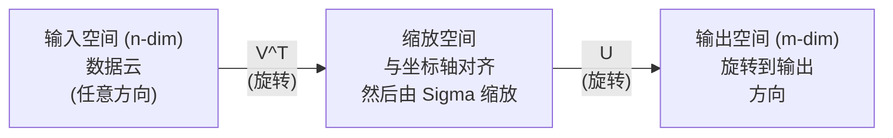
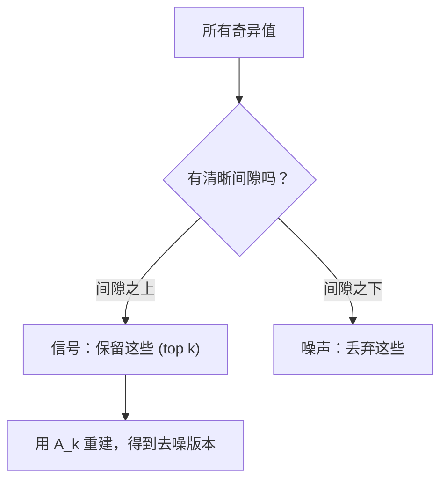

# Decompositividade de valores singulares

> O SVD é uma ferramenta de dados de base no número de dados.

**Type:** Build
**Languages:** Python, Julia
**Prerequisites:** Phase 1，Lessons 01 (Linear Algebra Intuition)、02 (Vectors & Matrices Operations)、03 (Matrix Transformations)
**Time:** ~120 minutes

## Objectivo de aprendizagem
- 通過電源代代代代代代代代代代代代代代代代代代代代代代代代代代代代代代代代代代代代代代代代代代代代代代代代代代代代代代代代代代代代代代代代代代代代代代代代代代代代代代代代代代代代代代代代代代代代代代代代代代代代代代代代代代代代代代代代代代代代代代代代代代代代代代代代代代代代代代代代代代代代代代代代代代代代代代代代代代代代代代代代代代代代代代代代代代代代代代代代代代代代代代代代代代代代代代代代代代代代代代代代代代代代代代代代代代代代代代代代代代代代代代代代代代代代代代代代代代代代代代代代代代代代代代代代代代代代代代代代代代代代代代代代代代代代代代代代代代代代代代代代代代代代代代代代代代代代代代代代代代代代代代代代代代代代代代代代代代代代代代代代代代代代代代代代代代代代代代代代代代代代代代代代代代代代代代代代代代代代代代代代代代代代代代代代代代代代代代代代代代代代代代代代代代代代代代代代代代代代代代代代代代代代代代代代代代代代代代代代代代代代代代代代代代代代代代代代代代代代代代代代代代代代代代代代代代代代代代代代代代代代代代代代代代代代代代代代代代代代代代代代代代代代代代代代代代代代代代代代代代代代代代代代代代$U$- Não.$\Sigma$和 $V^T$De geometria
-  aplicado SVD truncado  realizar compressão de imagem,并 medir a relação entre a taxa de compressão e o erro de reconstrução
-  através de SVD  calcular Moore-Penrose pseudoinverso, para buscar solução super-determinado mínimos-quadrados  sistema
- Para identificar os fatores latentes (LATENTS) e a análise semântica latente da PNL

## 问题
Você tem uma Matriz de 1000x2000. Pode ser um usuário-filme. Pode ser um documentário. Pode ser um valor de imagem. Você precisa comprimi-la, desviar o ruído, descobrir a estrutura oculta, ou usar-la para resolver um sistema de mínimos quadrados.

O SVD é aplicável a qualquer Matriz. Qualquer forma, qualquer grau, qualquer condição, qualquer limite. Ele divide a Matriz em três fatores, revelando que a Matriz é a mais comum, a mais útil, da fatorização de todo o número de elementos lineares.

## 概念
### SVD está fazendo o que faz

Cada Matriz, independentemente da forma, executará três operações em ordem: rotação, encolhimento, rotação.

```math
\underset{\substack{m \times n \\ \text{（任意形状）}}}{A} = \underset{\substack{m \times m \\ \text{（旋转）}}}{U} \cdot \underset{\substack{m \times n \\ \text{（缩放）}}}{\Sigma} \cdot \underset{\substack{n \times n \\ \text{（旋转）}}}{V^T}
```

给定任意 Matrix $A$,SVD irá descompô-lo em:
- $V^T$旋转输入空间 (transformação de espaço)$n$Vector em 维)
- $\Sigma$沿每个轴进行缩放 (拉伸或压缩)
- $U$O resultado vai virar para o espaço de saída.$m$维)



Pode-se perceber assim. Você entregou uma Matriz para a SVD.$V^T$旋转输入球体, então usar $\Sigma$E depois, depois, depois, depois, depois, depois, depois, depois, depois, depois, depois, depois, depois, depois, depois, depois, depois, depois, depois, depois, depois, depois, depois, depois, depois, depois, depois, depois, depois, depois, depois, depois, depois, depois, depois, depois, depois, depois, depois, depois, depois, depois, depois, depois, depois, depois, depois, depois, depois, depois, depois, depois, depois, depois, depois, depois, depois, depois, depois, depois, depois, depois, depois, depois, depois, depois, depois, depois, depois, depois, depois, depois, depois, depois, depois, depois, depois, depois, depois, depois, depois, depois, depois, depois, depois, depois, depois, depois, depois, depois, depois, depois, depois, depois, depois, depois, depois, depois, depois, depois, depois, depois, depois, depois, depois, depois, depois, depois, depois, depois, depois, depois, depois, depois de mais, de mais, depois, depois, de mais, de mais, depois, de mais, de mais, de mais, mais, mais, mais, mais, mais, mais, mais mais, mais mais mais, mais mais mais, mais mais mais mais, mais mais mais, mais mais mais mais mais mais mais mais mais, mais mais mais mais uma vez, mais uma.$U$O valor de rotação é a extensão de cada eixo da bola.

### A completa decomposição

对于形为 $m \times n$De Matrix $A$- Não .

```math
\begin{aligned}
& A = U \cdot \Sigma \cdot V^T \\[6pt]
& \text{其中：} \\
& \quad U \text{ 为 } m \times m, \text{，正交 } (U^T U = I) \\
& \quad \Sigma \text{ 为 } m \times n, \text{，对角矩阵（对角线为奇异值）} \\
& \quad V \text{ 为 } n \times n, \text{，正交 } (V^T V = I) \\[6pt]
& \text{奇异值 } \sigma_1 \ge \sigma_2 \ge \cdots \ge \sigma_r > 0 \\
& \text{其中 } r = \mathop{\mathrm{rank}}(A)
\end{aligned}
```

$U$É chamado de Vêctor de Curiosidade.$V$É chamado de Vêctor de Diferença Direita.$\Sigma$Os elementos de um canto são chamados de valores estranhos.

### Vêctores singulares de esquerda, valores singulares, vetores singulares de direita

Cada componente do SVD tem diferentes significados geográficos.

**Right singular vectors（$V$ 的列）：**它们为输入空间($\mathbb{R}^n$(a) constituem um conjunto de bases ortônormais. São direções no espaço de entrada, a matriz irá mapear essas direções para direções de saída.

**Singular values（$\Sigma$ 的对角线）：**Eles são factores de enfraquecimento. O primeiro valor de uma matriz é o segundo valor de uma matriz.

**Left singular vectors（$U$ 的列）：**Eles são para o espaço de saída.$\mathbb{R}^m$) constituir um conjunto de base ortônormal. O primeiro vetor esquerdário é o segundo vetor direito.

Relações entre elas:

```
A * v_i = sigma_i * u_i

Matrix A 接收第 i 个右奇异Vector v_i，
用 sigma_i 对其缩放，并将其映射到第 i 个左奇异Vector u_i。
```

Isso dá uma imagem de qualquer Matrix que faz o que faz.

### Forma de produto exterior

SVD pode ser escrito como grau-1 Matrix de:

```
A = sigma_1 * u_1 * v_1^T + sigma_2 * u_2 * v_2^T + ... + sigma_r * u_r * v_r^T

每一项 sigma_i * u_i * v_i^T 都是一个 rank-1 Matrix（一个 outer product）。
完整 Matrix 是 r 个这类 Matrix 的和，其中 r 是 rank。
```

Esta forma é a base da aproximação de baixo nível. Cada um deles adiciona uma estrutura de uma camada. O primeiro capta um modelo mais importante. O segundo capta um modelo mais importante.

```math
\begin{aligned}
\text{秩 1 近似：} \quad & A_1 = \sigma_1 u_1 v_1^T \\
& \text{（捕捉主导模式）} \\[6pt]
\text{秩 2 近似：} \quad & A_2 = \sigma_1 u_1 v_1^T + \sigma_2 u_2 v_2^T \\
& \text{（捕捉最重要的两个模式）} \\[6pt]
\text{秩 }k\text{ 近似：} \quad & A_k = \text{前 } k \text{ 项之和} \\
& \text{（由 Eckart-Young 定理可知最优）}
\end{aligned}
```

### Relação com a sua própria composição

A SVD e a sua própria composição têm uma profunda ligação.$A$O vector estranho e o estranho vêm diretamente de$A^T A$和 $A A^T$de valores próprios e de vetores próprios.

```
A^T A = V * Sigma^T * U^T * U * Sigma * V^T
      = V * Sigma^T * Sigma * V^T
      = V * D * V^T

其中 D = Sigma^T * Sigma 是一个对角 Matrix，其对角线上为 sigma_i^2。

因此：
- 右奇异Vector (V) 是 A^T A 的 eigenvectors
- 奇异值的平方 (sigma_i^2) 是 A^T A 的 eigenvalues

类似地：
A A^T = U * Sigma * V^T * V * Sigma^T * U^T
      = U * Sigma * Sigma^T * U^T

因此：
- 左奇异Vector (U) 是 A A^T 的 eigenvectors
- A A^T 的 eigenvalues 也都是 sigma_i^2
```

Este contacto diz-te três coisas:
1. 奇异值总是实数且非负 () 它们是正半确矩阵的自值的平方根) 
2. Podes passar por lá.$A^T A$Faça sua própria composição para calcular o SVD, mas este número de condição quadrada não perderá a precisão da quantidade.
3. - Não .$A$Se for de forma simétrica e positiva semi-definida, a SVD e a sua própria composição são a mesma coisa.

### SVD truncado: aproximação de baixo nível

O teorema de Eckart-Young-Mirsky mostra,$A$O melhor$\text{rank-}k$Próximo à norma de Frobenius e à norma espectral abaixo, só pode ser reservado o topo.$k$个奇异值及其对应 Vector 得到:

```math
\begin{aligned}
& A_k = U_k \cdot \Sigma_k \cdot V_k^T \\[6pt]
& \text{其中：} \\
& \quad U_k \text{ 为 } m \times k \quad \text{（前 } k \text{ 列，来自 } U\text{）} \\
& \quad \Sigma_k \text{ 为 } k \times k \quad \text{（左上角 } k \times k \text{ 子块，来自 } \Sigma\text{）} \\
& \quad V_k \text{ 为 } n \times k \quad \text{（前 } k \text{ 列，来自 } V\text{）} \\[6pt]
& \text{近似误差} = \sigma_{k+1} \quad \text{（谱范数下）} \\
& \text{近似误差} = \sqrt{\sigma_{k+1}^2 + \cdots + \sigma_r^2} \quad \text{（Frobenius 范数下）}
\end{aligned}
```

Não é apenas uma boa aproximação, é a melhor classificação.$k$Não há outro.$\text{rank-}k$Matrix 能更接近 $A$- Não.

| Component | Relative magnitude | Kept in rank-3 approx? |
|-----------|-------------------|------------------------|
| $\sigma_1$ | 最大 | 是 |
| $\sigma_2$ | 大 | 是 |
| $\sigma_3$ | 中等偏大 | 是 |
| $\sigma_4$ | 中等 | 否（误差） |
| $\sigma_5$ | 中等偏小 | 否（误差） |
| $\sigma_6$ | 小 | 否（误差） |
| $\sigma_7$ | 很小 | 否（误差） |
| $\sigma_8$ | 极小 | 否（误差） |

Mantém o top 3:$A_3$Capturar os três maiores valores estranhos.$\sigma_4$Até$\sigma_8$)。

Se o valor estranho diminuir rapidamente, um muito pequeno.$k$Se a decadência for lenta, a Matriz não terá uma estrutura de baixo nível.

### Utilize SVD  para fazer compressão de imagem

A imagem de cinza é uma matriz composta pela intensidade de imagem. Uma imagem de 800x600 tem 480.000 valores.

```
原始图像：800 x 600 = 480,000 个值

rank k 的 SVD：
  U_k:      800 x k 个值
  Sigma_k:  k 个值
  V_k:      600 x k 个值
  总计:     k * (800 + 600 + 1) = k * 1401 个值

  k=10:   14,010 个值   (原始的 2.9%)
  k=50:   70,050 个值  (原始的 14.6%)
  k=100: 140,100 个值  (原始的 29.2%)

  k 越小，压缩率越好，
  但视觉质量会下降。
```

关键洞察: O valor de uma imagem natural é muito menor. O valor de uma imagem natural é muito menor.

### SVD utiliza o sistema de

O Netflix Prize 让这个点广为人知──你有一个用户电影评分矩阵, a maioria dos artigos é ausente──

```
             Movie1  Movie2  Movie3  Movie4  Movie5
  User1      [  5      ?       3       ?       1  ]
  User2      [  ?      4       ?       2       ?  ]
  User3      [  3      ?       5       ?       ?  ]
  User4      [  ?      ?       ?       4       3  ]

  ? = 未知评分
```

核心思想:这个评分 矩阵 具有低级别──用户的品味不是完全独立──有几个隐藏因素──动作 vs.剧情、旧 vs.新、理性 vs.感官) 可以解释大多数偏好──

Para ((reempleno) de) avaliações Matrix fazer SVD, vai se descompõe em:
- $U$:latent factor space 中的用户配置文件
- $\Sigma$: importância de cada fator latente
- $V^T$:latent factor space 中的电影配置文件

O perfil do usuário é comparado com o produto do perfil do filme.

Na prática, você usará SVD incremental ou ALS de Simon Funk (alternando os mínimos quadrados) que podem tratar diretamente a falta de dados de variação.

### SVD:Análise Semântica Latente da PNL 中的SVD:Latent Semantic Analysis

Análise Semântica Latente (LSA), também chamada de Índice Semântico Latente (LSI), vai ser usado para o term-document Matrix.

```
             Doc1   Doc2   Doc3   Doc4
  "cat"      [  3      0      1      0  ]
  "dog"      [  2      0      0      1  ]
  "fish"     [  0      4      1      0  ]
  "pet"      [  1      1      1      1  ]
  "ocean"    [  0      3      0      0  ]

rank k=2 的 SVD 之后：

  每个文档变成 2D “概念空间”中的一个点。
  每个词项变成同一个 2D 空间中的一个点。
  主题相似的文档会聚在一起。
  含义相似的词项会聚在一起。

  "cat" 和 "dog" 最终会靠近彼此（陆地宠物）。
  "fish" 和 "ocean" 最终会靠近彼此（水相关概念）。
  如果 Doc1 和 Doc3 共享相似主题，它们会聚在一起。
```

A LSA é uma das primeiras formas de sucesso para capturar a semelhança entre palavras no texto original. É eficaz porque as semelhanças aparecem em documentos semelhantes, por isso a SVD as atribui às mesmas dimensões latentes.

### SVD para redução do ruído

Os dados de ruído geralmente concentram o sinal no valor de alto estrangeiro, enquanto o ruído é distribuído em todos os valores estrangeiros.

**干净信号的奇异值：**

| Component | Magnitude | Type |
|-----------|-----------|------|
| $\sigma_1$ | 非常大 | 信号 |
| $\sigma_2$ | 大 | 信号 |
| $\sigma_3$ | 中等 | 信号 |
| $\sigma_4$ | 接近零 | 可忽略 |
| $\sigma_5$ | 接近零 | 可忽略 |

**有噪声信号的奇异值（噪声会加到所有分量上）：**

| Component | Magnitude | Type |
|-----------|-----------|------|
| $\sigma_1$ | 非常大 | 信号 |
| $\sigma_2$ | 大 | 信号 |
| $\sigma_3$ | 中等 | 信号 |
| $\sigma_4$ | 小 | 噪声 |
| $\sigma_5$ | 小 | 噪声 |
| $\sigma_6$ | 小 | 噪声 |
| $\sigma_7$ | 小 | 噪声 |



Isto é usado para processamento de sinais, medição científica e limpeza de dados. Qualquer vez, desde que a sua matriz seja contaminada por ruído, o SVD truncado é um método de separação de ruído de confiança.

### Pseudoinversos através de SVD

Moore-Penrose pseudo-inversário $A^+$Para que a inversão da matriz se torne muito simples,

```
如果 A = U * Sigma * V^T，那么：

A+ = V * Sigma+ * U^T

其中 Sigma+ 的构造方式为：
  1. 转置 Sigma（交换行和列）
  2. 将每个非零对角元素 sigma_i 替换为 1/sigma_i
  3. 零保持为零

对于 A (m x n)：      A+ 是 (n x m)
对于 Sigma (m x n)：  Sigma+ 是 (n x m)
```

pseudoinverso pode ser solicitado para resolver os mínimos quadrados 问题──如果 $Ax = b$Não há uma solução, então...$x = A^+ b$É o menor número de quadrados.$\lVert Ax - b \rVert$)。

```
超定系统（方程数多于未知数）：

  [1  1]         [3]
  [2  1] x   =   [5]       不存在精确解。
  [3  1]         [6]

  x_ls = A+ b = V * Sigma+ * U^T * b

  这给出了使残差平方和最小的 x。
  结果与 normal equations (A^T A)^(-1) A^T b 相同，
  但数值上更稳定。
```

### Estabilidade numérica 优势

计算 $A^T A$De sua própria composição 会平方奇异值$A^T A$Os valores próprios são:$\sigma_i^2$O número de condição quadrada aumenta o número de erros de valor.

```
示例：
  A 的奇异值为 [1000, 1, 0.001]
  A 的 condition number：1000 / 0.001 = 10^6

  A^T A 的 eigenvalues 为 [10^6, 1, 10^{-6}]
  A^T A 的 condition number：10^6 / 10^{-6} = 10^{12}

  直接计算 SVD：使用 condition number 10^6
  通过 A^T A 计算：使用 condition number 10^{12}
                   （额外损失 6 位精度）
```

现代 SVD 算法(Golub-Kahan bi-diagonalização) diretamente em $A$上工作,从不构造 $A^T A$É por isso que deves sempre priorizar o uso.`np.linalg.svd(A)`- Não .`np.linalg.eig(A.T @ A)`- Não.

### Conexão ao PCA

O PCA é o SVD para dados centralizados. Não é um tipo de cálculo.

```
给定数据 Matrix X (n_samples x n_features)，已中心化（减去均值）：

Covariance Matrix: C = (1/(n-1)) * X^T X

PCA 寻找 C 的 eigenvectors。但：

  X = U * Sigma * V^T    (X 的 SVD)

  X^T X = V * Sigma^2 * V^T

  C = (1/(n-1)) * V * Sigma^2 * V^T

所以 principal components 恰好就是右奇异Vector V。
每个 component 的 explained variance 是 sigma_i^2 / (n-1)。

在 sklearn 中，PCA 使用 SVD 实现，而不是 eigendecomposition。
它更快，数值上也更稳定。
```

Isto significa que tudo o que você aprendeu na lição 10 sobre redução de dimensionalidade, o nível inferior é SVD;;PCA é a aplicação mais comum do SVD no ML;;


```figure
svd-rank-reconstruction
```

## Construí-lo
### 步骤 1: SVD a partir do zero usando iteração de potência

Pensamento: para encontrar o maior valor estranho e seu vetor, podemos$A^T A$(ou $A A^T$(MATRICS) e depois faz deflação,并重复寻找下一个奇异值──

```python
import numpy as np

def power_iteration(M, num_iters=100):
    n = M.shape[1]
    v = np.random.randn(n)
    v = v / np.linalg.norm(v)

    for _ in range(num_iters):
        Mv = M @ v
        v = Mv / np.linalg.norm(Mv)

    eigenvalue = v @ M @ v
    return eigenvalue, v

def svd_from_scratch(A, k=None):
    m, n = A.shape
    if k is None:
        k = min(m, n)

    sigmas = []
    us = []
    vs = []

    A_residual = A.copy().astype(float)

    for _ in range(k):
        AtA = A_residual.T @ A_residual
        eigenvalue, v = power_iteration(AtA, num_iters=200)

        if eigenvalue < 1e-10:
            break

        sigma = np.sqrt(eigenvalue)
        u = A_residual @ v / sigma

        sigmas.append(sigma)
        us.append(u)
        vs.append(v)

        A_residual = A_residual - sigma * np.outer(u, v)

    U = np.column_stack(us) if us else np.empty((m, 0))
    S = np.array(sigmas)
    V = np.column_stack(vs) if vs else np.empty((n, 0))

    return U, S, V
```

### 步骤 2: Teste e compare com NumPy

```python
np.random.seed(42)
A = np.random.randn(5, 4)

U_ours, S_ours, V_ours = svd_from_scratch(A)
U_np, S_np, Vt_np = np.linalg.svd(A, full_matrices=False)

print("Our singular values:", np.round(S_ours, 4))
print("NumPy singular values:", np.round(S_np, 4))

A_reconstructed = U_ours @ np.diag(S_ours) @ V_ours.T
print(f"Reconstruction error: {np.linalg.norm(A - A_reconstructed):.8f}")
```

### 步骤 3: Demo de compressão de imagem

```python
def compress_image_svd(image_matrix, k):
    U, S, Vt = np.linalg.svd(image_matrix, full_matrices=False)
    compressed = U[:, :k] @ np.diag(S[:k]) @ Vt[:k, :]
    return compressed

image = np.random.seed(42)
rows, cols = 200, 300
image = np.random.randn(rows, cols)

for k in [1, 5, 10, 20, 50]:
    compressed = compress_image_svd(image, k)
    error = np.linalg.norm(image - compressed) / np.linalg.norm(image)
    original_size = rows * cols
    compressed_size = k * (rows + cols + 1)
    ratio = compressed_size / original_size
    print(f"k={k:>3d}  error={error:.4f}  storage={ratio:.1%}")
```

### 步骤 4: Redução de ruído

```python
np.random.seed(42)
clean = np.outer(np.sin(np.linspace(0, 4*np.pi, 100)),
                 np.cos(np.linspace(0, 2*np.pi, 80)))
noise = 0.3 * np.random.randn(100, 80)
noisy = clean + noise

U, S, Vt = np.linalg.svd(noisy, full_matrices=False)
denoised = U[:, :5] @ np.diag(S[:5]) @ Vt[:5, :]

print(f"Noisy error:    {np.linalg.norm(noisy - clean):.4f}")
print(f"Denoised error: {np.linalg.norm(denoised - clean):.4f}")
print(f"Improvement:    {(1 - np.linalg.norm(denoised - clean) / np.linalg.norm(noisy - clean)):.1%}")
```

### 步骤 5: Pseudoinverso

```python
A = np.array([[1, 1], [2, 1], [3, 1]], dtype=float)
b = np.array([3, 5, 6], dtype=float)

U, S, Vt = np.linalg.svd(A, full_matrices=False)
S_inv = np.diag(1.0 / S)
A_pinv = Vt.T @ S_inv @ U.T

x_svd = A_pinv @ b
x_lstsq = np.linalg.lstsq(A, b, rcond=None)[0]
x_pinv = np.linalg.pinv(A) @ b

print(f"SVD pseudoinverse solution:  {x_svd}")
print(f"np.linalg.lstsq solution:   {x_lstsq}")
print(f"np.linalg.pinv solution:    {x_pinv}")
```

## Use-o
完整可运行 Demo 位于 `code/svd.py` Operar pode ver SVD 应用于图像压缩、推系统、latent semantic analysis 和噪音降低──

```bash
python svd.py
```

`code/svd.jl`中的Julia 版本使用Julia Origins `svd()`函数和  função`LinearAlgebra`O pacote 演示相同概念──

```bash
julia svd.jl
```

## Entrega-o
本课会产出:
- `outputs/skill-svd.md`- uma habilidade para entender quando e como aplicar o SVD em projetos reais

## 练习
1. Desde zero realizar SVD completo, não usar iteração de potência.$A^T A$A composição própria para obter$V$E depois, calcula-se.$U = A V \Sigma^{-1}$△将数值精度与你的功率反复 版本以及 NumPy 进行比较──

2. Carregar uma imagem de graça real (ou transformar uma imagem em graça) ⋅ em 1⁄5, 10⁄2, 25⁄5, 50⁄100 ⋅ em cada posição, calcular a taxa de compressão e os erros relativos ⋅ encontrar uma imagem que se torne aceitável na visão ⋅

3. Construir um sistema de recomendação de tipo pequeno. Criar uma Matriz de avaliação de usuários de filmes de 10×8, que contém algumas informações conhecidas. Criar um sistema de avaliação de filmes de vídeo de 10×8, que contém algumas informações conhecidas. Criar um sistema de avaliação de filmes de vídeo de 10×8, que contém algumas informações conhecidas. Criar um sistema de avaliação de filmes de vídeo de 10×8, que contém algumas informações conhecidas. Criar um sistema de avaliação de filmes de vídeo de 10×8, que contém algumas informações conhecidas. Criar um sistema de avaliação de filmes de vídeo de 10×8, que contém algumas informações conhecidas. Criar um sistema de avaliação de filmes de vídeo de 10×8, que contém um sistema de avaliação de imagens de vídeo de 10×8, que contém um sistema de avaliação de imagens de vídeo de 10×8, que contém um sistema de avaliação de imagens de imagens de vídeo de vídeo de 10×8, que contém um sistema de avaliação de imagens de imagens de imagens de imagens de imagens de imagens de imagens de imagens de imagens de imagens de imagens de imagens de imagens de imagens de imagens de imagens de imagens de imagens de imagens de imagens de imagens de imagens de imagens de imagens de imagens de imagens de imagens de imagens de imagens de imagens de imagens de imagens de imagens de imagens de imagens de imagens de imagens de imagens de imagens de imagens de imagens de imagens de imagens de imagens de imagens de imagens de imagens de imagens de imagens de imagens de imagens de imagens de imagens de imagens de imagens de imagens de imagens de imagens de imagens de imagens de imagens de imagens de imagens de imagens de imagens de imagens de imagens de imagens de imagens de imagens de imagens de imagens de imagens de imagens de imagens de imagens de imagens de imagens de imagens de imagens de imagens de imagens de imagens de imagens de imagens de imagens de imagens

4.                                                                                                                                                                                                                                                                                                                                                                                                                                                                                                                              

5. 生成一个干净的低级矩阵(rank 3,大小 50x40), e em diferentes níveis abaixo adicionar ruído gaussiano($\sigma$= 0,1 ̊ 0,5 ̊ 1,0 ̊ 2,0) ̊ para cada nível de ruído, através de $k$=1 a 40 扫描并测量对干净矩阵的重建错误,找到最优截断排名──绘制最优$k$Como o nível do ruído varia?

### 提示

**练习 1。**计算 $A^T A$, usá-lo`np.linalg.eigh` get its characteristic value and characteristic value,并按特征值降排列──奇异值是特征值的平方根;检查 $U \Sigma V^T$能重构 $A$,并将误差与 `svd_from_scratch`和 `np.linalg.svd`Comparar.

**练习 2。**Para cada categoria`truncated_svd`, usá-lo`reconstruct`Gravamento de imagens, us `compression_ratio(m, n, k)`計算大小──相对差差必须随着等级 增长而下降; primeiro não parece sair de um bloqueo obvio de erro de ranking é a resposta──

**练习 3。**标记缺失单元格, 填充, 再使用 `truncated_svd`和 `reconstruct`Gravamento de classificação 3 近似──随后衡量结果:统计超出评分范围的预测数量,并印印已知单元格中最大变化──rango 3 近似不保证这两性质,因此, se for necessário uma avaliação legal, deve cortar a previsão para a categoria de avaliação──

**练习 4。**Para cada tema, distribuir 5 blocos de palavras, que o arquivo do tema tenha um maior número de palavras, reincorporando uma pequena quantidade de ruído.

**练习 5。**Se você está usando uma matriz de 50x3 e uma matriz de 3x40, obtém uma matriz de cada um.$\sigma$加入噪声──对每个 $k$, Comparar com o rank $k$Gravamento e produção de águas residuais; pré-espectos de baixa ruído$k$接近3,高噪声时更小──

## 关键术语
| Term | What people say | What it actually means |
|------|----------------|----------------------|
| SVD | “Factor 任意 Matrix” | 将 $A$ 分解为 $U \Sigma V^T$，其中 $U$ 和 $V$ 是正交的，$\Sigma$ 是具有非负元素的对角 Matrix。适用于任意形状的任意 Matrix。 |
| Singular value | “这个 component 有多重要” | $\Sigma$ 的第 $i$ 个对角元素。衡量 Matrix 沿第 $i$ 个 principal direction 拉伸的程度。总是非负，并按降序排列。 |
| Left singular vector | “输出方向” | $U$ 的一列。第 $i$ 个右奇异Vector 经过 $\sigma_i$ 缩放后映射到的输出空间方向。 |
| Right singular vector | “输入方向” | $V$ 的一列。输入空间中的一个方向，Matrix 会将其映射到第 $i$ 个左奇异Vector（经过 $\sigma_i$ 缩放后）。 |
| Truncated SVD | “Low-rank approximation” | 只保留 top $k$ 个奇异值及其 Vector。生成原始 Matrix 的可证明最佳 $\text{rank-}k$ 近似（Eckart-Young theorem）。 |
| Rank | “真实维度” | 非零奇异值的数量。告诉你 Matrix 实际使用了多少个独立方向。 |
| Pseudoinverse | “广义逆” | $V \Sigma^+ U^T$。对非零奇异值取倒数，零保持为零。为非方阵或奇异 Matrix 求解 least-squares 问题。 |
| Condition number | “对误差有多敏感” | $\sigma_{\max} / \sigma_{\min}$。大的 condition number 意味着很小的输入变化会造成很大的输出变化。SVD 直接揭示这一点。 |
| Latent factor | “隐藏变量” | SVD 发现的 low-rank space 中的一个维度。在推荐中，latent factor 可能对应类型偏好。在 NLP 中，它可能对应一个主题。 |
| Frobenius norm | “Matrix 的总大小” | 所有元素平方和的平方根。等于所有奇异值平方和的平方根。用于衡量近似误差。 |
| Eckart-Young theorem | “SVD 给出最佳压缩” | 对任意目标 rank $k$，truncated SVD 会在所有可能的 $\text{rank-}k$ Matrix 中最小化近似误差。 |
| Power iteration | “找到最大的 eigenvector” | 反复用 Matrix 乘以一个随机 Vector 并归一化。会收敛到具有最大 eigenvalue 的 eigenvector。它是许多 SVD 算法的构建模块。 |

## 延伸阅读
- [Gilbert Strang: Linear Algebra and Its Applications, Chapter 7](https://math.mit.edu/~gs/linearalgebra/)- A análise aprofundada das SVD e da sua aplicação
- [3Blue1Brown: But what is the SVD?](https://www.youtube.com/watch?v=vSczTbgc8Rc)- O SVD
- [We Recommend a Singular Value Decomposition](https://www.ams.org/publicoutreach/feature-column/fcarc-svd)- Sociedade Americana de Matemática  fornecido fácil compreensão
- [Netflix Prize and Matrix Factorization](https://sifter.org/~simon/journal/20061211.html)- Simon Funk  Sobre o SVD Usado para o Sugerir
- [Latent Semantic Analysis](https://en.wikipedia.org/wiki/Latent_semantic_analysis)- SVD em aplicações iniciais na PNL
- [Numerical Linear Algebra by Trefethen and Bau](https://people.maths.ox.ac.uk/trefethen/text.html)- compreender o algoritmo SVD e a sua natureza numérica
