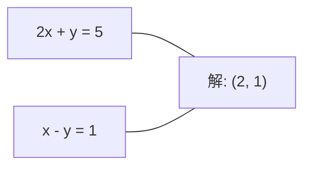
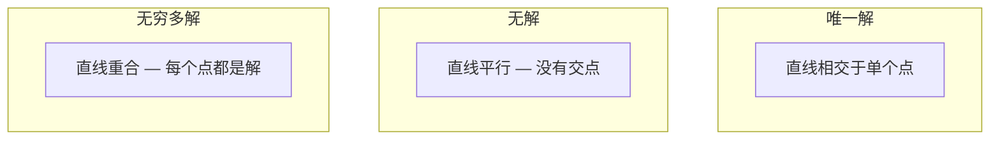

# Sistemas Lineares

> - Não .$Ax = b$É um dos problemas mais antigos da matemática, e ainda funciona na sua rede neural.

**Type:** Build
**Language:**Python
**前置要求：**Fase 1,Lessões 01 (Intuição de álgebra linear),02 (Vectores e matrizes),03 (Transformações de matriz)
**Time:** ~120 minutes

## Objectivo de aprendizagem
- Utilização de rotação parcial e substituição de volta de eliminação gaussiana 求解 $Ax = b$
- Utilize LU、QR 和 Cholesky decomposições 分解 Matrix,并解释每种方法适用场景
- 推导 menor quadrado de equações normais,并将其与线性回归和脊回归 联系起来
- Utilize condição número  diagnóstico de sistemas mal condicionados,并 aplicar regularização 使其稳定

## 问题
Cada vez que você treina regressão linear, você está procurando resolver um sistema linear.`y = Wx + b`Quando você está a modificar este sistema, você está a tentar resolver um sistema linear, usando processos gaussianos.

- Não .$Ax = b$Não há onde ir.$A$É uma matriz de números já conhecidos.$b$É um vetor de produção já conhecido.$x$É o que queres encontrar no vector de quantidade desconhecida.$A$É a sua matriz de dados,$b$É o seu vector-alvo,$x$É um vetor de peso. Todo o modelo pode ser concluído em: encontrar.$x$,使 $Ax$尽可能接近 $b$- Não.

Esta aula irá resolver todas as principais formas de construir a partir de zero. Você entenderá por que alguns métodos são mais rápidos e outros mais estáveis, por que alguns métodos são apenas aplicáveis a sistemas quadrados e outros podem lidar com sistemas sobredeterminados, bem como por que o número de condições da Matriz decide se sua resposta tem significado.

## 概念
### Ax = b = b = b = b = b = b = b = b = b = b = b = b = b = b = b = b = b = b = b = b = b = b = b = b = b = b = b = b = b = b = b = b = b = b = b = b = b = b = b = b = b = b = b = b = b = b = b = b = b = b = b = b = b = b = b = b = b = b = b = b = b = b = b = b = b = b = b = b = b = b = b = b = b = b = b = b = b = b = b = b = b = b = b = b = b = b = b = b = b = b = b = b = b = b = b = b = b = b = b = b = b = b = b = b = b = b = b = b = b = b = b = b = b = b = b = b = b = b = b = b = b = b = b = b = b = b = b = b = b = b = b = b = b = b = b = b = b = b = b = b = b = b = b = b = b = b = b = b = b = b = b = d = d = d = d = d = d = d = d = d = d = d = d = d = d = d = d = d = d = d = d = d = d = d = d = d = d = d = d = d = d = d = d = d = d = d = d = d = d = d = d = d = d = d = d = d = d = d = d = d = d = d = d = d = d = d = d = d = d = d = d = d = d = d = d = d = d = d = d d = d = d = d = d = d d = d = d = d = d = d = d d d d = d = d d d d = d = d = d = d = d d d d = d = d d d d d = d d d d = d = d d d d d = d d

Um sistema de equações lineares 具有几何解释── cada equação 定义一个超平面──解就是所有超平面相交的点(或点集)──

```
2x + y = 5          2D 中的两条直线。
x - y  = 1          它们相交于 x=2, y=1。
```



Podem surgir três situações:



Em matriz, "uma solução" significa$A$é invertível. Não há solução. Sistema é inconsistente.$A$tem um espaço zero. A maioria dos problemas da ML pertence a classes sem definição, porque as suas equações (pontos de dados) são maiores do que os parâmetros desconhecidos.

### imagem de coluna vs imagem de linha

Há duas maneiras de entender.$Ax = b$- Não.

**Row picture.** $A$Cada linha define uma equação. Cada equação é um hiperplano.

**Column picture.** $A$Cada linha é um vetor.$A$Qual combinação linear das colunas pode ser produzida ?$b$- Não .

```
A = | 2  1 |    b = | 5 |
    | 1 -1 |        | 1 |

Row picture: 同时求解 2x + y = 5 和 x - y = 1。

Column picture: 找到 x1, x2，使得：
  x1 * [2, 1] + x2 * [1, -1] = [5, 1]
  2 * [2, 1] + 1 * [1, -1] = [4+1, 2-1] = [5, 1]   check.
```

Imagens de coluna 更根本──如果 $b$                                                                                                                                                                                                                                                                                                                                                                                                                                                                                                                             $A$No espaço de coluna, o sistema está disponível.$b$Não entre eles, você encontra espaço coluna no centro do ponto mais próximo. Este ponto mais próximo é a solução de menor quadrado.

### Eliminação gaussiana

A eliminação gaussiana$Ax = b$转换为 sistema triangular superior $Ux = c$E depois, com a substituição de volta, procura uma solução. É o método mais direto.

- Não .

```
1. 对每一列 k（pivot column）：
   a. 在第 k 行及其下方，找到 column k 中最大的 entry（partial pivoting）。
   b. 将该行与第 k 行交换。
   c. 对 k 下方的每一行 i：
      - 计算 multiplier m = A[i][k] / A[k][k]
      - 从第 i 行中减去 m 倍的第 k 行。
2. Back substitute：从最后一个 equation 向上求解。
```

exemplo:

```
Original:
| 2  1  1 | 8 |       R2 = R2 - (2)R1     | 2  1   1 |  8 |
| 4  3  3 |20 |  -->  R3 = R3 - (1)R1 --> | 0  1   1 |  4 |
| 2  3  1 |12 |                            | 0  2   0 |  4 |

                       R3 = R3 - (2)R2     | 2  1   1 |  8 |
                                       --> | 0  1   1 |  4 |
                                           | 0  0  -2 | -4 |

Back substitute:
  -2 * x3 = -4    -->  x3 = 2
  x2 + 2  = 4     -->  x2 = 2
  2*x1 + 2 + 2 = 8 --> x1 = 2
```

O custo de cálculo da eliminação gaussiana é$O(n^3)$ $1000 \times 1000$Sistema, isto é cerca de um bilhão de vezes operações de ponto flutuante. É rápido, mas se você precisar usar o mesmo.$A$- Não. - Não, não.

### Pivagem parcial: Por que é importante

 sem pivô, eliminação gaussiana pode falhar ou produzir resultados de lixo

```
Bad pivot:                       With partial pivoting:
| 0.001  1 | 1.001 |            先交换行：
| 1      1 | 2     |            | 1      1 | 2     |
                                 | 0.001  1 | 1.001 |
m = 1/0.001 = 1000              m = 0.001/1 = 0.001
R2 = R2 - 1000*R1               R2 = R2 - 0.001*R1
| 0.001  1     | 1.001   |      | 1      1     | 2     |
| 0     -999   | -999.0  |      | 0      0.999 | 0.999 |

x2 = 1.000（正确）              x2 = 1.000（正确）
x1 = (1.001 - 1)/0.001          x1 = (2 - 1)/1 = 1.000（正确）
   = 0.001/0.001 = 1.000        稳定，因为 multiplier 很小。
```

Em precisão limitada de aritmética de pontos flutuantes, a versão não pivotada pode perder dígitos significativos.

### Descomposição de LU

LU decomposição $A$分解为 menor matriz triangular $L$和 matriz triangular superior $U$- Não .$A = LU$- Não.$L$Matriz  armazenamento de eliminação gaussiana 中的乘法──$U$A Matriz é o resultado da eliminação.

```
A = L @ U

| 2  1  1 |   | 1  0  0 |   | 2  1   1 |
| 4  3  3 | = | 2  1  0 | @ | 0  1   1 |
| 2  3  1 |   | 1  2  1 |   | 0  0  -2 |
```

Porque é que é um fator e não uma eliminação direta?$L$和 $U$, para qualquer novo .$b$- Não .$Ax = b$Só preciso.$O(n^2)$- Não .

```math
\begin{aligned}
Ax &= b \\
LUx &= b \\
&\text{令 } y = Ux\text{:} \\
Ly &= b \quad \text{（前代，} O(n^2)\text{）} \\
Ux &= y \quad \text{（回代，} O(n^2)\text{）}
\end{aligned}
```

$O(n^3)$O custo só é pago uma vez na factorização.$O(n^2)$Se precisar de usar o mesmo.$A$Diferentes.$b$Vectores Procura resolver 1000 sistemas, LU 会让总工作量节省约1000/3 倍.

Usando rotação parcial, você obtém.$PA = LU$, entre os $P$É registar matriz de permutação de swaps de filas.

### Descomposição QR

A decomposição do QR$A$分解为 matriz ortogonais $Q$和 matriz triangular superior $R$- Não .$A = QR$- Não.

Matriz ortogonal 具有 $Q^T Q = I$Sua natureza. Suas colunas são vetores ortônormais.$Q$会保持 lengths 和 angles。

```
A = Q @ R

Q has orthonormal columns: Q^T Q = I
R is upper triangular

To solve Ax = b:
  QRx = b
  Rx = Q^T b    (只需乘以 Q^T，不需要 inversion)
  Back substitute to get x.
```

Em busca de solução de problemas de mínimos quadrados 时,QR比 LU em estabilidade numérica 上更好──Gram-Schmidt processo 逐列构建 $Q$- Não .

```
Given columns a1, a2, ... of A:

q1 = a1 / ||a1||

q2 = a2 - (a2 . q1) * q1        (减去到 q1 上的 projection)
q2 = q2 / ||q2||                (normalize)

q3 = a3 - (a3 . q1) * q1 - (a3 . q2) * q2
q3 = q3 / ||q3||

R[i][j] = qi . aj    for i <= j
```

Cada passo vai ser deslocado para o outro lado.$q$Componente de vetores, apenas deixe uma nova direção ortogonais.

### Cholesky decomposição

- Não .$A$É simétrico.$A = A^T$) e positivo definido (((todos os valores próprios são por causa) quando você pode descompondo em$A = L L^T$, entre os $L$É triangular inferior. É a decomposição de Cholesky.

```
A = L @ L^T

| 4  2 |   | 2  0 |   | 2  1 |
| 2  5 | = | 1  2 | @ | 0  2 |

L[i][i] = sqrt(A[i][i] - sum(L[i][k]^2 for k < i))
L[i][j] = (A[i][j] - sum(L[i][k]*L[j][k] for k < j)) / L[j][j]    for i > j
```

Cholesky 快两倍比 LU, e só precisa de metade do espaço de armazenamento. É apenas aplicável a matrizes simétricas positivas definidas, mas esse tipo de Matriz aparece frequentemente:

- Matriz de covariância é semi-definida simétrica positiva através da regularização 可变为 positiva definida)
- A matriz do núcleo de processos gaussianos é definida simétrica positiva.
- Função convexa em mínimos de Hessian é simétrica positiva definida.
- $A^T A$总是对称正面半确式──

Em processos gaussianos, você usa Cholesky para resolver a matriz do núcleo.$K$, e depois , procurando solução .$K \alpha = y$Para obter uma média preditiva, o fator Cholesky também dá um log-determinante de probabilidade marginal:$\log \det(K) = 2 \sum \log(\mathop{\mathrm{diag}}(L))$- Não.

### Quadrados mínimos:当 Ax = b 没有精确解时

Se $A$Sim $m \times n$且 $m > n$(equações 多于未知), sistema é sobredeterminado.

```
minimize ||Ax - b||^2

这是 squared residuals 的总和：
  sum((A[i,:] @ x - b[i])^2 for i in range(m))
```

Minimizar 满足 equações normais:

```math
A^T A x = A^T b
```

推导:展开 $\lVert Ax - b \rVert^2 = (Ax - b)^T (Ax - b) = x^T A^T A x - 2 x^T A^T b + b^T b$- Não.$x$求 Gradiente,并令其为零:$2 A^T A x - 2 A^T b = 0$- Não.

```
Original system (overdetermined, 4 equations, 2 unknowns):
| 1  1 |         | 3 |
| 1  2 | x     = | 5 |       没有精确的 x 能满足全部 4 个 equations。
| 1  3 |         | 6 |
| 1  4 |         | 8 |

Normal equations:
A^T A = | 4  10 |    A^T b = | 22 |
        | 10 30 |            | 63 |

Solve: x = [1.5, 1.7]

这就是 linear regression。x[0] 是 intercept，x[1] 是 slope。
```

### Equações normais = regressão linear

Esta ligação é precisa. Na regressão linear, matriz de dados.$X$Cada linha se refere a uma amostra, cada linha se refere a uma característica, o vetor-alvo.$y$Cada entrada é feita em função de um vetor de peso.$w$满足:

```math
\begin{aligned}
X^T X w &= X^T y \\
w &= (X^T X)^{-1} X^T y
\end{aligned}
```

É a solução fechada da regressão linear.`sklearn.linear_model.LinearRegression.fit()`cidade calcular este resultado ((( ou através de QR ou SVD  calcular resultados de igual preço)

À Matrix 添加 regularisation term $\lambda I$- Tens regressão de cordilheira.

```math
\begin{aligned}
(X^T X + \lambda I) w &= X^T y \\
w &= (X^T X + \lambda I)^{-1} X^T y
\end{aligned}
```

A regularização vai fazer com que a matriz esteja condicionada melhor (mais fácil de obter a inversão), e através de pesos em direção a zero para evitar o excesso de encaixe.$\lambda > 0$时,Matrix $X^T X + \lambda I$总是对称正确, portanto, pode ser usado para buscar solução Cholesky.

### Pseudoinversos (Moore-Penrose)

Pseudo-inversário $A^+$Para qualquer Matriz, a inversão de matriz é proporcional à inversão de matriz.$A$- Não .

```math
\begin{aligned}
x &= A^+ b \\[4pt]
\text{其中 } A^+ &= V \Sigma^+ U^T \quad \text{（通过 SVD 计算）}
\end{aligned}
```

$\Sigma^+$通过对每个非零单数值 取相互并转置结果构成──如果 $A = U \Sigma V^T$- Então ?$A^+ = V \Sigma^+ U^T$- Não.

```
A = U Sigma V^T        (SVD)

Sigma = | 5  0 |       Sigma+ = | 1/5  0  0 |
        | 0  2 |                | 0  1/2  0 |
        | 0  0 |

A+ = V Sigma+ U^T
```

Pseudoinversos                                                                                                                                                                                                                                                                                                                                                                                                                                                                                                                         
- 唯一解:$A^+ b$- Dá-me a solução.
- Não .$A^+ b$给出最小平方的解决方案──
- Não há problema .$A^+ b$- Dá-me .$\lVert x \rVert$A última solução.

NumPy `np.linalg.lstsq`和 `np.linalg.pinv`内部都使用 SVD。

### Número de condição

Número de condição  Messa solução para pequenas variações de entrada                                                                                                                                                                                                                                                                                                                                                                                                                                                                                                              $A$, Número de condição é:

```math
\kappa(A) = \lVert A \rVert \cdot \lVert A^{-1} \rVert = \frac{\sigma_{\max}}{\sigma_{\min}}
```

Entre eles $\sigma_{\max}$和 $\sigma_{\min}$分别是最大和最小单数值──

```
Well-conditioned (kappa ~ 1):        Ill-conditioned (kappa ~ 10^15):
b 中的小变化 -->                    b 中的小变化 -->
x 中的小变化                         x 中的巨大变化

| 2  0 |   kappa = 2/1 = 2          | 1   1          |   kappa ~ 10^15
| 0  1 |   safe to solve            | 1   1+10^(-15) |   solution is garbage
```

经验法则:
- $\kappa < 100$A solução é:
- $\kappa \approx 10^k$A matemática do ponto flutuante está perdida.$k$- É um bom momento.
- $\kappa \approx 10^{16}$(Para float64):solução 没有意义──matrix 实际上是单一──

Em ML, mal-condicionamento ocorre em características quase colineares.$\lambda I$) vai ser o número de condição de $\sigma_{\max} / \sigma_{\min}$ melhorar $(\sigma_{\max} + \lambda) / (\sigma_{\min} + \lambda)$- Não.

### Métodos iterativos: gradiente conjugado

Para sistemas muito grandes e raros (((milhões de desconhecidos), métodos diretos como LU ou Cholesky, os métodos iterativos vão passar por várias vezes para melhorar uma suposição para uma solução próxima―.

Gradiente de conjugação (CG) $A$É simétrico positivo definido 时求解 $Ax = b$É uma matemática exacta.$n$Depois, encontramos uma solução, mas se...$A$Os valores próprios   reunir, normalmente                                                                                                                                                                                                                                                                                                                                                                                                                                                                                                                      

```
Algorithm sketch:
  x0 = initial guess (often zero)
  r0 = b - A x0           (residual)
  p0 = r0                 (search direction)

  For k = 0, 1, 2, ...:
    alpha = (rk . rk) / (pk . A pk)
    x_{k+1} = xk + alpha * pk
    r_{k+1} = rk - alpha * A pk
    beta = (r_{k+1} . r_{k+1}) / (rk . rk)
    p_{k+1} = r_{k+1} + beta * pk
    if ||r_{k+1}|| < tolerance: stop
```

CG Usado para:
- Optimização em larga escala (método Newton-CG)
- 求解 Discretizations de PDE
- Métodos do núcleo, entre os quais a matriz do núcleo 太大无法因子
- Como outros solventes iterativos de pré-condicionamento

A taxa de convergência depende do número de condições. A condição de sistemas melhores é mais rápida.

### O quadro completo:何时使用哪种方法

| Method | Requirements | Cost | Use case |
|--------|-------------|------|----------|
| Gaussian elimination | Square, nonsingular $A$ | $O(n^3)$ | 对 square system 的一次性求解 |
| LU decomposition | Square, nonsingular $A$ | $O(n^3)$ factor + $O(n^2)$ solve | 使用相同 $A$ 的多次求解 |
| QR decomposition | Any $A$ ($m \ge n$) | $O(mn^2)$ | Least squares，numerically stable |
| Cholesky | Symmetric positive definite $A$ | $O(n^3/3)$ | Covariance matrices，Gaussian processes，ridge regression |
| Normal equations | Overdetermined ($m > n$) | $O(mn^2 + n^3)$ | Linear regression（小 $n$） |
| SVD / pseudoinverse | Any $A$ | $O(mn^2)$ | Rank-deficient systems，minimum-norm solutions |
| Conjugate gradient | Symmetric positive definite, sparse $A$ | $O(n \cdot k \cdot \text{nnz})$ | Large sparse systems，$k$ = iterations |

### Conexão com a ML

Cada método desta aula aparece na classe ML de produção:

**Linear regression.**Solução de forma fechada 求解 equações normais $X^T X w = X^T y$Isto pode ser feito por Cholesky se...$n$很小) 、QR(se estabilidade numérica 很重要) 或 SVD(se Matrix 可能级-deficient)完成──

**Ridge regression.**Para o$X^T X$添加 $\lambda I$ Sistema regularizado $(X^T X + \lambda I) w = X^T y$- Não, não. - Não, não.$\lambda > 0$时,$X^T X + \lambda I$É simétrica positiva definida.

**Gaussian processes.**Medida preditiva 需要求解 $K \alpha = y$, entre os $K$É a matriz do núcleo.$K$Factorizar Cholesky é um método padrão. Log marginal probabilidade.$\log \det(K) = 2 \sum \log(\mathop{\mathrm{diag}}(L))$- Não.

**Neural network initialization.**Inicialização ortogonais Utilize decomposição QR  Crie colunas para matrizes de peso ortônormais  Isso pode prevenir o colapso do sinal de redes profundas 

**Preconditioning.**Optimizadores de grande escala Usar Cholesky incompleto ou LU incompleto como pré-condições de solventes de gradiente conjugado。

**Feature engineering.** $X^T X$Número de condição  diz-te características 否结线──如果$\kappa$很大, eliminar recursos ou adicionar regularização.


```figure
linear-system-conditioning
```

## Construí-lo
### 步骤 1: Eliminação gaussiana com rotação parcial

```python
import numpy as np

def gaussian_elimination(A, b):
    n = len(b)
    Ab = np.hstack([A.astype(float), b.reshape(-1, 1).astype(float)])

    for k in range(n):
        max_row = k + np.argmax(np.abs(Ab[k:, k]))
        Ab[[k, max_row]] = Ab[[max_row, k]]

        if abs(Ab[k, k]) < 1e-12:
            raise ValueError(f"Matrix is singular or nearly singular at pivot {k}")

        for i in range(k + 1, n):
            m = Ab[i, k] / Ab[k, k]
            Ab[i, k:] -= m * Ab[k, k:]

    x = np.zeros(n)
    for i in range(n - 1, -1, -1):
        x[i] = (Ab[i, -1] - Ab[i, i+1:n] @ x[i+1:n]) / Ab[i, i]

    return x
```

### 步骤 2: decomposição da LU

```python
def lu_decompose(A):
    n = A.shape[0]
    L = np.eye(n)
    U = A.astype(float).copy()
    P = np.eye(n)

    for k in range(n):
        max_row = k + np.argmax(np.abs(U[k:, k]))
        if max_row != k:
            U[[k, max_row]] = U[[max_row, k]]
            P[[k, max_row]] = P[[max_row, k]]
            if k > 0:
                L[[k, max_row], :k] = L[[max_row, k], :k]

        for i in range(k + 1, n):
            L[i, k] = U[i, k] / U[k, k]
            U[i, k:] -= L[i, k] * U[k, k:]

    return P, L, U

def lu_solve(P, L, U, b):
    n = len(b)
    Pb = P @ b.astype(float)

    y = np.zeros(n)
    for i in range(n):
        y[i] = Pb[i] - L[i, :i] @ y[:i]

    x = np.zeros(n)
    for i in range(n - 1, -1, -1):
        x[i] = (y[i] - U[i, i+1:] @ x[i+1:]) / U[i, i]

    return x
```

### 步骤 3: Decomposição de Cholesky

```python
def cholesky(A):
    n = A.shape[0]
    L = np.zeros_like(A, dtype=float)

    for i in range(n):
        for j in range(i + 1):
            s = A[i, j] - L[i, :j] @ L[j, :j]
            if i == j:
                if s <= 0:
                    raise ValueError("Matrix is not positive definite")
                L[i, j] = np.sqrt(s)
            else:
                L[i, j] = s / L[j, j]

    return L
```

### 步骤 4: Quadrados mínimos através de equações normais

```python
def least_squares_normal(A, b):
    AtA = A.T @ A
    Atb = A.T @ b
    return gaussian_elimination(AtA, Atb)

def ridge_regression(A, b, lam):
    n = A.shape[1]
    AtA = A.T @ A + lam * np.eye(n)
    Atb = A.T @ b
    L = cholesky(AtA)
    y = np.zeros(n)
    for i in range(n):
        y[i] = (Atb[i] - L[i, :i] @ y[:i]) / L[i, i]
    x = np.zeros(n)
    for i in range(n - 1, -1, -1):
        x[i] = (y[i] - L.T[i, i+1:] @ x[i+1:]) / L.T[i, i]
    return x
```

### 步骤 5: Número de condição

```python
def condition_number(A):
    U, S, Vt = np.linalg.svd(A)
    return S[0] / S[-1]
```

## Use-o
Para combinar estas partes, em dados reais, realizar regressão linear e regressão de cresta:

```python
np.random.seed(42)
X_raw = np.random.randn(100, 3)
w_true = np.array([2.0, -1.0, 0.5])
y = X_raw @ w_true + np.random.randn(100) * 0.1

X = np.column_stack([np.ones(100), X_raw])

w_ols = least_squares_normal(X, y)
print(f"OLS weights (ours):    {w_ols}")

w_np = np.linalg.lstsq(X, y, rcond=None)[0]
print(f"OLS weights (numpy):   {w_np}")
print(f"Max difference: {np.max(np.abs(w_ols - w_np)):.2e}")

w_ridge = ridge_regression(X, y, lam=1.0)
print(f"Ridge weights (ours):  {w_ridge}")

from sklearn.linear_model import Ridge
ridge_sk = Ridge(alpha=1.0, fit_intercept=False)
ridge_sk.fit(X, y)
print(f"Ridge weights (sklearn): {ridge_sk.coef_}")
```

## Entrega-o
本课产出:
- `code/linear_systems.py`, contendo de zero realização de eliminação gaussiana, LU decomposição, Cholesky decomposição, mínimos quadrados e regressão de cresta
- Uma demonstração operacional, mostrando equações normais e a Regressão Linear de sklearn  produzindo o mesmo peso

## 练习
1. Use a sua eliminação gaussiana, o seu solvente de LU e `np.linalg.solve`求解 sistema `[[1,2,3],[4,5,6],[7,8,10]] x = [6, 15, 27]`❖ testar ❖ em tolerância de ponto flutuante

2. 生成一个50x5 随机矩阵 X 和 目标 y = X @ w_true + noise──分别使用正常方程、QR(通过 `np.linalg.qr`)、SVD( através `np.linalg.svd`) e `np.linalg.lstsq`求解 w──比较四个解决方案──测量 $X^T X$Não é o que eu quero dizer.

3. 通過讓兩列差不多來创建一個近乎單一矩阵 (por exemplo, coluna 2 = coluna 1 + 1e-10 * noise) ⋅ calcular seu número de condição──分別在有规律化和无规律化的情况下求解$Ax = b$(Add $0.01 I$(■■) Comparar soluções e resíduos■■ Explique por que a regularização é útil■■

4. Para uma matriz definida simétrica aleatória positiva 100x100                                                                                                                                                                                                                                                                                                                                                                                                                                                                                                              $n$Iterações do teorico máximo de comparação:

5. Em grande para 10 ̊50 ̊200 ̊500 de matrizes definidas simétricas positivas, para o seu solvente Cholesky ̊ seu solvente LU 和 ̊`np.linalg.solve`计时――绘制结果――验证 Cholesky 大约比 LU 快 2 倍――

### 提示

**练习 1。**调用 `gaussian_elimination(A, b)`, re调用 `lu_decompose(A)`Não se segue a usar`lu_solve(P, L, U, b)`, última调用 `np.linalg.solve(A, b)`。 Uso `np.allclose(A @ x, b)`检查每个解,并用 `np.allclose`Comparar estas três soluções.

**练习 2。**Para equações normais `least_squares_normal`, restantes métodos utilizam três funções de número de resposta .`w_true` Comparar `condition_number(X.T @ X)`和 `condition_number(X)`O primeiro é o quadrado do segundo, portanto, as equações normais perdem a maior precisão.

**练习 3。**预期 número de condição 会超過 $10^{9}$△分別使用 `np.linalg.solve`和 `ridge_regression(A, b, 0.01)`                                                                                                                                                                                                                                                              `np.linalg.norm(x)`O teor de resíduos pode ser muito pequeno, mas a solução de regularização não pode ser muito grande.

**练习 4。**Utilização `B @ B.T + n * np.eye(n)`Construir uma matriz simétrica positiva definida, garantindo que cada valor próprio seja correto.`conjugate_gradient`A partir de agora, o número de vezes de um ciclo de 1 a 8 é igual a 100 e o número de vezes de um ciclo de 1 a 8 é igual a 100 e o número de vezes de um ciclo de 1 a 8 é igual a 100 e o número de vezes de um ciclo de 1 a 8 é igual a 100 e o número de vezes de um ciclo de 1 a 8 é igual a 100 e o número de vezes de um ciclo de 1 a 8 é igual a 100 e o número de vezes de um ciclo de 1 a 8 é igual a 1 e o número de vezes de um ciclo de 1 a 10 e o número de vezes de um ciclo de 1 a 10 é igual a 1 e o número de vezes de um ciclo de 1 a 10 e o número de vezes de um ciclo de 1 a 10 é igual a 1 e o número de vezes de um ciclo de 1 a 1 e o número de um ciclo de 1 é igual a 1 e o número de um ciclo de 1 e o número de um ciclo de 1 é igual a 1 e o número de vezes de um ciclo de 1 e o número de um ciclo de 1 e o número de um ciclo de 1 e de um ciclo de um ciclo de 1 é igual a 2

**练习 5。**Três solventes`B @ B.T + n * np.eye(n)`矩阵,并用 `time.perf_counter`∆ medir o tempo de cada procura de solução, obter o melhor resultado de várias operações. ∆ Cholesky requer o cálculo de operação de cálculo de cerca de metade da LU, portanto, sob a maior dimensão da matriz, esta proporção é mais evidente.

## 关键术语
| Term | What people say | What it actually means |
|------|----------------|----------------------|
| Linear system | "Solve for x" | 一组 linear equations $Ax = b$。找到 $x$ 意味着找到在 transformation $A$ 下产生 output $b$ 的 input。 |
| Gaussian elimination | "Row reduce" | 使用 row operations 系统性地将 diagonal 下方的 entries 置零，产生可通过 back substitution 求解的 upper triangular system。$O(n^3)$。 |
| Partial pivoting | "Swap rows for stability" | 在 column $k$ 中进行 elimination 前，将该 column 中 absolute value 最大的行交换到 pivot 位置。防止除以很小的数。 |
| LU decomposition | "Factor into triangles" | 写成 $A = LU$，其中 $L$ 是 lower triangular（存储 multipliers），$U$ 是 upper triangular（eliminated matrix）。将 $O(n^3)$ 成本摊销到多次求解中。 |
| QR decomposition | "Orthogonal factorization" | 写成 $A = QR$，其中 $Q$ 的 columns 是 orthonormal，$R$ 是 upper triangular。对于 least squares，比 LU 更稳定。 |
| Cholesky decomposition | "Square root of a matrix" | 对 symmetric positive definite $A$，写成 $A = LL^T$。成本是 LU 的一半。用于 covariance matrices、kernel matrices 和 ridge regression。 |
| Least squares | "Best fit when exact is impossible" | 当 system overdetermined（equations 多于 unknowns）时，最小化 squared residuals 的总和 $\lVert Ax - b \rVert^2$。 |
| Normal equations | "The calculus shortcut" | $A^T A x = A^T b$。将 $\lVert Ax - b \rVert^2$ 的 Gradient 设为零。这就是 linear regression 的 closed-form solution。 |
| Pseudoinverse | "Inversion for non-square matrices" | $A^+ = V \Sigma^+ U^T$ via SVD。对于任意 Matrix，无论 square 或 rectangular、singular 与否，给出 minimum-norm least-squares solution。 |
| Condition number | "How trustworthy is this answer" | $\kappa = \sigma_{\max} / \sigma_{\min}$。衡量对 input perturbations 的敏感性。大约损失 $\log_{10}(\kappa)$ 位精度。 |
| Ridge regression | "Regularized least squares" | 求解 $(X^T X + \lambda I) w = X^T y$。添加 $\lambda I$ 改善 conditioning，并将 weights 向零收缩。防止 overfitting。 |
| Conjugate gradient | "Iterative Ax=b for big matrices" | 用于 symmetric positive definite systems 的 iterative solver。最多 $n$ 步收敛。适合 factorization 成本过高的大型 sparse systems。 |
| Overdetermined system | "More data than parameters" | 在 $m\text{-by-}n$ system 中 $m > n$。不存在精确解。Least squares 找到最佳近似。这就是每个 regression problem。 |
| Back substitution | "Solve from the bottom up" | 给定 upper triangular system，先求解最后一个 equation，然后向后 substitute。$O(n^2)$。 |
| Forward substitution | "Solve from the top down" | 给定 lower triangular system，先求解第一个 equation，然后向前 substitute。$O(n^2)$。用于 LU solves 中的 L step。 |

## 延伸阅读
- [MIT 18.06: Linear Algebra](https://ocw.mit.edu/courses/18-06-linear-algebra-spring-2010/)(Gilbert Strang) --  Sobre sistemas lineares e factorizations de matriz
- [Numerical Linear Algebra](https://people.maths.ox.ac.uk/trefethen/text.html)(Trefethen & Bau) -- Entender estabilidade numérica, condicionamento e algoritmos por que falhar
- [Matrix Computations](https://www.cs.cornell.edu/cv/GolubVanLoan4/golubandvanloan.htm)(Golub & Van Loan) --  abrangendo todos os tipos de algoritmos de matriz
- [3Blue1Brown: Inverse Matrices](https://www.3blue1brown.com/lessons/inverse-matrices)- Para a solução$Ax = b$几何意义的可视化直觉 (Intuição visível de geometria)
