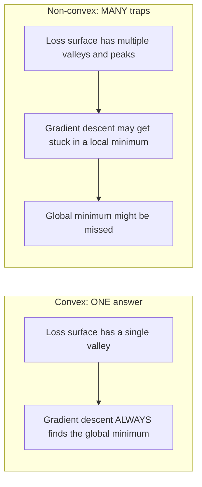
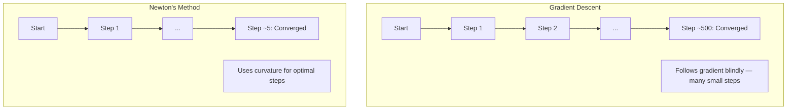
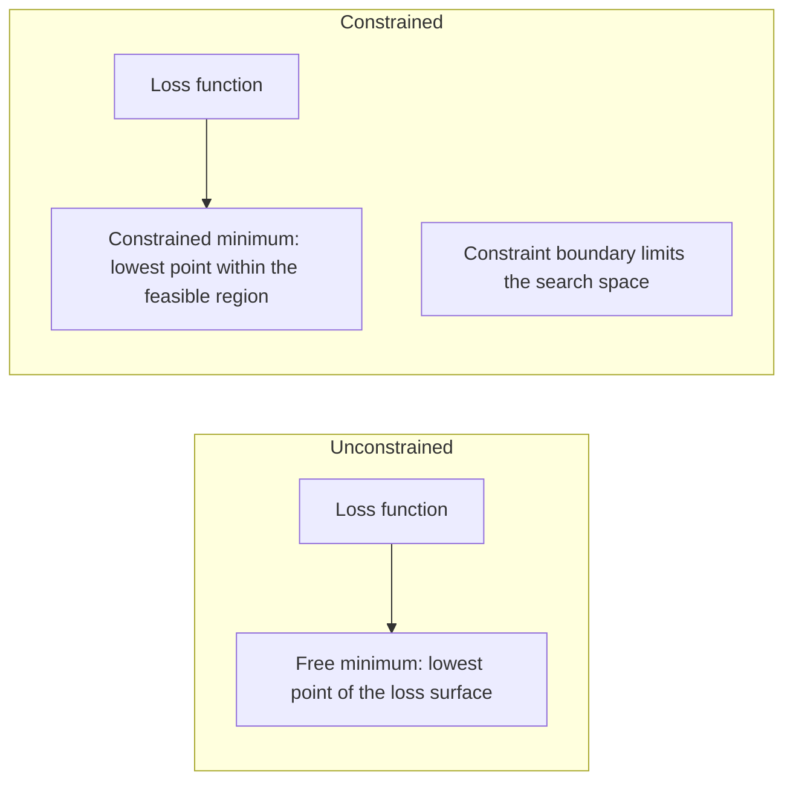
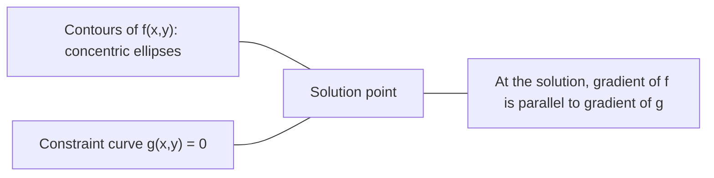

# 凸优化

> 凸问题只有一个谷底――Neural Network 有数百万个――理解这种差异很重要――

**类型：**Construção
**语言：**Python
**前置要求：**Fase 1, Lições 04 ((Calculo para ML) 、08 ((Optimização)
**时间：**Cerca de 90 minutos

## Objectivo de aprendizagem

- Utilize definição、二阶导数和 Hessian 判据测试 um função se for um função de cam
-                                                                                                                                                                                                                                                                                                                                                                                                                                                                                                                              
- Utilize multiplicadores de lagrança 求解带约束的优化问题,并解释 KKT condições
- Explicação de porquê a perda de rede neural é não-confundida, mas a SGD ainda consegue encontrar uma boa solução.

## 问题

Lição 08 - Otimizador pode se mover em qualquer superfície, mas não tem garantia. O Descenso Gradiente pode entrar em um local de baixo valor, em um ponto de sela, ou em um ponto de vibração permanente. Você ainda usa isso, porque a rede neural não é de baixo valor, e não há alternativa.

Mas muitos problemas do ML são de contagem. Régresso linear, regressão logística, SVMs, LASSO, regressão de bordo. Para estes problemas, há ferramentas mais fortes: com garantia matemática de otimização.

Compreender a conexão tem três valores. Primeiro, ele diz-lhe o problema quando é simples, quando é difícil, quando não conexão. Segundo, ele fornece ferramentas mais rápidas para o problema com conexão, como o método de Newton.

## 概念

### 凸集

Se para o conjunto$S$Entre quaisquer dois pontos, o intervalo entre eles também está completamente localizado.$S$中,则集合 $S$É um bom trabalho.

| 凸集 | 非凸 |
|---|---|
| **矩形**：内部任意两点都可以用一条仍在内部的线段连接 | **星形/月牙形**：两个内部点之间的线段可能穿过集合外部 |
| **三角形**：对所有内部点都满足相同性质 | **甜甜圈/环形**：中间的孔意味着某些线段会离开集合 |
| 任意两点之间的线段都留在集合内 | 某些点对之间的线段会离开集合 |

形式化测试: para$S$中任意点 $x, y$, e arbitrária$t \in [0, 1]$,点 $tx + (1-t)y$Também está$S$- Não.

凸集 exemplo:
- Uma linha reta, um plano, todo.$\mathbb{R}^n$
- Uma bola (round 球体 超球)
- Um espaço de meio:$\lbrace x : a^T x \le b \rbrace$
- 任意数凸集的交交交

Não-conclusão exemplo:
- Um doce doce círculo
- 两个不相交交的并集
- Qualquer conjunto de armadilhas ou buracos

### 凸函数

Se função $f$O domínio definido é um conjunto de pontos, e para qualquer ponto do seu domínio definido.$x, y$, e arbitrária$t \in [0, 1]$- Não .

```math
f(tx + (1-t)y) \le t f(x) + (1-t) f(y)
```

几何上看: linha entre qualquer ponto da imagem está situada sobre a imagem ou sobre a imagem.

| 属性 | 凸函数 | 非凸函数 |
|---|---|---|
| **线段测试** | 图像上任意两点之间的线段位于曲线**之上或之上** | 图像上某些点之间的线段会下探到曲线**之下** |
| **形状** | 单个向上弯曲的碗/谷底 | 多个峰和谷，曲率混合 |
| **局部最小值** | 每个局部最小值都是全局最小值 | 可能存在多个高度不同的局部最小值 |

常见凸函数:
- $f(x) = x^2$(抛物线)
- $f(x) = \lvert x \rvert$(valor absoluto)
- $f(x) = e^x$(indice)
- $f(x) = \max(0, x)$(ReLU, apesar de ser dividido por sexo)
- $f(x) = -\log(x)$Para$x > 0$(负对数)
- 任意线性函数 $f(x) = a^T x + b$(既凸又)

### 测试凸性

Três testes práticos, do mais fácil ao mais rigoroso.

**测试 1：二阶导数测试（1D）。**Se para tudo$x$- Não .$f''(x) \ge 0$, , ,$f$É uma função de forma.

- $f(x) = x^2$- Não .$f''(x) = 2 \ge 0$- Não, não.
- $f(x) = x^3$- Não .$f''(x) = 6x$- Não.$x < 0$时为负――非凸――
- $f(x) = e^x$- Não .$f''(x) = e^x > 0$- Não, não.

**测试 2：Hessian 测试（多变量）。**Se a Matriz Hessiana $H(x)$Para tudo .$x$São semidefinidos positivos.$f$É uma função de contagem.

**测试 3：定义测试。**直接检查不等式 $f(tx + (1-t)y) \le t f(x) + (1-t) f(y)$                                                                                                                                                                                                                                                              

### Por que é importante?

凸优化的核心定理:

**对于凸函数，每个局部最小值都是全局最小值。**

Isto significa que a Descenso Gradiente não será atrapada. Qualquer caminho para baixo vai para a mesma resposta.



结果:
- Não precisa de reiniciar
- Não precisa de uma modulação de taxa de aprendizagem complexa
- Pode provar a receita (a taxa depende da função)
- 解是唯一的 (Dentro da região plana)

### Câmbio e não-câmbio no meio do ML

| 问题 | 凸？ | 原因 |
|---------|---------|-----|
| Linear regression (MSE) | 是 | Loss 关于权重是二次的 |
| Logistic regression | 是 | Log-loss 关于权重是凸的 |
| SVM (hinge loss) | 是 | 线性函数的最大值 |
| LASSO (L1 regression) | 是 | 凸函数之和是凸的 |
| Ridge regression (L2) | 是 | 二次 + 二次 = 凸 |
| Neural Network（任意 Loss） | 否 | 非线性 activations 会产生非凸 landscape |
| k-means clustering | 否 | 离散分配步骤 |
| Matrix factorization | 否 | 未知量的乘积 |

O modelo linear de perda de conchas é de conchas. Uma vez que se juntam a camadas ocultas de ativasões não lineares, a conchas são destruídas.

### Matriz Hessiana

Função$f: \mathbb{R}^n \to \mathbb{R}$                                                                                                                                                                                                                                                                                                                                                                                                                                                                                                                             $H$É composto por dois grupos de orientação.$n \times n$Matrix.

```math
H_{ij} = \frac{\partial^2 f}{\partial x_i \, \partial x_j}
```

Para o$f(x, y) = x^2 + 3xy + y^2$- Não .

```math
\begin{gathered}
\begin{aligned}
\frac{\partial f}{\partial x} &= 2x + 3y & \frac{\partial^2 f}{\partial x^2} &= 2 & \frac{\partial^2 f}{\partial x \, \partial y} &= 3 \\
\frac{\partial f}{\partial y} &= 3x + 2y & \frac{\partial^2 f}{\partial y \, \partial x} &= 3 & \frac{\partial^2 f}{\partial y^2} &= 2
\end{aligned} \\[8pt]
H = \begin{bmatrix} 2 & 3 \\ 3 & 2 \end{bmatrix}
\end{gathered}
```

Hessian 告诉你曲率信息:
- Valores próprios totalmente por-core: função em cada direção
- Valores próprios 全为负: em cada direção acima de tudo para baixo 曲 (, local máximo)
- 符号混合: ponto de sela (( certas direções para cima, outras direções para baixo)
- 零 eigenvalue: este sentido é plano de

Para contagem, Hessian  deve estar em todas as posições são semidefinidas positivas  todos os valores próprios $\ge 0$), não apenas em algum ponto.

### Método de Newton

Descenso Gradiente Utilize a informação de uma fase (Gradiente) ―― Método de Newton Utilize a informação de segunda fase (Hessian) ―― Ele está no ponto de preparação para uma segunda aproximação, e então salta diretamente para o valor mínimo dessa segunda função。

```math
\begin{aligned}
\text{更新规则：} \quad & x_{\text{new}} = x - H^{-1} \cdot \text{gradient} \\
\text{与 gradient descent 比较：} \quad & x_{\text{new}} = x - \text{lr} \cdot \text{gradient}
\end{aligned}
```

O método de Newton utiliza o Hessian 替代标量学习率── que irá ajustá-lo automaticamente de acordo com a curva local.



优点:
- 接近最小值时二次收( cada passo erro diferença
- Não precisa de um ritmo de aprendizagem
- Não importa como você faz a questão de fazer a quantidade de trabalho)

缺点:
- 计算 Hessian 需要 $O(n^2)$Inserir, pedir, pedir.$O(n^3)$
- Para uma rede neural com um milhão de pesos, isso significa que...$10^{12}$个条目和 $10^{18}$Próximo
- Não é prático para o Deep Learning

### 约束优化

Não há restrições.$x$Minimizar$f(x)$- Não.
约束优化: 约束条件下最小化 $f(x)$- Não.

现实问题有约束――你想最小化成本,但预算有限――你想最小化错误,但模型复杂度有限――



### Multiplicadores de lagrança

Multiplicadores de lagrança 方法把束問題转换为无束問題──

问题: em $g(x) = 0$O que é que é isso?$f(x)$- Não.

解法: introduzir um novo variação $\lambda$),并求解无约束问题:

```math
L(x, \lambda) = f(x) + \lambda g(x)
```

Em um lugar,$L$de Gradiente 为零:

```math
\begin{aligned}
\frac{\partial L}{\partial x} &= \frac{\partial f}{\partial x} + \lambda \frac{\partial g}{\partial x} = 0 \\
\frac{\partial L}{\partial \lambda} &= g(x) = 0
\end{aligned}
```

几何直觉: em um valor mínimo de um conjunto,$f$de Gradiente   obrigatório $g$Se elas não se alinham, você pode se mover ao longo do seu caminho e diminuir ainda mais.$f$- Não.



exemplo: em$x + y = 1$O que é que é isso?$f(x,y) = x^2 + y^2$- Não.

```math
\begin{aligned}
L &= x^2 + y^2 + \lambda(x + y - 1) \\[4pt]
\frac{\partial L}{\partial x} &= 2x + \lambda = 0 \implies x = -\lambda/2 \\
\frac{\partial L}{\partial y} &= 2y + \lambda = 0 \implies y = -\lambda/2 \\
\frac{\partial L}{\partial \lambda} &= x + y - 1 = 0 \\[4pt]
&\text{由前两个方程得：} x = y \\
&\text{代入得：} 2x = 1, \text{因此 } x = y = 0.5, \ \lambda = -1
\end{aligned}
```

Direct Line$x + y = 1$A distância do ponto de origem é o ponto mais próximo.$(0.5, 0.5)$- Não.

### Condições da KKT

As condições de Karush-Kuhn-Tucker vão multiplicar os multiplicadores de Lagrange  expandir para não é igual

问题: em $g_i(x) \le 0$- Não .$i = 1, \ldots, m$O que é que é isso?$f(x)$- Não.

Condições de KKT ((最优性的必要条件):

```math
\begin{aligned}
&\text{1. 驻点条件：} && \frac{\partial f}{\partial x} + \sum_i \lambda_i \frac{\partial g_i}{\partial x} = 0 \\
&\text{2. 原始可行性：} && g_i(x) \le 0 \quad \text{对于所有 } i \\
&\text{3. 对偶可行性：} && \lambda_i \ge 0 \quad \text{对于所有 } i \\
&\text{4. 互补松弛：} && \lambda_i \, g_i(x) = 0 \quad \text{对于所有 } i
\end{aligned}
```

A preguiça complementar é o que faz com que o corpo se torne ativo.$g_i = 0$, , , , , , , , , , , , , , , , , , , , , , , , , , , , , , , , , , , , , , , , , , , , , , , , , , , , , , , , , , , , , , , , , , , , , , , , , , , , , , , , , , , , , , , , , , , , , , , , , , , , , , , , , , , , , , , , , , , , , , , , , , , , , , , , , , , , , , , , , , , , , , , , , , , , , , , , , , , , , , , , , , , , , , , , , , , , , , , , , , , , , , , , , , , , , , , , , , , , , , , , , , , , , , , , , , , , , , , , , , , , , , , , , , , , , , , , , , , , , , , , , , , , , , , , , , , , , , , , , , , , , , , , , , , , , , , , , , , , , , , , , , , , , , , , , , , , , , , , , , , , , , , , , , , , , , , , , , , , , , , , , , , , , , , , , , , , , , , , , , , , , , , , , , , , , , , , , , , , , , , , , , , , , , , , , , , , , , , , , , , , , , , , , , , , , , , , , , , , , , , , , , , , , , , , , , , , , , , , , , , , , , , , , , , , , , , , , , , , , , , , , , , , , , , , , , , , , , , , , , , , , , , , , , , , , , , , , , , , , , , , , , , , , , , , , , , , , , , , , , , , , , , , , , , , , ,$\lambda = 0$- Não.

As condições KKT são o núcleo dos SVMs;; vetores de suporte são os pontos de dados activos do conjunto$\lambda > 0$)¬ todos os outros dados $\lambda = 0$, não afetam os limites da decisão¬¬¬¬¬¬¬¬¬¬¬¬¬¬¬¬¬¬¬¬¬¬¬¬¬¬¬¬¬¬¬¬¬¬¬¬¬¬¬¬¬¬¬¬¬¬¬¬¬¬¬¬¬¬¬¬¬¬¬¬¬¬¬¬¬¬¬¬¬¬¬¬¬¬¬¬¬¬¬¬¬¬¬¬¬¬¬¬¬¬¬¬¬¬¬¬¬¬¬¬¬¬¬¬¬¬¬¬¬¬¬¬¬¬¬¬¬¬¬¬¬¬¬¬¬¬¬¬¬¬¬¬¬¬¬¬¬¬¬¬¬¬¬¬¬¬¬¬¬¬¬¬¬¬¬¬¬¬¬¬¬¬¬¬¬¬¬¬¬¬¬¬¬¬¬¬¬¬¬¬¬¬¬¬¬¬¬¬¬¬¬¬¬¬¬¬¬¬¬¬¬¬¬¬¬¬¬¬¬¬¬¬¬¬¬¬¬¬¬¬¬¬¬¬¬¬¬¬¬¬¬¬¬¬¬¬¬¬¬¬¬¬¬¬¬¬¬¬¬¬¬¬¬¬¬¬¬¬¬¬¬¬¬¬¬¬¬¬¬¬¬¬¬¬¬¬¬¬¬¬¬¬¬¬¬¬¬¬¬¬¬¬¬¬¬¬¬¬¬¬¬¬¬¬¬¬¬¬¬¬¬¬¬¬¬¬¬¬¬¬¬¬¬¬¬¬¬¬¬¬¬¬¬¬¬¬¬¬¬¬¬¬¬¬¬¬¬¬¬¬¬¬¬¬¬¬¬¬¬¬¬¬¬¬¬¬¬¬¬¬¬¬¬¬¬¬¬¬¬¬¬¬¬¬¬¬¬¬¬¬¬¬¬¬¬¬¬¬¬¬¬¬¬¬¬¬¬¬¬¬¬¬¬¬¬¬¬¬¬¬¬¬¬¬¬¬¬¬¬¬¬¬¬¬¬¬¬¬¬¬¬¬¬¬¬¬¬¬¬¬¬¬¬¬¬¬¬¬¬¬¬¬¬¬¬¬¬¬¬¬¬¬¬¬¬¬¬¬¬¬¬¬¬¬¬¬¬¬¬¬¬¬¬¬¬¬¬¬¬¬¬

### Regularização  como o 约束优化

A regularização de L1 e L2 não é uma técnica arbitrária.

**L2 regularization (Ridge)：**

```math
\begin{aligned}
&\text{最小化 } \text{Loss}(w) \text{，约束为 } \lVert w \rVert^2 \le t \\[4pt]
&\text{等价的无约束形式：} \\
&\text{最小化 } \text{Loss}(w) + \lambda \lVert w \rVert^2
\end{aligned}
```

约束 $\lVert w \rVert^2 \le t$定義一个球(2D 中是圆,3D 中是球面) ・・・解位于 Loss 等高线第一次接触这个球的位置──

**L1 regularization (LASSO)：**

```math
\begin{aligned}
&\text{最小化 } \text{Loss}(w) \text{，约束为 } \lVert w \rVert_1 \le t \\[4pt]
&\text{等价的无约束形式：} \\
&\text{最小化 } \text{Loss}(w) + \lambda \lVert w \rVert_1
\end{aligned}
```

约束 $\lVert w \rVert_1 \le t$定義一个形(2D 中旋转的正方形) 』

| 属性 | L2 约束（圆） | L1 约束（菱形） |
|---|---|---|
| **约束形状** | 圆（更高维中是球面） | 菱形（2D 中旋转的正方形） |
| **Loss 等高线接触的位置** | 光滑边界：圆上的任意点 | 角点：与某个轴对齐 |
| **解的行为** | 权重较小但非零 | 某些权重恰好为零（稀疏） |
| **结果** | 权重收缩 | 特征选择 |

Isso explica por que L1 produzirá um modelo raro (títulos selecionados), enquanto L2 apenas reduzirá o peso.

### Dualismo

Cada problema de optimização de um conjunto de elementos (primário) tem um problema de acompanhamento (dual) e para o problema de contagem, primário e dual têm o mesmo valor máximo.

Função dupla de Lagrange:

```math
\begin{aligned}
&\text{原始问题：} && \text{最小化 } f(x) \text{，约束为 } g(x) \le 0 \\
&\text{拉格朗日函数：} && L(x, \lambda) = f(x) + \lambda g(x) \\
&\text{对偶函数：} && d(\lambda) = \min_x L(x, \lambda) \\
&\text{对偶问题：} && \text{最大化 } d(\lambda) \text{，约束为 } \lambda \ge 0
\end{aligned}
```

Por que a dualidade é importante:
- Dual problema, às vezes mais fácil de resolver do que primário
- SVMs em forma dupla 求解, entre os quais o problema depende dos dados entre pontos de produtos dotados (para ativar o truque do kernel)
- Dual  fornecer o ótimo primário 的下界, pode ser usado para verificar a qualidade

 concretos até aos SVM:

```
Primal: find w, b that maximize the margin 2/||w|| subject to
        y_i(w^T x_i + b) >= 1 for all i

Dual:   maximize sum(alpha_i) - 0.5 * sum_ij(alpha_i * alpha_j * y_i * y_j * x_i^T x_j)
        subject to alpha_i >= 0 and sum(alpha_i * y_i) = 0

The dual only involves dot products x_i^T x_j.
Replace x_i^T x_j with K(x_i, x_j) to get the kernel trick.
```

### Por que o Deep Learning ainda pode funcionar

Função de perda de rede neural 极其非凸── de acordo com cada padrão clássico, otimizá-los todos devem falhar── no entanto, a descida do gradiente estocástico pode encontrar de forma confiável uma boa solução── vários fatores explicam isso──

**大多数局部最小值已经足够好。**Em alto espaço, os pontos críticos são os pontos de sela, não o valor mínimo local. O mínimo local geralmente tem um valor de perda próximo ao mínimo local. Quando o espaço tem milhões de vezes, a probabilidade de um valor mínimo local é muito baixa.

**真正的障碍是 saddle points，而不是局部最小值。**Em um há$n$个参数的函数中, Saddle point 同时具有正曲率和负曲率方向──对高维中的随机关键点,所有 $n$个 eigenvalues 都为正 (%) local mínimo) probabilidade é aproximadamente $2^{-n}$Quase todos os pontos críticos são pontos de sela.

**Overparameterization 会平滑 landscape。** número de parâmetros é maior que a de um modelo de treinamento, mas a rede tem superfícies de perda mais simples e mais conectadas.

**Loss landscape 结构：**

| 属性 | 低维空间 | 高维空间 |
|---|---|---|
| **Landscape** | 许多孤立的峰和谷 | 平滑连通的谷 |
| **最小值** | 许多孤立局部最小值 | 很少有糟糕局部最小值；大多数接近最优 |
| **导航** | 难以找到全局最小值 | 许多路径通向好的解 |
| **Critical points** | 局部最小值和 saddle points 混合 | 压倒性地是 saddle points，而非局部最小值 |

**随机噪声充当隐式 regularization。**Mini-batch SGD  introdução de ruído, prevenção de queda em mínimos nítidos―Minimos nítidos  fácil de adaptar; mínimos planos  generalização melhor―

###  prática do método

O método de Newton para um grande modelo não é prático.

**L-BFGS (Limited-memory BFGS)：**Usado recentemente $m$个 Gradiente 差分近似逆 Hessian──需要 $O(mn)$内存, em vez de $O(n^2)$ Aplica-se a mais de 10.000 questões de parâmetros  Aplica-se a clásica ML  regressão logística  CRFs, mas não a Deep Learning 

**Natural gradient：**Utilize Fisher information matrix ([[log-probabilidade expectativa de Hessian]]) em vez de padrão Hessian。 This will consider概率分布的几何结构。 K-FAC (Curvatura aproximada Cronécker-factored) irá colocar Fisher Matrix 近似为 Cronécker product, fazendo com que seja disponível para a Rede Neural。

**Hessian-free optimization：**Utilize gradiente conjugado 求解 $Hx = g$, não se forma claramente$H$ Só é necessário produtos de vetor Hessiano, que podem ser diferenciados automaticamente em$O(n)$タイム内計算──

**Diagonal approximations：**O segundo momento de Adão é a aproximação hessiana de um ângulo de linha. Ada Hessian, através do estimador de Hutchinson, ampliou este ponto usando elementos diagonais hessianos reais.

| 方法 | 内存 | 每步成本 | 何时使用 |
|--------|--------|--------------|-------------|
| Gradient Descent | $O(n)$ | $O(n)$ | Baseline，大模型 |
| Newton's method | $O(n^2)$ | $O(n^3)$ | 小型凸问题 |
| L-BFGS | $O(mn)$ | $O(mn)$ | 中型凸问题 |
| Adam | $O(n)$ | $O(n)$ | Deep Learning 默认选择 |
| K-FAC | $O(n)$ | 每层 $O(n)$ | 研究、大 batch training |


```figure
convex-vs-nonconvex
```

## Construí-lo

### 步骤 1: exame de forma gráfica

Construir uma função, através de um ponto de análise e de uma definição de experiência.

```python
import random
import math

def check_convexity(f, dim, bounds=(-5, 5), samples=1000):
    violations = 0
    for _ in range(samples):
        x = [random.uniform(*bounds) for _ in range(dim)]
        y = [random.uniform(*bounds) for _ in range(dim)]
        t = random.uniform(0, 1)
        mid = [t * xi + (1 - t) * yi for xi, yi in zip(x, y)]
        lhs = f(mid)
        rhs = t * f(x) + (1 - t) * f(y)
        if lhs > rhs + 1e-10:
            violations += 1
    return violations == 0, violations
```

### Passo 2: Utilize o método de Newton em 2D

Utilize explicitamente Hessian  realizar o método de Newton.

```python
def newtons_method(f, grad_f, hessian_f, x0, steps=50, tol=1e-12):
    x = list(x0)
    history = [x[:]]
    for _ in range(steps):
        g = grad_f(x)
        H = hessian_f(x)
        det = H[0][0] * H[1][1] - H[0][1] * H[1][0]
        if abs(det) < 1e-15:
            break
        H_inv = [
            [H[1][1] / det, -H[0][1] / det],
            [-H[1][0] / det, H[0][0] / det],
        ]
        dx = [
            H_inv[0][0] * g[0] + H_inv[0][1] * g[1],
            H_inv[1][0] * g[0] + H_inv[1][1] * g[1],
        ]
        x = [x[0] - dx[0], x[1] - dx[1]]
        history.append(x[:])
        if sum(gi ** 2 for gi in g) < tol:
            break
    return history
```

### 步骤 3: Multiplicador de largura 求解器

通過在拉格兰基上执行 Gradient Descent 来求解约束优化──

```python
def lagrange_solve(f_grad, g_val, g_grad, x0, lr=0.01,
                   lr_lambda=0.01, steps=5000):
    x = list(x0)
    lam = 0.0
    history = []
    for _ in range(steps):
        fg = f_grad(x)
        gv = g_val(x)
        gg = g_grad(x)
        x = [
            xi - lr * (fgi + lam * ggi)
            for xi, fgi, ggi in zip(x, fg, gg)
        ]
        lam = lam + lr_lambda * gv
        history.append((x[:], lam, gv))
    return history
```

### 步骤 4: Comparar 1o estágio com 2o estágio

Em um mesmo segundo função, executar o método de descida gradual e Newton.

```python
def quadratic(x):
    return 5 * x[0] ** 2 + x[1] ** 2

def quadratic_grad(x):
    return [10 * x[0], 2 * x[1]]

def quadratic_hessian(x):
    return [[10, 0], [0, 2]]
```

O método de Newton vai ser usado em 1 步内收 (o que é preciso para a segunda função) ◦ Descenso gradual vai precisar de 100 步, pois os valores próprios de Hessian são 5 vezes diferentes, formando um vale de longa distância.

## Use-o

Quando se escolhe um modelo e um solvente, a análise gráfica pode ser aplicada diretamente.

对于凸问题(regressão logística、SVMs、LASSO):
- Utilize专用 solver(liblinear、CVXPY、scipy.optimize.minimize com método='L-BFGS-B')
-                                                                                                                                                                                                                                                                                                                                                                                                                                                                                                                              
- 2o Caso de método prático e rápido

对于非凸问题:
- Use一阶方法 (SGD、Adam)
-                                                                                                                                                                                                                                                                                                                                                                                                                                                                                                                              
- Utilize a sobreparametrização, o ruído e a modulação da taxa de aprendizagem como regularização conceitual
- Não percas tempo procurando o mínimo da área inteira.

```python
from scipy.optimize import minimize

result = minimize(
    fun=lambda w: sum((y - X @ w) ** 2) + 0.1 * sum(w ** 2),
    x0=np.zeros(d),
    method='L-BFGS-B',
    jac=lambda w: -2 * X.T @ (y - X @ w) + 0.2 * w,
)
```

Para SVM, dupla formulação, podes usar o truque do kernel:

```python
from sklearn.svm import SVC

svm = SVC(kernel='rbf', C=1.0)
svm.fit(X_train, y_train)
print(f"Support vectors: {svm.n_support_}")
```

## 练习

1. **凸性画廊。**Utilize checkcher tester estas funções de convecção:$f(x) = x^4$- Não.$f(x) = \sin(x)$- Não.$f(x,y) = x^2 + y^2$- Não.$f(x,y) = xy$- Não.$f(x) = \max(x, 0)$❖ Explicar por que cada resultado é razoável.

2. **Newton vs Gradient Descent 竞赛。**Desde o início$(10, 10)$- Não, não.$f(x,y) = 50x^2 + y^2$上运行两种方法── Cada método requer quantos passos para alcançar a perda < 1e-10? Quando o número de condição ((máximo valor próprio hessiano e menor comparativo de valor próprio hessiano) aumenta, o que acontece na descida gradiente?

3. **Lagrange multiplier 几何。**Em um momento .$x + 2y = 4$Baixa-o ao mínimo .$f(x,y) = (x-3)^2 + (y-3)^2$ através de inspecção$f$de Gradiente com$g$O Gradiente de Píngua é um método de avaliação de

4. **Regularization 约束。**实现 L1-otimizar com restrições:$\lvert x \rvert + \lvert y \rvert \le 1$O que é que é isso?$(x-3)^2 + (y-2)^2$展示解有一个坐标等于零 (形约束) 

5. **Hessian eigenvalue 分析。** calcular a função Rosenbrock em (1,1) 和 (-1,1) 处的赫西亚语――计算两个点处的自值――自值值 告诉你近最小值与远最小值处的曲率有什么区别?

### 提示

**练习 1。**运行 `check_convexity`Antes, antes de prever cada resultado:$f''(x)$de Hessian.$f(x,y) = xy$Os valores próprios de Hessian são 1 e -1, portanto, o verificador deve relatar que essa função não é uma função de contagem.

**练习 2。**Utilização $f$调用                                                                                                                                                                                                                                                                                                                                                                                                                                                                                                                           `optimize_gd`Com`newtons_method`O método de Newton só precisa de um passo para resolver a função quadrática.$50x^2$项, taxa de aprendizagem 必須小于 $2/100$, portanto $y$A direcção se move muito lentamente.$100x^2$后重复实验, novamente统计步数──

**练习 3。**Utilização $g(x,y) = x + 2y - 4$调用 `lagrange_solve` Em resposta à procura, verificar se a procura foi satisfeita$x + 2y = 4$, bem como $\nabla f = (2(x-3), 2(y-3))$Sim ou não$\nabla g = (1, 2)$De multiplicidade.

**练习 4。**Minimo não restrito (3, 2) 位于形外, portanto 答案在边界上── Use projected gradient descent:先进行一次 Gradient 更新,再投投影回 $\lvert x \rvert + \lvert y \rvert \le 1$◊ Verificar se os resultados estão em conformidade com o número de`demo_regularization_geometry`Comparar.

**练习 5。**Em cada ponto de rodagem`rosenbrock_hessian`,并将结果传入 `hessian_eigenvalues_2d` Em (1, 1) situações, dois valores próprios são positivos, e o seu valor proporcional é muito grande, por isso o vale é muito estreito em uma direção, muito plano em outra direção.

## 关键术语

| 术语 | 含义 |
|------|---------------|
| 凸集 | 集合中任意两点之间的线段仍留在集合内部的集合 |
| 凸函数 | 图像上任意两点之间的线段位于图像之上或图像上的函数。等价地，Hessian 在所有位置都是 positive semidefinite |
| 局部最小值 | 比所有邻近点都低的点。对于凸函数，每个局部最小值都是全局最小值 |
| 全局最小值 | 函数在其整个定义域上的最低点 |
| Hessian Matrix | 所有二阶偏导数组成的 Matrix。编码曲率信息 |
| Positive semidefinite | Eigenvalues 全部非负的 Matrix。是“二阶导数 >= 0”的多维类比 |
| Condition number | Hessian 的最大 eigenvalue 与最小 eigenvalue 的比值。高 condition number 意味着拉长的谷和缓慢的 Gradient Descent |
| Newton's method | 使用逆 Hessian 确定步进方向和大小的二阶 Optimizer。接近最小值时二次收敛 |
| Lagrange multiplier | 为了将约束优化问题转换为无约束问题而引入的变量 |
| KKT conditions | 不等式约束下最优性的必要条件。推广了 Lagrange multipliers |
| Complementary slackness | 在解处，约束要么是 active 的，要么其 multiplier 为零。二者不会同时非零 |
| Duality | 每个约束问题都有一个伴随的 dual problem。对于凸问题，二者具有相同的最优值 |
| Strong duality | Primal 和 dual 的最优值相等。对满足 Slater's condition 的凸问题成立 |
| L-BFGS | 近似二阶方法，存储最近 $m$ 个 Gradient 差分，而不是完整 Hessian |
| Saddle point | Gradient 为零，但在某些方向上是最小值、在另一些方向上是最大值的点 |
| Overparameterization | 使用比训练样本更多的参数。会平滑 Loss landscape 并减少糟糕局部最小值 |

## 延伸阅读

- [Boyd & Vandenberghe: Convex Optimization](https://web.stanford.edu/~boyd/cvxbook/)- Padrão de ensino, online gratuito
- [Bottou, Curtis, Nocedal: Optimization Methods for Large-Scale Machine Learning (2018)](https://arxiv.org/abs/1606.04838)- 连接凸优化理论与深度学习 实践
- [Choromanska et al.: The Loss Surfaces of Multilayer Networks (2015)](https://arxiv.org/abs/1412.0233)- Porque é que as paisagens da rede neural não parecem tão ruins?
- [Nocedal & Wright: Numerical Optimization](https://link.springer.com/book/10.1007/978-0-387-40065-5)- Método de Newton L-BFGS
