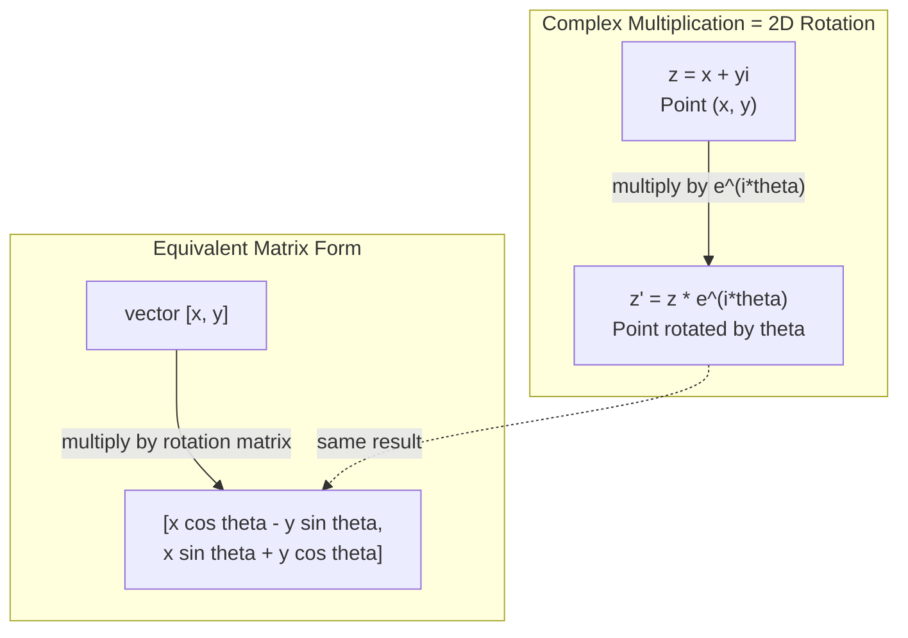
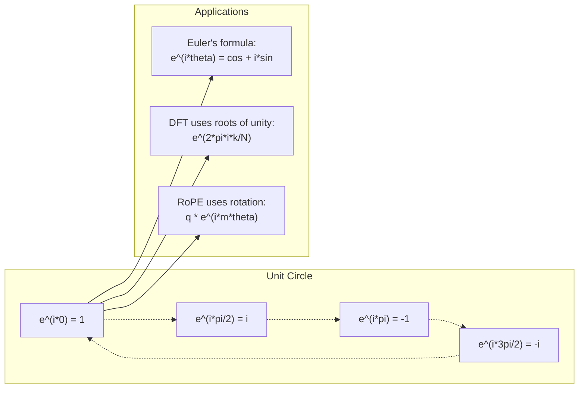

# AI 中中复数

> A raiz quadrada de -1 não é falsa. É a chave para a rotação, frequência e meio campo de processamento de sinais.

**Type:** Learn
**Language:**Python
**Prerequisites:** Phase 1, Lessons 01-04（linear algebra, calculus）
**Time:** ~60 分钟

## Objectivo de aprendizagem
- Em forma de linha reta e de extrema forma de坐标, executar o número de operações (加法、乘法、除法、共)
-  aplicar a fórmula de Euler em ∆ {\displaystyle \mathbb {\\displaystyle \mathbb {\\mathbb {\\mathbb {\\mathbb {\\mathbb {\\mathbb {\\mathbb {\\mathbb {\\mathbb {\\mathbb {\\mathbb {\\mathbb {\\mathbb {T}}}} }
- Utilize Duple Unit Root para implementar Transformação de Fourier discreta
- 解释复数旋转 如何构建变压器 中 RoPE 和正弦位置编码的基础

## 问题
Você abriu um artigo sobre as transformações de Fourier, por toda parte.`i`──你查看 Transformer 位置编码, ver diferentes frequências abaixo `sin`和 `cos` 也就是复指数的实部和虚部── você lê a quantical calculação, e descobre que tudo é usado para repetir o vector 空间 para expressar──

O número é um sistema matemático construído sobre a raiz quadrada de -1 e parece ser uma técnica matemática, mas não é uma técnica. É a linguagem natural da rotação e oscilação.

Se não entender o número duplo, você não consegue entender a Transformação de Fourier Discreta. Você não consegue entender a FFT. Você não consegue entender o RoPE em Modelo Moderno de Idiomas Modernos.

Esta aula irá começar do zero construção de quadros de cálculo, conectá-los à geometria, e exibir a posição do quadros em Machine Learning.

## 概念
### O que é o número?

O número de números tem duas partes:

```
z = a + bi

where:
  a is the real part
  b is the imaginary part
  i is the imaginary unit, defined by i^2 = -1
```

É assim. Você faz um eixo numérico expandir em uma superfície.

### 复数运算

**加法。**- Não, não, não.

```math
\begin{aligned}
(a + bi) + (c + di) &= (a + c) + (b + d)i \\[4pt]
\text{示例：} (3 + 2i) + (1 + 4i) &= 4 + 6i
\end{aligned}
```

**乘法。**Uso de distribuição,并记住 $i^2 = -1$- Não.

```math
\begin{aligned}
(a + bi)(c + di) &= ac + adi + bci + bdi^2 \\
&= ac + adi + bci - bd \\
&= (ac - bd) + (ad + bc)i \\[8pt]
\text{示例：} (3 + 2i)(1 + 4i) &= 3 + 12i + 2i + 8i^2 \\
&= 3 + 14i - 8 \\
&= -5 + 14i
\end{aligned}
```

**共轭。**翻转虚部的符号──

```math
(a + bi)\text{ 的共轭} = a - bi
```

Um multiplicador e o seu multiplicador são números reais:

```math
(a + bi)(a - bi) = a^2 + b^2
```

**除法。**分子和分母同时乘以分母的共──

```math
\frac{a + bi}{c + di} = \frac{(a + bi)(c - di)}{c^2 + d^2}
```

Isto vai acabar com a parte de divisão, obtendo um número de vezes mais puro.

### 复平面

复平面把每个复数映射到一个2D点――水平轴是实轴,垂直轴是虚轴――

```
z = 3 + 2i  corresponds to the point (3, 2)
z = -1 + 0i corresponds to the point (-1, 0) on the real axis
z = 0 + 4i  corresponds to the point (0, 4) on the imaginary axis
```

O número duplo é um vector de origem de um ponto, e também de um ponto.

### 极坐标形式

Qualquer ponto na superfície pode ser usado para descrevê-lo a distância do ponto de origem, bem como o ângulo do eixo real em relação a ele.

```math
\begin{aligned}
z &= r (\cos\theta + i \sin\theta) \\[4pt]
\text{其中：} r &= |z| = \sqrt{a^2 + b^2} \quad \text{（magnitude，即模）} \\
\theta &= \mathop{\mathrm{atan2}}(b, a) \quad \text{（phase，即辐角）}
\end{aligned}
```

Directamente$(a + bi)$适合加法──极坐标形式                                                                                                                                                                                                                                                                                                                                                                                                                                                                                                                    $(r, \theta)$适合乘法.

**极坐标形式下的乘法。**模长相乘, ângulo de imagem

```math
\begin{aligned}
z_1 &= r_1 e^{i\theta_1} \\
z_2 &= r_2 e^{i\theta_2} \\[4pt]
z_1 z_2 &= (r_1 r_2) \, e^{i(\theta_1 + \theta_2)}
\end{aligned}
```

É por isso que o número de vezes é muito adequado para representar a rotação.

### A fórmula de Euler

O ponto de partida entre o índice de repunto e o triângulo:

```math
e^{i\theta} = \cos\theta + i \sin\theta
```

É a fórmula mais importante da aula.$\theta = \pi$时:

```math
\begin{aligned}
e^{i\pi} &= \cos\pi + i \sin\pi = -1 + 0i = -1 \\[4pt]
\text{因此：} e^{i\pi} + 1 &= 0
\end{aligned}
```

五个基本常数 (quatro vezes mais)$e$- Não .$i$- Não .$\pi$, 1, 0) são ligados em um mesmo caminho.

### Por que a fórmula de Euler para ML é importante?

A fórmula de Euler mostra,$e^{i\theta}$- Não .$\theta$变化描绘单位圆──当 $\theta = 0$- Está bem.$(1, 0)$- Não.$\theta = \pi/2$- Está bem.$(0, 1)$- Não.$\theta = \pi$- Está bem.$(-1, 0)$- Não.$\theta = 3\pi/2$- Está bem.$(0, -1)$完整一圈旋转是 $\theta = 2\pi$- Não.

Isto significa que o índice de repetição é a rotação, enquanto a rotação não está presente no processamento de sinais e no ML.

### Contacto com 2D  rotativo

                 $(x + yi)$- Não .$e^{i\theta}$- Não , não .$(x, y)$ Rondando o ponto de rotação $\theta$- Não.

```math
\begin{aligned}
&\text{通过复数乘法旋转：} \\
&\quad (x + yi)(\cos\theta + i \sin\theta) = (x \cos\theta - y \sin\theta) + (x \sin\theta + y \cos\theta)i \\[8pt]
&\text{通过矩阵乘法旋转：} \\
&\quad \begin{bmatrix} \cos\theta & -\sin\theta \\ \sin\theta & \cos\theta \end{bmatrix} \begin{bmatrix} x \\ y \end{bmatrix} = \begin{bmatrix} x \cos\theta - y \sin\theta \\ x \sin\theta + y \cos\theta \end{bmatrix}
\end{aligned}
```

它们产生完全相同的结果──复数乘法就是 2D 旋转──旋转矩阵 只是用矩阵记法写出的复数乘法──



### Fázer e sinal de rotação

复指数 $e^{i\omega t}$É uma frequência de cúpula.$\omega$绕单位圆旋的点──随随$t$Aumente, esse ponto será desenhado.

Esta rotação é a parte real.$\cos(\omega t)$- Não, não.$\sin(\omega t)$O sinal de um sinal de um sinal de um sinal de um sinal de um sinal de um sinal de um sinal de um sinal de um sinal de um sinal de um sinal de um sinal de um sinal de um sinal de um sinal de um sinal de um sinal de um sinal de um sinal de um sinal de um sinal de um sinal de um sinal de um sinal de um sinal de um sinal de um sinal de um sinal de um sinal de um sinal de um sinal de um sinal de um sinal de um sinal de um sinal de um sinal de um sinal de um sinal de um sinal de um sinal de um sinal de um sinal de um sinal de um sinal de um sinal de um sinal de um sinal de um sinal de um sinal de um sinal de um sinal de um sinal de um sinal de um sinal de um sinal de um sinal de um sinal de um sinal de um sinal de um sinal de um sinal de um sinal de um sinal de um sinal de um sinal de um sinal de um outro.

```math
\begin{aligned}
e^{i\omega t} &= \cos(\omega t) + i \sin(\omega t) \\[4pt]
\text{实部：} & \cos(\omega t) \quad \text{，即 cosine wave} \\
\text{虚部：} & \sin(\omega t) \quad \text{，即 sine wave}
\end{aligned}
```

É o modo de expressão do fator. Não se segue mais uma onda de cordas de um desvio, mas sim uma flecha de rotação plana.

### 单位根

$N$A segunda unidade é a unidade de distribuição de círculo e de$N$- Não .

```math
w_k = e^{2\pi i k/N} \quad \text{其中 } k = 0, 1, 2, \ldots, N-1
```

- Não .$N = 4$- Não, não.$1, i, -1, -i$(Foço rotas direcionadas)
- Não .$N = 8$Quando, você vai ter quatro direções, mais quatro direções em contra-esquina.

A unidade é a base da Transforma Fourier Discreta.$N$个等间隔频率上的分量──

### Contacto com DFT

 sinal $x[0], x[1], \ldots, x[N-1]$Da Transformação de Fourier Discreta é:

```math
X[k] = \sum_{n=0}^{N-1} x[n] \, e^{-2\pi i k n/N}
```

Cada um .$X[k]$∆ ∆ ∆ ∆ ∆ ∆ ∆ ∆ ∆ ∆$k$个单位根的相关程度,也就是与频率 的相关程度,也就是与频率 的相关程度$k$处一个复正弦波的相关程度──DFT 将信号分解为 $N$个旋转phasor,并告诉你每一个振幅和相位的每个振幅和相位.

### Por que não estou a mentir?

Imaginário, essa palavra é um acaso histórico. Descartes tinha um desprezo por usar.$i$Não é comparado ao número negativo mais 虚── números negativos responderam:                                                                                                                                                                                                                                                     

Mais útil é entender:$i$É um arquiteto de 90 graus.$i$Uma vez, você gira 90 graus para o real.$i$Uma vez$i^2$), você gira novamente 90 graus, agora em direção ao eixo negativo.$i^2 = -1$Não é misterioso. É um meio-circulo rotativo formado por duas quartos.

É por isso que o complexo não está em qualquer lugar no engenharia. Qualquer coisa que gira é adequada à descrição do complexo.

### 复指数 vs 三角函数

Antes da fórmula de Euler, o engenheiro escreveu um sinal.$A \cos(\omega t + \phi)$ 振幅 $A$Frequência$\omega$、相位 $\phi$ É possível, mas vai fazer o cálculo tornar-se doloroso                                                                                                                                                                                                                                                       

Usando o índice de repetição, o mesmo sinal pode ser escrito.$A e^{i(\omega t + \phi)}$△相加两个信号只是相加两个复数──相乘(调制)只是模长相乘、角度相加──相位偏移变成角加法──频率偏移变成乘乘相──

Todo o campo de processamento de sinais se tornou mais complexo, pois a matemática é mais limpa.

### Contacto com Transformer

**正弦位置编码**(原始 Transformer 论文):

```math
\begin{aligned}
PE(pos, 2i) &= \sin\left(pos / 10000^{2i/d}\right) \\
PE(pos, 2i+1) &= \cos\left(pos / 10000^{2i/d}\right)
\end{aligned}
```

Sin 和 cos 成对出现,它们是不同频率下复指数的实部和虚部──每个频率都为编码位置提供一种不同的分辨率──低频变化缓慢──粗略位置)──高频变化快速──精细位置──它们共同为每个位置提供独特频率纹──

**RoPE（Rotary Position Embedding）**Mais adiante. É obviamente usado para repetir a rotação de Matriz 乘以查询和键向量. A posição relativa entre dois Tokens se transforma em um ângulo de rotação. Atenção.

| Operation | Algebraic Form | Geometric Meaning |
|-----------|---------------|-------------------|
| 加法 | $(a+c) + (b+d)i$ | 平面中的 Vector 加法 |
| 乘法 | $(ac-bd) + (ad+bc)i$ | 旋转并缩放 |
| 共轭 | $a - bi$ | 关于实轴反射 |
| 模长 | $\sqrt{a^2 + b^2}$ | 到原点的距离 |
| 相位 | $\mathop{\mathrm{atan2}}(b, a)$ | 相对正实轴的角度 |
| 除法 | multiply by conjugate | 反向旋转并重新缩放 |
| 幂 | $r^n e^{in\theta}$ | 旋转 $n$ 次，按 $r^n$ 缩放 |




```figure
roots-of-unity
```

## Construí-lo
### 步骤 1: Complexo 类

Construir um número complexo, apoiar o cálculo, a formação, a formação, e a transformação entre a forma de um esquema e a forma de um esquema.

```python
import math

class Complex:
    def __init__(self, real, imag=0.0):
        self.real = real
        self.imag = imag

    def __add__(self, other):
        return Complex(self.real + other.real, self.imag + other.imag)

    def __mul__(self, other):
        r = self.real * other.real - self.imag * other.imag
        i = self.real * other.imag + self.imag * other.real
        return Complex(r, i)

    def __truediv__(self, other):
        denom = other.real ** 2 + other.imag ** 2
        r = (self.real * other.real + self.imag * other.imag) / denom
        i = (self.imag * other.real - self.real * other.imag) / denom
        return Complex(r, i)

    def magnitude(self):
        return math.sqrt(self.real ** 2 + self.imag ** 2)

    def phase(self):
        return math.atan2(self.imag, self.real)

    def conjugate(self):
        return Complex(self.real, -self.imag)
```

### 步骤 2: 极坐标转换 com a fórmula de Euler

```python
def to_polar(z):
    return z.magnitude(), z.phase()

def from_polar(r, theta):
    return Complex(r * math.cos(theta), r * math.sin(theta))

def euler(theta):
    return Complex(math.cos(theta), math.sin(theta))
```

验证:`euler(theta).magnitude()`应始终为 1.0。`euler(0)`应给出 (1, 0)`euler(pi)`应给出 (-1, 0)

### 步骤 3: rotação

- Não .$(x, y)$旋转 $\theta$角, só precisa de uma vez repetido:

```python
point = Complex(3, 4)
rotated = point * euler(math.pi / 4)
```

模长保持不变──只有角度发生变──

### 步骤 4: DFT baseado em quadros de operações

```python
def dft(signal):
    N = len(signal)
    result = []
    for k in range(N):
        total = Complex(0, 0)
        for n in range(N):
            angle = -2 * math.pi * k * n / N
            total = total + Complex(signal[n], 0) * euler(angle)
        result.append(total)
    return result
```

É isso .$O(N^2)$De DFT.$X[k]$São amostras de sinal multiplicadas pelo total das unidades de base.

### 步骤 5: DFT inverso

A inversa DFT irá reconstruir o sinal original do espectro de frequência. Em comparação com a direita DFT, a única variação é:$N$- Não.

```python
def idft(spectrum):
    N = len(spectrum)
    result = []
    for n in range(N):
        total = Complex(0, 0)
        for k in range(N):
            angle = 2 * math.pi * k * n / N
            total = total + spectrum[k] * euler(angle)
        result.append(Complex(total.real / N, total.imag / N))
    return result
```

Isso dará uma reconstrução perfeita. Primeiro aplicar DFT, reaplicar IDFT, você obterá o sinal original dentro da precisão da máquina.

### 步骤 6: unidade

```python
def roots_of_unity(N):
    return [euler(2 * math.pi * k / N) for k in range(N)]
```

验证 duas características:
- Cada raiz é de um.
- Todos os$N$个根的和为零 (em termos de "separar")

Estes elementos fazem com que a DFT seja reversível.

## Use-o
Python 内置支持复数──字面量 `j`Expressão de números de unidades.

```python
z = 3 + 2j
w = 1 + 4j

print(z + w)
print(z * w)
print(abs(z))

import cmath
print(cmath.phase(z))
print(cmath.exp(1j * cmath.pi))
```

Para o número, não há número original:

```python
import numpy as np

z = np.array([1+2j, 3+4j, 5+6j])
print(np.abs(z))
print(np.angle(z))
print(np.conj(z))
print(np.real(z))
print(np.imag(z))

signal = np.sin(2 * np.pi * 5 * np.linspace(0, 1, 128))
spectrum = np.fft.fft(signal)
freqs = np.fft.fftfreq(128, d=1/128)
```

## Entrega-o
运行 `code/complex_numbers.py`Para gerar`outputs/skill-complex-arithmetic.md`- Não.

## 练习
1. **手算复数运算。**计算 $(2 + 3i)(4 - i)$,并用代码验证──然后计算 $(5 + 2i) / (1 - 3i)$把两个结果都在复平面上绘制,并检查乘法是否旋转并缩小第一数.

2. **旋转序列。**Desde o ponto$(1, 0)$Começo a fazer isso.$e^{i\pi/6}$12 vezes. 12 vezes. Depois voltarás.$(1, 0)$Imprimir os sitágios de cada passo, e confirmar que eles são desenhados em uma forma de 12 margens.

3. **已知信号的 DFT。**Criar um sinal, é um sinal de 32 pontos.$\sin(2\pi \cdot 3t)$Com$0.5 \sin(2\pi \cdot 7t)$之和──运行你的DFT──验证幅度频谱在频率 3 和 7 处有峰值,并且频率 7 处的峰值高度是频率 3 处的一半──

4. **单位根可视化。**計算 8 次单位根──验证它们的和为零──验证任意根乘以本原根 $e^{2\pi i/8}$Vou ter a próxima raiz.

5. **旋转 Matrix 等价性。**Para 10 ângulos e 10 ângulos, os resultados da prova de multiplicidade multiplicada são os mesmos que os resultados da matriz rotativa de 2x2  executar o vector de multiplicidade matriz                                                                                                                                                                                                                                                                                                                                                                                                                                                                                

### 提示

**练习 1。**Utilização $i^2 = -1$展开乘积; fazer除法时,将分子和分母同时乘以结合 $1 + 3i$。 Uso `Complex(2, 3) * Complex(4, -1)`检查乘积:其 `magnitude()`Deve ser igual a duas magnitude de multiplicidade,`phase()`必須等於兩相 之和──

**练习 2。**Utilização `euler(math.pi / 6)`Construir cada passo de rotação, e continuar a repetir 12 vezes. Cada passo de verificação deve manter a magnitude de 1, ângulo ou aumentar 30 °. A distância entre o último ponto e (1, 0) deve estar entre 1 e 12 °C.

**练习 3。**Utilização $t = n/32$构建时间点,并调用 `dft` Basta olhar para os canos 0 a 15, pois a parte superior é um espelho$A$A onda sinusal, filho.$k$A magnitude é$AN/2$, portanto, a expectativa é de que o bin 3 seja de cerca de 16,bin 7 seja de cerca de 8.

**练习 4。**调用 `roots_of_unity(8)`Não vai ter todas as raízes em cada uma delas: a magnitude total deve aproximar-se de 0.`euler(2 * math.pi / 8)`- Não.

**练习 5。**A matriz de rotação é [[cos t, -sin t], [sin t, cos t]]──对每个角 和点,计算 `euler(t) * Complex(x, y)`E assim, a maior diferença absoluta é registada.$10^{-15}$- Não.

## 关键术语
| Term | What it means |
|------|---------------|
| 复数 | 形如 $a + bi$ 的数，其中 $a$ 是实部，$b$ 是虚部，并且 $i^2 = -1$ |
| 虚数单位 | 数 $i$，定义为 $i^2 = -1$。它在哲学意义上并不“虚”——它是一个旋转算子 |
| 复平面 | x 轴为实轴、y 轴为虚轴的 2D 平面。也称为 Argand plane |
| 模长（模） | 到原点的距离：$\sqrt{a^2 + b^2}$。写作 $\lvert z \rvert$ |
| 相位（辐角） | 相对正实轴的角度：$\mathop{\mathrm{atan2}}(b, a)$。写作 $\arg(z)$ |
| 共轭 | 关于实轴的镜像：$a + bi$ 的共轭是 $a - bi$ |
| 极坐标形式 | 将 $z$ 表示为 $r e^{i\theta}$，而不是 $a + bi$。让乘法变得容易 |
| Euler's formula | $e^{i\theta} = \cos\theta + i \sin\theta$。连接指数函数与三角函数 |
| Phasor | 表示正弦信号的旋转复数 $e^{i\omega t}$ |
| 单位根 | $k = 0$ 到 $N-1$ 时的 $N$ 个复数 $e^{2\pi i k/N}$。单位圆上等间隔的 $N$ 个点 |
| DFT | Discrete Fourier Transform。使用单位根将信号分解为复正弦分量 |
| RoPE | Rotary Position Embedding。使用复数乘法在 Transformer Attention 中编码相对位置 |

## 延伸阅读
- [Visual Introduction to Euler's Formula](https://betterexplained.com/articles/intuitive-understanding-of-eulers-formula/)- Em circunstâncias de não utilização de jornal pesado
- [Su et al.: RoFormer (2021)](https://arxiv.org/abs/2104.09864)-  propõe o uso de repetidas rotações de rotário posição de inserção de
- [Vaswani et al.: Attention Is All You Need (2017)](https://arxiv.org/abs/1706.03762)-  propositar o original Transformer 论文
- [3Blue1Brown: Euler's formula with introductory group theory](https://www.youtube.com/watch?v=mvmuCPvRoWQ)- Para quê ?$e^{i\pi} = -1$De visibilidade explicação
- [Needham: Visual Complex Analysis](https://global.oup.com/academic/product/visual-complex-analysis-9780198534464)-                                                                                                                                                                                                                                                                                                                                                                                                                                                                                                                             
- [Strang: Introduction to Linear Algebra, Ch. 10](https://math.mit.edu/~gs/linearalgebra/)- Número de números e de caracteres
