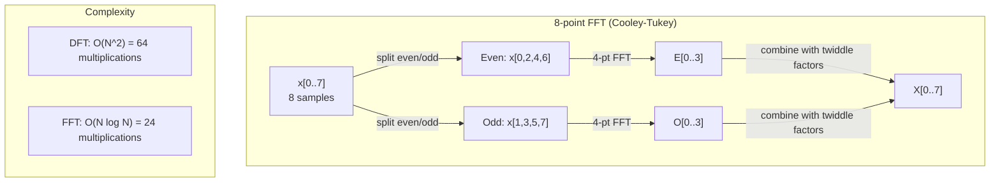
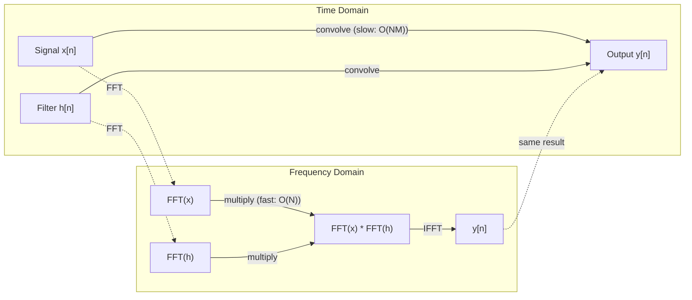

# Transformação de Fourier

> Cada sinal é uma superposição de ondas sinusais. A transformação de Fourier vai dizer-lhe qual é.

**Type:** Build
**Language:**Python
**Prerequisites:** Phase 1, Lessons 01-04, 19 (complex numbers)
**Time:** ~90 分钟

## Objectivo de aprendizagem
- Desde zero realizando DFT,并用 $O(N \log N)$O Cooley-Tukey FFT 验证它
- Compreender os coeficientes de frequência: do sinal para a amplitude, fase e espectro de potência
-  aplicar teorema de convolução, através da multiplicação FFT  executar convolução
- A descomposição de frequência de Fourier com codificação posicional do transformador e camadas de convolução da CNN  liga-se

## 问题
Uma série de valores de pressão que variam com o tempo. O preço de ação é uma série de valores de pixel intensidades em espaço.

Mas muitos padrões no domínio do tempo são invisíveis. Este sinal de áudio é um tom puro ou um acorde?

A transformação de Fourier irá transferir dados do domínio do tempo para o domínio da frequência. Ele recebe um sinal e o descompõe em ondas sinusais de diferentes frequências. Cada onda sinusa tem uma amplitude e uma fase.

Isto é importante para o ML, porque o pensamento de domínio de frequência 隨處可见──Convolutional neural networks 執行 convolution,而 convolution在頻域中就是乘法──Transformer positional encodings  使用頻度分解 来表示位置──Audio models(speech recognition、music generation) Processing spectrograms,也就是声音的频率表示──Time series models 会寻找周期性模式──理解Fourier transform,让你具备处理这些问题所需的词汇──

## 概念
### A definição de DFT

- Não .$N$个 amostras $x[0], x[1], \ldots, x[N-1]$, Transformação de Fourier discreta 会生成 $N$个 coeficientes de frequência $X[0], X[1], \ldots, X[N-1]$- Não .

```math
X[k] = \sum_{n=0}^{N-1} x[n] \, e^{-2\pi i k n/N} \qquad \text{其中 } k = 0, 1, \ldots, N-1
```

Cada um .$X[k]$É um número complexo.$\lvert X[k] \rvert$Com frequência$k$De amplitude 成正比──未归化时, amplitude 为 $A$E é bom que esteja no bin.$k$A onda de verdade é a que me dá.$\lvert X[k] \rvert = AN/2$, portanto , deve ser excluído$N/2$才能读出 amplitude──a sua fase $\angle X[k]$Indicar a deslocação de fase da frequência.

关键洞见:$e^{-2\pi i k n/N}$É uma frequência.$k$旋转的phasor──DFT 计算是信号与 $N$个等间隔频率 中每一个的相关性──如果信号在频率中$k$É um sistema de energia, correlação é muito grande.

### O significado de cada número

**$X[0]$: DC component。**É a soma de todas as amostras, com a proporção média de 成── é a constante de sinal de zero-freqüência (offset).

```math
X[0] = \sum_{n=0}^{N-1} x[n] \, e^0 = \text{全部 samples 之和}
```

**$X[k]$ for $1 \le k \le N/2$: positive frequencies。** $X[k]$Indicar cada $N$个 amostras 中 $k$Frequência de ciclos:$k$越大, freqüência 越高(oscillação 越快)

**$X[N/2]$: Nyquist frequency。**É isso .$N$个样本 能表示的最高频率──超越这个频率,就会出现别名,也就是高频率──伪装成低频率──

**$X[k]$ for $N/2 < k < N$: negative frequencies。** Para sinais de valor real,$X[N-k] = \overline{X[k]}$As frequências negativas são o reflexo das positivas. É por isso que a informação útil está localizada.$N/2 + 1$个 coeficientes 中──

### DFT inverso

Reversos DFT de frequência de coefícios Reconstruir sinal original:

```math
x[n] = \frac{1}{N} \sum_{k=0}^{N-1} X[k] \, e^{2\pi i k n/N} \qquad \text{其中 } n = 0, 1, \ldots, N-1
```

É a única diferença entre o DFT de frente e o: símbolo do exponente em meio é positivo, não negativo, e há um.$1/N$Factor de normalização:

O DFT inverso é uma reconstrução perfeita. Não perde qualquer informação. Você pode passar do domínio do tempo ao domínio da frequência, voltar e não produzir qualquer erro.

### A FFT: a acelerar

Como definido acima, a DFT é$O(N^2)$- Não .$N$个output coefficientes  中的每个,都要对 $N$个 amostras de entrada 求和──当 $N$= 1 milhão, é isso.$10^{12}$Próximo operação.

Transformação rápida de Fourier (FFT) 会以 $O(N \log N)$計算同样结果──当 $N$= 1 milhão de vezes, isto é cerca de 20 milhões de operações, não um milhão de vezes. Isso faz com que a análise de frequência se torne viável.

Algoritmo Cooley-Tukey (((mais comum FFT) usar dividir e conquistar:

1. O sinal será dividido em amostras indexadas e paradas.
2. 递归计算每一半的DFT──
3. Utilize "factores de violino" $e^{-2\pi i k/N}$合并两个半尺寸 DFTs──

```math
\begin{aligned}
X[k] &= E[k] + e^{-2\pi i k/N} \, O[k] && \text{其中 } k = 0, \ldots, N/2 - 1 \\
X[k + N/2] &= E[k] - e^{-2\pi i k/N} \, O[k] && \text{其中 } k = 0, \ldots, N/2 - 1 \\[6pt]
\text{其中 } E &= \text{偶数索引 samples 的 DFT} \\
O &= \text{奇数索引 samples 的 DFT}
\end{aligned}
```

Esta simetria significa cada nível de execução de regresso.$O(N)$Trabalho, e há.$\log_2(N)$層──總计:$O(N \log N)$- Não.



O radix-2 FFT realizado neste sinal é o mais rápido de 2 vezes. Se um problema tiver uma duração rara, retornará ao normal.`dft`Por isso, para a velocidade, os sinais normalmente vão ser de pad zero até o próximo 2 de ──`numpy.fft`FFT em armazém utiliza algoritmos de radicais mistos, que podem ser processados de qualquer extensão, mas contêm apenas pequenos fatores de extensão.

### Análise espectral

**power spectrum**Sim $\lvert X[k] \rvert^2$, é a magnitude quadrada de cada coeficiente de frequência.

**phase spectrum**Sim $\angle X[k]$, é o offset de fase de cada frequência. Para a maioria das tarefas de análise, você se preocupa com o espectro de potência, e ignora a fase.

```math
\begin{aligned}
\text{频率 } k \text{ 处的 Power：} \quad P[k] &= |X[k]|^2 = \mathop{\mathrm{Re}}(X[k])^2 + \mathop{\mathrm{Im}}(X[k])^2 \\
\text{频率 } k \text{ 处的 Phase：} \quad \phi[k] &= \mathop{\mathrm{atan2}}(\mathop{\mathrm{Im}}(X[k]), \mathop{\mathrm{Re}}(X[k]))
\end{aligned}
```

### Resolução de frequência

Resolução de frequência do DFT  Depende das amostras $N$e taxa de amostragem $f_s$- Não.

```math
\begin{aligned}
\text{bin } k \text{ 对应的频率：} \quad & f_k = k \cdot f_s / N \\
\text{频率分辨率：} \quad & \Delta f = f_s / N \\
\text{最高频率：} \quad & f_{\max} = f_s / 2 \quad \text{(Nyquist)}
\end{aligned}
```

Para distinguir duas frequências muito próximas, você precisa de mais amostras. Para capturar frequências altas, você precisa de uma taxa de amostragem mais alta.

### O teorema da convolução

É um dos resultados mais importantes do processamento de sinais e está diretamente relacionado com as CNNs.

**time domain 中的 convolution 等于 frequency domain 中的 pointwise multiplication。**

```math
\begin{aligned}
& x * h = \text{IFFT}(\text{FFT}(x) \cdot \text{FFT}(h)) \\[4pt]
& \text{其中 } * \text{ 表示 convolution，} \cdot \text{ 表示 element-wise multiplication}
\end{aligned}
```

Por que é importante:

- 两个长度为 $N$和 $M$Os sinais  direct convolução  necessidades $O(NM)$Operações
-  Baseada em FFT  necessidade de convolução $O(N \log N)$Transformar 两者、multiplicar、transformar de volta。
- Para os núcleos grandes, a convolução FFT vai ser rápida.
- Isto é o que acontece nas camadas convolucionais com grandes campos receptivos.

Nota:DFT  calcular é uma convulsão circular (signal 会 wrap around) ・・・ Para convulsão linear (linear convulsão) ∞ não wraparound (linear convulsão) ∞ , por favor, em cálculo ∞, os dois sinais serão zero pad até a longitude ∞$N + M - 1$- Não.



### Janela

DFT 假设 sinal é periódico, é o mesmo que$N$个样本 视为一个无限重复信号的周期――如果信号的起点和终点不是相同的值,就会在边界产生不连续性,并表现为虚假的高频内容――这称为光谱泄漏――

O tempo de exposição da janela em cálculo DFT anterior será o sinal 两端 taper到零, reduzindo assim a fuga.

Janela de frequência:

| Window | Shape | Main lobe width | Side lobe level | Use case |
|--------|-------|----------------|-----------------|----------|
| Rectangular | 平坦（无 window） | 最窄 | 最高 (-13 dB) | 当 signal 在 N 个 samples 中正好 periodic 时 |
| Hann | Raised cosine | 中等 | 低 (-31 dB) | 通用 spectral analysis |
| Hamming | Modified cosine | 中等 | 更低 (-42 dB) | Audio processing、speech analysis |
| Blackman | Triple cosine | 宽 | 非常低 (-58 dB) | 当 side lobe suppression 至关重要时 |

```math
\begin{aligned}
\text{Hann window：} \quad & w[n] = 0.5 \left(1 - \cos\frac{2\pi n}{N-1}\right) \\
\text{Hamming window：} \quad & w[n] = 0.54 - 0.46 \cos\frac{2\pi n}{N-1}
\end{aligned}
```

Antes de DFT, a janela será aplicada com o sinal para multiplicação de elementos:`X = DFT(x * w)`- Não.

### Propriedades DFT

| Property | Time Domain | Frequency Domain |
|----------|-------------|-----------------|
| Linearity | $ax + by$ | $aX + bY$ |
| Time shift | $x[n - k]$ | $X[f] e^{-2\pi i f k/N}$ |
| Frequency shift | $x[n] e^{2\pi i f_0 n/N}$ | $X[f - f_0]$ |
| Convolution | $x * h$ | $X \cdot H$ (pointwise) |
| Multiplication | $x \cdot h$ (pointwise) | $X * H$ (circular convolution, scaled by $1/N$) |
| Parseval's theorem | $\sum \lvert x[n] \rvert^2$ | $\frac{1}{N} \sum \lvert X[k] \rvert^2$ |
| Conjugate symmetry (real input) | $x[n]$ real | $X[k] = \overline{X[N-k]}$ |

Teorema de Parseval expressa energia total em dois domínios entre os mesmos.

### Com relação a codificações posicionais

Origins Transformer Utilize sinusoidal codificação posicional:

```math
\begin{aligned}
PE(pos, 2i) &= \sin\left(pos / 10000^{2i/d_{\text{model}}}\right) \\
PE(pos, 2i+1) &= \cos\left(pos / 10000^{2i/d_{\text{model}}}\right)
\end{aligned}
```

Cada uma das dimensões$(2i, 2i+1)$Todas as frequências variam em diferentes oscilações. As frequências variam de alta (dimensão 0,1) a baixa (dimensões finais) em intervalos geométricos.

Ele fornece propriedades-chave:

- **Uniqueness:**Qualquer duas posições não terão a mesma codificação.
- **Bounded values:**Sin 和 cos 始终在 $[-1, 1]$- Não.
- **Relative position:**posição $p+k$Of codificação pode ser expressa em posição $p$处 codificação de função linear──modelo pode aprender a observar posições relativas──

### Conexão com as CNNs

A camada de convolução 通過在信号或图像 上滑动一个学会过器 (kernel),将将其应用到输入――数学上,这就是 convolution operation――

De acordo com o teorema da convolução, isso é igual a:
1. Para entrada  execução FFT
2. Para o kernel  executar FFT
3. Multiplicar no domínio de frequência
4. Para efeitos da execução do IFFT

标准 CNN 实现使用直接卷积 (convolução direta) 对小型3x3 kernels 更快) . Mas para grandes kernels ou convolução global, baseada em FFT métodos 会显著更快──. Algumas arquiteturas .$O(N \log N)$Não é$O(N^2)$A complexidade, a precisão e a competitividade são as principais características da competitividade.

### Espectogramas e Transformação Fourier de Curto Tempo

单次 FFT 将给出整个信号的频率内容,但不能告诉你这些频率何时出现──p频率 随着时间的增加信号) 和弦所有频率同时存在) 可能具有相同的 magnitudo谱──

Transformação de Fourier de Tempo Curto (STFT)  através de janelas sobrepostas de sinal  上计算 FFT 来解决这个问题──结果是谱谱图:一种2D representação,其中一个轴是时间,另一个轴是频率──每个点的强度表示该时间上该频率的能量──

```
STFT procedure:
1. Choose a window size (e.g., 1024 samples)
2. Choose a hop size (e.g., 256 samples -- 75% overlap)
3. For each window position:
   a. Extract the windowed segment
   b. Apply a Hann/Hamming window
   c. Compute FFT
   d. Store the magnitude spectrum as one column of the spectrogram
```

Espectogramas são a representação padrão de entrada de modelos de áudio ML. Modelos de reconhecimento de fala (Whisper, DeepSpeech) processam espectrogramas mel, ou seja, as frequências são mapeadas até a escala mel, o que se ajusta mais à percepção de pitch humana.

### Aliasing

Se o sinal 包含高于 $f_s/2$Frequências (frequência Nyquist)$f_s$A amostragem irá produzir cópias alias. Um sinal de 90 Hz de amostragem de 100 Hz parece ser completamente o mesmo do sinal de 10 Hz. Apenas com amostras não se pode distinguir entre elas.

```
Example:
  True signal: 90 Hz sine wave
  Sampling rate: 100 Hz
  Apparent frequency: 100 - 90 = 10 Hz

  The samples from the 90 Hz signal at 100 Hz sampling rate
  are identical to the samples from a 10 Hz signal.
  No amount of math can recover the original 90 Hz.
```

É por isso que os conversores analógicos para digitais contêm filtros anti-aliasing, em amostragem. Antes de moverem-se para as frequências de Nyquist.

### O padding zero não vai melhorar a resolução

Um erro comum é: em FFT antes de um sinal  realizar padagem zero 会提升频分辨率──它不会──零 padding 只是在现有频段之间插值,让光谱看起来更平滑──但它无法揭露原始样品中不存在的频率细节──

A resolução da frequência real depende apenas do tempo de observação .$T = N / f_s$                                                                                                                                                                                                                                                              $\Delta f$De duas frequências, pelo menos precisas.$T = 1 / \Delta f$Não importa o quanto seja zero-padding, não podemos mudar este limite fundamental.


```figure
fourier-synthesis
```

## Construí-lo
### 步骤 1: DFT a partir do zero

$O(N^2)$DFT 直接来自定义──

```python
import math

class Complex:
    ...

def dft(x):
    N = len(x)
    result = []
    for k in range(N):
        total = Complex(0, 0)
        for n in range(N):
            angle = -2 * math.pi * k * n / N
            w = Complex(math.cos(angle), math.sin(angle))
            xn = x[n] if isinstance(x[n], Complex) else Complex(x[n])
            total = total + xn * w
        result.append(total)
    return result
```

### 步骤 2: DFT inverso

 estrutura é igual, exponente é justo, e é excluído $N$- Não.

```python
def idft(X):
    N = len(X)
    result = []
    for n in range(N):
        total = Complex(0, 0)
        for k in range(N):
            angle = 2 * math.pi * k * n / N
            w = Complex(math.cos(angle), math.sin(angle))
            total = total + X[k] * w
        result.append(Complex(total.real / N, total.imag / N))
    return result
```

### 步骤 3: FFT (Cooley-Tukey)

FFT recorrente 要求长度为 2 的──拆分为 even 和 odd,递归, então usar fatores de bico 合并──

```python
def fft(x):
    N = len(x)
    if N <= 1:
        return [x[0] if isinstance(x[0], Complex) else Complex(x[0])]
    if N % 2 != 0:
        return dft(x)

    even = fft([x[i] for i in range(0, N, 2)])
    odd = fft([x[i] for i in range(1, N, 2)])

    result = [Complex(0)] * N
    for k in range(N // 2):
        angle = -2 * math.pi * k / N
        twiddle = Complex(math.cos(angle), math.sin(angle))
        t = twiddle * odd[k]
        result[k] = even[k] + t
        result[k + N // 2] = even[k] - t
    return result
```

### 步骤 4: Auxiliares de análise espectral

```python
def power_spectrum(X):
    return [xk.real ** 2 + xk.imag ** 2 for xk in X]

def convolve_fft(x, h):
    N = len(x) + len(h) - 1
    padded_N = 1
    while padded_N < N:
        padded_N *= 2

    x_padded = x + [0.0] * (padded_N - len(x))
    h_padded = h + [0.0] * (padded_N - len(h))

    X = fft(x_padded)
    H = fft(h_padded)

    Y = [xk * hk for xk, hk in zip(X, H)]

    y = idft(Y)
    return [y[n].real for n in range(N)]
```

## Use-o
Em trabalho real, usando o Numpy de FFT, é apoiado por bibliotecas C altamente optimizadas.

```python
import numpy as np

signal = np.sin(2 * np.pi * 5 * np.arange(256) / 256)
spectrum = np.fft.fft(signal)
freqs = np.fft.fftfreq(256, d=1/256)

power = np.abs(spectrum) ** 2

positive_freqs = freqs[:len(freqs)//2]
positive_power = power[:len(power)//2]
```

对于窗户和更高级的光谱分析:

```python
from scipy.signal import windows, stft

window = windows.hann(256)
windowed = signal * window
spectrum = np.fft.fft(windowed)
```

 Para a convulsão:

```python
from scipy.signal import fftconvolve

result = fftconvolve(signal, kernel, mode='full')
```

 Para os espectrogramas:

```python
from scipy.signal import stft

frequencies, times, Zxx = stft(signal, fs=sample_rate, nperseg=256)
spectrogram = np.abs(Zxx) ** 2
```

Espectograma Matrix forma é (n_frequências, n_time_frames) ⋅ cada linha são uma janela de tempo ⋅ power spectrum ⋅ é o modelo de áudio ML ⋅ como entrada ⋅ consumação ⋅

## Entrega-o
运行 `code/fourier.py` 生成`outputs/prompt-spectral-analyzer.md`- Não.

## 练习
1. **Pure tone identification。**                                                                                                                                                                                                                                                                                                                                                                                                                                                                                                                             

2. **FFT vs DFT verification。**生成一个长度为 64 的随机信号――同时计算 DFT($O(N^2){}$) e FFT──verificação de todos os coeficientes em 1e-10 以内匹配── em longitude de 256、512、1024 和 2048 sinais 上分別计时两个函数── desenhar a relação entre o tempo DFT e o tempo FFT──

3. **Convolution theorem proof by example。**创建信号 x = [1, 2, 3, 4, 0, 0, 0, 0] 和 filter h = [1, 1, 1, 0, 0, 0, 0, 0]──直接计算它们的圆形卷积 (圆形卷积) ─然后通过FFT 计算(transform、multiply、inverse transform) ─验证结果匹配──现在通过适当的零执行线形卷积──

4. **Windowing effects。**Crear um sinal, é 10 Hz 和 12 Hz( muito próximo) duas ondas sinusais de和──以 128 Hz amostragem 1 秒──分别在无窗、汉窗 和汉窗 下计算电源谱──哪个窗是最容易区分两个峰?为什么?

5. **Positional encoding analysis。**Por d_modelo = 128 和 max_pos = 512 生成 sinusoidal posições codificadas──对每一对位置$(p_1, p_2)$, calcular os codificadores do produto ponto.$\lvert p_1 - p_2 \rvert$Não depende de posições absolutas, mas com a distância, o produto do ponto aumenta.

### 提示

**练习 1。**Em 1 segundo, 128 vezes, bin.$k$                                                                                                                                                                                                                                                                                                                                                                                                                                                                                                                             $k$Hz, portanto, para a frequência inteira, os binos 1 a 63 o índice de maior valor é essa frequência. Escolha uma frequência inteira de Hz.`generate_signal`和 `magnitude_spectrum` Após a inclusão do ruído, o valor máximo de verificação continua a estar no mesmo recipiente, enquanto o valor dos outros recipientes aumenta.

**练习 2。**Utilize 2 次长度, porque `fft`会将信号对半分分――对全部系数 检查 `max(abs(a - b))`◊ Consumo de tempo em comparação com o$N / \log_2 N$- Não.

**练习 3。**Para a convulsão circular, calcula-se$n$= 0 、1 、2 时的$y[n] = \sum_k h[k] x[(n-k) \bmod 8]$,并比较 `convolve_direct`和 `convolve_fft`Os três valores anteriores são: 4 + 3 - 1 = 6, portanto, primeiro verifique se o comprimento 8 já é suficiente.

**练习 4。**Utilização `hann_window`- Não.`hamming_window`- Não.`apply_window`和 `power_spectrum`, e estatisticamente, entre 9 e 13 Hz há muitas divisões de picos. 10 Hz e 12 Hz em 1 segundo são perfeitos para completar vários ciclos, portanto, sem adicionar a janela pode parecer melhor.

**练习 5。**Utilização `positional_encoding(pos, 128)`計算每个编码──比较位置 (0, 10) 的点 product 和位置 (100, 110) 的点 product: 两者的差别必须在约1e-10 以内──然后固定一个 $p_1$, desenhar pontos de produto$\lvert p_1 - p_2 \rvert$变化的曲线──

## 关键术语
| Term | What it means |
|------|---------------|
| DFT (Discrete Fourier Transform) | 将 $N$ 个 time-domain samples 转换为 $N$ 个 frequency-domain coefficients。每个 coefficient 都是与该 frequency 上 complex sinusoid 的 correlation |
| FFT (Fast Fourier Transform) | 用于计算 DFT 的 $O(N \log N)$ algorithm。Cooley-Tukey algorithm 递归拆分 even/odd indices |
| Inverse DFT | 从 frequency coefficients 重建 time-domain signal。公式与 DFT 相同，但 exponent sign 相反，并带有 $1/N$ scaling |
| Frequency bin | DFT output 中的每个 index $k$ 表示 frequency $k f_s/N$ Hz。"bin" 是离散的 frequency slot |
| DC component | $X[0]$，zero-frequency coefficient。与 signal mean 成比例 |
| Nyquist frequency | $f_s/2$，在 sampling rate $f_s$ 下可表示的最大 frequency。高于它的 frequencies 会 alias |
| Power spectrum | $\lvert X[k] \rvert^2$，每个 frequency coefficient 的 squared magnitude。显示 energy 在 frequencies 上的分布 |
| Phase spectrum | $\angle X[k]$，每个 frequency component 的 phase offset。在 analysis 中通常会忽略 |
| Spectral leakage | 将 non-periodic signal 当作 periodic 处理导致的虚假 frequency content。可通过 windowing 减少 |
| Window function | 在 DFT 前应用的 tapering function（Hann、Hamming、Blackman），用于减少 spectral leakage |
| Twiddle factor | FFT butterfly computation 中用于合并 sub-DFTs 的 complex exponential $e^{-2\pi i k/N}$ |
| Convolution theorem | time domain 中的 convolution 等于 frequency domain 中的 pointwise multiplication。它是 signal processing 和 CNNs 的基础 |
| Circular convolution | signal 会 wrap around 的 convolution。这是 DFT 自然计算的内容 |
| Linear convolution | 没有 wraparound 的标准 convolution。通过在 DFT 前 zero-padding 实现 |
| Parseval's theorem | 总 energy 在 Fourier transform 中保持不变。$\sum \lvert x[n] \rvert^2 = \frac{1}{N} \sum \lvert X[k] \rvert^2$ |
| Aliasing | 当 sampling rate 不足时，高于 Nyquist 的 frequencies 表现为较低 frequencies |

## 延伸阅读
- [Cooley & Tukey: An Algorithm for the Machine Calculation of Complex Fourier Series (1965)](https://www.ams.org/journals/mcom/1965-19-090/S0025-5718-1965-0178586-1/)-                                                                                                                                                                                                                                                                                                                                                                                                                                                                                                                             
- [3Blue1Brown: But what is the Fourier Transform?](https://www.youtube.com/watch?v=spUNpyF58BY)-  Sobre as melhores transformações de Fourier
- [Lee-Thorp et al.: FNet: Mixing Tokens with Fourier Transforms (2021)](https://arxiv.org/abs/2105.03824)- Em transformadores , em vez de auto-atentação ,
- [Smith: The Scientist and Engineer's Guide to Digital Signal Processing](http://www.dspguide.com/)- 免费在线教材, abrangendo profundamente FFT, vidro e análise espectral
- [Vaswani et al.: Attention Is All You Need (2017)](https://arxiv.org/abs/1706.03762)- Descomposição de frequência de Fourier  Derivados de codificações sinusoidais de posição
- [Radford et al.: Whisper (2022)](https://arxiv.org/abs/2212.04356)- Utilize mel-spectrogramas  como representação de entrada de reconhecimento de fala
